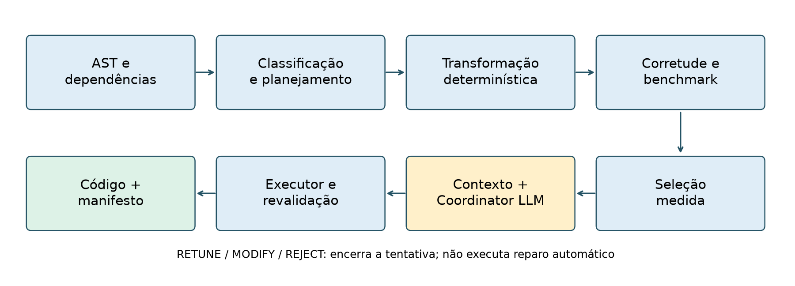
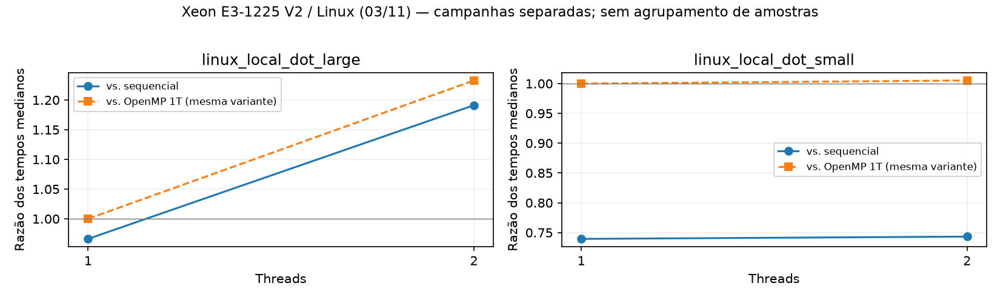

# Reestruturação de código com OpenMP e coordenação por evidências

Sistemas Multiagentes para Reestruturação Autônoma de Códigos
Lucas Nory Ulson · Ciência da Computação · PUCRS
Versão de trabalho · 3 de novembro de 2026

<!-- fala:
A apresentação corresponde ao protótipo implementado e às evidências disponíveis.
A avaliação final da LLM está pendente. Não apresentar esta versão como uma
defesa de resultados LLM já concluídos. Roteiro sugerido de aproximadamente
15 minutos, ajustável à duração exigida; demonstração técnica é opcional.
-->

---

# Problema: diretivas paralelas não bastam

- Uma transformação precisa produzir a saída esperada nas entradas testadas.
- Uma implementação correta pode ficar mais lenta com várias threads.
- A decisão deve apontar o código, a configuração e as medições utilizados.
- O ganho do código precisa ser separado do efeito da decisão da LLM.

<!-- fala:
O problema estudado é encadear transformação, validação e medição de forma
verificável. O exemplo de desempenho será o Wavefront: uma versão pode ter
benefício em uma thread e ainda assim piorar em várias. Isso motiva verificar
ambos os baselines antes de publicar uma variante paralela.
-->

---

# Perguntas e objetivos do recorte

- R1: como vincular artefatos e bloquear candidatos inconsistentes?
- R2: quais configurações medidas melhoram os dois baselines?
- R3: com candidato e evidências constantes, o que o Coordinator acrescenta?
- Objetivo: integrar o caminho suportado e medir decisão, resultado e custo.

<!-- fala:
A proposta inicial previa comparação ampla com geração monolítica. O experimento
atual estuda decisão sobre candidato já gerado, portanto o objetivo foi
delimitado. R1 e R2 têm evidências técnicas e empíricas disponíveis; R3 ainda
depende das inferências reais. Não são perguntas equivalentes sobre geração.
-->

---

# Escopo: três níveis diferentes de automação

- Análises: DOALL, REDUCTION, STENCIL, WAVEFRONT e MIXED nos casos tratados.
- Caminho integrado: Dot Product C com redução escalar suportada.
- Variantes históricas: manuais ou transformações específicas sobre base existente.
- CPU/OpenMP; GPU, geração universal e reparo autônomo ficam fora da avaliação.

<!-- fala:
Classificar um padrão não significa gerar sua implementação automaticamente.
GEMM, Jacobi e Covariance têm variantes manuais. Wavefront tiled também é manual.
Nussinov automático parte de uma base OpenMP manual, com transformação específica.
O título foi delimitado a OpenMP, sem afirmar uma avaliação em GPU.
-->

---

# Arquitetura implementada

Fonte: run_pipeline.py e componentes do checkout atual.

<!-- fala:
O runner é Python e troca artefatos JSON. A maior parte dos papéis é determinística;
o Coordinator utiliza uma LLM. Não estamos executando LangGraph nem um motor BDI.
O retorno RETUNE, MODIFY ou REJECT interrompe a tentativa. A promoção exige
verificações adicionais mesmo após ACCEPT.
-->

---

# Código medido = código autorizado = código publicado

- Cópias das entradas, SHA-256, campanha, compilador e tempos individuais.
- Seleção e contexto conferidos contra as evidências vinculadas.
- ACCEPT + configuração medida + ganho contra sequencial e OpenMP 1T.
- Recompilação e corretude fresca antes de publicar código e manifesto.

<!-- fala:
O hash permite detectar troca de arquivo; não comprova sozinho que um produtor
externo fez uma medição verdadeira. A nova revalidação testa o candidato atual,
enquanto o vínculo da campanha relaciona o benchmark aos bytes medidos. O contrato
não arquiva toda biblioteca ou header de projeto e não é prova formal de corretude.
-->

---

# Metodologia: unidades e evidências separadas

- 19 campanhas, 161 configurações e 515 tempos individuais recuperados.
- 17 campanhas históricas sem o contrato atual completo; duas com gates locais.
- Dot Product: dois tamanhos, cinco medições externas por configuração.
- Driver de corretude separado do benchmark; sem race detector integrado.

<!-- fala:
As campanhas não foram agrupadas para aumentar o tamanho da amostra. O benchmark
grande usa dez milhões de elementos e cem chamadas internas por observação; o
pequeno usa 1.024 elementos e dez mil chamadas internas. O driver de corretude
usa um milhão de elementos, tolerância relativa 1e-9 e absoluta 1e-12. Isso é
validação empírica nas entradas e threads testadas.
-->

---

# Métricas: dois baselines, efeitos diferentes

- Ganho total: T_seq / T_p.
- Ganho de transformação: T_seq / T_1.
- Escalabilidade: T_1 / T_p; eficiência paralela: (T_1 / T_p) / p.
- Autotuning: T_1 precisa usar o mesmo bloco da variante em p threads.

<!-- fala:
O produto do ganho de transformação pela escalabilidade é o ganho total.
Essa decomposição impede atribuir ao paralelismo um ganho que já estava presente
na variante de uma thread. Um quociente acima de cem por cento contra o sequencial
não é, por si só, eficiência paralela acima de cem por cento.
-->

---

# Resultado local: admitir e recusar por medição

Entrada grande: ganho 1,191× em 2T; entrada pequena: paralelo não admitido.
Fonte: campanhas linux_local_dot_large e linux_local_dot_small.

<!-- fala:
As curvas azuis comparam com o sequencial; as laranjas comparam com OpenMP 1T.
Na entrada pequena, as threads quase não mudam o tempo da variante e ela continua
mais lenta que o sequencial. O fallback da avaliação é o sequencial. Estes são
resultados dos componentes determinísticos, sem contribuição demonstrada da LLM.
-->

---

# Casos históricos: interpretar o ganho corretamente

- Wavefront manual: 1,412× em 1T, sem sucesso multicore.
- Wavefront tiled: bloco 64 / 4T; ganho 3,400×; escalabilidade 2,377×.
- Eficiência paralela tiled: 0,594; 0,850 usa outro denominador.
- Nussinov automático: ganho 4,106×; escalabilidade 3,005×; eficiência 0,751.

Fonte: matriz consolidada; hardware da campanha Nussinov automático não registrado.

<!-- fala:
Wavefront manual e tiled pertencem a campanhas diferentes. O histórico mostra
diagnóstico, modificação manual e autotuning; não demonstra que a LLM executou o
ciclo sozinha. Nussinov automático já parte de OpenMP manual. Os números do
resumo de outubro foram reconciliados com os baselines atuais; não atribuímos
hardware não registrado nem ganho da transformação ao Coordinator.
-->

---

# Estudo do Coordinator: comparação pronta, resultado pendente

- Três modos: determinístico, Coordinator completo e sem análises estruturadas.
- Mesmo candidato, mesmas medições e mesmos gates nos três modos.
- Registrar concordância, aceitação, falhas, latência, tokens e chamadas.
- Rodada local: quatro inferências expiradas em 30 s; campanha INCOMPLETE.

<!-- fala:
O limite de trinta segundos foi diagnóstico e não fundamenta uma comparação de
qualidade. Timeout é ausência de resposta, não uma resposta semanticamente errada.
Repetições da LLM não são novas medições do kernel. O resultado final pode ser
concordância sem benefício de speedup e com custo de inferência, ou um veto que
altere a aceitação. Não há resultado preenchido antecipadamente para R3.
-->

---

# Limitações que delimitam as conclusões

- Um kernel em dois tamanhos para o estudo pareado da LLM.
- Corretude empírica; não é prova de equivalência ou ausência geral de races.
- Histórico com lacunas de ambiente, hashes e amostras; oito CSVs inconsistentes.
- Sem busca de reparo; possível truncamento de contexto e ruído de medição.

<!-- fala:
A ablação também muda o tamanho do prompt. A ordem do benchmark é fixa e não há
controle dedicado de frequência ou temperatura. Os CSVs históricos foram
preservados e os recortes escolhidos explicitamente. As limitações entram na
interpretação, em vez de serem escondidas por uma tabela única de melhores ganhos.
-->

---

# Conclusão compatível com o estado atual

- Caminho suportado integrado, com seleção e executor de promoção auditável.
- Métricas e evidências distinguem ganho, escalabilidade e origem da variante.
- O benefício adicional do Coordinator ainda não foi demonstrado.
- Fechamento: concluir R3 e atualizar texto, resumo, gráficos e conclusão juntos.

<!-- fala:
O resultado mais sólido hoje é a integração técnica e a organização das
evidências. Não afirmamos superioridade de múltiplos LLMs sobre um monolítico.
Após a campanha final, esta conclusão deve ser revisada com os números e falhas
obtidos. A discussão continua válida mesmo se a LLM só reproduzir a política.
-->

---

# Demonstração técnica — opcional

- Mostrar um contexto e relatórios reais vinculados ao Dot Product.
- Conferir hash, gate de corretude e configurações medidas.
- Executar um teste de recusa por alteração de arquivo, em diretório temporário.
- Separar demonstração do executor de inferência LLM e de resultado científico.

Fonte: DEMONSTRACAO.md; não depender de uma inferência terminar durante a fala.

<!-- fala:
Se a duração da banca permitir, reservar cerca de três minutos para a demonstração,
reduzindo a exposição dos slides anteriores. Usar o roteiro com evidências
previamente preparadas. Uma decisão simulada pode verificar integração, desde
que seja nomeada como tal; nunca apresentá-la como resposta real de um modelo.
-->

---

# Referências — apoio

- OpenMP ARB. OpenMP API Specification 5.2. 2021. openmp.org/spec-html/5.2/openmp.html
- Wu et al. AutoGen. 2023. arXiv:2308.08155v2.
- Nichols et al. Can Large Language Models Write Parallel Code? 2024. arXiv:2401.12554v3.
- Pouchet. PolyBench/C. Página do projeto; versão do código fixada no submódulo.

<!-- fala:
Fontes primárias verificadas para o recorte. AutoGen situa arquiteturas
conversacionais, mas não é uma dependência do protótipo. ParEval avalia geração
de código, enquanto este estudo prioritário avalia decisão sobre evidências.
Essas referências não constituem uma revisão sistemática nem uma comparação
numérica entre os respectivos resultados e os deste TCC.
-->

---

# Perguntas da banca — apoio

- Por que LLM se a política já decide? É a hipótese avaliada em R3; ganho ainda aberto.
- É um sistema de vários LLMs? Não; são papéis funcionais e um Coordinator LLM.
- O código está correto para toda entrada? Os testes não estabelecem essa garantia.
- O que significam 4,106×? Ganho total; escalabilidade e eficiência usam OpenMP 1T.

<!-- fala:
Se perguntarem sobre mudança da proposta, explicar o recorte explicitamente:
troca de uma ambição de geração geral por integração verificável e avaliação
delimitada da decisão. Se perguntarem por que não usar sempre mais threads,
mostrar Nussinov e o caso pequeno. Se perguntarem sobre publicação, responder
com o estudo realizado e suas limitações, sem prometer aceitação ou novidade
absoluta. As respostas devem acompanhar o estado atualizado da campanha final.
-->
