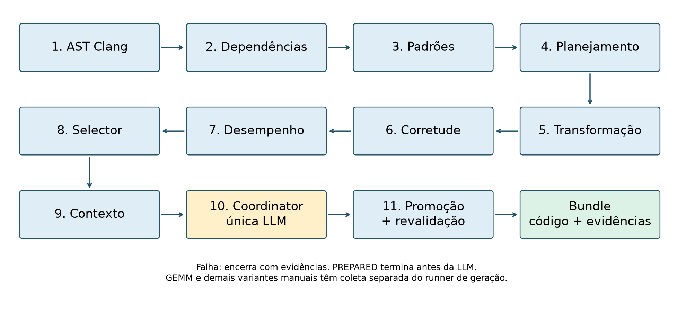
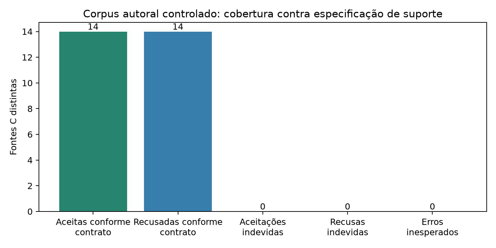
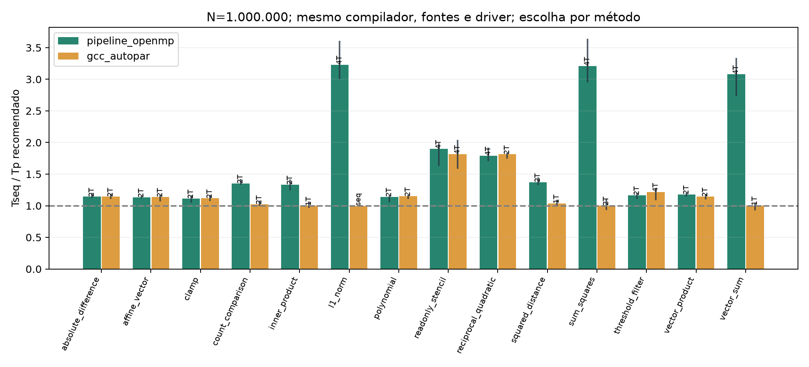

# Paralelização OpenMP baseada em evidências

Pipeline verificável, escalabilidade e limites de um Coordinator LLM
Lucas Nory Ulson · Ciência da Computação · PUCRS
Revisão para fortalecimento científico · 6 de novembro de 2026
Corpus, sessões e heldout concluídos; falhas e limites preservados.

<!-- fala:
Esta versão propõe um título compatível com o sistema implementado. Há uma
LLM no Coordinator; os demais papéis são majoritariamente determinísticos.
O roteiro preserva os resultados anteriores e incorpora corpus e sessões
verificados. Os estados de diagnóstico e integração são apresentados em
separado. Conferir o layout no PowerPoint antes da apresentação.
-->

---

# Pergunta central e contribuição delimitada

- Como ligar código, corretude empírica e desempenho à admissão de um candidato?
- O que acrescenta uma LLM quando a configuração admissível já foi selecionada?
- Contribuição: implementação auditável e avaliação crítica do recorte suportado.
- Diagnóstico offline é uma tarefa complementar, com protocolo próprio.

<!-- fala:
O objetivo inicial de reestruturação autônoma geral foi delimitado ao que é
executável e verificável. Não alegamos ser o primeiro sistema híbrido com
LLM e regras. A contribuição envolve o contrato implementado, a análise de
escalabilidade e a identificação dos limites do Coordinator posterior ao Selector.
-->

---

# Arquitetura: evidência antes da decisão

A extensão DOALL amplia o Transformer conservador e preserva os gates.
Fonte: runner e componentes reais; figura da revisão multiplataforma anterior.

<!-- fala:
O runner em Python troca artefatos JSON entre análise AST, dependências,
classificação, planejamento, transformação, gates, seleção e contexto.
O Coordinator interpreta as evidências. O executor confere novamente a
admissibilidade antes de promover. A figura é da arquitetura base, preservada;
a ampliação DOALL atua na transformação e não relaxa a promoção.
-->

---

# Três eixos que não podem ser confundidos

- Automação: fontes distintas transformadas ou recusadas conforme o contrato.
- Escalabilidade: variantes, entradas, threads e sessões de cinco algoritmos.
- LLM: decisões de admissão ou diagnósticos sobre evidências.
- Mais amostras de tempo não significam mais programas ou maior autonomia.

<!-- fala:
A campanha Linux possui 900 tempos externos, mas não 900 programas.
GEMM, Jacobi e Covariance manuais ampliam a avaliação de desempenho, sem
ampliar a demonstração de geração automática. Repetir o mesmo contexto da
LLM também não acrescenta um novo programa nem uma medição independente do kernel.
-->

---

# Transformação conservadora: redução e DOALL

- Redução: acumulador local inicializado em zero e soma de expressão pura.
- DOALL: uma atribuição Y[i], escrita injetiva e ausência de leitura da saída.
- Fonte atual reanalisada pelo Clang antes de inserir a diretiva OpenMP.
- Restrict, extents válidos e aritmética definida são pré-condições do chamador.
- Chamadas, efeitos laterais, scatter e nós desconhecidos são recusados.

Fonte: conservative_transform.py, contrato standalone-ast-v2.

<!-- fala:
Esta extensão implementa DOALL restrito em fontes independentes, sem tornar
GEMM aninhado automaticamente suportado. Restrict não é análise dinâmica de
alias. A checagem AST conservadora evita aceitar formatos desconhecidos;
recusar um programa fora do subconjunto não prova que ele é inerentemente
sequencial. O corpus e a demonstração DOALL precisam de suas próprias evidências.
-->

---

# Admissão: a resposta da LLM não basta

- Fontes, drivers, executáveis, relatórios e medições ligados por campanha e SHA.
- Configuração medida, com ganho contra sequencial e OpenMP 1T.
- ACCEPT só segue quando corresponde à seleção admissível.
- Promoção recompila e repete corretude antes de publicar o bundle.
- RETUNE, MODIFY e REJECT encerram a tentativa, sem reparo automático.

<!-- fala:
O contrato bloqueia troca de artefato, mistura de campanha e configuração
não medida. SHA verifica integridade local; não é prova semântica ou assinatura
externa. A validação é empírica nas entradas testadas. Na avaliação histórica,
o candidato aceito é o já selecionado; a LLM não tem liberdade para alcançar
outro speedup admissível superior.
-->

---

# Método: corpus autoral de automação

- 28 fontes C: 14 positivas e 14 recusas esperadas conforme suporte.
- Positivas: oito DOALL e seis reduções; duas entradas por fonte.
- Sequencial, OpenMP gerado e GCC autopar usam o mesmo GCC e driver.
- DOALL é verificado por elemento; reduções usam referência long double.
- Corpus controlado, sem validação humana independente ou amostra representativa.

Fonte: publication/AUTOMATION_CORPUS.md e arquivo científico verificado.

<!-- fala:
O corpus foi escrito para avaliar o subconjunto, incluindo recusas, e possui
arquivos distintos de desenvolvimento e teste controlado. Isso não constitui
um benchmark externo intocado. O baseline GCC usa ftree-parallelize-loops=p;
a flag não garante paralelização, e seus diagnósticos foram arquivados.
Não usamos fast-math para forçar um resultado favorável. As tolerâncias não
estabelecem equivalência para todos os valores nem ausência geral de races.
-->

---

# Corpus: cobertura executada e limite

28 fontes; 14 aceitas e 14 recusadas conforme o suporte; zero falsos aceites/recusas.
28 pares positivos fonte × entrada validados; 196 configurações e 2.940 medições.
Fonte: publication/automation_corpus_linux_2026-11-05; corpus autoral controlado.

<!-- fala:
As oito DOALL e seis reduções positivas foram geradas automaticamente por regras.
As quatorze negativas foram recusadas conforme o contrato; algumas são
paralelizáveis por técnicas fora desse contrato. Todos os 28 pares positivos
fonte × entrada passaram, incluindo comparação por elemento no DOALL.
Fontes e entradas não são programas novos. O split é autoral e não um benchmark
externo cego. A cobertura perfeita contra essa especificação não prova
paralelização geral nem ausência de races para qualquer C.
-->

---

# Corpus: mesmo GCC, resultados diferentes por classe

N=1.000.000: oito DOALL do pipeline entre 1,114× e 1,898×; GCC entre 1,117× e 1,816×.
Nas reduções, permissões distintas de reassociação limitam o contraste.
Fonte: summary.csv e selection.json do corpus; não houve inferência.

<!-- fala:
O mesmo GCC 13.3.0 compila original, OpenMP gerado e fonte original com autopar.
Nos 32 objetos DOALL p2/p4 há mensagem de paralelização e GOMP_parallel;
nas 24 reduções não há esses indícios. O pipeline permite reassociação por
OpenMP reduction, o GCC sem fast-math pode preservar a ordem. Portanto, os
maiores ganhos nas reduções não provam superioridade da análise de dependências.
SELECTED pode incluir 1T; promoção de paralelo exige ao menos duas threads e
ganho contra sequencial e 1T. Pequenas: 12/14 mantêm sequencial no pipeline,
e os dois ganhos selecionados têm IC incluindo um. A regra por mediana não
é teste estatístico. Tabelas completas preservam todas as fontes e entradas.
-->

---

# Linux p15w3: campanha principal já concluída

- Xeon E3-1225 V2: quatro núcleos; Clang 18.1.3; OpenMP 1/2/4T.
- 60 configurações, 180 aquecimentos e 900 medições externas.
- Três aquecimentos e quinze observações por configuração, em rodadas embaralhadas.
- 60 validações aprovadas; fontes, comandos, binários e saídas arquivados.
- Medianas, dispersão e bootstrap pareado de rodadas; ICs condicionais à coleta.

Fonte: experiments/MULTIPLATFORM_REPORT.md; campanha linux_xeon_2026-11-05_p15w3.

<!-- fala:
Este é resultado anterior verificado e preservado. Cada observação externa é
um processo; as chamadas internas dependem do driver e não multiplicam n.
Os dumps verificam as saídas live-out instrumentadas; Jacobi verifica A.
A frequência e temperatura não foram fixadas e o host não foi exclusivo.
O bootstrap não prova independência temporal nem repetibilidade entre sessões.
-->

---

# Métricas e resultados das entradas maiores

- Ganho total = Tseq/Tp; escalabilidade = T1/Tp; eficiência = (T1/Tp)/p.
- Dot C automático, 2T: ganho 1,254×; escalabilidade 1,276×.
- GEMM manual, 4T: ganho 2,845×; escalabilidade 2,854×.
- Nussinov manual, 4T: ganho 3,195×; escalabilidade 3,204×.
- Jacobi manual, 2T: 1,177×; Covariance manual, 4T: 2,193× de ganho total.

Fonte: p15w3, configurações recomendadas; T1 é a mesma variante OpenMP em uma thread.

<!-- fala:
Estes ganhos pertencem às variantes medidas, não ao Coordinator. No Dot
grande a menor mediana ocorreu em 4T, mas 2T foi recomendado pelo quase empate
de 2%; isso é uma política operacional, não um teste de significância.
O Dot C pequeno e o C++ menor não tiveram paralelo benéfico. Dot C e C++ têm
regimes de chamada diferentes e não isolam o efeito de linguagem. Para tiled,
T1 e Tp precisam usar também o mesmo bloco.
-->

---

# Repetibilidade: escolhas e tempos variam

- S1: 900 medições; S2: 900; S3: 570, com código congelado b9e252d.
- 60 configurações comuns nas duas completas; 38 nas três sessões.
- Recomendações repetidas: 15/16 casos em S1/S2 e 9/10 nas três.
- Dot C++ grande: 2T → 4T → 2T, conforme o limiar operacional de 2%.
- Maior razão entre medianas das três: 1,1618× no GEMM médio sequencial.

Fonte: publication/REPEATABILITY_RESULTS.md; sem agrupar amostras entre sessões.

<!-- fala:
São sessões do mesmo dia e host, sem exclusividade ou frequência/temperatura
controladas. LARGE de PolyBench tem só duas sessões. O caso Dot C++ ficou
1,926%, 3,867% e 1,588% mais lento em 2T que em 4T; isso cruza o limiar de 2%.
No Dot C a escolha 2T se repetiu, mas a menor mediana mudou de 4T para 2T.
GEMM médio em S3 atingiu Spar 4,0816, com IC contendo quatro; não se demonstra
superlinearidade reprodutível. Nussinov médio manual 4T variou por fator 1,1153.
IC dentro da sessão não mede incerteza populacional entre sessões. Os arquivos
exploratórios antigos permanecem separados, sem exclusão do menos favorável.
-->

---

# Coordinator histórico: concordância e custo

- M5: dois tamanhos de Dot, candidato e medições compartilhados entre braços.
- Replicação final: 12/12 respostas LLM válidas e concordantes com a política.
- Campanha original INCOMPLETE e correção de schema preservadas.
- Mesmo speedup nos braços que aceitam: consequência da seleção já fixada.
- Não foi demonstrado benefício adicional da LLM ou da análise nessa amostra.

Fonte: COORDINATOR_EVALUATION_MAC.md; estudo histórico separado da nova matriz M5.

<!-- fala:
A LLM podia concordar, vetar ou falhar, mas não escolher outra configuração
admissível. Portanto, não se conclui que ela otimizou melhor ou pior o código
por igualdade de speedup. O desfecho relevante é concordância, validade,
veto e custo. No ensaio controlado do llama, MODIFY permaneceu 0/6, o que
limita qualquer narrativa de recuperação autônoma. O estudo não generaliza
para diagnóstico, geração de código ou outros kernels.
-->

---

# Diagnóstico: tarefa própria com evidências ocultando rótulos

- Catálogo congelado: 24 vistas sobre cinco famílias, não 24 programas.
- Desenvolvimento: Dot/Nussinov; heldout: GEMM/Jacobi/Covariance.
- Regras, LLM completa e ablação; prompts sem gabarito ou recomendação pronta.
- Schema próprio propõe causa e encaminhamento; nenhuma ação é executada.
- Rubrica autoral: regras implementam o gabarito; concordância não é validação externa.

Fonte: publication/DIAGNOSTIC_PROTOCOL.md e DIAGNOSTIC_RUN_PLAN.json.

<!-- fala:
O catálogo mistura evidência histórica, extração de fontes, omissão controlada
e falhas de compilação/incorretude realmente executadas por injeção. Não
fingimos que são incidentes espontâneos. A separação por família evita ajuste
de prompt à família heldout, mas as classes e rótulos continuam autorais.
A baseline já atinge o máximo da rubrica; o estudo mede conformidade e custo,
sem permitir uma promessa de superioridade de acurácia sobre essas regras.
-->

---

# Diagnóstico: 48 chamadas e falha preservada

- Heldout: doze vistas, 24 chamadas por modelo; todos os slots foram tentados.
- Qwen: JSON 11/12 completo e 12/12 sem análise; latências 41,536/39,747 s.
- Llama: JSON 12/12 nos dois braços; latências 75,712/64,194 s.
- Causa + ação conforme rubrica: 0/12 em cada braço LLM; regras 12/12 por construção.
- Um Qwen INVALID por limite de 384 tokens; nenhum timeout/NOT_RUN no heldout.

Fonte: results.json das campanhas Qwen/Llama heldout de 05/11; uma chamada por caso/braço.

<!-- fala:
Modelos qwen2.5:3b, ID 357c53fb659c, e llama3.1:8b, ID 46e0c10c039e,
ambos Q4_K_M, Ollama 0.15.1, contexto 4096, temperatura zero, seed 2026.
Cada campanha tem 36 slots: doze regras e 24 chamadas reais. Qwen terminou
COMPLETE_WITH_FAILURES; Llama COMPLETE. O preflight não entra no heldout.
A falha Qwen recebeu HTTP, mas esgotou a saída em 384 tokens sem fechar
JSON; não foi timeout nem prova de estouro da janela de entrada. Não houve
retry seletivo. As medianas incluem comunicação e geração; uma chamada por
caso/braço não caracteriza variância nem efeito causal do tamanho do modelo.
O timeout da demonstração integrada DOALL é outra execução, separada deste
heldout que não teve timeout. Nenhuma ação diagnóstica foi executada.
-->

---

# Diagnóstico: vínculo factual e limites da interface

- Claims sem vínculo exato: Qwen 90/98; Llama 46/94, nas respostas válidas.
- Nenhuma resposta LLM teve claims presentes e todas vinculáveis.
- Falha de ID/campo não equivale automaticamente a falsidade factual.
- Ablação só muda dois casos; neles, a evidência fica vazia e o rótulo é mantido.
- Schema em format, sem opções enumeradas nas mensagens; resultado restrito à interface.

Fonte: campanhas congeladas e DIAGNOSTIC_RESULTS.md; sem revisão humana independente.

<!-- fala:
O contrato exige ID, campo e valor visíveis. No Qwen, 72 falhas são de ID
inexistente e 18 de campo ausente; doze destas últimas usam prefixo data.
Não chamar a soma de porcentagem de alucinação semântica. No Llama sem análise,
duas respostas não têm claims: essa ausência não demonstra fundamentação.
Nos dois casos de ablação efetiva, todas as evidências são removidas; o gabarito
original não é um julgamento independente da resposta prudente à entrada vazia.
O schema foi enviado no campo format; a campanha não isolou a apresentação
também como texto. Não atribuir os erros exclusivamente ao modelo ou dizer
que outra formulação teria corrigido o resultado. O baseline perfeito aplica
a rubrica que o define e não estabelece superioridade geral sobre LLMs.
-->

---

# Trabalhos próximos e comparação justa

- ParEval: avaliação de geração paralela em tarefas diversas.
- OMPar e P4OMP: produção de diretivas ou transformação por modelos.
- RepoOMP: regras e agente com contexto de dependências em repositórios.
- Nosso recorte: contrato de admissão, variantes identificadas e custo da decisão.
- Baseline local executável: GCC autopar; sem ranking numérico com artigos externos.

Fonte: publication/RELATED_WORK.md, fontes primárias e limites de acesso registrados.

<!-- fala:
Esses trabalhos impedem anunciar geração OpenMP com LLM ou validação executável
como novidades isoladas. Não reproduzimos as ferramentas externas para uma
comparação quantitativa; resultados publicados em máquinas e corpora diferentes
não devem formar um ranking com os nossos. O GCC fornece um contraste local
restrito às fontes positivas do contrato, não uma avaliação geral da cobertura
ou da superioridade de análise de dependências entre ferramentas.
-->

---

# Limitações que permanecem na conclusão

- Corpus e rótulos autorais; microkernels controlados, sem amostra externa independente.
- Corretude empírica e pré-condições; sem prova formal ou detector geral de races.
- Frequência, temperatura e atividades externas não completamente controladas.
- Cache, banda e barreiras: hipóteses explicativas sem contadores de hardware.
- Contraprova: sequencial/1T=0, redução 2T=-inf; gate FAIL, fora do corpus.
- Nova coleta M5, layout nativo Office e aprovação institucional ainda pendentes.

<!-- fala:
A nova matriz M5 exige execução real e compatibilidade de fontes, entradas e
protocolo. Diferenças entre Linux e M5 incluem processador, memória, compilador,
runtime e sistema operacional; não isolam número de núcleos. Fonte e executável
com hash melhoram rastreabilidade, sem congelar toda a plataforma. Não apresentar
os PDFs de revisão como conformidade institucional ou layout nativo aprovado.
A contraprova numérica usou 1.026 entradas finitas de magnitude até 1e308,
com original e 1T finitos mas parcial 2T não finito. O gate recusou; reconhecer
uma redução não prova equivalência para todas as magnitudes. O suplemento
não foi somado às 28 fontes nem às 2.940 medições do corpus.
-->

---

# Fechamento nos seis itens originais

- 1. Dot promovido historicamente; DOALL gerado/medido, mas demo Qwen expirou sem promoção.
- 2. Bateria final: 123 testes sem skips, 23 casos de regressão e 4.416 históricos preservados.
- 3. Redução/DOALL determinísticos, variantes manuais e LLM com escopos separados.
- 4. Heldout concluído: falha preservada e ausência de benefício adicional demonstrado.
- 5. p15w3, S2/S3 e corpus preservados; matriz M5 equivalente ainda pendente.
- 6. Finalizar exportação/revisão visual, conferir Office e ensaiar defesa.

<!-- fala:
Esta lista mantém a numeração acordada com o autor. A demonstração integrada
DOALL real passou nas etapas determinísticas e falhou por timeout Qwen 180 s,
sem decisão/promoção e sem retry. Os tempos desse ensaio não são amostras do
corpus. A bateria final passou: 123 testes, 23 casos em seis regressões, isolamento
estático, três bash-n e duas recusas de sobrescrita. Esses testes não são
inferências científicas. Exportação e inspeção visual têm registros próprios
e ainda não são aprovadas por os experimentos terem concluído. O trabalho pode sustentar
uma contribuição técnica delimitada e resultados negativos; não precisa
atribuir benefícios inexistentes à LLM. A formulação final deve responder
cada pergunta com a evidência correspondente, sem vender scripts preparados
como medições concluídas ou uma proposta textual como reparo executado.
-->

---

# Perguntas da banca — apoio

- Só foi usado Dot? Cinco algoritmos no desempenho; automação e LLM têm outros recortes.
- A LLM gera OpenMP? A geração avaliada é determinística; a LLM interpreta evidências.
- Por que diagnóstico? Ele avalia outra tarefa, sem relaxar gates ou afirmar reparo.
- Isso prova correção geral? Não: contrato restrito, pré-condições e entradas verificadas.
- Está pronto para publicar? Precisa fechar evidências, redação e recorte do veículo.

<!-- fala:
Se perguntarem sobre o título original, explicar a delimitação para pipeline
verificável e coordenação por evidências. Se perguntarem por que utilizar LLM
quando as regras já resolvem, responder com o custo e a conformidade observados,
sem presumir utilidade. Se perguntarem pelo M5, distinguir estudo histórico
já executado da matriz equivalente nova ainda dependente do hardware. Não
prometer aceite editorial ou pioneirismo sem revisão e comparação suficientes.
-->
