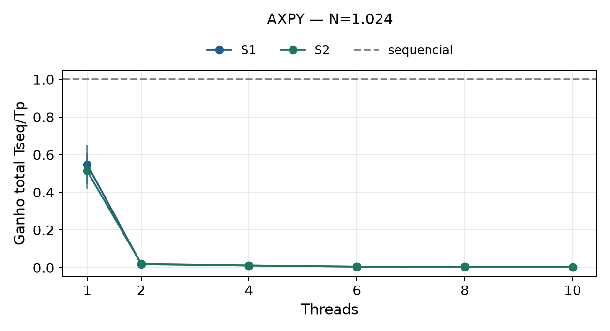
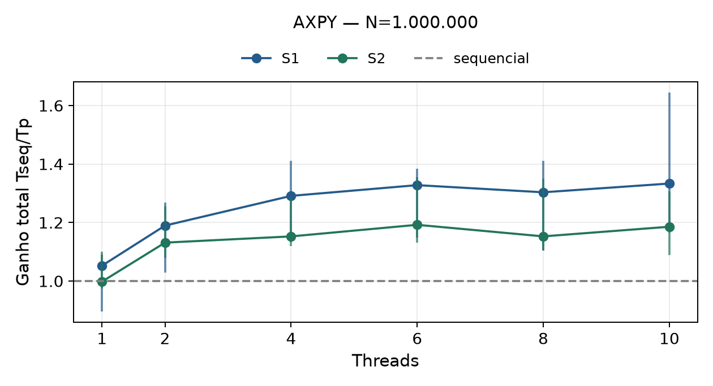
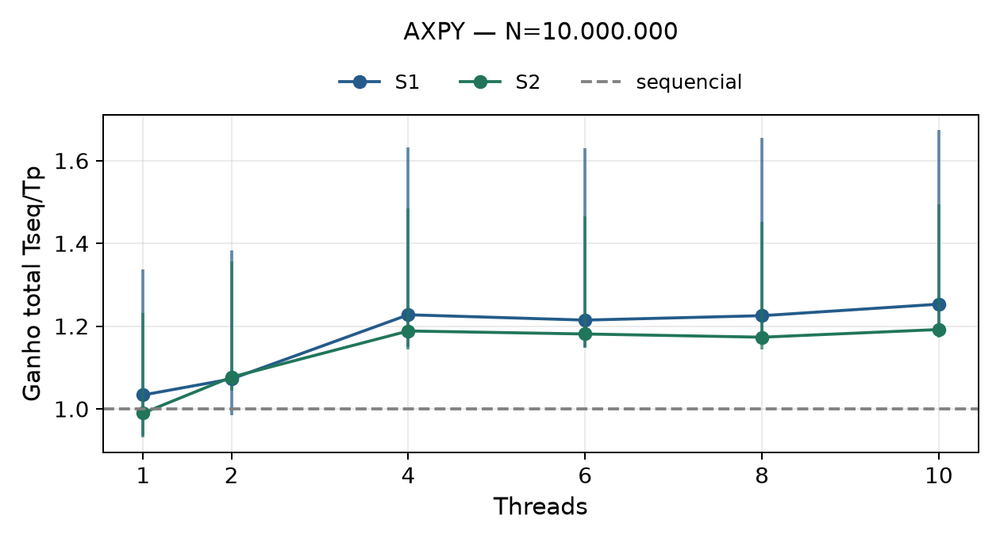

# Campanha científica AXPY no Apple M5 — 16/11/2026

#### 5.8.2. Nova campanha científica AXPY

O protocolo AXPY foi fixado antes das medições em `82de6e0`. As duas sessões
utilizam N=1.024, 1.000.000 e 10.000.000, com respectivamente 10.000, 100 e 40
chamadas internas por processo. Cada entrada tem sete configurações:
sequencial e OpenMP em 1/2/4/6/8/10T;
o conjunto tem 21 por sessão. Quinze processos medidos e três aquecimentos
por configuração totalizam 630 medições e 126 aquecimentos nas duas sessões.
O intervalo ocioso previsto entre sessões é de 30 segundos. Toda execução
temporizada verifica sua saída integralmente fora do intervalo do kernel.
As três áreas double ocupam logicamente 24.576, 24.000.000 e 240.000.000 bytes;
isso não mede residência de cache nem tráfego DRAM. As amostras não são somadas
ao corpus de 28 fontes ou às campanhas multiplataforma anteriores.

| N | Seleção S1 | Mediana selecionada (µs) | S total S1 [IC95%] | S paralelo S1 | E paralela S1 |
|---|---:|---:|---:|---:|---:|
| 1.024 | seq. | 0,2501 | 1,000 [1,000; 1,000] | — | — |
| 1.000.000 | 6T | 658,6600 | 1,328 [1,149; 1,384] | 1,262 | 0,210 |
| 10.000.000 | 10T | 7808,2750 | 1,253 [1,190; 1,674] | 1,212 | 0,121 |

As medianas, médias, DP amostrais, MAD, IQR e IC95% de todas as configurações permanecem nos CSVs. Os intervalos são bootstrap percentil de 5.000 reamostragens de rodadas completas, condicionais à coleta; não são testes de significância nem estimativas populacionais. A linha sequencial é a própria referência, não um ganho.







As escolhas foram congeladas em arquivo com SHA-256 antes do início da segunda sessão. O limiar de quase empate permanece em 2%, sem ajustes no holdout.

| N | Configuração congelada | S total S2 | Excesso sobre melhor S2 | Inadequada (>2%) |
|---|---:|---:|---:|---|
| 1.024 | seq. | 1,000 | 0,000% | Não |
| 1.000.000 | 6T | 1,192 | 0,000% | Não |
| 10.000.000 | 10T | 1,192 | 0,000% | Não |

A recomendação permaneceu igual em 2/3 casos. Nenhuma das três escolhas congeladas ficou mais de 2% acima da menor mediana da segunda sessão, incluindo sequencial. Isso descreve três entradas do mesmo kernel, não três programas independentes. O caso pequeno conservou o sequencial; aumentar threads não foi presumido benéfico.

#### 5.8.3. Amortização do preparo determinístico AXPY

| N | Preparo S1 (s) | Preparo S2 (s) | Equilíbrio do preparo S1 na latência S2 (chamadas) |
|---|---:|---:|---:|
| 1.024 | 39,959 | 37,508 | não definido |
| 1.000.000 | 12,326 | 14,152 | 84220 |
| 10.000.000 | 63,683 | 61,916 | 42162 |

C é o tempo observado do prefixo real: análises, geração, compilação, corretude, amostragem, seleção e contexto. A economia por chamada usa a configuração congelada e as novas medianas da S2. Não houve nova inferência LLM nem promoção: estes pontos amortizam somente o preparo, constituindo limites inferiores para o custo completo de admissão. Não se transportou a latência LLM histórica ao novo candidato. Sem economia positiva, o equilíbrio não é definido. As duas observações de custo por entrada não sustentam IC populacional.

O macOS registrou energia externa com bateria em 3%, carregando. A carga inicial baixa, a ausência de controle dedicado de temperatura/frequência e a execução no mesmo host/dia limitam a interpretação. O probe confirmou equipes de 1/2/4/6/8/10 workers, não sua alocação P/E durante o kernel. Não se inferem causas físicas de memória das curvas. Todas as configurações lentas e sem ganho foram mantidas.

Fontes: [protocolo fixado](./AXPY_SCIENTIFIC_PROTOCOL_2026-11-16.json), [arquivos das sessões](../../results/axpy_scientific/mac_m5_2026-11-16/), [análise completa](../../results/axpy_scientific/analysis_mac_m5_2026-11-16/report.json).

A monografia consolidada incorpora estes resultados. A revisão anterior de 78 páginas permanece em `MONOGRAFIA_CONSOLIDADA_PRE_AXPY_2026-11-16.*`. O profiling físico e a revisão nativa institucional não foram concluídos por esta campanha.

## Reprodução e testes

Execute na raiz `tcc2`, com LLVM/OpenMP no PATH. Para análise e exportações,
instale `requirements-experimental.txt` em um venv local. Os nomes abaixo são
novos para preservar a coleta arquivada:

```bash
python3 -B scripts/evaluate_axpy_campaign.py prepare --directory results/axpy_scientific/repeat
python3 -B scripts/evaluate_axpy_campaign.py session01 --directory results/axpy_scientific/repeat
python3 -B scripts/evaluate_axpy_campaign.py freeze --directory results/axpy_scientific/repeat
sleep 30
python3 -B scripts/evaluate_axpy_campaign.py session02 --directory results/axpy_scientific/repeat
python3 -B scripts/evaluate_axpy_campaign.py analyze --directory results/axpy_scientific/repeat --output results/axpy_scientific/analysis_repeat
python3 -B scripts/evaluate_axpy_campaign.py verify --directory results/axpy_scientific/repeat
```

O gerador `scripts/build_axpy_material.py` é específico da campanha arquivada
de 16/11 e só reexporta seus próprios arquivos se os hashes ainda coincidirem;
edições manuais divergentes são recusadas. Não o use para substituir dados por
outra coleta. O resultado dos testes finais e da verificação acadêmica está em
[report.json](../../results/validation/axpy_scientific_2026-11-16/report.json).
A suíte ampliada aprovou 152 testes sem skips e 23 casos de regressão. Os avisos
legados de arquivos CSV não fechados foram conservados nos logs, sem falhas.
