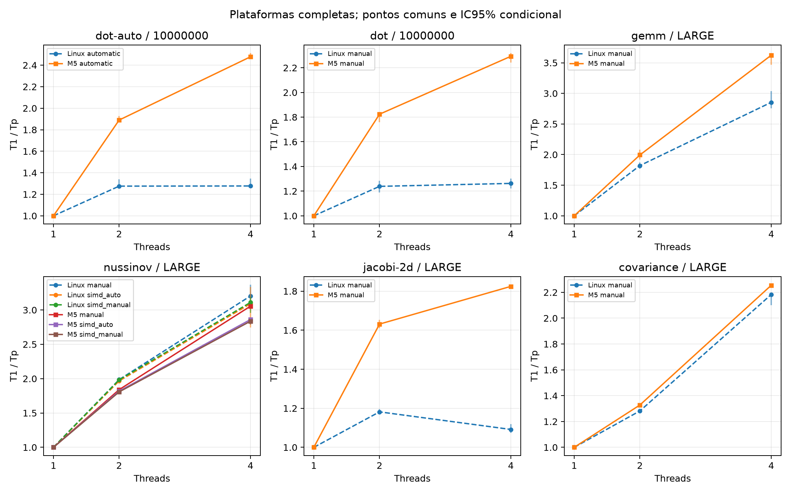
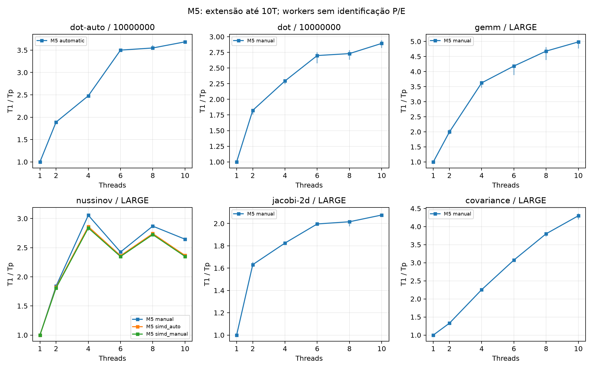

# Avaliação experimental Linux e Apple M5 — 16/11/2026

### 5.8. Apple M5 e comparação multiplataforma

Duas sessões completas foram realizadas em 16/11/2026. Cada sessão preserva 108 configurações, 1.620 observações externas, 324 aquecimentos e 108 validações aprovadas. As observações das duas sessões permanecem em arquivos separados. A primeira sessão determina as decisões; a segunda avalia sua reaplicação.

O M5 possui 4 núcleos de desempenho e 6 de eficiência, com 16 GiB de memória e macOS 26.6.2. LLVM Homebrew 23.1.1 e o runtime registrado por otool compõem a plataforma experimental. A energia registrada no início da primeira sessão foi bateria. Não houve controle exclusivo de temperatura, frequência ou carga do sistema. O probe confirmou equipes de 1/2/4/6/8/10 workers; não identificou sua classe de núcleo.

A comparação com Linux foi aprovada pelo verificador: bytes de fontes, headers e drivers, dimensões, flags, aquecimentos, repetições e seed coincidem. Linux usa Clang 18.1.3 e outro runtime. Os pontos comuns são 1T, 2T e 4T; diferenças observadas pertencem às plataformas completas.

| Caso / entrada / variante | S1: recomendação | S total S1 [IC95%] | S paralelo S1 | S2: recomendação |
|---|---:|---:|---:|---:|
| covariance / LARGE / manual | 10T | 4.295 [4.192; 4.359] | 4.298 | 10T |
| covariance / MEDIUM / manual | 10T | 3.920 [3.847; 3.975] | 3.881 | 10T |
| dot / 1000000 / manual | 4T | 1.025 [0.975; 1.060] | 1.669 | 4T |
| dot / 10000000 / manual | 10T | 2.677 [2.596; 2.725] | 2.893 | 6T |
| dot-auto / 1024 / automatic | seq. | 1,000 (sequencial) | — | seq. |
| dot-auto / 10000000 / automatic | 10T | 3.679 [3.635; 3.726] | 3.685 | 10T |
| gemm / LARGE / manual | 10T | 4.976 [4.671; 5.032] | 4.984 | 10T |
| gemm / MEDIUM / manual | 8T | 4.215 [4.075; 4.290] | 4.289 | 8T |
| jacobi-2d / LARGE / manual | 10T | 2.525 [2.488; 2.568] | 2.076 | 10T |
| jacobi-2d / MEDIUM / manual | 4T | 1.133 [1.064; 1.156] | 1.150 | 4T |
| nussinov / LARGE / manual | 4T | 2.703 [2.676; 2.728] | 3.056 | 4T |
| nussinov / LARGE / simd_auto | 4T | 3.963 [3.926; 3.996] | 2.861 | 4T |
| nussinov / LARGE / simd_manual | 4T | 3.953 [3.888; 3.985] | 2.837 | 4T |
| nussinov / MEDIUM / manual | 4T | 1.071 [0.994; 1.087] | 1.109 | seq. |
| nussinov / MEDIUM / simd_auto | 1T | 1.511 [1.447; 1.528] | 1.000 | 1T |
| nussinov / MEDIUM / simd_manual | 1T | 1.516 [1.442; 1.537] | 1.000 | 1T |

As entradas menores também possuem figuras próprias e os CSVs completos registram mediana, média, DP amostral, MAD, IQR e IC95% para todas as configurações. ICs usam 5.000 reamostragens pareadas por rodada; não se interpretam como causalidade arquitetural ou prova de independência temporal.

### 5.9. Avaliação independente da recomendação

As 16 decisões da primeira sessão foram congeladas com hashes antes do início da segunda. As quatro políticas utilizam somente configurações definidas na primeira coleta: sequencial, máximo de threads, recomendação do Selector e menor mediana OpenMP. O comparador posterior é a menor mediana da segunda sessão incluindo sequencial. O arrependimento é percentual de tempo excedente; inadequação operacional significa exceder 2%.

| Política | Casos inadequados / 16 | Arrependimento médio (%) | Maior arrependimento (%) | Mais lentos que sequencial |
|---|---:|---:|---:|---:|
| sequential | 14/16 | 171.834 | 390.737 | 0 |
| max_threads | 9/16 | 846.934 | 12767.655 | 6 |
| selector | 1/16 | 0.736 | 11.769 | 1 |
| fastest_selection | 2/16 | 2.660 | 30.796 | 2 |

As recomendações coincidiram em 14/16 casos entre sessões. O arquivo de sensibilidade aplica limiares de 0%, 1%, 2% e 5% somente aos dados de seleção; a política de produção conserva 2%. O mínimo posterior foi escolhido após observar a segunda sessão e é uma referência descritiva, não um ótimo populacional. A média de arrependimento dá o mesmo peso a cada caso; perdas muito grandes nas entradas pequenas podem dominá-la.

| Caso / entrada / variante | Configuração congelada | S total na S2 | Excesso sobre melhor S2 (%) |
|---|---:|---:|---:|
| covariance / LARGE / manual | 10T | 4.227 | 0.000 |
| covariance / MEDIUM / manual | 10T | 3.966 | 0.000 |
| dot / 1000000 / manual | 4T | 1.081 | 0.000 |
| dot / 10000000 / manual | 10T | 2.786 | 0.000 |
| dot-auto / 1024 / automatic | seq. | 1.000 | 0.000 |
| dot-auto / 10000000 / automatic | 10T | 3.942 | 0.000 |
| gemm / LARGE / manual | 10T | 4.907 | 0.000 |
| gemm / MEDIUM / manual | 8T | 4.254 | 0.000 |
| jacobi-2d / LARGE / manual | 10T | 2.511 | 0.000 |
| jacobi-2d / MEDIUM / manual | 4T | 1.129 | 0.000 |
| nussinov / LARGE / manual | 4T | 2.668 | 0.000 |
| nussinov / LARGE / simd_auto | 4T | 3.770 | 0.000 |
| nussinov / LARGE / simd_manual | 4T | 3.768 | 0.000 |
| nussinov / MEDIUM / manual | 4T | 0.895 | 11.769 |
| nussinov / MEDIUM / simd_auto | 1T | 1.241 | 0.000 |
| nussinov / MEDIUM / simd_manual | 1T | 1.244 | 0.000 |

| Limiar de quase empate | Decisões diferentes de 2% | Inadequadas na S2 | Arrependimento médio (%) |
|---|---:|---:|---:|
| 0% | 0/16 | 1/16 | 0.736 |
| 1% | 0/16 | 1/16 | 0.736 |
| 2% | 0/16 | 1/16 | 0.736 |
| 5% | 2/16 | 3/16 | 1.283 |

### 5.10. Investigação dos gargalos no Mac

A instalação disponível contém somente Command Line Tools; xcrun informa que xctrace não está disponível. Não foram obtidos contadores de cache ou DRAM. A investigação auxiliar usa cópias instrumentadas e mede intervalos de computação e espera em barreiras por worker em 1T, 4T e 10T, com três observações por entrada. Cada saída instrumentada foi comparada exatamente ao dump sequencial da campanha principal. As esperas incluem desbalanceamento, escalonamento e sincronização; não isolam um custo puro do runtime.

| Kernel / entrada | Workers | Espera / (computação + espera), mediana (%) | Máx./mín. de itens atribuídos |
|---|---:|---:|---:|
| nussinov / LARGE | 4 | 12.01 | 1.002 |
| nussinov / LARGE | 10 | 61.30 | 1.007 |
| jacobi-2d / LARGE | 4 | 7.77 | não contado |
| jacobi-2d / LARGE | 10 | 56.21 | não contado |
| covariance / LARGE | 4 | 42.14 | 6.980 |
| covariance / LARGE | 10 | 42.99 | 18.851 |

Em Covariance, a contagem registra pares (i,j) da fase triangular e os intervalos abrangem somente essa fase. Em Nussinov, os itens são células das diagonais; igualdade de células não implica igualdade de trabalho, pois a redução interna muda de comprimento. Em Jacobi, os intervalos abrangem as duas varreduras por passo de tempo. A instrumentação adiciona relógios, contadores e barreiras explícitas equivalentes; seus tempos não substituem os da campanha principal.

No Dot, a variação entre entradas e threads mede quando overhead domina, mas não isola fisicamente a banda. A taxa 16*N/T é derivada dos bytes lógicos de entrada; caches e reutilização das chamadas internas impedem tratá-la como tráfego DRAM. GEMM mantém reuso e laço contíguo, porém a localidade permanece hipótese sem contadores. Em Jacobi, pressão de memória e barreiras podem atuar juntas. A espera instrumentada confirma intervalos de espera no código medido, sem atribuir todo o efeito à memória ou às classes P/E.

O experimento Linux preparado em scripts/profile_linux_followup.sh coleta ciclos, instruções, eventos genéricos de cache, trocas de contexto e migrações em novo diretório. Banda física exige eventos suportados do controlador de memória, que devem ser escolhidos após consultar perf list. Nenhuma medição desse roteiro Linux foi presumida.

### 5.11. Custo do pipeline e ponto de equilíbrio

O custo foi medido em uma campanha técnica separada, com três prefixos reais de Dot C. Cada prefixo executa análise, dependências, classificação, planejamento, transformação, corretude, benchmark, seleção e contexto. Compilações e execuções internas possuem telemetria própria. Cada prefixo é compartilhado pela política determinística e pelo Coordinator LLM; alterna-se a ordem das decisões. O benchmark original dos gates conserva cinco observações por configuração, sem somá-las às quinze da campanha principal.

| Braço | Prefixo mediano (s) | Decisão mediana (s) | Promoção mediana (s) | Custo contabilizado mediano (s) | Equilíbrio mediano (execuções) |
|---|---:|---:|---:|---:|---:|
| deterministic | 11.368 | 0.000005 | 0.497 | 11.865 | 3360 |
| coordinator | 11.368 | 8.916923 | 0.756 | 20.842 | 5929 |

| Etapa medida | Mediana inclusiva (s) | Compilação interna mediana (s) | Execução interna mediana (s) |
|---|---:|---:|---:|
| static | 0.072293 | 0.000000 | 0.000000 |
| dependences | 0.019227 | 0.000000 | 0.000000 |
| patterns | 0.019943 | 0.000000 | 0.000000 |
| strategy | 0.020365 | 0.000000 | 0.000000 |
| transform | 0.046351 | 0.000000 | 0.000000 |
| correctness | 0.557897 | 0.190849 | 0.304140 |
| performance | 10.573984 | 0.187974 | 10.303857 |
| selection | 0.037732 | 0.000000 | 0.000000 |
| context | 0.034085 | 0.000000 | 0.000000 |

O equilíbrio é ceil(C/(Tseq−Topt)) quando a economia por chamada é positiva. C inclui o prefixo, decisão/validação da decisão e promoção. A promoção já inclui recompilação e corretude fresca; somar novamente esses tempos internos contaria o mesmo trabalho duas vezes. As medianas por etapa não são somadas para reconstruir a mediana do total. Os custos dos braços são comparações contabilizadas sobre prefixos comuns, não seis pipelines independentes.

Falhas, recusas e timeouts permanecem nos arquivos de tentativa; ausência de economia recebe equilíbrio indefinido. O modelo é local e a inferência inclui estado de carregamento/cache observado. O ganho do kernel é produzido pela transformação, configuração e hardware, não pela LLM que decide sobre evidências já medidas. As três observações dos custos e perfis têm mediana, DP amostral, MAD e IQR em MAC_AUXILIARY_STATISTICS_2026-11-16.csv; seus ICs ficam ausentes por não atingir o mínimo pré-definido de quinze observações. Esses ensaios auxiliares não estimam distribuição populacional.
