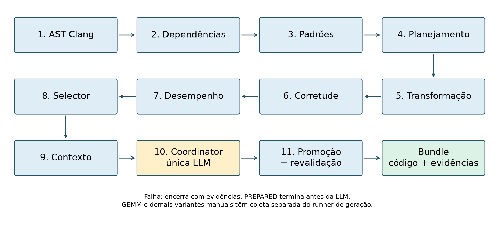
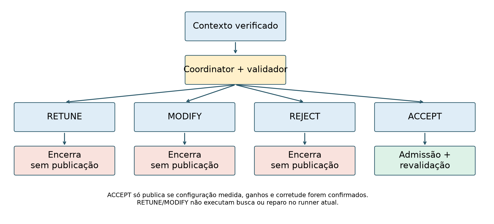
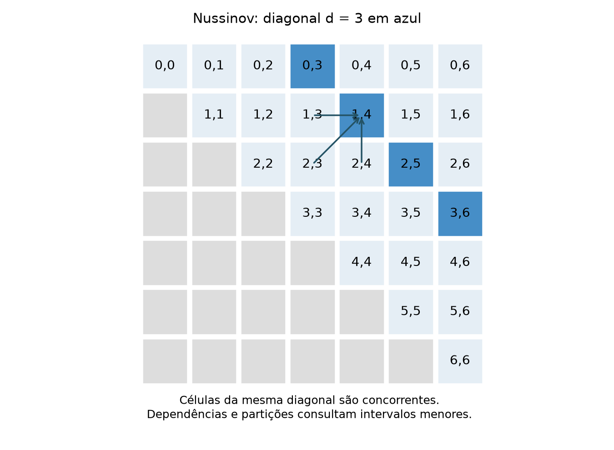

### 3.4. Entradas, saídas e limites de cada componente

O runner é um programa Python que chama outros programas e troca arquivos JSON.
Não há escalonamento concorrente entre agentes nesse caminho. O termo agente
designa um papel funcional, não uma instância independente de LLM. Apenas o
Coordinator consulta um modelo de linguagem; análise, transformação e gates
são determinísticos. Essa distinção determina o que cada resultado pode demonstrar.

| Componente e função | Entrada efetiva | Saída consumida pela etapa seguinte | Limite que importa à interpretação |
|---|---|---|---|
| Static Analyzer: `analyze`, `run_clang` | Fonte, diretórios de include e AST JSON do Clang | Funções kernel, laços, intervalos de linhas, leituras, escritas e atualizações escalares | Não é um compilador de otimização completo; depende do AST e das construções reconhecidas |
| Dependence Analyzer: `analyze_loop`, `compare_accesses` | Acessos extraídos do mesmo laço | Relações entre leitura/escrita do mesmo array e offsets reconhecidos | Não resolve aliasing arbitrário; compara candidatos leitura–escrita, sem prova geral de independência |
| Pattern Classifier: `classify_loop`, `classify_kernel` | Estrutura e relações de dependência | Família, evidências e rótulo heurístico de confiança | Reconhecer um padrão não demonstra que existe transformação implementada |
| Strategy Planner: `plan_kernel`, `plan_reduction` | Padrões e hierarquia de laços | Estratégia, alvo, variável, operador e autorização de transformação direta | Um plano DOALL ou WAVEFRONT não torna esses padrões suportados pelo transformador genérico |
| Code Transformer: `apply_strategy`, `transform_scalar_reduction` | Fonte e plano ligados à análise | Fonte com pragma e registro da transformação | Caminho genérico restrito a redução escalar direta; demais estratégias são recusadas |
| Correctness Gate: `run_gate`, `validate_numeric` | Original, candidato, driver e threads | Compilação, saídas finitas, tolerâncias e relatório v0.2 | Validação empírica do driver, sem equivalência formal ou detector de races |
| Performance Gate: `execute`, `parse_average_time` | Evidência de corretude e driver de benchmark | Amostras e relatório v0.1 ligado à corretude | Protocolo original de cinco amostras; distinto da nova coleta de quinze |
| Performance Selector: `select_configuration` | Tempos por configuração | Mais rápida, conjunto de quase empate e recomendação | Política determinística de 2%; não busca novo código ou configurações não medidas |
| Context Builder: `build_context` | Análises e evidências verificáveis | Contexto v0.3, bytes congelados e referências | Uma declaração PASS externa não substitui verificação da cadeia de evidências |
| Coordinator: `compact_context`, `call_ollama`, `validate_decision` | Prompt, schema e contexto | Decisão v0.2 e metadados da inferência | Não gera os kernels nem executa reparo; decisões inválidas são recusadas |
| Promotion Executor: `promote_candidate` | ACCEPT válido e evidências | Bundle, manifesto e revalidação | Só publica a configuração admissível e medida, após nova compilação e corretude |



As setas da figura representam dependência entre artefatos e ordem do runner.
Falhas de compilação, ausência de evidência ou divergência de hash encerram a
tentativa. O modo `--prepare-only` termina antes da inferência e da promoção.
Na campanha multiplataforma, um harness de medição separado reutiliza os cinco
primeiros componentes para gerar Dot C e valida as variantes de todos os kernels.
Ele não apresenta seu arquivo experimental como um bundle promovido.

### 3.5. Algoritmos determinísticos e transformação suportada

Os pseudocódigos abaixo resumem funções existentes. Os nomes de arquivo e de
função permitem conferir o comportamento no repositório; os blocos não são
novos algoritmos implementados apenas para a redação.

Algoritmo 1 — extração estrutural e dependências (`static_analyzer.analyze` e
`dependence_analyzer.analyze_loop`).

```text
receber fonte e diretórios de include
executar Clang com AST em JSON e verificar seu retorno
encontrar funções cujo nome identifica um kernel
para cada kernel e laço reconhecido:
    registrar localização, iterador e hierarquia
    coletar leituras, escritas e atualizações escalares
    para cada escrita w e leitura r do mesmo array:
        comparar índices reconhecidos em w e r
        registrar relação e offsets, quando obtidos
gravar análises em arquivos distintos por fonte/variante
```

O comparador trata expressões simples de índice e distingue mesma localização,
acesso deslocado e relação simbólica. Uma lista vazia de dependências significa
que o procedimento não encontrou candidatos segundo suas regras; não é um
certificado universal de independência. Ponteiros que se sobrepõem, chamadas
externas e expressões não reconhecidas exigem cautela.

Algoritmo 2 — classificação e autorização (`classify_loop`, `classify_kernel`,
`plan_reduction` e `apply_strategy`).

```text
classificar laços a partir das evidências extraídas
    acessos deslocados sustentam candidato wavefront
    atualização escalar reconhecida sustenta candidato reduction
    demais regras identificam redução em array, stencil e doall
agregar as classificações no kernel e construir a hierarquia
produzir plano com laço, variável, operador e construção OpenMP
se a estratégia não for REDUCTION: recusar no caminho genérico
para cada redução, da última linha da fonte para a primeira:
    exigir tipo scalar e direct_code_transformation autorizado
    localizar o laço e conferir a linha de inserção
    inserir pragma parallel for reduction(...) schedule(static)
gravar candidato e metadados da transformação
```

O tratamento em ordem inversa evita que uma inserção desloque as posições dos
próximos alvos. O rótulo de confiança do classificador é uma classificação
heurística do programa, não uma probabilidade calibrada de correção. GEMM não
passa a ser automaticamente transformado porque seu laço foi chamado de DOALL.

O exemplo a seguir é a função sequencial real de
`analysis/fixtures/dot_product.c`, apenas compactada na apresentação:

```c
double kernel_dot(int n, const double *A, const double *B) {
    double sum = 0.0;
    for (int i = 0; i < n; i++) {
        sum += A[i] * B[i];
    }
    return sum;
}
```

O candidato gerado na campanha mantém a função e acrescenta a redução:

```c
double kernel_dot(int n, const double *A, const double *B) {
    double sum = 0.0;
    #pragma omp parallel for reduction(+:sum) schedule(static)
    for (int i = 0; i < n; i++) {
        sum += A[i] * B[i];
    }
    return sum;
}
```

A variável acumuladora é privada segundo a semântica de redução e seus valores
parciais são combinados ao final. A associação das operações pode mudar; por
isso, a validação floating-point usa tolerância explícita em vez de exigir a
mesma sequência de bits do sequencial. O resultado continua sujeito às entradas
e ao comportamento efetivamente testados. [OpenMP 5.2, reduction](https://www.openmp.org/spec-html/5.2/openmpsu52.html).

Algoritmo 3 — corretude e vínculo de evidências (`run_gate` e
`load_selection_evidence`).

```text
capturar original, candidato, driver e identidade do compilador
calcular SHA-256 e criar identidade exclusiva da campanha
compilar os snapshots sequencial e OpenMP
se houver erro de compilação ou execução: FAIL
obter escalar de referência e exigir valor finito
para cada configuração de threads solicitada:
    executar candidato e exigir escalar finito
    comparar com referência usando rtol=1e-9 e atol=1e-12
    se falhar: conservar o relatório e encerrar com FAIL
emitir PASS com fontes, executáveis, parâmetros e resultados
ao consumir a evidência: verificar hashes e a mesma campanha
```

O gate integrado testa o driver fornecido. O novo harness amplia a cobertura de
entrada da campanha e compara dumps completos dos casos PolyBench, mas não
transforma esses testes em uma prova formal. Seu protocolo e suas saídas são
descritos separadamente na metodologia.

Algoritmo 4 — seleção de desempenho (`select_configuration`).

```text
localizar sequencial e OpenMP 1T da mesma variante
calcular speedup total por configuração medida
identificar configurações que superam o sequencial
se nenhuma superar: não recomendar candidato benéfico
localizar a menor mediana entre configurações benéficas
formar conjunto com tempo até 1,02 vezes a menor mediana
recomendar a configuração de menos threads nesse conjunto
registrar separadamente transformação e ganho paralelo
```

O Selector pode reconhecer benefício já em uma thread; isso é transformação,
não escalabilidade. O executor impõe condições adicionais: recomendação paralela
com pelo menos duas threads, ganho contra os dois baselines e evidências íntegras.
A mediana mais baixa e a recomendação são mantidas separadas nas tabelas.

### 3.6. Decisão da LLM e publicação controlada

`build_context` carrega a seleção e os gates ligados à mesma campanha, verifica
as referências e recupera os bytes congelados da fonte. Não toma uma string
PASS como prova suficiente. `compact_context` mantém código, padrão, plano,
dependências, validação, desempenho e restrições para construir o prompt.

Algoritmo 5 — decisão e promoção (`run_pipeline`, `validate_decision` e
`promote_candidate`).

```text
construir contexto a partir de evidências verificadas
se prepare_only: retornar PREPARED antes da LLM
consultar Ollama com prompt e schema estruturado
validar decisão, ação e configuração contra o contexto
se RETUNE, MODIFY ou REJECT:
    registrar decisão e encerrar sem publicar
se ACCEPT e PROMOTE_CANDIDATE:
    conferir identidades do contexto, candidato e campanha
    exigir configuração medida com ganho vs. sequencial e OpenMP 1T
    reservar destino exclusivo e criar staging
    recompilar e repetir corretude na configuração selecionada
    se houver falha ou alteração: recusar publicação
    arquivar código, evidências e manifesto
    publicar por renomeação atômica
```



RETUNE e MODIFY expressam intenções na interface, mas o runner avaliado não
executa uma nova busca nem chama um codificador para reparar o candidato.
Na avaliação pareada, a recusa usa fallback sequencial; esse fallback é uma
regra do experimento, não um laço oculto de recuperação do runner. Os timeouts
e respostas inválidas são observações, não tentativas apagadas.

O manifesto da promoção registra a configuração medida, métricas e hashes.
SHA-256 permite detectar troca de bytes em relação aos registros; não é uma
assinatura externa nem garante honestidade de relatórios fabricados fora do
processo. A revalidação cobre a entrada do driver, não todos os programas C.

### 3.7. Algoritmos dos kernels e diferença entre paralelismos

No GEMM, cada linha de C pode ser calculada por uma thread. O excerto de
`kernels/gemm/manual_openmp.c` conserva a ordem i–k–j e o contrato
C ← αAB + βC:

```c
#pragma omp parallel for private(j, k) schedule(static)
for (i = 0; i < ni; i++) {
    for (j = 0; j < nj; j++) C[i][j] *= beta;
    for (k = 0; k < nk; k++)
        for (j = 0; j < nj; j++)
            C[i][j] += alpha * A[i][k] * B[k][j];
}
```

A partição por i evita que duas threads atualizem a mesma linha de C. O laço
j acessa posições contíguas, enquanto B é reutilizada. O programa avaliado é
uma implementação simples, sem atribuir-lhe a eficiência de uma BLAS otimizada.

Nussinov calcula uma tabela de programação dinâmica sobre intervalos da
sequência. A fonte original percorre linhas; a variante OpenMP manual usa
diagonais d=j−i. O pseudocódigo conserva a recorrência implementada:

```text
inicializar sequência sintética e tabela com zeros
criar uma região paralela persistente
para d = 1 até N-1, em todas as threads:
    distribuir i = 0 até N-d-1 com omp for schedule(static)
        j = i + d
        incorporar table[i][j-1] e table[i+1][j]
        incorporar table[i+1][j-1] e pareamento, se não adjacentes
        para k = i+1 até j-1:
            maximizar com table[i][k] + table[k+1][j]
    sincronizar antes de começar a próxima diagonal
```



As células da mesma diagonal são concorrentes, mas consultam diagonais anteriores.
O fim do `omp for` precisa da barreira implícita. A largura disponível N−d diminui
ao longo do cálculo; a carga e os acessos a intervalos também mudam com d.
Isso difere do conjunto de linhas independentes de GEMM.
[OpenMP 5.2, worksharing-loop](https://www.openmp.org/spec-html/5.2/openmpse66.html).

A adaptação SIMD substitui atualizações repetidas do destino por um acumulador
local e uma redução de máximo no laço k. O trecho foi extraído da variante
automática específica existente, não escrito pela LLM:

```c
DATA_TYPE tcc2_best = table[i][j];
#pragma omp simd reduction(max:tcc2_best)
for (k = i + 1; k < j; k++) {
    DATA_TYPE tcc2_candidate = table[i][k] + table[k + 1][j];
    tcc2_best = max_score(tcc2_best, tcc2_candidate);
}
table[i][j] = tcc2_best;
```

Jacobi-2D atualiza dois arrays em passos de tempo. Os pontos de cada varredura
podem ser distribuídos, mas as fases e os passos precisam respeitar suas
dependências; não é correto paralelizar o eixo temporal sem outra transformação.
Covariance contém três fases: médias por coluna, centralização dos dados e
matriz de covariância. A versão manual usa barreiras entre fases e explora
paralelismo nos índices externos. O domínio triangular da covariância pode
desbalancear a distribuição estática de trabalho. Esses dois casos ampliam a
avaliação de desempenho; não ampliam a cobertura do transformador genérico.

### 3.8. Procedimento de apresentação institucional

Esta revisão preserva a base original e a versão de trabalho anterior. O corpo
é organizado em problema, fundamentação, implementação, metodologia, resultados,
discussão e conclusão, com pseudocódigos e exemplos conferíveis. A capa oficial
pública da Biblioteca PUCRS foi preservada e uma cópia preenchida é gerada com
autor, escola, curso, título, cidade e ano. Os campos não fornecidos, como nome
de orientador e composição da banca, não foram inventados.

O corpo de revisão utiliza A4, margens superior/esquerda de 3 cm e
inferior/direita de 2 cm, fonte de texto de 12 pontos e entrelinhas de 1,5.
Essas opções melhoram a apresentação, mas não equivalem à certificação de
aderência integral ao modelo institucional atual, cujo acesso é autenticado.
A paginação e a integração final da capa exigem conferência no aplicativo de
edição utilizado na entrega. [Biblioteca PUCRS, modelo e acesso](https://biblioteca.pucrs.br/apoio-a-pesquisa/modelos-de-normas-tecnicas-de-documentacao/trabalhos-academicos-abnt/),
[capa de graduação](https://biblioteca.pucrs.br/apoio-a-pesquisa/capas-padrao-pucrs/capa-para-tcc/).
