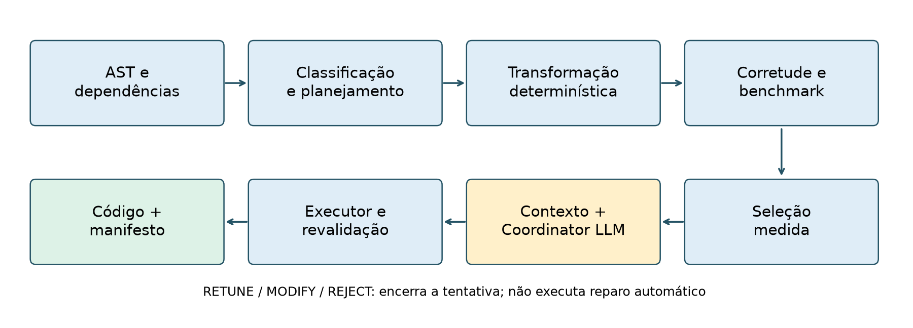
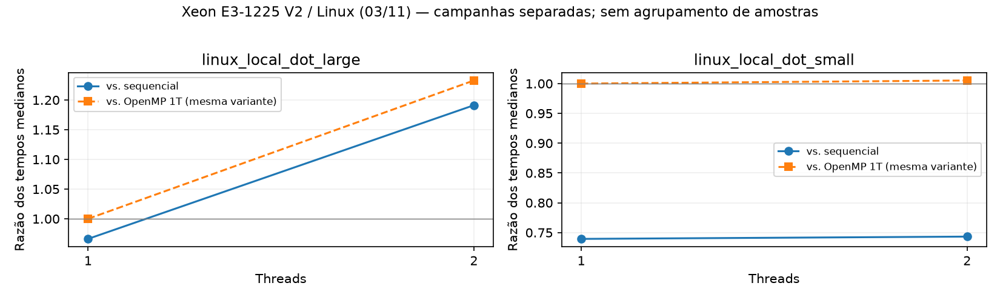

# Sistemas Multiagentes para Reestruturação Autônoma de Códigos

## Análise de dependências, paralelização OpenMP e coordenação baseada em evidências

Lucas Nory Ulson — Ciência da Computação, PUCRS

Versão de trabalho de 3 de novembro de 2026. Texto alinhado à implementação,
à campanha final do Mac e aos documentos recebidos. A campanha original do
Coordinator terminou `INCOMPLETE`; o contrato foi corrigido e a replicação com
as mesmas evidências terminou `COMPLETE`, mantendo ambos os resultados;
esta versão ainda não constitui monografia final aprovada.

## Resumo

Este trabalho apresenta um protótipo híbrido para análise e reestruturação de
código numérico em CPU multicore com OpenMP. A arquitetura separa componentes
determinísticos de análise, transformação, validação e medição de um Coordinator
baseado em modelo de linguagem. O fluxo integrado recebe uma fonte C
independente, identifica uma redução escalar suportada, produz um candidato,
verifica sua saída numérica, mede configurações de threads e condiciona a
publicação a evidências vinculadas ao artefato. Um executor determinístico
revalida o candidato antes de publicar código e manifesto. A avaliação distingue
o ganho contra o sequencial da escalabilidade em relação à mesma variante
OpenMP com uma thread. A consolidação experimental organiza 22 campanhas,
incluindo variantes manuais, transformações automáticas específicas e resultados
sem ganho. Em uma coleta local de Dot Product, a entrada grande apresentou
ganho de aproximadamente 1,191× com duas threads; a entrada pequena não satisfez
a política de admissão paralela. Foi implementado um estudo pareado entre a
política determinística, o Coordinator completo e uma ablação das análises
estruturadas. Na replicação final no Mac, as 12 inferências foram válidas e os
dois braços LLM concordaram 3/3 com a política em cada caso. Um ensaio controlado
reproduziu ACCEPT, REJECT e RETUNE, mas não MODIFY. Não foi demonstrado benefício
adicional da LLM ou das análises estruturadas nesta amostra. As contribuições
demonstradas concentram-se na integração auditável do caminho suportado, na
separação das métricas e na organização das evidências, com limitações explícitas
de cobertura, corretude empírica e generalização.

Palavras-chave: OpenMP; análise de dependências; reestruturação de código;
modelos de linguagem; reprodutibilidade experimental.

## Abstract

This work presents a hybrid prototype for numerical code analysis and
restructuring on multicore CPUs using OpenMP. Deterministic analysis,
transformation, validation and measurement components are separated from a
language-model Coordinator. The integrated workflow supports a standalone C
scalar-reduction case, binds validation and timing evidence to the candidate,
and performs fresh correctness validation before publication. Evaluation
separates speedup over the sequential program from scaling over the same
OpenMP variant with one thread. Experimental consolidation covers 19 campaigns
with manual variants, specific automatic transformations and negative results.
In a local Dot Product campaign, the large input achieved approximately 1.191×
speedup using two threads, while the small input did not satisfy the parallel
admission policy. A paired decision study compares the deterministic policy,
the full Coordinator and an ablation of structured analyses. In the final Mac
replication, all 12 inference calls were valid and both LLM arms agreed 3/3 with
policy in each case. A controlled study reproduced ACCEPT, REJECT and RETUNE,
but not MODIFY. No additional benefit from the LLM or structured analyses was shown
in this sample. Demonstrated contributions concern workflow integration,
artifact traceability, metric separation and experimental organization, with
explicit limits on transformation coverage and empirical correctness.

Keywords: OpenMP; dependence analysis; code restructuring; language models;
experimental reproducibility.

## 1. Introdução

A reestruturação de um programa para execução paralela envolve decisões sobre
dependências, distribuição do trabalho e configuração de execução. Neste
trabalho, o problema é tratado como uma sequência de decisões verificáveis:
identificar uma transformação suportada, testar o resultado e medir se uma
configuração oferece ganho. A presença de diretivas paralelas, isoladamente,
não é adotada como critério de sucesso.

OpenMP fornece construções de execução e de compartilhamento de dados para
programação paralela. Sua especificação é a referência conceitual para os
mecanismos empregados; isso não implica que os compiladores avaliados implementem
integralmente todas as funcionalidades da versão 5.2. [OpenMP ARB, 2021](https://www.openmp.org/spec-html/5.2/openmp.html).

O uso de modelos de linguagem acrescenta uma decisão textual ao fluxo. Essa
decisão pode interpretar informações produzidas pelas ferramentas, mas não
substitui as medições nem a validação do candidato. Para investigar essa
separação, o protótipo concentra a LLM no Coordinator e mantém as etapas de
geração suportada, medição e admissibilidade como componentes determinísticos.

A proposta inicial descrevia quatro agentes, LangGraph e um ciclo de reparo
mais amplo. A implementação avaliada adotou um recorte menor: orquestração em
Python, evidências serializadas em JSON e um Coordinator LLM com ações
estruturadas. A geração automática integrada foi demonstrada para Dot Product
com redução escalar. Outros padrões aparecem nas análises e nas campanhas de
variantes, com cobertura parcial de transformação. Essa distinção determina o
alcance das conclusões.

### 1.1. Problema e questões de pesquisa

A pergunta central do recorte é: como integrar análise, transformação suportada,
validação, medição e decisão de uma LLM preservando a rastreabilidade do candidato,
e qual efeito adicional a LLM exerce sobre a decisão de admissão?

Três questões organizam a avaliação:

1. **R1 — Integração:** como o pipeline vincula código, validação, configuração
   e medição, e em quais situações bloqueia a promoção?
2. **R2 — Desempenho:** quais configurações medidas apresentam ganho contra o
   sequencial e escalabilidade em relação à mesma variante OpenMP com uma thread?
3. **R3 — Coordinator:** mantendo candidato e evidências constantes, o Coordinator
   altera decisões e resultados admitidos em relação à política determinística,
   e qual é seu custo em latência e chamadas?

R3 não equivale a comparar geração one-shot com geração por vários agentes.
Também não mede redução de tentativas de uma busca autônoma por novos códigos,
pois tal busca não é executada pelo runner atual.

### 1.2. Objetivos e contribuições

O objetivo geral é desenvolver e avaliar, no recorte suportado, um pipeline
híbrido de reestruturação OpenMP com decisão baseada em evidências. Os objetivos
específicos são extrair informações estruturais; planejar e aplicar uma
transformação implementada; verificar saídas; medir configurações; rastrear os
artefatos utilizados; e comparar a decisão da LLM com a política sem LLM.

As contribuições técnicas demonstradas são a integração do caminho de redução
escalar, o contrato que vincula evidências ao candidato, a revalidação antes da
publicação e a consolidação de métricas com baselines distintos. A contribuição
empírica adicional do Coordinator depende da conclusão de R3; não é pressuposta
pela existência desses componentes.

## 2. Fundamentação e posicionamento

### 2.1. Dependências e padrões

O analisador estático utiliza o AST produzido pelo Clang para extrair informações
sobre laços, acessos e atualizações. O analisador de dependências e o classificador
aplicam regras implementadas sobre essa representação. Seus resultados orientam
o planejamento, sem constituir uma análise completa de todos os recursos de C,
de aliasing arbitrário ou de bibliotecas externas.

Os casos do repositório são organizados em DOALL, REDUCTION, STENCIL,
WAVEFRONT/DOACROSS e MIXED. Essa taxonomia de padrões não deve ser confundida
com uma classificação da arquitetura física de execução. Em particular,
distribuir iterações entre threads e inserir uma redução SIMD específica são
operações diferentes no protótipo.

### 2.2. Arquitetura por papéis e LLM

O termo multiagente é usado no projeto para organizar responsabilidades
especializadas. No caminho avaliado, a maioria desses papéis é implementada por
módulos determinísticos; um Coordinator utiliza uma LLM. Não foi implementado
um conjunto de modelos independentes negociando planos, um motor BDI ou uma
memória blackboard com atualização concorrente. O contexto compartilhado é
materializado por artefatos e referências explícitas entre etapas.

Como referência de arquitetura, AutoGen apresenta composição de agentes capazes
de conversar e combinar modelos, ferramentas e intervenção humana. O presente
protótipo não utiliza esse framework nem avalia o mesmo mecanismo de conversação.
Essa referência situa a diferença entre uma arquitetura multiagente conversacional
e a divisão de papéis adotada aqui. [Wu et al., 2023](https://arxiv.org/abs/2308.08155).

### 2.3. Avaliação de código paralelo

ParEval foi proposto para avaliar geração de código paralelo por LLMs sobre 420
tarefas, considerando diferentes tipos de problema e modelos de programação.
Esse trabalho relaciona o tema de LLMs à avaliação de código paralelo. O estudo
atual possui outra unidade experimental: a decisão sobre um candidato já gerado
e medido. Não se compara numericamente o resultado deste TCC aos resultados de
ParEval. [Nichols et al., 2024](https://arxiv.org/abs/2401.12554).

Parte dos kernels históricos deriva de PolyBench/C, uma coleção de benchmarks
com instrumentação e inicialização de dados para avaliação de kernels. O projeto
fixa um submódulo PolyBenchC-4.2.1 para esses casos; os fixtures independentes de
Dot Product permitem exercitar o novo contrato sem essa dependência.
[Pouchet, PolyBench/C](https://www.cs.colostate.edu/~pouchet/software/polybench/polybench.html).

Essas referências fundamentam o recorte, mas não constituem uma revisão
sistemática da literatura nem demonstram novidade absoluta da arquitetura.

## 3. Arquitetura e implementação

### 3.1. Fluxo implementado

O runner executa análise estática, dependências, classificação, planejamento,
transformação, gate de corretude, gate de desempenho, seleção, construção do
contexto, Coordinator e promoção. O modo de preparação encerra após construir
o contexto verificado, permitindo separar a coleta determinística da inferência.

| Etapa | Responsabilidade | Implementação principal |
|---|---|---|
| Análise | Extrair estrutura e relações reconhecidas | `analysis/static_analyzer.py`, `dependence_analyzer.py` |
| Classificação e plano | Identificar padrão e transformação implementada | `pattern_classifier.py`, `strategy_planner.py` |
| Transformação | Aplicar redução escalar direta suportada | `analysis/code_transformer.py` |
| Corretude | Compilar e comparar saída numérica nas threads solicitadas | `scripts/compile_correctness_gate.py` |
| Desempenho | Registrar tempos brutos e resumos | `scripts/performance_gate.py` |
| Seleção | Escolher configuração a partir de medições | `analysis/performance_selector.py` |
| Contexto e decisão | Agregar evidências e obter ação estruturada | `agents/context_builder.py`, `coordinator_agent.py` |
| Promoção | Conferir evidências, revalidar e publicar | `scripts/promote_candidate.py` |

A implementação do planejador adaptativo e as transformações específicas de
Nussinov são caminhos adicionais. Sua existência não significa que o runner de
fontes independentes execute automaticamente todo o projeto PolyBench.

### 3.2. Recorte de automação

| Caso | O que foi automatizado / avaliado |
|---|---|
| Dot Product C | Caminho integrado de redução escalar, gates, seleção, decisão e executor; inferência real e promoção concluídas no Mac em 03/11/2026 |
| GEMM | Análises e campanhas de variante OpenMP manual |
| Jacobi-2D | Análises, variante OpenMP manual e experiências específicas com tiling |
| Covariance | Análises e campanha de variante OpenMP manual |
| Nussinov | Análises e transformações adaptativas específicas sobre base OpenMP existente; contratos legados nas campanhas |
| Wavefront sintético | Diagnóstico de baixo desempenho, variante tiled manual e autotuning |

A classificação de um padrão não comprova a geração automática de código para
esse padrão. O caso Wavefront registra uma trajetória experimental de diagnóstico,
modificação e autotuning; os artefatos não comprovam que a LLM executou esse
ciclo de forma autônoma.

### 3.3. Contrato de evidências

Os gates atuais preservam cópias dos arquivos explícitos de entrada e registram
hashes SHA-256 de fontes e executáveis, identidade do compilador, flags,
variáveis OpenMP, campanha e tempos individuais. A seleção é recalculada ao
carregar a evidência. O contexto inclui o código verificado e referências aos
relatórios. A decisão registra a identidade do contexto recebido.

O vínculo de hashes permite detectar a troca de um arquivo após a medição. Não
é uma assinatura de um produtor externo, nem prova que um relatório fabricado
fora do processo é verdadeiro. Também não captura integralmente bibliotecas,
headers de projeto ou todos os componentes de uma toolchain.

O Coordinator emite ACCEPT, RETUNE, MODIFY ou REJECT e uma próxima ação
compatível. RETUNE/MODIFY/REJECT encerram a tentativa do runner sem publicar um
artefato. ACCEPT não basta para promoção: o executor exige configuração medida,
ganho contra ambos os baselines e revalidação fresca de corretude. A publicação
é feita por staging e renomeação do diretório final, com código, manifesto e
evidências. Uma tentativa duplicada é recusada.

## 4. Metodologia

### 4.1. Unidades experimentais e proveniência

São separados três conjuntos de evidências. O primeiro contém 17 campanhas
históricas recuperadas de CSVs, logs e dumps, sem o contrato atual completo de
vínculo ao código medido. O segundo contém duas coletas Linux cujo resumo foi
preservado, mas cujos contextos originais não estão neste checkout. O terceiro
contém três campanhas finais de Dot Product no Mac verificáveis pelos gates
atuais. A consolidação totaliza 22 campanhas e 173 configurações, com 545 tempos
individuais recuperados.

Os 35 CSVs históricos foram inventariados sem alteração, junto a nove CSVs das
campanhas finais. Oito históricos apresentam linhas
incompatíveis com o cabeçalho; vários acumulam mais de uma execução. A matriz
usa fontes selecionadas explicitamente, conferindo resumos com amostras quando
disponíveis. Não se unem amostras de máquinas ou campanhas diferentes para
aumentar artificialmente o tamanho da amostra.

### 4.2. Corretude e compilação

No caminho independente, a corretude compara o resultado escalar do candidato
ao sequencial com tolerâncias relativa de 1e-9 e absoluta de 1e-12. O driver
determinístico de validação utiliza N=1.000.000. São verificadas as threads que
serão medidas. Esse driver é distinto do driver de benchmark; portanto, o PASS
não deve ser descrito como teste de todas as entradas temporizadas.

Nos casos legados PolyBench, há validações por comparação de dumps da
compilação de validação e campanhas de desempenho com instrumentação de tempo.
Esses resultados têm cobertura e registro diferentes dos gates novos. O runner
atual não inclui um detector de races nem estabelece equivalência formal.

Na campanha local foram usados GCC 13.3.0 para compilação e Clang para análise
AST, em Linux x86_64 com Xeon E3-1225 V2 e quatro núcleos. Os flags de desempenho
são -O3 para sequencial e -O3 -fopenmp para o candidato. O ambiente registra
OMP_DYNAMIC=FALSE, OMP_PROC_BIND=TRUE e OMP_PLACES=cores. As campanhas históricas
do Mac usam o ambiente Apple M5 registrado em setembro, com as lacunas
específicas indicadas no catálogo.

### 4.3. Desempenho e estatística descritiva

O benchmark local possui dois tamanhos: N=10.000.000, com 100 chamadas internas,
e N=1.024, com 10.000 chamadas internas. Cada configuração tem cinco medições
externas; o tempo por chamada é reportado pelo driver. A medida principal é a
mediana dessas cinco observações, mantendo média, mínimo, máximo e desvio
padrão populacional para inspeção.

Se T_seq é o tempo mediano do sequencial, T_1 o tempo da variante OpenMP com uma
thread e T_p o tempo dessa mesma variante com p threads, calculam-se:

- Ganho contra o sequencial: S_total = T_seq / T_p.
- Ganho da transformação: S_transf = T_seq / T_1.
- Escalabilidade paralela: S_par = T_1 / T_p.
- Eficiência paralela: E_par = S_par / p.
- Decomposição: S_total = S_transf × S_par.

No autotuning tiled, T_1 deve corresponder ao mesmo tamanho de bloco da
configuração avaliada. O melhor bloco em uma thread pode ser diferente daquele
selecionado em várias threads. Usar blocos distintos no quociente mistura os
efeitos e não representa escalabilidade da mesma variante.

O Selector considera quase empates de até 2% e pode recomendar menos threads
que a configuração de menor mediana. Os gráficos mostram razões de medianas,
sem intervalos de confiança ou testes de significância inventados. As amostras
disponíveis não justificam generalização estatística entre plataformas.

### 4.4. Avaliação do Coordinator

O estudo pareado compara a política determinística, o Coordinator completo e
o Coordinator com análises estruturadas retiradas do prompt. Os três modos
recebem o mesmo candidato e as mesmas medições. A ablação preserva os gates e
o contexto canônico de validação; o script verifica se o prompt mudou.

A ordem dos modos é embaralhada com semente 2026. O protocolo prevê três
repetições de decisão por caso, temperatura zero e timeout explícito. Uma
repetição da LLM não representa uma nova observação independente do tempo do
kernel. Cada tentativa considera um candidato e, nos modos LLM, uma chamada;
não há recuperação automática de novas variantes.

Registram-se decisões brutas e enriquecidas, erros, timeouts, concordância
binária com a política, aceitação efetiva, propostas inadmissíveis, oportunidades
elegíveis não aceitas, latência e tokens disponíveis. Concordância não é uma
verdade independente sobre a melhor ação textual. Falhas permanecem no
denominador. Custo monetário não é estimado sem dados.

O resultado admitido usa a configuração paralela elegível; recusa ou falha usa
o sequencial como fallback definido para a avaliação. O tempo contabilizado soma
o prefixo determinístico compartilhado ao custo de decisão/validação, sem
representar nova execução independente do pipeline e sem incluir publicação.

## 5. Resultados disponíveis

### 5.1. Verificação técnica

A bateria final registrada contém 81 testes unittest e 14 casos de regressão dos
seletores e Coordinator, cobrindo integração, configuração, alterações de
artefatos, falhas de gates e promoção. Esses testes verificam comportamento
de software. Respostas simuladas da LLM usadas em integração não são resultados
científicos de inferência.

Uma execução de integração com análise Clang, compilação GCC/OpenMP e benchmark
real publicou um bundle após resposta explicitamente simulada do Coordinator.
O teste demonstra o mecanismo de publicação e revalidação, sem demonstrar que
uma LLM real realizou a decisão dessa execução.

### 5.2. Dot Product local

| Caso | Sequencial (s) | OpenMP 1T (s) | OpenMP 2T (s) | Resultado da política |
|---|---:|---:|---:|---|
| N=10.000.000 | 0,010607341 | 0,010978541 | 0,008904885 | Admite 2T |
| N=1.024 | 0,000001183 | 0,000001600 | 0,000001592 | Não admite paralelo |

Na entrada grande, o ganho contra o sequencial foi 1,191×; a escalabilidade
contra OpenMP 1T foi 1,233×, com eficiência paralela de aproximadamente 0,616.
Na entrada pequena, o tempo paralelo permaneceu maior que o sequencial. O
resultado demonstra que o pipeline preserva uma recusa motivada pelas medições;
não demonstra um ganho causado pelo Coordinator.

Fonte: campanhas `linux_local_dot_large` e `linux_local_dot_small` na matriz
consolidada. As medidas são por chamada; não são tempos totais de otimização.

### 5.3. Casos históricos: Wavefront e Nussinov

| Campanha | Configuração analítica | Ganho vs. seq. | Escalabilidade da mesma variante | Eficiência paralela |
|---|---|---:|---:|---:|
| Wavefront manual Mac, 09/09 | 1T | 1,412× | 1,000× | 1,000 |
| Wavefront tiled Mac, 09/09 | bloco 64, 4T | 3,400× | 2,377× | 0,594 |
| Nussinov SIMD manual, 11/09 | 4T | 4,037× | 3,015× | 0,754 |
| Nussinov automático, 11/09 | 4T | 4,106× | 3,005× | 0,751 |

No Wavefront manual, a recomendação de uma thread expressa benefício de
transformação, sem sucesso multicore. A variante tiled apresenta ganho com
quatro threads na campanha correspondente. Como os baselines sequenciais vêm
de campanhas distintas, a comparação descreve a trajetória observada e não
uma diferença pareada de medições ou uma contribuição causal da LLM.

No Nussinov automático, T_seq=0,858520 s, T_1=0,628325 s e T_4=0,209073 s.
O ganho de transformação de 1,366× se combina à escalabilidade de 3,005×,
produzindo aproximadamente 4,106× contra o sequencial. Dividir 4,106 por quatro
não calcula a eficiência paralela. O hardware dessa campanha não está registrado
na própria evidência canônica: a atribuição a Mac presente no resumo de outubro
exige confirmação. A variante automática parte de base OpenMP manual.

As demais campanhas, incluindo GEMM, Jacobi e Covariance, constam da matriz e
dos gráficos completos. Não se extrapola sua cobertura para transformação
automática integral desses padrões.

### 5.4. Avaliação pareada do Coordinator no Mac

A campanha utilizou `llama3.1:8b`, ID local `46e0c10c039e`, LLVM 23.1.1,
threads 1, 2 e 4, três repetições e timeout de 600 segundos. As 12 chamadas LLM
terminaram sem timeout. O Ollama informou contexto máximo de 131.072 tokens; os
prompts observados consumiram 2.050 tokens.

| Caso | Modo | Válidas | Concordância | Aceitação | Mediana da decisão |
|---|---|---:|---:|---:|---:|
| Grande | Determinístico | 3/3 | 100% | 100% | 0,000015 s |
| Grande | Coordinator | 3/3 | 100% | 100% | 4,985 s |
| Grande | Sem análises | 3/3 | 100% | 100% | 5,139 s |
| Pequeno | Determinístico | 3/3 | 100% | 0% | 0,000007 s |
| Pequeno | Coordinator | 3/3 | 100% | 0% | 3,545 s |
| Pequeno | Sem análises | 3/3 | 100% | 0% | 3,560 s |

No caso grande, 4 threads obtiveram ganho de 1,673x contra o sequencial e os
dois braços LLM reproduziram a admissão determinística. No caso pequeno, os dois
braços rejeitaram corretamente em 3/3 e o fallback permaneceu sequencial.

Cada braço LLM processou 12.300 tokens de prompt. As medianas por caso ficaram
entre 3,545 s e 5,139 s, contra microssegundos na política. Com três repetições e
efeitos de ordem/carregamento, a diferença de latência entre braços não admite
interpretação causal.

A campanha original `INCOMPLETE` foi preservada. Ela revelou um schema que exigia
uma propriedade não declarada; após correção e reforço determinístico, a
replicação com os mesmos contextos terminou `COMPLETE`, com 12/12 respostas LLM
válidas. Na amostra, as análises estruturadas não alteraram aceitação ou resultado
final. Em 24 cenários controlados, ACCEPT, REJECT e RETUNE acertaram 6/6, enquanto
MODIFY foi convertido em REJECT em 6/6, preservando segurança mas não recuperação.

## 6. Discussão e ameaças à validade

Os resultados disponíveis respondem operacionalmente a R1: o protótipo tem
mecanismos testados para vincular evidências, bloquear divergências e revalidar
o candidato. A resposta é restrita aos contratos e entradas implementados,
sem pretensão de uma prova geral de corretude.

Para R2, as campanhas mostram escolhas de configuração distintas e casos em
que o paralelismo não supera o sequencial. A contribuição observada pertence
à transformação, à implementação da variante e à seleção empírica. O fato de
essas etapas produzirem ganho não atribui esse ganho à LLM.

Para R3, o Coordinator reproduziu a política e acrescentou latência sem alterar
o speedup, que é igual por construção quando a configuração aceita é a mesma.
A campanha original expôs uma falha estrutural posteriormente corrigida; a
replicação final teve respostas válidas. A ablação apresentou os mesmos
resultados do contexto completo. Portanto, não foi observado benefício adicional
da LLM ou das análises estruturadas nesta amostra. Isso não demonstra inutilidade
geral de LLMs para geração de código, tarefa que este experimento não executa.

As principais ameaças à validade são:

- **Cobertura funcional:** validação numérica para um driver, sem prova formal,
  detector de races integrado ou cobertura de todas as entradas temporizadas.
- **Escopo:** estudo do Coordinator em um kernel com dois tamanhos; variantes
  históricas de outros padrões não ampliam automaticamente essa amostra.
- **Medição:** ordem fixa das configurações do benchmark, ausência de controle
  dedicado de frequência/temperatura e possibilidade de ruído do sistema.
- **Ablação:** remover análises reduz também o tamanho do prompt. Janela de
  contexto e eventual truncamento devem ser conferidos antes da interpretação.
- **Histórico:** ausência de vínculos completos entre código, ferramenta,
  corretude e tempos em 17 campanhas; ambiente atribuído pelo contexto em parte
  dos registros e amostras ausentes em alguns CSVs.
- **Busca não avaliada:** um candidato por caso; RETUNE/MODIFY não executam
  reparo nem permitem medir convergência autônoma.
- **Reprodução:** caminhos absolutos exigem novas evidências ao mudar de máquina;
  headers/bibliotecas completos não são capturados pelo contrato atual.

## 7. Conclusão compatível com as evidências atuais

Foi implementado um caminho de reestruturação OpenMP para redução escalar que
integra análise, geração determinística, validação, medição, seleção e um
executor de promoção condicionado a evidências. Sua verificação técnica inclui
recusas por inconsistência e revalidação antes da publicação. A organização dos
experimentos tornou explícitas as diferenças entre ganho de transformação,
escalabilidade e configuração selecionada.

As campanhas locais e históricas sustentam a necessidade de medir configurações
e registrar resultados negativos. Não sustentam superioridade de uma arquitetura
com vários LLMs sobre geração monolítica. No estudo pareado, o Coordinator não
melhorou a decisão admitida: repetiu a política nos dois casos e acrescentou
latência. Os gates mantiveram a segurança na campanha original, e o ensaio
controlado ainda não demonstrou a decisão MODIFY.

O fechamento restante é consolidar as evidências selecionadas, manter o recorte
implementado na redação e finalizar o material de entrega. Ampliação
de padrões transformados, recuperação automática de candidatos e suporte a
dependências de projetos são extensões, sem promessa de implementação neste TCC.

## Referências verificadas para esta base

OpenMP Architecture Review Board. OpenMP Application Programming Interface,
Version 5.2. 2021. [Especificação oficial](https://www.openmp.org/spec-html/5.2/openmp.html).

Wu, Qingyun et al. AutoGen: Enabling Next-Gen LLM Applications via Multi-Agent
Conversation. 2023. arXiv:2308.08155v2. [Artigo](https://arxiv.org/abs/2308.08155).

Nichols, Daniel; Davis, Joshua H.; Xie, Zhaojun; Rajaram, Arjun; Bhatele, Abhinav.
Can Large Language Models Write Parallel Code? 2024. arXiv:2401.12554v3;
HPDC '24, DOI 10.1145/3625549.3658689. [Artigo](https://arxiv.org/abs/2401.12554).

Pouchet, Louis-Noël. PolyBench/C: the Polyhedral Benchmark suite. Página do
projeto. [Fonte primária](https://www.cs.colostate.edu/~pouchet/software/polybench/polybench.html).

## Apêndice de rastreabilidade e atualização

Fontes internas: [catálogo](../experiment_catalog.json),
[matriz completa](../../results/consolidated/REPORT.md),
[protocolo dos agentes](../COORDINATOR_EVALUATION.md),
[execução Linux](../COORDINATOR_EVALUATION_LOCAL.md),
[campanha Mac](../COORDINATOR_EVALUATION_MAC.md) e
[reprodução](../EXPERIMENT_REPRODUCTION.md). A conferência dos documentos Word
está em [LEITURA_DOS_DOCUMENTOS.md](LEITURA_DOS_DOCUMENTOS.md).

A campanha final foi incorporada ao resumo/abstract, §5.4, discussão e conclusão.
Não substituir tempos do kernel por latência de inferência. Nome de orientador,
template, paginação e exigências formais de entrega não foram inferidos dos
arquivos recebidos.
