# Paralelização OpenMP baseada em evidências

## Pipeline verificável, escalabilidade e limites de um Coordinator LLM

Lucas Nory Ulson — Ciência da Computação, PUCRS

Revisão para fortalecimento científico de 6 de novembro de 2026. O título é uma
proposta editorial alinhada ao recorte implementado. Preserva a revisão
multiplataforma anterior e distingue o estudo histórico do Coordinator no M5
da nova coleta equivalente, ainda pendente naquela máquina. A campanha original do
Coordinator terminou `INCOMPLETE`; o contrato foi corrigido e a replicação com
as mesmas evidências terminou `COMPLETE`, mantendo ambos os resultados;
esta versão ainda não constitui monografia final aprovada.

## Resumo

Este trabalho avalia um pipeline que vincula transformação OpenMP, validação,
medições e admissão de candidatos por evidências verificáveis. A geração é
determinística; uma LLM no Coordinator interpreta evidências e permanece
subordinada aos critérios de promoção. O contrato AST conservador suporta
reduções escalares e atribuições DOALL sob pré-condições explícitas. Em 28
fontes autorais, houve 14 aceitações e 14 recusas conforme o suporte, sem
falsos aceites ou falsas recusas. Os 28 pares positivos fonte × entrada passaram
na validação funcional. A campanha do corpus preserva 2.940 observações externas
em 196 configurações e compara original, OpenMP gerado e autoparalelização com
o mesmo GCC 13.3.0. Nos oito DOALL grandes, o ganho total do pipeline ficou
entre 1,114× e 1,898×; nas reduções, as permissões diferentes de reassociação
limitam a interpretação do contraste com GCC.

A avaliação de escalabilidade contém Dot Product, GEMM, Nussinov, Jacobi-2D e
Covariance, com origem manual ou automática identificada. A sessão principal
Linux contém 900 medições em 60 configurações; seus ganhos recomendados nas
entradas grandes foram 1,254× no Dot C automático, 2,845× em GEMM e 3,195× em
Nussinov manual. Duas sessões adicionais acrescentaram 1.470 observações em
arquivos separados. Nove das dez recomendações comuns às três sessões se
repetiram; a escolha do Dot C++ grande mudou com o limiar de quase empate.
Os ICs bootstrap são condicionais a cada sessão e não estabelecem independência.

Na admissão histórica no Apple M5, doze respostas LLM válidas reproduziram a
política determinística, acrescentando custo sem benefício adicional demonstrado;
a igualdade do speedup decorre da configuração admissível já fixada.
O estudo heldout de diagnóstico executou 48 chamadas reais em doze vistas de
três famílias, com Qwen e Llama: 47 respostas foram válidas no schema, mas nenhuma
combinou causa e ação aceitas pela rubrica autoral. Houve um truncamento de
saída e erros de citação predominantemente estruturais. A ablação esvaziou a
evidência em dois casos, limitando a interpretação do gabarito mantido; o schema
em format sem apresentação textual também limita atribuições sobre os modelos.
A coleta M5 equivalente permanece pendente. Os resultados sustentam uma
integração delimitada e auditável; não demonstram paralelização geral,
reparo autônomo ou ganhos de implementações manuais produzidos pela LLM.

Palavras-chave: OpenMP; análise de dependências; paralelização automática;
escalabilidade; modelos de linguagem; reprodutibilidade experimental.

## Abstract

This work evaluates a pipeline linking OpenMP transformation, validation,
measurements and candidate admission through verifiable evidence. Code generation
is deterministic; an LLM Coordinator interprets evidence under fixed promotion
criteria. A conservative AST contract supports scalar reductions and DOALL
assignments subject to explicit preconditions. In an authored corpus of 28 C
sources, 14 acceptances and 14 refusals matched the support specification, with
no false acceptances or refusals. All 28 positive source–input pairs passed
functional validation. The corpus campaign preserves 2,940 external observations
across 196 configurations, comparing original code, generated OpenMP and GCC
automatic parallelization with the same GCC 13.3.0. For the eight large DOALL
inputs, pipeline total speedups ranged from 1.114× to 1.898×; different floating
point reassociation permissions constrain the reduction comparison.

Scaling experiments cover Dot Product, GEMM, Nussinov, Jacobi-2D and Covariance,
with explicit variant attribution. The primary Linux session has 900 observations
across 60 configurations; recommended large-input total speedups include 1.254×
for automatically generated Dot C, 2.845× for GEMM and 3.195× for manual Nussinov.
Two additional sessions preserve 1,470 observations separately. Nine of the ten
recommendations common to all three sessions repeated; large Dot C++ changed
with the near-tie threshold. Bootstrap intervals are conditional on each session
and do not establish independence.

In the historical Apple M5 admission study, twelve valid LLM responses reproduced
the deterministic policy with additional cost and no demonstrated decision
benefit; equal speedups follow from an already fixed admissible configuration.
The heldout diagnosis study executed 48 real calls over twelve evidence views
from three families using Qwen and Llama. Forty-seven responses satisfied the
schema, but none combined a cause and action accepted by the authored rubric.
Observed failures included one output truncation and mainly structural citation
errors. Ablation removed all evidence in two cases, limiting the fixed-label
interpretation; supplying the schema through format without textual presentation
also constrains conclusions about model capability.
The equivalent new M5 campaign remains pending. The findings support a restricted,
auditable integration, without demonstrating general parallelization, autonomous
repair or LLM-generated benefits from manual implementations.

Keywords: OpenMP; dependence analysis; automatic parallelization; scaling;
language models; experimental reproducibility.

## 1. Introdução

A reestruturação de um programa para execução paralela envolve decisões sobre
dependências, distribuição do trabalho e configuração de execução. Neste
trabalho, o problema é tratado como uma sequência de decisões verificáveis:
identificar uma transformação suportada, testar o resultado e medir se uma
configuração oferece ganho. A presença de diretivas paralelas, isoladamente,
não é adotada como critério de sucesso.

OpenMP fornece construções de execução e de compartilhamento de dados para
programação paralela. Sua especificação é a referência conceitual para os
mecanismos empregados; isso não implica que os compiladores avaliados implementem
integralmente todas as funcionalidades da versão 5.2. [OpenMP ARB, 2021](https://www.openmp.org/spec-html/5.2/openmp.html).

O uso de modelos de linguagem acrescenta uma decisão textual ao fluxo. Essa
decisão pode interpretar informações produzidas pelas ferramentas, mas não
substitui as medições nem a validação do candidato. Para investigar essa
separação, o protótipo concentra a LLM no Coordinator e mantém as etapas de
geração suportada, medição e admissibilidade como componentes determinísticos.

A proposta inicial descrevia quatro agentes, LangGraph e um ciclo de reparo
mais amplo. A implementação avaliada adotou um recorte menor: orquestração em
Python, evidências serializadas em JSON e um Coordinator LLM com ações
estruturadas. O caminho histórico de geração integrada foi demonstrado para
Dot Product com redução escalar. A extensão desta revisão acrescenta DOALL
somente para uma atribuição injetiva com expressão pura, entradas de leitura e
pré-condição explícita de `restrict`. O corpus de transformação, os kernels de
escalabilidade e as vistas de diagnóstico são unidades distintas. Outros
padrões continuam com cobertura parcial; a ampliação não transforma o runner
num paralelizador geral de GEMM, stencil temporal ou wavefront.

### 1.1. Problema e questões de pesquisa

A pergunta central do recorte é: como integrar análise, transformação suportada,
validação, medição e decisão de uma LLM preservando a rastreabilidade do candidato,
e qual efeito adicional a LLM exerce sobre a decisão de admissão?

Quatro questões organizam a avaliação:

1. **R1 — Integração e cobertura:** como o pipeline vincula código, validação,
   configuração e medição, quais fontes do corpus pertencem ao subconjunto
   suportado e em quais situações transformação ou promoção são recusadas?
2. **R2 — Desempenho:** quais configurações medidas apresentam ganho contra o
   sequencial e escalabilidade em relação à mesma variante OpenMP com uma thread,
   e como essas recomendações variam entre sessões identificadas?
3. **R3 — Admissão:** mantidas as evidências e a configuração admissível, com
   que frequência o Coordinator concorda com a política, veta oportunidades ou
   produz propostas inválidas, e qual custo adicional introduz?
4. **R4 — Diagnóstico:** em vistas de evidências com anotação rastreável e
   rótulos ocultos, qual a conformidade de causas e encaminhamentos propostos
   por regras e por LLM, incluindo falhas, citações factuais e custo?

R3 não equivale a comparar geração one-shot com geração por vários agentes.
Também não mede redução de tentativas de uma busca autônoma por novos códigos,
pois tal busca não é executada pelo runner atual.

### 1.2. Objetivos e contribuições

O objetivo geral é desenvolver e avaliar, no recorte suportado, um pipeline
híbrido de reestruturação OpenMP com decisão baseada em evidências. Os objetivos
específicos são extrair informações estruturais; planejar e aplicar uma
transformação implementada; verificar saídas; medir configurações; rastrear os
artefatos utilizados; e comparar a decisão da LLM com a política sem LLM.

As contribuições técnicas são a integração de redução escalar e DOALL no
subconjunto explicitado, o contrato que vincula evidências ao candidato, a
revalidação antes da publicação e a consolidação de métricas com baselines
distintos. O corpus e os estudos de sessões e diagnóstico possuem protocolos
próprios e resultados separados em §5.2–5.4, preservando suas unidades e limites.
A utilidade adicional de um Coordinator não é pressuposta pela existência
desses componentes. R3 mede concordância e custo sob uma configuração já
determinada; R4 examina uma tarefa diagnóstica separada e não autoriza promoção.

## 2. Fundamentação e posicionamento

### 2.1. Dependências e padrões

O analisador estático utiliza o AST produzido pelo Clang para extrair informações
sobre laços, acessos e atualizações. O analisador de dependências e o classificador
aplicam regras implementadas sobre essa representação. Seus resultados orientam
o planejamento, sem constituir uma análise completa de todos os recursos de C,
de aliasing arbitrário ou de bibliotecas externas.

Os casos do repositório são organizados em DOALL, REDUCTION, STENCIL,
WAVEFRONT/DOACROSS e MIXED. Essa taxonomia de padrões não deve ser confundida
com uma classificação da arquitetura física de execução. Em particular,
distribuir iterações entre threads e inserir uma redução SIMD específica são
operações diferentes no protótipo.

### 2.2. Arquitetura por papéis e LLM

O termo multiagente é usado no projeto para organizar responsabilidades
especializadas. No caminho avaliado, a maioria desses papéis é implementada por
módulos determinísticos; um Coordinator utiliza uma LLM. Não foi implementado
um conjunto de modelos independentes negociando planos, um motor BDI ou uma
memória blackboard com atualização concorrente. O contexto compartilhado é
materializado por artefatos e referências explícitas entre etapas.

Como referência de arquitetura, AutoGen apresenta composição de agentes capazes
de conversar e combinar modelos, ferramentas e intervenção humana. O presente
protótipo não utiliza esse framework nem avalia o mesmo mecanismo de conversação.
Essa referência situa a diferença entre uma arquitetura multiagente conversacional
e a divisão de papéis adotada aqui. [Wu et al., 2023](https://arxiv.org/abs/2308.08155).

### 2.3. Avaliação de código paralelo

ParEval foi proposto para avaliar geração de código paralelo por LLMs sobre 420
tarefas, considerando diferentes tipos de problema e modelos de programação.
Esse trabalho relaciona o tema de LLMs à avaliação de código paralelo. O estudo
atual possui outra unidade experimental: a decisão sobre um candidato já gerado
e medido. Não se compara numericamente o resultado deste TCC aos resultados de
ParEval. [Nichols et al., 2024](https://arxiv.org/abs/2401.12554).

Parte dos kernels históricos deriva de PolyBench/C, uma coleção de benchmarks
com instrumentação e inicialização de dados para avaliação de kernels. O projeto
fixa um submódulo PolyBenchC-4.2.1 para esses casos; os fixtures independentes de
Dot Product permitem exercitar o novo contrato sem essa dependência.
[Pouchet, PolyBench/C](https://www.cs.colostate.edu/~pouchet/software/polybench/polybench.html).

Esta revisão também confronta OMPar, P4OMP e RepoOMP por tarefa, baseline,
corretude e artefatos. O contraste é de desenho experimental; não houve
reprodução quantitativa desses sistemas na mesma máquina.

| Linha de trabalho | Relação com a pergunta deste TCC | Diferença que limita a comparação |
|---|---|---|
| ParEval | Avalia geração e tradução de funções paralelas em tarefas diversas | Não estuda especificamente a admissão subordinada ao nosso Selector |
| OMPar | Produz pragmas com modelos especializados e avalia compilação, saídas e threads | A LLM participa da transformação; nosso caminho gera por regras |
| P4OMP | Acrescenta instruções recuperadas à geração OpenMP e compara com prompting sem recuperação | Pergunta de geração, não de conformidade diagnóstica sobre logs congelados |
| RepoOMP | Integra regras, agente e contexto de dependências em hotspots de repositórios | Escopo mais amplo; preprint e protótipo público têm diferenças declaradas |

Fontes primárias: [ParEval v3](https://arxiv.org/abs/2401.12554v3),
[OMPar v1](https://arxiv.org/abs/2409.14771v1),
[P4OMP v1](https://arxiv.org/abs/2506.22703v1) e
[RepoOMP v1](https://arxiv.org/abs/2608.05855v1). ParEval possui registro HPDC
2024; OMPar tem versão de workshop consultada. P4OMP e RepoOMP são tratados
pelas versões de preprint lidas, sem inferir aceite ou confirmação independente
de suas alegações. A matriz detalhada, os blobs de README consultados e a
limitação de acesso ao artefato P4OMP estão no
[levantamento bibliográfico](../publication/RELATED_WORK.md).

Não se reivindica prioridade absoluta para combinar regras, LLM e validação
executável. A contribuição proposta é uma implementação delimitada e auditável,
com vínculo entre candidato e admissão, resultados de variantes identificadas e
análise dos limites de um Coordinator subordinado à evidência. O estudo
diagnóstico mede conformidade com rubrica autoral, não superioridade sobre
especialistas. Esta comparação dirigida não é uma revisão sistemática.

## 3. Arquitetura e implementação

### 3.1. Fluxo implementado

O runner executa análise estática, dependências, classificação, planejamento,
transformação, gate de corretude, gate de desempenho, seleção, construção do
contexto, Coordinator e promoção. O modo de preparação encerra após construir
o contexto verificado, permitindo separar a coleta determinística da inferência.

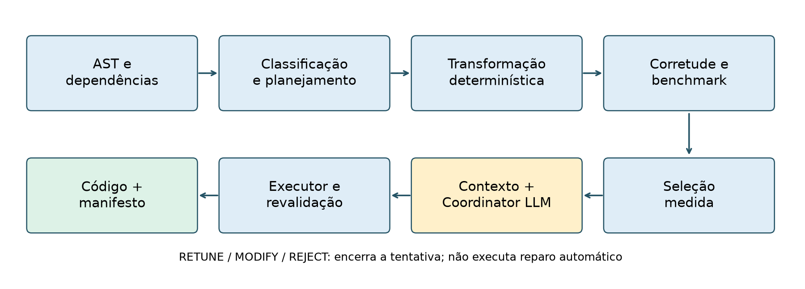

| Etapa | Responsabilidade | Implementação principal |
|---|---|---|
| Análise | Extrair estrutura e relações reconhecidas | `analysis/static_analyzer.py`, `dependence_analyzer.py` |
| Classificação e plano | Identificar padrão e transformação implementada | `pattern_classifier.py`, `strategy_planner.py` |
| Transformação | Revalidar contrato AST e aplicar redução escalar ou DOALL suportados | `analysis/conservative_transform.py`, `analysis/code_transformer.py` |
| Corretude | Compilar e comparar saída numérica nas threads solicitadas | `scripts/compile_correctness_gate.py` |
| Desempenho | Registrar tempos brutos e resumos | `scripts/performance_gate.py` |
| Seleção | Escolher configuração a partir de medições | `analysis/performance_selector.py` |
| Contexto e decisão | Agregar evidências e obter ação estruturada | `agents/context_builder.py`, `coordinator_agent.py` |
| Promoção | Conferir evidências, revalidar e publicar | `scripts/promote_candidate.py` |

A implementação do planejador adaptativo e as transformações específicas de
Nussinov são caminhos adicionais. Sua existência não significa que o runner de
fontes independentes execute automaticamente todo o projeto PolyBench.

### 3.2. Recorte de automação

| Caso | O que foi automatizado / avaliado |
|---|---|
| Dot Product C | Caminho integrado de redução escalar, gates, seleção, decisão e executor; inferência real e promoção concluídas no Mac em 03/11/2026 |
| Corpus controlado DOALL/REDUCTION | Extensão determinística para atribuição injetiva e redução local; campanha e denominadores próprios, sem nova inferência ou promoção LLM presumida |
| GEMM | Análises e campanhas de variante OpenMP manual |
| Jacobi-2D | Análises, variante OpenMP manual e experiências específicas com tiling |
| Covariance | Análises e campanha de variante OpenMP manual |
| Nussinov | Análises e transformações adaptativas específicas sobre base OpenMP existente; contratos legados nas campanhas |
| Wavefront sintético | Diagnóstico de baixo desempenho, variante tiled manual e autotuning |

A classificação de um padrão não comprova a geração automática de código para
esse padrão. O caso Wavefront registra uma trajetória experimental de diagnóstico,
modificação e autotuning; os artefatos não comprovam que a LLM executou esse
ciclo de forma autônoma.

### 3.3. Contrato de evidências

Os gates atuais preservam cópias dos arquivos explícitos de entrada e registram
hashes SHA-256 de fontes e executáveis, identidade do compilador, flags,
variáveis OpenMP, campanha e tempos individuais. A seleção é recalculada ao
carregar a evidência. O contexto inclui o código verificado e referências aos
relatórios. A decisão registra a identidade do contexto recebido.

O vínculo de hashes permite detectar a troca de um arquivo após a medição. Não
é uma assinatura de um produtor externo, nem prova que um relatório fabricado
fora do processo é verdadeiro. Também não captura integralmente bibliotecas,
headers de projeto ou todos os componentes de uma toolchain.

O Coordinator emite ACCEPT, RETUNE, MODIFY ou REJECT e uma próxima ação
compatível. RETUNE/MODIFY/REJECT encerram a tentativa do runner sem publicar um
artefato. ACCEPT não basta para promoção: o executor exige configuração medida,
ganho contra ambos os baselines e revalidação fresca de corretude. A publicação
é feita por staging e renomeação do diretório final, com código, manifesto e
evidências. Uma tentativa duplicada é recusada.

### 3.4. Entradas, saídas e limites de cada componente

O runner é um programa Python que chama outros programas e troca arquivos JSON.
Não há escalonamento concorrente entre agentes nesse caminho. O termo agente
designa um papel funcional, não uma instância independente de LLM. Apenas o
Coordinator consulta um modelo de linguagem; análise, transformação e gates
são determinísticos. Essa distinção determina o que cada resultado pode demonstrar.

| Componente e função | Entrada efetiva | Saída consumida pela etapa seguinte | Limite que importa à interpretação |
|---|---|---|---|
| Static Analyzer: `analyze`, `run_clang` | Fonte, diretórios de include e AST JSON do Clang | Funções kernel, laços, intervalos de linhas, leituras, escritas e atualizações escalares | Não é um compilador de otimização completo; depende do AST e das construções reconhecidas |
| Dependence Analyzer: `analyze_loop`, `compare_accesses` | Acessos extraídos do mesmo laço | Relações entre leitura/escrita do mesmo array e offsets reconhecidos | Não resolve aliasing arbitrário; compara candidatos leitura–escrita, sem prova geral de independência |
| Pattern Classifier: `classify_loop`, `classify_kernel` | Estrutura e relações de dependência | Família, evidências e rótulo heurístico de confiança | Reconhecer um padrão não demonstra que existe transformação implementada |
| Strategy Planner: `plan_kernel`, `plan_reduction` | Padrões, hierarquia e contrato AST local | Estratégia, alvo, variável, operador e autorização de transformação direta | O rótulo DOALL só autoriza o subconjunto certificado novamente; wavefront genérico continua fora do caminho |
| Code Transformer: `apply_strategy`, `transform_scalar_reduction` | Fonte atual e plano revalidado com AST fresco | Fonte com pragma e registro da transformação | Somente DOALL injetivo e redução escalar do contrato conservador; JSON não substitui pré-condições |
| Contrato local: `certify_kernel` | AST Clang e bytes atuais do arquivo do kernel | Suporte DOALL/REDUCTION ou recusa motivada | Whitelist sintática com pré-condições de uso, sem prova formal de C ou alias dinâmico |
| Correctness Gate: `run_gate`, `validate_numeric` | Original, candidato, driver e threads | Compilação, saídas finitas, tolerâncias e relatório v0.2 | Validação empírica do driver, sem equivalência formal ou detector de races |
| Performance Gate: `execute`, `parse_average_time` | Evidência de corretude e driver de benchmark | Amostras e relatório v0.1 ligado à corretude | Protocolo original de cinco amostras; distinto da nova coleta de quinze |
| Performance Selector: `select_configuration` | Tempos por configuração | Mais rápida, conjunto de quase empate e recomendação | Política determinística de 2%; não busca novo código ou configurações não medidas |
| Context Builder: `build_context` | Análises e evidências verificáveis | Contexto v0.3, bytes congelados e referências | Uma declaração PASS externa não substitui verificação da cadeia de evidências |
| Coordinator: `compact_context`, `call_ollama`, `validate_decision` | Prompt, schema e contexto | Decisão v0.2 e metadados da inferência | Não gera os kernels nem executa reparo; decisões inválidas são recusadas |
| Promotion Executor: `promote_candidate` | ACCEPT válido e evidências | Bundle, manifesto e revalidação | Só publica a configuração admissível e medida, após nova compilação e corretude |

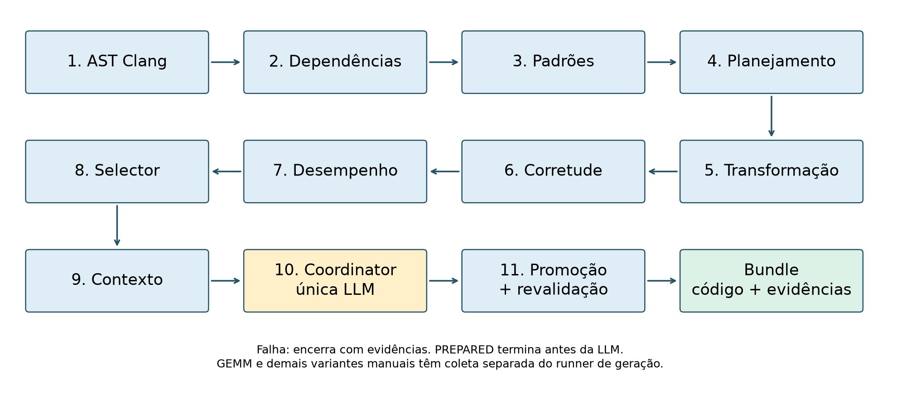

As setas da figura representam dependência entre artefatos e ordem do runner.
Falhas de compilação, ausência de evidência ou divergência de hash encerram a
tentativa. O modo `--prepare-only` termina antes da inferência e da promoção.
Na campanha multiplataforma, um harness de medição separado reutiliza os cinco
primeiros componentes para gerar Dot C e valida as variantes de todos os kernels.
Ele não apresenta seu arquivo experimental como um bundle promovido.

### 3.5. Algoritmos determinísticos e transformação suportada

Os pseudocódigos abaixo resumem funções existentes. Os nomes de arquivo e de
função permitem conferir o comportamento no repositório; os blocos não são
novos algoritmos implementados apenas para a redação.

Algoritmo 1 — extração estrutural e dependências (`static_analyzer.analyze` e
`dependence_analyzer.analyze_loop`).

```text
receber fonte e diretórios de include
executar Clang com AST em JSON e verificar seu retorno
encontrar funções cujo nome identifica um kernel
para cada kernel e laço reconhecido:
    registrar localização, iterador e hierarquia
    coletar leituras, escritas e atualizações escalares
    para cada escrita w e leitura r do mesmo array:
        comparar índices reconhecidos em w e r
        registrar relação e offsets, quando obtidos
gravar análises em arquivos distintos por fonte/variante
```

O comparador trata expressões simples de índice e distingue mesma localização,
acesso deslocado e relação simbólica. Uma lista vazia de dependências significa
que o procedimento não encontrou candidatos segundo suas regras; não é um
certificado universal de independência. Ponteiros que se sobrepõem, chamadas
externas e expressões não reconhecidas exigem cautela.

Algoritmo 2 — classificação e autorização (`classify_loop`, `classify_kernel`,
`plan_reduction` e `apply_strategy`).

```text
classificar laços a partir das evidências extraídas
    acessos deslocados sustentam candidato wavefront
    atualização escalar reconhecida sustenta candidato reduction
    demais regras identificam redução em array, stencil e doall
agregar as classificações no kernel e construir a hierarquia
produzir plano com laço, variável, operador e construção OpenMP
reanalisar os bytes atuais com Clang e reconstruir posições
exigir contrato standalone-ast-v2 compatível com a estratégia
se DOALL:
    exigir escrita Y[i] injetiva, expressão pura e contrato restrict
    inserir parallel for schedule(static)
senão se REDUCTION:
    exigir acumulador local double iniciado em zero, sem leitura no RHS
    conferir alvo, variável, operador, cláusula e schedule contra o AST
    inserir parallel for reduction(+:acumulador) schedule(static)
senão: recusar
gravar candidato e metadados da transformação
```

O contrato admite um único laço externo e uma instrução de atualização;
posições de JSONs antigos não comandam a inserção. O rótulo de confiança do
classificador é uma classificação heurística, não uma probabilidade calibrada.
GEMM não passa a ser transformado porque um laço foi chamado de DOALL: sua
composição aninhada está fora desse contrato.

O exemplo a seguir é a função sequencial real de
`analysis/fixtures/dot_product.c`, apenas compactada na apresentação:

```c
double kernel_dot(int n, const double *A, const double *B) {
    double sum = 0.0;
    for (int i = 0; i < n; i++) {
        sum += A[i] * B[i];
    }
    return sum;
}
```

O candidato gerado na campanha mantém a função e acrescenta a redução:

```c
double kernel_dot(int n, const double *A, const double *B) {
    double sum = 0.0;
    #pragma omp parallel for reduction(+:sum) schedule(static)
    for (int i = 0; i < n; i++) {
        sum += A[i] * B[i];
    }
    return sum;
}
```

A variável acumuladora é privada segundo a semântica de redução e seus valores
parciais são combinados ao final. A associação das operações pode mudar; por
isso, a validação floating-point usa tolerância explícita em vez de exigir a
mesma sequência de bits do sequencial. O resultado continua sujeito às entradas
e ao comportamento efetivamente testados. [OpenMP 5.2, reduction](https://www.openmp.org/spec-html/5.2/openmpsu52.html).

Um exemplo da segunda classe é a transformação de
`analysis/fixtures/publication_corpus/affine_vector.c`. Preservados os argumentos
e o corpo, o candidato insere a diretiva antes da atribuição independente:

```c
void kernel_case(int n, const double *restrict A,
                 const double *restrict B, double *restrict Y) {
    #pragma omp parallel for schedule(static)
    for (int i = 0; i < n; i++) {
        Y[i] = 2.0 * A[i] + B[i];
    }
}
```

Não há leitura de Y nem escrita compartilhada fora de Y[i]. O índice de saída
é injetivo no domínio das iterações. Essa justificativa depende do contrato
`restrict` e de extents válidos; não autoriza transpor automaticamente uma
recorrência in-place ou um algoritmo de múltiplas fases.

Algoritmo 3 — corretude e vínculo de evidências (`run_gate` e
`load_selection_evidence`).

```text
capturar original, candidato, driver e identidade do compilador
calcular SHA-256 e criar identidade exclusiva da campanha
compilar os snapshots sequencial e OpenMP
se houver erro de compilação ou execução: FAIL
obter escalar de referência e exigir valor finito
para cada configuração de threads solicitada:
    executar candidato e exigir escalar finito
    comparar com referência usando rtol=1e-9 e atol=1e-12
    se falhar: conservar o relatório e encerrar com FAIL
emitir PASS com fontes, executáveis, parâmetros e resultados
ao consumir a evidência: verificar hashes e a mesma campanha
```

O gate integrado testa o driver fornecido. A campanha principal compara as
saídas live-out instrumentadas em PolyBench; o corpus DOALL verifica cada
elemento antes de emitir o escalar consumido pelo gate. Nenhum desses caminhos
constitui prova formal. Protocolos e oráculos são descritos separadamente.

Algoritmo 4 — seleção de desempenho (`select_configuration`).

```text
localizar sequencial e OpenMP 1T da mesma variante
calcular speedup total por configuração medida
identificar configurações que superam o sequencial
se nenhuma superar: não recomendar candidato benéfico
localizar a menor mediana entre configurações benéficas
formar conjunto com tempo até 1,02 vezes a menor mediana
recomendar a configuração de menos threads nesse conjunto
registrar separadamente transformação e ganho paralelo
```

O Selector pode reconhecer benefício já em uma thread; isso é transformação,
não escalabilidade. O executor impõe condições adicionais: recomendação paralela
com pelo menos duas threads, ganho contra os dois baselines e evidências íntegras.
A mediana mais baixa e a recomendação são mantidas separadas nas tabelas.

### 3.6. Decisão da LLM e publicação controlada

`build_context` carrega a seleção e os gates ligados à mesma campanha, verifica
as referências e recupera os bytes congelados da fonte. Não toma uma string
PASS como prova suficiente. `compact_context` mantém código, padrão, plano,
dependências, validação, desempenho e restrições para construir o prompt.

Algoritmo 5 — decisão e promoção (`run_pipeline`, `validate_decision` e
`promote_candidate`).

```text
construir contexto a partir de evidências verificadas
se prepare_only: retornar PREPARED antes da LLM
consultar Ollama com prompt e schema estruturado
validar decisão, ação e configuração contra o contexto
se RETUNE, MODIFY ou REJECT:
    registrar decisão e encerrar sem publicar
se ACCEPT e PROMOTE_CANDIDATE:
    conferir identidades do contexto, candidato e campanha
    exigir configuração medida com ganho vs. sequencial e OpenMP 1T
    reservar destino exclusivo e criar staging
    recompilar e repetir corretude na configuração selecionada
    se houver falha ou alteração: recusar publicação
    arquivar código, evidências e manifesto
    publicar por renomeação atômica
```

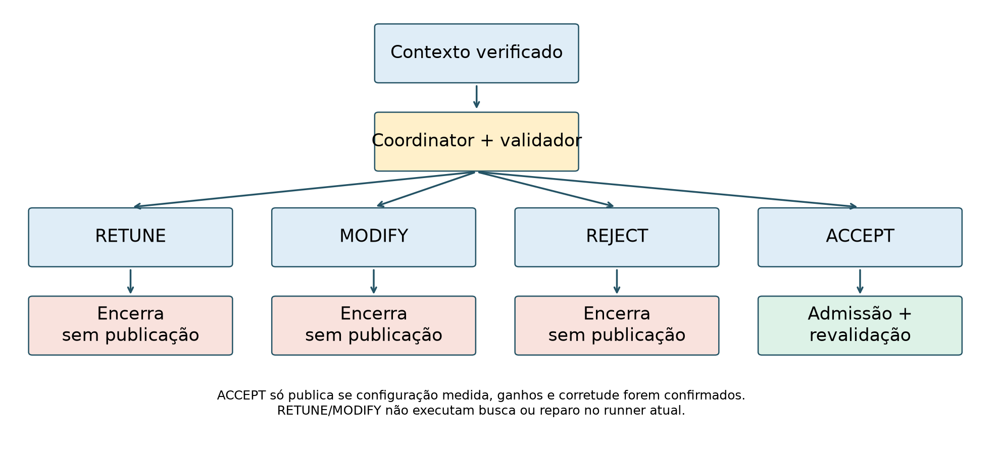

RETUNE e MODIFY expressam intenções na interface, mas o runner avaliado não
executa uma nova busca nem chama um codificador para reparar o candidato.
Na avaliação pareada, a recusa usa fallback sequencial; esse fallback é uma
regra do experimento, não um laço oculto de recuperação do runner. Os timeouts
e respostas inválidas são observações, não tentativas apagadas.

O manifesto da promoção registra a configuração medida, métricas e hashes.
SHA-256 permite detectar troca de bytes em relação aos registros; não é uma
assinatura externa nem garante honestidade de relatórios fabricados fora do
processo. A revalidação cobre a entrada do driver, não todos os programas C.
A promoção repete compilação e corretude; o desempenho provém da campanha
vinculada e não é medido novamente pelo Executor. Uma promoção não garante
que a mesma vantagem se repetirá em outra sessão ou entrada.

### 3.7. Algoritmos dos kernels e diferença entre paralelismos

No GEMM, cada linha de C pode ser calculada por uma thread. O excerto de
`kernels/gemm/manual_openmp.c` conserva a ordem i–k–j e o contrato
C ← αAB + βC:

```c
#pragma omp parallel for private(j, k) schedule(static)
for (i = 0; i < ni; i++) {
    for (j = 0; j < nj; j++) C[i][j] *= beta;
    for (k = 0; k < nk; k++)
        for (j = 0; j < nj; j++)
            C[i][j] += alpha * A[i][k] * B[k][j];
}
```

A partição por i evita que duas threads atualizem a mesma linha de C. O laço
j acessa posições contíguas, enquanto B é reutilizada. O programa avaliado é
uma implementação simples, sem atribuir-lhe a eficiência de uma BLAS otimizada.

Nussinov calcula uma tabela de programação dinâmica sobre intervalos da
sequência. A fonte original percorre linhas; a variante OpenMP manual usa
diagonais d=j−i. O pseudocódigo conserva a recorrência implementada:

```text
inicializar sequência sintética e tabela com zeros
criar uma região paralela persistente
para d = 1 até N-1, em todas as threads:
    distribuir i = 0 até N-d-1 com omp for schedule(static)
        j = i + d
        incorporar table[i][j-1] e table[i+1][j]
        incorporar table[i+1][j-1] e pareamento, se não adjacentes
        para k = i+1 até j-1:
            maximizar com table[i][k] + table[k+1][j]
    sincronizar antes de começar a próxima diagonal
```

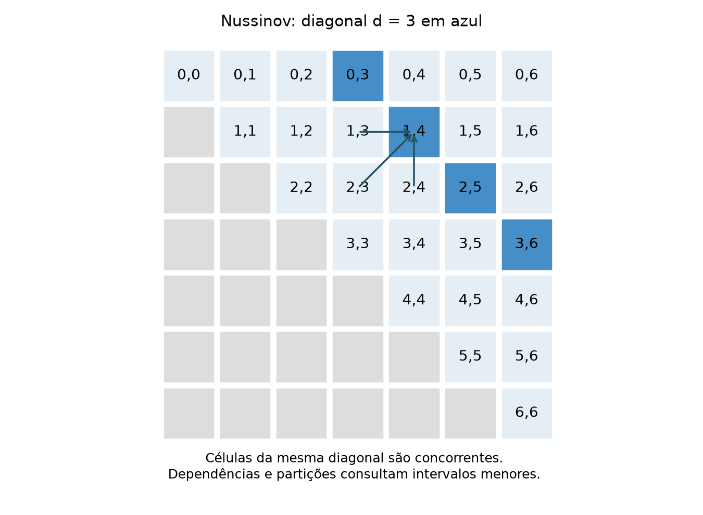

As células da mesma diagonal são concorrentes, mas consultam diagonais anteriores.
O fim do `omp for` precisa da barreira implícita. A largura disponível N−d diminui
ao longo do cálculo; a carga e os acessos a intervalos também mudam com d.
Isso difere do conjunto de linhas independentes de GEMM.
[OpenMP 5.2, worksharing-loop](https://www.openmp.org/spec-html/5.2/openmpse66.html).

A adaptação SIMD substitui atualizações repetidas do destino por um acumulador
local e uma redução de máximo no laço k. O trecho foi extraído da variante
automática específica existente, não escrito pela LLM:

```c
DATA_TYPE tcc2_best = table[i][j];
#pragma omp simd reduction(max:tcc2_best)
for (k = i + 1; k < j; k++) {
    DATA_TYPE tcc2_candidate = table[i][k] + table[k + 1][j];
    tcc2_best = max_score(tcc2_best, tcc2_candidate);
}
table[i][j] = tcc2_best;
```

Jacobi-2D atualiza dois arrays em passos de tempo. Os pontos de cada varredura
podem ser distribuídos, mas as fases e os passos precisam respeitar suas
dependências; não é correto paralelizar o eixo temporal sem outra transformação.
Covariance contém três fases: médias por coluna, centralização dos dados e
matriz de covariância. A versão manual usa barreiras entre fases e explora
paralelismo nos índices externos. O domínio triangular da covariância pode
desbalancear a distribuição estática de trabalho. Esses dois casos ampliam a
avaliação de desempenho; não ampliam a cobertura do transformador genérico.

### 3.8. Procedimento de apresentação institucional

Esta revisão preserva a base original e a versão de trabalho anterior. O corpo
é organizado em problema, fundamentação, implementação, metodologia, resultados,
discussão e conclusão, com pseudocódigos e exemplos conferíveis. A capa oficial
pública da Biblioteca PUCRS foi preservada e uma cópia preenchida é gerada com
autor, escola, curso, título, cidade e ano. Os campos não fornecidos, como nome
de orientador e composição da banca, não foram inventados.

O corpo de revisão utiliza A4, margens superior/esquerda de 3 cm e
inferior/direita de 2 cm, fonte de texto de 12 pontos e entrelinhas de 1,5.
Essas opções melhoram a apresentação, mas não equivalem à certificação de
aderência integral ao modelo institucional atual, cujo acesso é autenticado.
A paginação e a integração final da capa exigem conferência no aplicativo de
edição utilizado na entrega. [Biblioteca PUCRS, modelo e acesso](https://biblioteca.pucrs.br/apoio-a-pesquisa/modelos-de-normas-tecnicas-de-documentacao/trabalhos-academicos-abnt/),
[capa de graduação](https://biblioteca.pucrs.br/apoio-a-pesquisa/capas-padrao-pucrs/capa-para-tcc/).


### 3.9. Contrato conservador da extensão DOALL e redução

`analysis/conservative_transform.py` verifica a estrutura atual de uma única
função `kernel_*`. Aceita o laço `for (int i = 0/1; i < n; i++)`, com limite
parâmetro `int` distinto do iterador e uma atualização no corpo. DOALL exige
retorno `void`, escrita `Y[i]`, entradas somente lidas `const double *restrict`,
saída `double *restrict` e nenhuma leitura de Y. Índices de entrada podem ser
i ou i mais/menos constante de até 16. A redução exige acumulador local
`double` iniciado em zero, atualização `+=` sem leitura do acumulador no lado
direito e retorno desse acumulador.

Chamadas, casts explícitos, escritas aninhadas, scatter, in-place, múltiplas
instruções, laços aninhados, saídas antecipadas e nós desconhecidos são recusados.
O filtro também exclui atributos com semântica não interpretada, definições em
headers, pragmas e pré-processamento no arquivo do kernel. Ele recusa os tokens
`#`, `%:`, `??`, `_Pragma` e barra invertida mesmo em comentários/strings, para
evitar um segundo pré-processador incompleto. São restrições de suporte; recusar
um programa não prova que ele possui dependência ou é impossível de paralelizar.

O contrato `standalone-ast-v2` é reconstruído antes da inserção. Clang deve
identificar o mesmo kernel e o offset deve apontar para `for`. Os bytes são
decodificados preservando CRLF e as linhas de inserção são separadas somente
por LF, evitando deslocamento por VT/FF. Uma análise JSON editada ou uma posição
antiga não autoriza a transformação. A
[revisão técnica](../publication/TRANSFORM_REVIEW.md) registra os contraexemplos
que motivaram essas restrições; não constitui certificação formal.

`restrict` é uma obrigação do chamador segundo C, não uma detecção dinâmica de
alias. Buffers, extents e índices precisam ser válidos, sem comportamento
indefinido. Reordenação de soma pode alterar arredondamento e valores parciais;
resultados finitos e tolerância são testados nas entradas do estudo, sem garantia
para todas as combinações de magnitudes ou cancelamentos. Drivers separados
podem incluir headers, alocação e instrumentação sem ampliar o subconjunto do
arquivo transformado.

## 4. Metodologia

As subseções 4.1–4.4 descrevem o acervo e os protocolos anteriores. A coleta
exploratória de sete amostras é descrita em 4.5. O protocolo principal de
três aquecimentos e quinze medições externas está em 4.6, com os ambientes
comparados em 4.7. As extensões desta revisão são o corpus de transformação
(4.8), as sessões de repetibilidade (4.9) e a conformidade diagnóstica (4.10).
Os conjuntos são analisados separadamente; implementação de protocolo, teste
técnico e resultado experimental concluído são estados distintos.

### 4.1. Acervo anterior, unidades e proveniência

São separados três conjuntos de evidências. O primeiro contém 17 campanhas
históricas recuperadas de CSVs, logs e dumps, sem o contrato atual completo de
vínculo ao código medido. O segundo contém duas coletas Linux cujo resumo foi
preservado, mas cujos contextos originais não estão neste checkout. O terceiro
contém três campanhas finais de Dot Product verificadas pelos gates no Mac
em 03/11. A consolidação totaliza 22 campanhas e 173 configurações, com 545 tempos
individuais recuperados.

Os 35 CSVs históricos foram inventariados sem alteração, junto a nove CSVs das
campanhas finais. Oito históricos apresentam linhas
incompatíveis com o cabeçalho; vários acumulam mais de uma execução. A matriz
usa fontes selecionadas explicitamente, conferindo resumos com amostras quando
disponíveis. Não se unem amostras de máquinas ou campanhas diferentes para
aumentar artificialmente o tamanho da amostra.

### 4.2. Corretude e compilação

No caminho independente, a corretude compara o resultado escalar do candidato
ao sequencial com tolerâncias relativa de 1e-9 e absoluta de 1e-12. O driver
determinístico de validação utiliza N=1.000.000. São verificadas as threads que
serão medidas. Esse driver é distinto do driver de benchmark; portanto, o PASS
não deve ser descrito como teste de todas as entradas temporizadas.

Nos casos legados PolyBench, há validações por comparação de dumps da
compilação de validação e campanhas de desempenho com instrumentação de tempo.
Esses resultados têm cobertura e registro diferentes dos gates novos. O runner
atual não inclui um detector de races nem estabelece equivalência formal.

Na campanha local foram usados GCC 13.3.0 para compilação e Clang para análise
AST, em Linux x86_64 com Xeon E3-1225 V2 e quatro núcleos. Os flags de desempenho
são -O3 para sequencial e -O3 -fopenmp para o candidato. O ambiente registra
OMP_DYNAMIC=FALSE, OMP_PROC_BIND=TRUE e OMP_PLACES=cores. As campanhas históricas
do Mac usam o ambiente Apple M5 registrado em setembro, com as lacunas
específicas indicadas no catálogo.

### 4.3. Desempenho e estatística descritiva

O benchmark local possui dois tamanhos: N=10.000.000, com 100 chamadas internas,
e N=1.024, com 10.000 chamadas internas. Cada configuração tem cinco medições
externas; o tempo por chamada é reportado pelo driver. A medida principal é a
mediana dessas cinco observações, mantendo média, mínimo, máximo e desvio
padrão populacional para inspeção.

Se T_seq é o tempo mediano do sequencial, T_1 o tempo da variante OpenMP com uma
thread e T_p o tempo dessa mesma variante com p threads, calculam-se:

- Ganho contra o sequencial: S_total = T_seq / T_p.
- Ganho da transformação: S_transf = T_seq / T_1.
- Escalabilidade paralela: S_par = T_1 / T_p.
- Eficiência paralela: E_par = S_par / p.
- Decomposição: S_total = S_transf × S_par.

No autotuning tiled, T_1 deve corresponder ao mesmo tamanho de bloco da
configuração avaliada. O melhor bloco em uma thread pode ser diferente daquele
selecionado em várias threads. Usar blocos distintos no quociente mistura os
efeitos e não representa escalabilidade da mesma variante.

O Selector considera quase empates de até 2% e pode recomendar menos threads
que a configuração de menor mediana. Os gráficos históricos e exploratórios
mostram razões de medianas e sua dispersão disponível, sem criar ICs ausentes.
A campanha principal de quinze observações usa o bootstrap pareado descrito
em 4.6. Seus intervalos são condicionais à coleta e não justificam
generalização estatística entre plataformas.

### 4.4. Avaliação do Coordinator

O estudo pareado compara a política determinística, o Coordinator completo e
o Coordinator com análises estruturadas retiradas do prompt. Os três modos
recebem o mesmo candidato e as mesmas medições. A ablação preserva os gates e
o contexto canônico de validação; o script verifica se o prompt mudou.

A ordem dos modos é embaralhada com semente 2026. O protocolo prevê três
repetições de decisão por caso, temperatura zero e timeout explícito. Uma
repetição da LLM não representa uma nova observação independente do tempo do
kernel. Cada tentativa considera um candidato e, nos modos LLM, uma chamada;
não há recuperação automática de novas variantes.

Registram-se decisões brutas e enriquecidas, erros, timeouts, concordância
binária com a política, aceitação efetiva, propostas inadmissíveis, oportunidades
elegíveis não aceitas, latência e tokens disponíveis. Concordância não é uma
verdade independente sobre a melhor ação textual. Falhas permanecem no
denominador. Custo monetário não é estimado sem dados.

O resultado admitido usa a configuração paralela elegível; recusa ou falha usa
o sequencial como fallback definido para a avaliação. O tempo contabilizado soma
o prefixo determinístico compartilhado ao custo de decisão/validação, sem
representar nova execução independente do pipeline e sem incluir publicação.

### 4.5. Coleta complementar Linux e comparação multiplataforma

Em 05/11/2026 foi iniciada uma coleta complementar de escalabilidade no Xeon
E3-1225 V2, com quatro núcleos físicos, Linux x86_64, Clang 18.1.3 e runtime
OpenMP identificado nas saídas de vinculação. O governor observado foi
`schedutil`; não houve fixação de frequência, isolamento exclusivo da máquina
ou controle térmico. Não se executaram testes nem inferências junto à campanha.
Usaram-se 1, 2, 3 e 4 threads, `-O3`, sem `-march=native` ou `-ffast-math`.

Foram selecionados Dot Product C++ com N=1.000.000 e 10.000.000, GEMM double
com dimensões 200×220×240 e 1000×1100×1200, e Nussinov int com N=500 e 2500.
As variantes preexistentes são manual no Dot/GEMM e manual, SIMD manual e
SIMD automaticamente adaptada no Nussinov. Não houve inferência nem nova
otimização manual dos kernels nessa campanha.

Cada configuração utiliza sete processos de medição e um processo prévio de
aquecimento. A ordem é embaralhada em blocos completos, com semente 2026,
preservando amostras individuais. O Dot C++ temporiza uma única chamada:
a inicialização do runtime OpenMP pode estar incluída. Aquecimento em outro
processo não conserva a equipe de workers. Portanto, esse Dot não substitui
o experimento C do pipeline com 100 chamadas internas. PolyBench conserva
seu flush de cache padrão antes de iniciar o timer. Os tempos excluem alocação,
inicialização dos arrays, compilação e inferência.
O flush OpenMP do utilitário PolyBench já cria a equipe antes do cronômetro de
GEMM/Nussinov, diferentemente do Dot C++. O timer PolyBench usa `gettimeofday`
com saída de seis casas decimais; manteve-se essa instrumentação preexistente.

A validação cobre cada combinação de entrada, variante e threads. Dot compara
o escalar com a fórmula esperada; GEMM compara todos os elementos impressos
com 17 dígitos significativos, em vez das duas casas decimais históricas;
Nussinov compara o dump inteiro exato. Os executáveis de dump e tempo são
separados e compilados com a mesma otimização. Os arquivos originais são
preservados; a mudança de precisão ocorre no header copiado da campanha.
Fontes, headers, utilitário PolyBench, comandos, bibliotecas, executáveis e
saídas são arquivados com SHA-256. Essa coleta possui protocolo próprio e não
autoriza promoção pelo contrato de fontes independentes do pipeline.

As figuras exibem mediana e amplitude mínimo–máximo, sem intervalos de
confiança ou alegação de significância. Os CSVs novos também registram desvio
padrão amostral; a consolidação histórica usa desvio padrão populacional.
A campanha nova equivalente no M5
está preparada, mas não foi medida nesta máquina Linux. Dados históricos são
contexto, sem permitir atribuir causalmente diferenças à arquitetura.
Esta coleta amplia a avaliação de R2, sem ampliar a amostra de decisões LLM de R3.

### 4.6. Protocolo principal multiplataforma de quinze medições

A coleta principal de 05/11 adota três execuções externas de aquecimento por
configuração, seguidas de quinze medições externas. Linux mede sequencial e
OpenMP 1T, 2T e 4T. O script M5 mantém códigos, entradas e critérios e acrescenta
6T, 8T e 10T; o trecho de comparação direta será 1T/2T/4T. Resultados da nova
campanha M5 só serão acrescentados após execução real.

| Caso compilado | Entrada menor | Entrada maior | Chamadas por processo |
|---|---|---|---:|
| Dot C automático | N=1024 | N=10.000.000 | 10.000 / 100 |
| Dot C++ manual | N=1.000.000 | N=10.000.000 | 1 |
| GEMM | NI=200, NJ=220, NK=240 | NI=1000, NJ=1100, NK=1200 | 1 |
| Nussinov | N=500 | N=2500 | 1 |
| Jacobi-2D | N=250, TSTEPS=100 | N=1300, TSTEPS=500 | 1 |
| Covariance | N=260, M=240 | N=1400, M=1200 | 1 |

São cinco algoritmos e seis casos compilados, pois Dot possui dois drivers
explicitamente separados. Nussinov inclui manual, SIMD manual e adaptação SIMD
específica preexistente. A matriz Linux contém 60 configurações e prevê 900
amostras externas e 180 execuções de aquecimento; o baseline de Nussinov é
compartilhado, sem duplicação de observações.

Algoritmo 6 — coleta de `benchmark_scaling.execute`, acionada pelo wrapper
`benchmark_multiplatform.py`.

```text
reservar diretório exclusivo e registrar ambiente/Git/toolchain
compilar probe e conferir tamanhos reais das equipes OpenMP
gerar Dot C com os componentes determinísticos do projeto
para cada caso e entrada:
    congelar fontes, headers, driver e parâmetros efetivos
    compilar original e variantes OpenMP com a mesma otimização
    validar cada configuração contra referência/resultado esperado
    para cada um dos três blocos de aquecimento:
        embaralhar configurações e executar uma vez cada
    para cada um dos quinze blocos medidos:
        embaralhar configurações com o mesmo PRNG de seed 2026
        executar cada configuração e registrar stdout/stderr/retorno
        conferir resultado numérico do Dot e tempo finito positivo
        preservar observação e identidade do comando em JSONL
conferir fontes e executáveis por SHA-256 e emitir CSVs
em falha, conservar evidências e estado FAILED, sem nova tentativa oculta
```

Dot C é gerado e medido nesta campanha; não se reaproveitam os cinco tempos do
Performance Gate original para completar quinze observações. Seu driver usa
valores periódicos dependentes de i, enquanto o C++ usa dois vetores constantes.
Mesmo quando N coincide, as duas execuções não isolam o efeito da linguagem ou
da transformação. A identidade da fonte e do driver acompanha cada caso.

A ordem é aleatória reprodutível dentro de blocos completos. O gerador de seed
2026 também é usado nos aquecimentos antes das medições. Os registros permitem
reconstruir a ordem efetiva. A medição de um kernel não ocorre junto de testes,
renderização de figuras ou inferência iniciados nesta avaliação. A máquina não
foi reservada exclusivamente, e serviços externos não são controlados.

São registrados média, mediana, desvio padrão amostral, mínimo, máximo, MAD sem
fator de escala, Q1, Q3 e IQR. Os quartis usam interpolação linear inclusiva nas
posições (n−1)q. Nenhuma amostra é excluída como outlier. Para n≥15, intervalos
de 95% usam bootstrap percentil com 5.000 réplicas e seed 2026. Reamostram-se
blocos completos: original, OpenMP 1T e p usam os mesmos índices de repetição,
recalculando medianas e razões em cada réplica. O bloco é uma rodada do desenho
pareado; não se utiliza moving-block bootstrap de rodadas temporais contíguas.
A ideia de reamostragem da distribuição empírica é apresentada por
[Efron (1979)](https://sites.stat.washington.edu/courses/stat527/s13/readings/ann_stat1979.pdf).

Os limites são os percentis 2,5 e 97,5. Eles descrevem a incerteza condicional à
campanha observada; não comprovam estacionariedade, independência temporal,
superioridade causal de arquitetura ou ótimo global de threads. Não se aplicou
correção de comparações múltiplas. A escolha posterior da menor mediana pode
favorecer uma observação de sorte; a recomendação determinística é uma decisão
operacional e não um teste estatístico de superioridade.

A corretude PolyBench compara dumps das saídas live-out instrumentadas,
com 17 dígitos nos casos double e inteiros exatos em Nussinov, em executáveis
separados dos temporizados. Em Jacobi-2D, o benchmark imprime A; a comparação
não verifica separadamente B nem os estados intermediários. Fontes
originais não são alteradas. Relógios e regimes de primeira chamada são os
preexistentes, explicitados no protocolo. Código, comandos, entradas, logs,
amostras, métodos estatísticos e figuras ficam em diretórios próprios.

### 4.7. Ambientes Linux e Apple M5

| Característica | Linux da nova campanha | M5 do acervo histórico |
|---|---|---|
| Processador | Intel Xeon E3-1225 V2 | Apple M5, Mac17,2 |
| Arquitetura | x86-64 | ARM64 |
| Núcleos registrados | 4 físicos e 4 lógicos | 10, sendo 4 de desempenho e 6 de eficiência |
| Memória | 19,47 GiB reportados pelo Linux, estado em environment.json | 16 GB registrados em 03/11 |
| Compilador | Clang 18.1.3 | LLVM Homebrew 23.1.1 registrado em 03/11 |
| Frequência/energia | Governor schedutil; frequência não fixada | Estado atual deve ser registrado na nova coleta |
| Threads da nova receita | 1, 2 e 4 | 1, 2, 4, 6, 8 e 10 |

A coluna M5 descreve o acervo, não uma observação feita nesta execução Linux.
O novo script registra novamente modelo, sistema, compilador, contagens de
núcleos e energia. O valor histórico não é copiado como metadado de uma
campanha futura. No Linux, caminho/hash dos compiladores, afinidade disponível,
versões, macros de entrada e bibliotecas dinâmicas acompanham os registros.

A seleção de mais threads no M5 pode refletir maior capacidade disponível,
mas também diferentes classes de núcleo, runtime, compilador e subsistema de
memória. No wavefront, barreiras e redução de largura podem tornar novas threads
mais caras que úteis. Em GEMM, a quantidade de trabalho por linha e a localidade
são diferentes. Em Dot, movimento de dados e custos de entrada na região
paralela podem dominar. Essas são hipóteses apoiadas na estrutura dos códigos,
não causas isoladas por contadores ou intervenções neste experimento.

O comparador das duas campanhas novas exige a mesma identidade de fontes,
headers, drivers, dimensões e protocolo, e mantém curvas separadas por plataforma.
Diferenças incompatíveis impedem o gráfico conjunto. Mesmo quando esses critérios
forem satisfeitos, a comparação será entre plataformas completas; não um teste
que varia apenas quantidade de núcleos ou ISA.

### 4.8. Corpus controlado e comparação com autoparalelização GCC

O [catálogo](../../analysis/fixtures/publication_corpus/catalog.json) contém
28 fontes C autorais: 14 com suporte esperado e 14 recusas esperadas pelo
contrato. São oito DOALL e seis reduções positivas. A partição registra oito
fontes de desenvolvimento e vinte de teste, com quatro/dez positivas em cada
grupo. Ambas foram escritas e verificadas pelos autores do estudo; a partição
organiza a análise, sem constituir amostra externa intocada ou teste cego de
generalização. Não houve treinamento de modelo nesses arquivos.

As operações incluem mapas aritméticos, filtros, stencil somente de leitura
com saída distinta e reduções de soma, quadrados, norma e contagem. Negativos
exercitam dependências, alias não resolvido e limites deliberados, como stride
ou chamadas fora do subconjunto. A verdade esperada é conformidade à
especificação de suporte, não um rótulo universal de paralelizabilidade.
Uma fonte é contada uma vez, independentemente de entrada, thread ou repetição.

As 14 positivas usam N=1.024 e N=1.000.000. O coletor compila todas as fontes
originais e executa os pares positivos no sequencial e candidato 1/2/4T.
Candidato produzido para recusa esperada nunca é executado. O driver DOALL
compara cada posição contra uma fórmula da operação antes de emitir checksum;
a redução usa soma de termos em `long double`. As tolerâncias são relativas
1e-9 e absolutas 1e-12, com rejeição de não finitos. A fórmula é uma especificação
autoral, não um oráculo externo independente. Cada execução temporizada também
valida sua saída depois do intervalo medido.

O coletor 1.1 usa A[i]=((i%23)−11)/8, entre −1,375 e 1,375, e
B[i]=(((i*7)%19)−9)/32. As duas entradas cobrem os ramos negativo, interno e
superior a um de `clamp`. O preflight A/16 anterior não cobria o último ramo
e foi preservado fora desta campanha científica.

No contraste de desempenho, o mesmo executável GCC 13.3.0 é usado nos três braços:

| Braço | Fonte do objeto do kernel | Flags específicas |
|---|---|---|
| Original | Sequencial | `-O3` |
| Pipeline | C gerado por regras DOALL/redução | `-O3 -fopenmp` |
| GCC autopar | Mesmo sequencial | `-O3 -ftree-parallelize-loops=p -fopt-info-loop-optimized` |

O driver é um objeto comum compilado somente a `-O3`. Inicialização e validação
não são autoparalelizadas para aquecer workers apenas num braço. Não se usa
LTO ou `-ffast-math`. A documentação GCC descreve
[`-ftree-parallelize-loops`](https://gcc.gnu.org/onlinedocs/gcc-13.4.0/gcc/Optimize-Options.html);
sua presença não prova que o compilador ativou p workers. São preservados os
diagnósticos reais. Cada p do braço GCC é compilado separadamente, de modo que
T1/Tp compara configurações dessa família e não só o ambiente de um binário.

As reduções OpenMP permitem reassociação que o GCC sem essas concessões pode
recusar. Relatar DOALL e redução separadamente impede interpretar uma diferença
semântica como superioridade de análise. O estudo mede desempenho das 14 fontes
positivas; não mede a cobertura GCC nas 14 recusas. Nenhum dos três braços usa
LLM. Esse contraste local não substitui reprodução de OMPar, P4OMP ou RepoOMP.

A campanha concluída contém 196 configurações: 14 fontes × duas entradas × sete configurações
(sequencial e 1/2/4T nos dois candidatos), com quinze amostras externas e três
aquecimentos. Foram registrados 2.940 processos medidos e 588 aquecimentos,
separados das 900 observações da campanha principal Clang. `CLOCK_MONOTONIC` abrange 1.000 chamadas internas no pequeno e vinte
no grande, incluindo a primeira inicialização OpenMP. A média por processo
constitui uma observação; n externo permanece quinze. As rodadas completas
são embaralhadas com seed 2026, e as estatísticas/ICs seguem o pareamento de 4.6.
Fontes, ASTs, planos, candidatos, comandos, drivers, logs, gates e binários ficam
em arquivo próprio, verificado por SHA-256. A especificação integral está em
[AUTOMATION_CORPUS.md](../publication/AUTOMATION_CORPUS.md).

### 4.9. Sessões adicionais de repetibilidade Linux

O [protocolo de repetibilidade](../publication/REPEATABILITY_PROTOCOL.md) fixa
uma nova sessão completa equivalente à principal e uma terceira sessão que
prioriza MEDIUM de PolyBench e os dois tamanhos de ambos os Dot. O conjunto
comum às três não inclui LARGE de PolyBench; entradas grandes têm duas sessões
planejadas nesta etapa. As sessões usam cópia congelada em `b9e252d`, mantendo
o código da campanha original: não medem a extensão `standalone-ast-v2`.

Cada sessão tem diretório, ambiente e amostras próprios, com três aquecimentos,
quinze observações, 1/2/4T e seed 2026. As execuções ocorrem em sequência e sem
testes ou inferências iniciados por esta avaliação simultaneamente. Todas as
atividades do host não são isoladas. São sessões na mesma máquina e dia, sem
alegação de independência, controle térmico ou repetição em dias distintos.

`scripts/compare_sessions.py` exige identidade de fonte, compilador e flags
nas configurações comuns. Compara medianas e recomendações por sessão, sem
juntar tempos brutos num n artificialmente maior. O CV, quando apresentado,
é `100 × DP_amostral / média`; mede dispersão da unidade explicitada, não prova
estabilidade. Poucas sessões não estimam um IC populacional entre sessões.
Nenhuma sessão será excluída por produzir um resultado desfavorável.

### 4.10. Conformidade diagnóstica, evidências e custo

O estudo de R4 é offline e possui schema separado do Coordinator de produção.
Avalia uma causa, uma ação aceitável, abstinência e até cinco claims factuais;
nenhuma ação é executada. `MEASURED_GAIN` não autoriza promoção. O baseline
`rules` implementa a própria rubrica: sua concordância é consequência da
definição, servindo a consistência técnica. A LLM não pode superar esse baseline
na métrica de conformidade. Não se promete uma avaliação de utilidade contra
diagnósticos independentes ou de reparo.

O catálogo v1 congela 24 vistas sobre cinco famílias, com snapshots e SHA-256.
Não são 24 programas independentes nem falhas espontâneas. Desenvolvimento
reúne doze vistas Dot/Nussinov; heldout reúne doze vistas GEMM/Jacobi/Covariance,
mantendo a família inteira numa partição. A rubrica é autoral, sem anotação
humana independente. Fontes públicas podem ter sido vistas no treinamento;
heldout significa separação por família para este ensaio, não ausência dessa
contaminação ou validação externa.

As origens incluem extrações de medidas e diagnósticos arquivados, anotação da
fonte, omissões/sondas controladas e falhas efetivamente executadas. Estas últimas
incluem três compilações com opção/header inválido e duas mutações de Dot;
comandos e saídas foram preservados. A anotação das duas fases temporais de
Jacobi não é atribuída ao analisador antigo, que não detectava essa relação.
Pedir uma versão incompatível ao contrato é uma sonda, não uma falha histórica
da produção. Origens são reportadas separadamente para evitar confundir
construções experimentais com incidência em uso real.

O prompt recebe `observations` e `analysis` com IDs neutros de fatos. Não recebe
caso, split, origem, gabarito, recomendação do Selector ou evento dominante.
Resultados e mensagens permanecem visíveis como dados. Os braços são regras,
Coordinator completo e Coordinator sem análises. A ablação muda oito dos 24
prompts, somente dois no heldout; nos demais, as entradas são idênticas.
Agregados do subconjunto efetivo são necessários, e retirar análise muda
simultaneamente conteúdo e comprimento do prompt.

O [plano fixado antes de heldout](../publication/DIAGNOSTIC_RUN_PLAN.json)
prevê `qwen2.5:3b` e `llama3.1:8b`, doze vistas heldout, uma repetição por braço,
temperatura zero, seed 2026, `num_ctx=4096`, `num_predict=384` e timeout 180 s.
São 36 slots por modelo, sendo doze regras e até 24 chamadas LLM. Nome não
substitui ID do modelo: versões, parâmetros e metadados Ollama serão reportados
do servidor efetivamente observado. O preflight em d01 de desenvolvimento é
conservado e excluído da avaliação heldout. A versão de scoring 1.1 foi fixada
antes de heldout; o preflight retém a versão anterior.

Slots caso × repetição × braço são embaralhados. Cada tentativa tem uma chamada,
sem retry. Timeout encerra chamadas daquele modelo na campanha e deixa slots
LLM restantes `NOT_RUN`; regras podem continuar. Isso evita uma requisição nova
enquanto o servidor ainda pode gerar após desconexão. Falhas e não executados
ficam no denominador planejado; relatório também separa tentados, chamadas
reais e medianas de latência somente das tentativas realizadas.

Mede-se validade de schema, causa/ação conforme rubrica, propostas perigosas
conhecidas, abstinência, presença e suporte de claims, latência e tokens
observados. Suporte exige igualdade de ID, campo e valor visíveis naquele braço;
números JSON como 15/15.0 são equivalentes, mas booleanos e strings são distintos.
Ausência de claims não demonstra fundamentação. O verificador não julga a
semântica causal de frases, portanto “claims sem suporte” não equivale a uma
taxa geral de alucinação. Opções perigosas explícitas no schema são uma sonda;
sua incidência não estima comportamento espontâneo de produção. Prompts,
respostas HTTP, erros, opções e metadados são preservados. O protocolo completo
está em [DIAGNOSTIC_PROTOCOL.md](../publication/DIAGNOSTIC_PROTOCOL.md).

## 5. Resultados disponíveis

A campanha principal é apresentada primeiro. Cobertura de transformação,
repetibilidade e diagnóstico têm espaços identificados para seus relatórios
próprios; contagens planejadas não são resultados. O estudo anterior do
Coordinator e a execução Mac preservam sua identidade histórica. As coletas
exploratórias e comparações contextuais foram deslocadas para o Apêndice A.

### 5.1. Campanha principal Linux: três aquecimentos e quinze medições

A nova campanha concluiu 60 configurações, 900 amostras externas, 180 aquecimentos e 60 validações aprovadas. As observações pertencem aos cinco algoritmos e seis casos compilados descritos na metodologia. Nenhum tempo anterior foi usado para preencher essa contagem.

| Caso | Entrada | Variante | Recomendação | Tp (s) | S total | S paralelo | E paralela |
|---|---|---|---:|---:|---:|---:|---:|
| dot-auto | 1024 | automatic | sequencial | 8.78806e-07 | 1 | — | — |
| dot-auto | 10000000 | automatic | 2T | 0.00864162 | 1.25361 | 1.27581 | 0.637905 |
| dot | 1000000 | manual | sequencial | 0.0013915 | 1 | — | — |
| dot | 10000000 | manual | 2T | 0.0107116 | 1.04356 | 1.23881 | 0.619404 |
| gemm | LARGE | manual | 4T | 0.221314 | 2.84511 | 2.85401 | 0.713502 |
| gemm | MEDIUM | manual | 4T | 0.000967 | 3.81489 | 3.97828 | 0.994571 |
| nussinov | LARGE | manual | 4T | 5.44933 | 3.19496 | 3.20409 | 0.801022 |
| nussinov | LARGE | simd_auto | 4T | 5.88327 | 2.95931 | 3.09117 | 0.772792 |
| nussinov | LARGE | simd_manual | 4T | 5.85374 | 2.97424 | 3.1101 | 0.777524 |
| nussinov | MEDIUM | manual | 4T | 0.007798 | 2.70441 | 3.47794 | 0.869486 |
| nussinov | MEDIUM | simd_auto | 4T | 0.005443 | 3.87452 | 3.41191 | 0.852976 |
| nussinov | MEDIUM | simd_manual | 4T | 0.005448 | 3.87096 | 3.41153 | 0.852882 |
| jacobi-2d | LARGE | manual | 2T | 2.19022 | 1.17673 | 1.18168 | 0.590838 |
| jacobi-2d | MEDIUM | manual | 4T | 0.00283 | 3.60813 | 3.65265 | 0.913163 |
| covariance | LARGE | manual | 4T | 5.60143 | 2.19285 | 2.18317 | 0.545792 |
| covariance | MEDIUM | manual | 4T | 0.004922 | 2.17148 | 2.26249 | 0.565624 |

| Caso / entrada / variante | Menor mediana OpenMP | Recomendação | Estado |
|---|---:|---:|---|
| dot-auto / 1024 / automatic | 1T; 1.75612e-06 s | sequencial | NO_BENEFICIAL_CONFIGURATION |
| dot-auto / 10000000 / automatic | 4T; 0.00863066 s | 2T | SELECTED |
| dot / 1000000 / manual | 2T; 0.00285288 s | sequencial | NO_BENEFICIAL_CONFIGURATION |
| dot / 10000000 / manual | 4T; 0.0105092 s | 2T | SELECTED |
| gemm / LARGE / manual | 4T; 0.221314 s | 4T | SELECTED |
| gemm / MEDIUM / manual | 4T; 0.000967 s | 4T | SELECTED |
| nussinov / LARGE / manual | 4T; 5.44933 s | 4T | SELECTED |
| nussinov / LARGE / simd_auto | 4T; 5.88327 s | 4T | SELECTED |
| nussinov / LARGE / simd_manual | 4T; 5.85374 s | 4T | SELECTED |
| nussinov / MEDIUM / manual | 4T; 0.007798 s | 4T | SELECTED |
| nussinov / MEDIUM / simd_auto | 4T; 0.005443 s | 4T | SELECTED |
| nussinov / MEDIUM / simd_manual | 4T; 0.005448 s | 4T | SELECTED |
| jacobi-2d / LARGE / manual | 2T; 2.19022 s | 2T | SELECTED |
| jacobi-2d / MEDIUM / manual | 4T; 0.00283 s | 4T | SELECTED |
| covariance / LARGE / manual | 4T; 5.60143 s | 4T | SELECTED |
| covariance / MEDIUM / manual | 4T; 0.004922 s | 4T | SELECTED |

Os valores são arredondados para apresentação; amostras e resumos completos permanecem nos CSVs. A menor mediana OpenMP pode perder para o sequencial e pode diferir da recomendação por quase empate. Os gráficos usam o mesmo baseline 1T da variante e entrada, com ICs bootstrap condicionais.

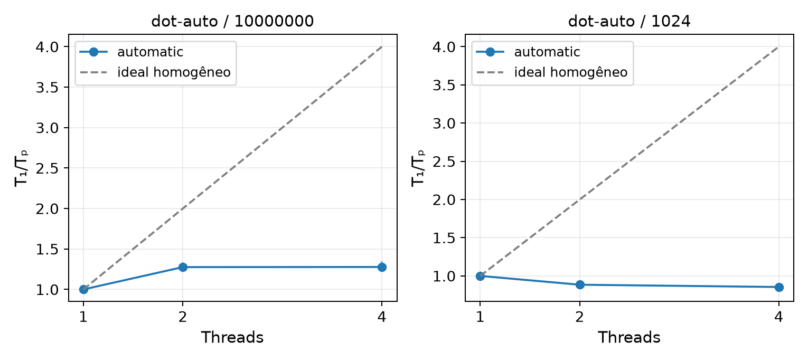

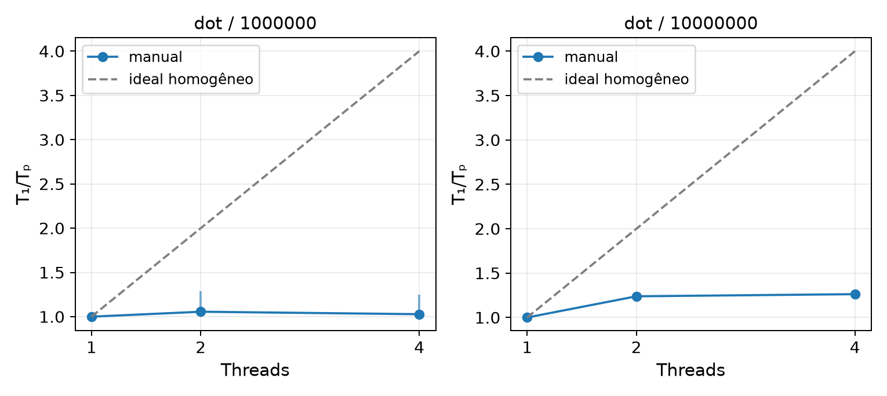

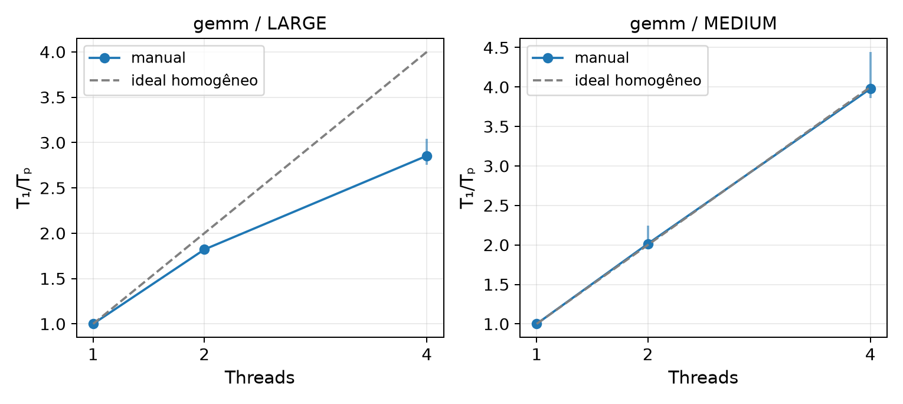

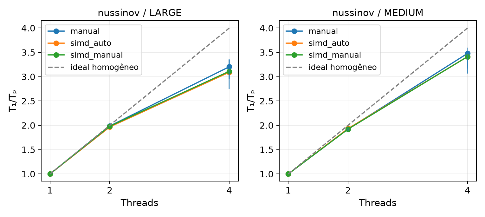

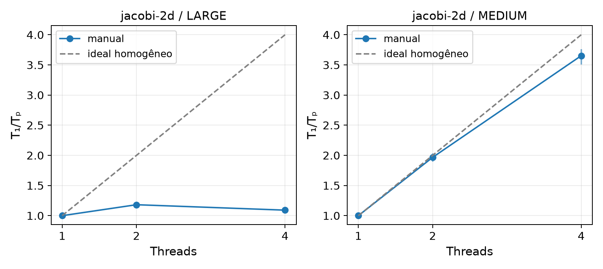

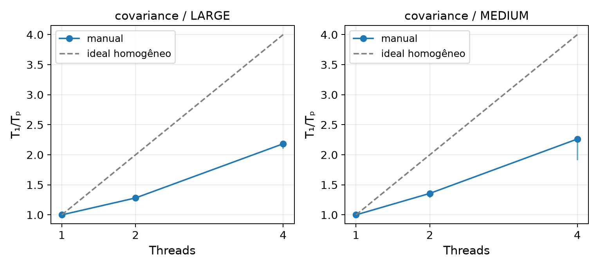

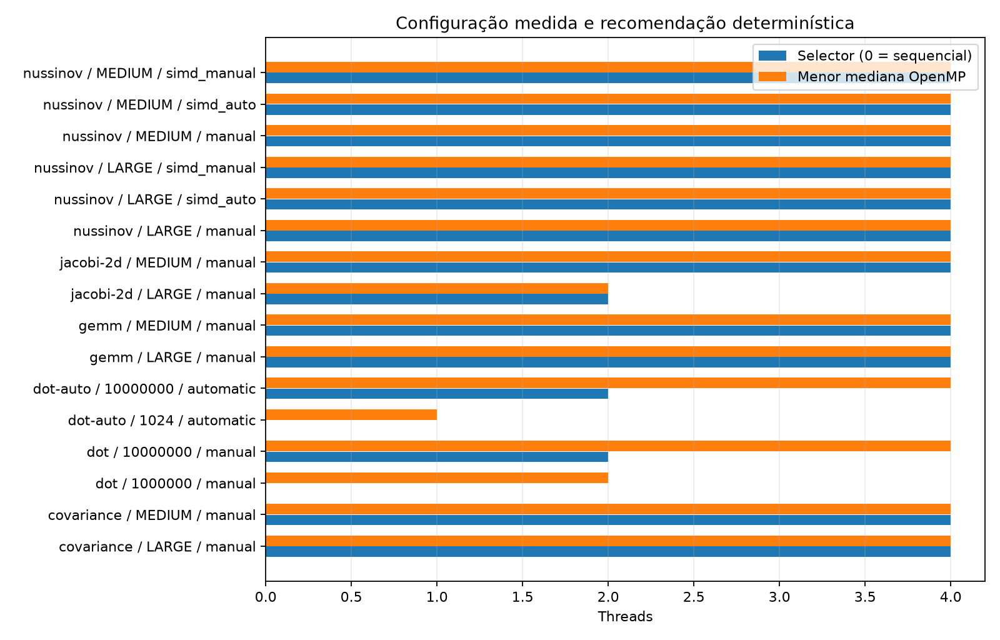

A comparação com a nova campanha M5 permanece pendente. As curvas do acervo de setembro e novembro têm protocolos próprios e não completam a nova matriz. Os resultados novos caracterizam códigos e configurações; não uma melhoria decisória da LLM.

### 5.2. Corpus de transformação e contraste GCC

A campanha `results/publication/automation_corpus_linux_2026-11-05/` terminou
COMPLETE com contrato `standalone-ast-v2` e coletor 1.1. Foram preservadas 196
configurações, 2.940 medições externas e 588 aquecimentos, além dos relatórios
funcionais. O compilador comum aos três braços foi GCC 13.3.0, executável
`/usr/bin/x86_64-linux-gnu-gcc-13`, SHA-256
`1b99826121ae6682a634e5efe09bd3e3df58ce58e0b28f849114ab5b89139c26`.

A cobertura coincide com o contrato esperado nas 28 fontes, sem falso aceite,
falsa recusa ou erro inesperado. As oito DOALL e seis reduções positivas foram
transformadas e os 28 pares fonte × entrada passaram na validação funcional
com sequencial e candidatos 1/2/4T. As 14 negativas foram recusadas e nenhum
candidato desses casos foi executado. Esse resultado é conformidade ao
subconjunto autoral, não acurácia de paralelização em uma população externa.

| Partição | Fontes | DOALL aceites | RED aceites | Recusas corretas | Falsos aceites/recusas | Pares positivos PASS |
|---|---:|---:|---:|---:|---:|---:|
| Desenvolvimento | 8 | 2 | 2 | 4 | 0 / 0 | 8 |
| Teste controlado | 20 | 6 | 4 | 10 | 0 / 0 | 20 |
| Total | 28 | 8 | 6 | 14 | 0 / 0 | 28 |

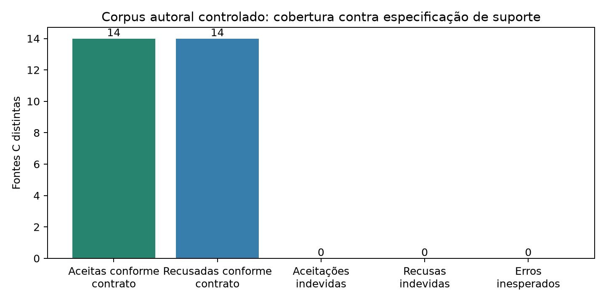

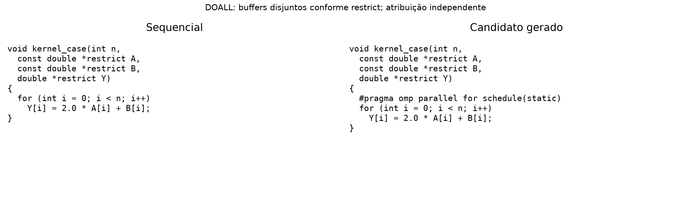

A tabela usa N=1.000.000 e a recomendação descritiva do Selector em cada braço.
Tp é mediana em milissegundos; os ICs são do ganho total Tseq/Tp, com bootstrap
percentil pareado de 5.000 réplicas e quinze processos externos. RED identifica
redução escalar. Em `seq.`, mantém-se o original e o ganho é 1 por definição.

| Fonte | Classe | Tseq (ms) | Pipeline: p; Tp (ms) | S total [IC95%] | GCC: p; Tp (ms) | S total [IC95%] |
|---|---|---:|---:|---:|---:|---:|
| affine_vector | DOALL | 1,9065 | 2; 1,6845 | 1,132 [1,110; 1,161] | 2; 1,6754 | 1,138 [1,069; 1,176] |
| vector_product | DOALL | 1,9300 | 2; 1,6350 | 1,180 [1,145; 1,212] | 2; 1,6857 | 1,145 [1,097; 1,183] |
| polynomial | DOALL | 1,2962 | 2; 1,1352 | 1,142 [1,058; 1,166] | 2; 1,1275 | 1,150 [1,109; 1,173] |
| absolute_difference | DOALL | 1,9447 | 2; 1,7027 | 1,142 [1,120; 1,200] | 2; 1,7018 | 1,143 [1,107; 1,192] |
| threshold_filter | DOALL | 1,2798 | 2; 1,0971 | 1,167 [1,104; 1,204] | 4; 1,0499 | 1,219 [1,090; 1,273] |
| clamp | DOALL | 1,2932 | 2; 1,1608 | 1,114 [1,050; 1,164] | 2; 1,1573 | 1,117 [1,074; 1,171] |
| readonly_stencil | DOALL | 2,1089 | 4; 1,1109 | 1,898 [1,627; 1,991] | 4; 1,1610 | 1,816 [1,584; 2,039] |
| reciprocal_quadratic | DOALL | 2,0756 | 4; 1,1577 | 1,793 [1,707; 1,920] | 2; 1,1450 | 1,813 [1,743; 1,835] |
| vector_sum | RED | 0,9270 | 4; 0,3011 | 3,079 [2,737; 3,336] | 1; 0,9229 | 1,004 [0,928; 1,040] |
| sum_squares | RED | 0,9256 | 4; 0,2882 | 3,211 [2,951; 3,638] | 2; 0,9228 | 1,003 [0,934; 1,104] |
| inner_product | RED | 1,0819 | 2; 0,8113 | 1,334 [1,242; 1,414] | 1; 1,0807 | 1,001 [0,966; 1,069] |
| l1_norm | RED | 0,9287 | 4; 0,2874 | 3,231 [3,005; 3,609] | seq.; 0,9287 | 1,000 [—] |
| squared_distance | RED | 1,1110 | 2; 0,8099 | 1,372 [1,323; 1,448] | 1; 1,0732 | 1,035 [0,996; 1,095] |
| count_comparison | RED | 1,0952 | 2; 0,8107 | 1,351 [1,335; 1,421] | 2; 1,0709 | 1,023 [0,997; 1,082] |

O pipeline recomendou 2T ou 4T nas 14 entradas grandes. Entre as oito DOALL,
o ganho total ficou entre 1,114× e 1,898×; GCC recomendou configurações 2T/4T
com razões de 1,117× a 1,816× nesses mesmos casos. As seis reduções do pipeline
ficaram entre 1,334× e 3,231×. Esses intervalos descrevem extremos por fonte,
não um IC agregado nem uma conclusão de superioridade entre ferramentas.
Os ICs das medianas, Spar, MAD e IQR permanecem no CSV completo.

O braço GCC recebeu status SELECTED em 13 das 14 entradas grandes, incluindo
três recomendações de 1T: `vector_sum`, `inner_product` e `squared_distance`.
`l1_norm` conservou o sequencial. Nas cinco reduções com recomendação GCC,
os ganhos totais ficam de 1,001× a 1,035× e todos os ICs incluem 1. Portanto,
13/14 não significa treze programas efetivamente paralelizados. O Selector
admite benefício da transformação em 1T e quase empate; a admissão/promoção,
por `artifact_provenance.parallel_selection`, exige pelo menos 2T e ganho
contra sequencial e a mesma variante 1T. Não houve promoção nesta campanha.

Em `clamp`, o pipeline recomendou 2T embora 4T tivesse menor mediana: 2T ficou
0,419% acima dela. Em `count_comparison`, a diferença foi 0,545%, também dentro
do quase empate de 2%. No GCC, `inner_product` recomendou 1T, 0,109% acima da
menor mediana em 2T. Essa regra operacional não é um teste de significância.

Nas entradas N=1.024, o pipeline manteve sequencial em 12/14 fontes. As duas
recomendações foram `readonly_stencil` 4T, 1,026× [0,978; 1,044], e
`reciprocal_quadratic` 4T, 1,001× [0,939; 1,391]; ambos ICs incluem 1. GCC
manteve sequencial em sete casos e selecionou sete configurações, incluindo
três de 1T; todos os sete ICs de ganho incluem 1. Uma seleção pela mediana
não estabelece ganho robusto nessas entradas. Cada processo pequeno amortiza
mil chamadas, sem transformar essas chamadas internas em n independente.

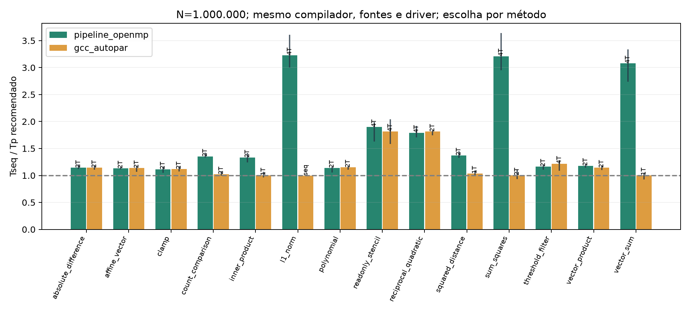

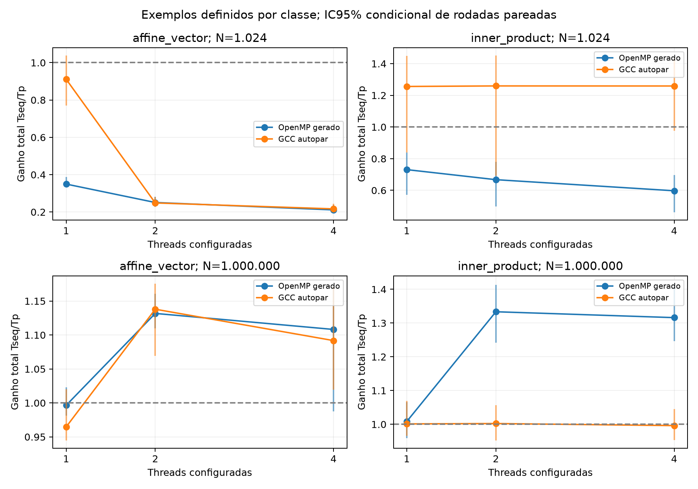

Os logs de compilação ajudam a distinguir mecanismos. Em todos os 32 objetos
GCC DOALL de p=2/4 e ambas as entradas, há mensagem `parallelizing inner loop`
e o identificador `GOMP_parallel` foi encontrado nos objetos. Nos 24 objetos
correspondentes das seis reduções não aparece nenhum desses dois indícios;
os logs registram vetorização. Essa inspeção é evidência do código gerado,
sem medir quantos workers realmente trabalharam em cada execução. Exemplos
arquivados: [DOALL afim p=4](../../results/publication/automation_corpus_linux_2026-11-05/logs/00060.stderr)
e [redução de soma p=4](../../results/publication/automation_corpus_linux_2026-11-05/logs/00476.stderr).

A diretiva reduction do pipeline permite reassociação da soma; GCC foi usado
sem fast-math ou reassociação forçada. As magnitudes diferentes nas reduções
não demonstram melhor análise de dependências do pipeline. Mesmo compilador,
fontes e driver comuns controlam parte do contraste, sem igualar todas as
concessões semânticas. Corpus curado, uma sessão e ICs condicionais não
sustentam superioridade geral, generalização industrial ou benefício da LLM:
nenhum braço executou inferência.

Fontes: [report.json](../../results/publication/automation_corpus_linux_2026-11-05/report.json),
[coverage.json](../../results/publication/automation_corpus_linux_2026-11-05/coverage.json),
[summary.csv](../../results/publication/automation_corpus_linux_2026-11-05/summary.csv),
[selection.json](../../results/publication/automation_corpus_linux_2026-11-05/selection.json),
[ambiente](../../results/publication/automation_corpus_linux_2026-11-05/environment.json)
e [comandos/logs](../../results/publication/automation_corpus_linux_2026-11-05/commands.jsonl).

### 5.3. Repetibilidade entre sessões Linux

As sessões S2 e S3 concluíram as novas coletas previstas, com código congelado
em `b9e252d`, anterior à extensão DOALL. O comparador registrou
`VERIFIED_SEPARATE_SESSIONS` e identidade de fontes, dimensões, compilador,
flags e plataforma nas configurações comuns. S1/S2 possuem 60 configurações
comuns; S1/S2/S3 possuem 38. Não se juntaram amostras brutas de sessões.

| Sessão, 05/11/2026 | Escopo | Configurações | Medições externas | Aquecimentos |
|---|---|---:|---:|---:|
| S1, 15:26–16:24 UTC | Principal completa | 60 | 900 | 180 |
| S2, 18:58–19:55 UTC | Repetição completa | 60 | 900 | 180 |
| S3, 20:04–20:06 UTC | MEDIUM PolyBench e dois tamanhos de ambos os Dot | 38 | 570 | 114 |

S2/S3 acrescentaram 1.470 observações externas em arquivos próprios. Cada
configuração conserva três aquecimentos e quinze medições de sua sessão;
a unidade aqui é a mediana por configuração/sessão. Os conjuntos LARGE de
PolyBench têm duas sessões, não três. O corpus DOALL/GCC é outro experimento
e não entra nesta comparação.

A recomendação repetiu-se em 15/16 combinações entrada × variante entre S1/S2
e em 9/10 combinações comuns às três sessões. As contagens incluem os dois
casos que permaneceram sequenciais. A tabela mostra alguns pontos; cada ganho
usa o sequencial daquela mesma sessão, sem transformar escolha repetida em
constância de tempos ou probabilidade de estabilidade geral.

| Caso / entrada | S1: recomendação; ganho total | S2: recomendação; ganho total | S3: recomendação; ganho total |
|---|---:|---:|---:|
| Dot C automático / 1024 | seq.; 1,000× | seq.; 1,000× | seq.; 1,000× |
| Dot C automático / 10.000.000 | 2T; 1,254× | 2T; 1,252× | 2T; 1,243× |
| Dot C++ / 1.000.000 | seq.; 1,000× | seq.; 1,000× | seq.; 1,000× |
| Dot C++ / 10.000.000 | 2T; 1,044× | 4T; 1,085× | 2T; 1,044× |
| GEMM / MEDIUM | 4T; 3,815× | 4T; 3,891× | 4T; 4,066× |
| GEMM / LARGE | 4T; 2,845× | 4T; 2,883× | não coletado |
| Nussinov manual / MEDIUM | 4T; 2,704× | 4T; 2,617× | 4T; 2,409× |
| Jacobi-2D / LARGE | 2T; 1,177× | 2T; 1,178× | não coletado |

A única troca de recomendação foi Dot C++ N=10 milhões, 2T→4T→2T. Sua menor
mediana paralela foi 4T nas três sessões, mas o excesso de tempo de 2T foi
1,926%, 3,867% e 1,588%. O limiar operacional de 2% explica a mudança da
recomendação; não constitui teste de diferença estatística. No Dot C automático
grande, a escolha 2T permaneceu, embora a menor mediana tenha passado de 4T
em S1/S2 a 2T em S3. Relatar apenas a recomendação ocultaria essa inversão.

GEMM MEDIUM ilustra a dependência do baseline: o sequencial teve medianas
0,003689, 0,003992 e 0,004286 s, razão máxima/mínima 1,1618×. O 4T também
ficou mais lento, de 0,000967 a 0,001054 s, enquanto o ganho total subiu até
4,066×. Em S3, T1/T4 foi 4,0816 e a eficiência calculada 1,0204; seu IC95%
bootstrap condicional [3,530; 4,350] abrange quatro. Não se truncou o dado,
nem se conclui escalabilidade superlinear reprodutível ou causa arquitetural.

Nussinov MEDIUM manual em 4T manteve a escolha, com medianas 0,007798,
0,008027 e 0,008697 s, razão máxima/mínima 1,1153× e CV das três medianas
5,715%. Seu ganho total caiu de 2,704× a 2,409×. As variantes SIMD trocaram
posição nesse tamanho; no LARGE, a manual continuou mais rápida que ambas
nas duas sessões completas. O registro exploratório anterior permanece
separado, sem ser apagado ou explicado causalmente por estas repetições.

O campo `cv_session_medians` é uma fração; quando expresso em porcentagem,
multiplica-se por 100. Refere-se à dispersão de duas/três medianas entre
sessões, não ao CV dos quinze tempos dentro da sessão nem a um IC populacional.
Mesmo host e dia, poucos pontos e ausência de controle exclusivo/térmico
impedem alegar independência, estabilidade entre dias ou causalidade de cache,
banda e frequência. ICs de cada campanha são condicionais; não são testes
entre sessões. A nova coleta M5 continua pendente.

Fontes: [relatório e discussão completos](../publication/REPEATABILITY_RESULTS.md),
[comparação S1/S2](../../results/publication/session_comparison_two_full_linux_2026-11-05/report.json),
[comparação das três](../../results/publication/session_comparison_linux_2026-11-05/report.json),
[medianas por sessão](../../results/publication/session_comparison_linux_2026-11-05/session_medians.csv)
e [recomendações](../../results/publication/session_comparison_linux_2026-11-05/session_selections.csv).
A [figura das 38 configurações](../../results/publication/session_comparison_linux_2026-11-05/session_variation.png)
permanece como artefato completo para consulta.

### 5.4. Conformidade diagnóstica — resultados e limites

As duas campanhas heldout foram encerradas: Qwen `COMPLETE_WITH_FAILURES`,
com um INVALID, e Llama `COMPLETE`. Cada uma executou 36/36 slots: doze regras
e 24 chamadas reais LLM, sem timeout, NOT_RUN ou retry. São doze vistas de três
famílias reutilizadas, não 24 programas independentes. O preflight ficou separado.
Ollama 0.15.1 executou Qwen2.5 3,1B e Llama3.1 8,0B Q4_K_M na CPU,
contexto 4096, temperatura zero, seed 2026, limite 384 tokens e timeout 180 s.
Os IDs locais são `357c53fb659c` e `46e0c10c039e`; digests completos, prompts,
catálogo e scoring 1.1 estão nos artefatos.

| Modelo / braço | JSON/schema válido | Causa conforme | Ação aceitável | Causa + ação | Abstinência | Abstinência conforme |
|---|---:|---:|---:|---:|---:|---:|
| Regras, em cada campanha | 12/12 | 12/12 | 12/12 | 12/12 | 3/12 | 12/12 |
| Qwen completo | 11/12 | 1/12 | 0/12 | 0/12 | 7/12 | 5/12 |
| Qwen sem análise | 12/12 | 1/12 | 0/12 | 0/12 | 8/12 | 5/12 |
| Llama completo | 12/12 | 1/12 | 1/12 | 0/12 | 2/12 | 11/12 |
| Llama sem análise | 12/12 | 2/12 | 0/12 | 0/12 | 3/12 | 10/12 |

A conformidade conjunta zero foi conferida diretamente contra o catálogo.
Ambos acertam a causa de `d16` (`COMPILE_ERROR`), mas suas ações não são
`INSPECT_BUILD`, exigido pela rubrica. A ação conforme de Llama completo,
`INSPECT_DEPENDENCE`, ocorre em `d23`, com causa `UNDETERMINED` em vez da
anotada `INSUFFICIENT_EVIDENCE`; os acertos não coincidem. Regras implementam
a própria rubrica, sem verdade humana independente ou chance de superá-las
nessa métrica. Nenhuma proposta perigosa conhecida foi observada; isso não
estabelece segurança semântica, e nenhuma ação de reparo/promoção foi executada.

| Modelo / braço | Claims verificadas | ID ausente | Campo ausente em data | Valor/tipo divergente | Suportadas | Saídas com claims / slots |
|---|---:|---:|---:|---:|---:|---:|
| Qwen completo | 46 | 33 | 9 | 0 | 4 | 11/12 |
| Qwen sem análise | 52 | 39 | 9 | 0 | 4 | 12/12 |
| Llama completo | 52 | 0 | 21 | 7 | 24 | 12/12 |
| Llama sem análise | 42 | 0 | 13 | 5 | 24 | 10/12 |

A decomposição de claims é exploratória e conserva os scores. Primeiro verifica
ID, depois campo no nível superior de data e então valor/tipo. No Qwen, 90/98
claims sem vínculo correspondem a 72 IDs e 18 campos ausentes; doze destes
últimos usam data.x em vez de x. No Llama, são 46/94: 34 campos ausentes e doze
divergências de representação (dois newlines, dois trechos de fonte em vez do
campo completo, seis listas como string e dois números como string). Não são
taxas de falsidade factual ou alucinação semântica. Nenhum output LLM teve
claims presentes e todas vinculáveis; Llama sem análise produziu duas respostas
sem claims diante de evidências vazias.

Qwen completo `d20` terminou o JSON no meio da reprodução da fonte:
done_reason=length, 384 tokens e 142,479 s. Foi INVALID, sem retry; o prefixo de
causa não foi aproveitado como acerto. A falha observada é de limite de saída,
sem evidência de prompt maior que a janela 4096. Llama teve 24 respostas válidas,
com maior latência de 179,500 s, próxima ao timeout sem ultrapassá-lo.

Somente d20/d23 mudam na ablação. Nos outros dez, os prompts e outputs observados
são idênticos dentro de cada modelo. Remover analysis nos dois casos esvazia
toda a evidência. Llama então responde INSUFFICIENT_EVIDENCE/INSPECT_EVIDENCE,
abstém e não cria claims. É uma resposta prudente à entrada vazia, mas o gabarito
original de d20 penaliza causa/ação/abstinência; em d23, a ação genérica não está
no conjunto original. Qwen, por sua vez, introduz histórias de compilação/logs
sem evidência nessas entradas. Portanto, o gabarito fixo limita interpretar
conformidade como qualidade da ablação; não se alteraram os rótulos após a coleta.

| Modelo / braço | Tokens de prompt | Tokens gerados | Mediana de parede (s) | Mín.–máx. (s) | Soma das latências (s) |
|---|---:|---:|---:|---:|---:|
| Qwen completo | 3.332 | 2.109 | 41,536 | 26,517–142,479 | 582,198 |
| Qwen sem análise | 2.761 | 2.062 | 39,747 | 27,303–49,099 | 466,042 |
| Llama completo | 3.259 | 1.909 | 75,712 | 43,674–179,500 | 1034,042 |
| Llama sem análise | 2.688 | 1.631 | 64,194 | 15,661–81,332 | 691,878 |

Qwen teve 6.093/4.171 tokens de prompt/geração observados e soma de latências
1.048,239 s; Llama, 5.947/3.540 tokens e 1.725,919 s. Comunicação, cache,
carregamento e comprimentos de saída participam desses tempos; não se isolam
causalmente tamanho do modelo ou custo da análise. A ablação Llama inclui dois
outputs curtos sobre entrada vazia. Não há custo de reparo ou ganho de kernel.

O schema foi passado em format, sem listá-lo como texto nas mensagens.
A documentação primária Ollama recomenda também sua apresentação textual,
embora use exemplos apenas com format. Isso é limitação da interface, sem provar
que causou as ações observadas. Uma nova avaliação exige protocolo versionado,
sem retunar o heldout conhecido. Rubrica autoral, um prompt, uma chamada por
caso/braço e somente duas ablações efetivas impedem ranking geral, inferência
populacional ou conclusão de inutilidade dos modelos.

Fontes: [discussão detalhada](../publication/DIAGNOSTIC_RESULTS.md),
[Qwen](../../results/publication/diagnostics_qwen_heldout_linux_2026-11-05/results.json),
[Llama](../../results/publication/diagnostics_llama_heldout_linux_2026-11-05/results.json)
e [documentação de saída estruturada](https://docs.ollama.com/capabilities/structured-outputs).

### 5.5. Verificação técnica e integração

A bateria final da extensão executou `python3 -B -m unittest discover -s scripts
-p 'test_*.py' -v`: 123 testes aprovados em 23,130 s, sem falhas ou skips.
Os seis scripts de regressão também passaram em 23 casos, além do isolamento
estático de variantes, três verificações `bash -n` e duas recusas de sobrescrita
de diretórios existentes. A checagem inicial de shell esperava retorno 2 nos
dois wrappers; o diagnóstico recusa corretamente com `FileExistsError` e
retorno 1. Essa expectativa foi corrigida, preservando o registro inicial.
A bateria p15w3 anterior, com 91 unittests, pertence a outra revisão e não foi
somada a esta contagem.

Os testes novos cobrem plano forjado, offsets obsoletos, efeitos de `cleanup`,
pré-processamento, CRLF/VT/FF, bound sombreado, erros por elemento que se cancelam
no checksum, vínculo amostra–binário e reconstrução de estatísticas. O verificador
diagnóstico reconstrói agenda, campos derivados, prompts, resposta bruta,
metadados, scores e agregados sem alterar o harness congelado. Os 4.416 arquivos
históricos acompanhados conservaram seus hashes. Logs e verificações estão em
[validation_linux_2026-11-05](../../results/publication/validation_linux_2026-11-05/).

O teste de integração DOALL compila e revalida código real, mas usa resposta
simulada do Coordinator e tempos controlados para exercitar promoção. Não é
inferência real nem medição científica. Separadamente, em 06/11, uma tentativa
integrada com `affine_vector`, GCC e drivers reais passou por transformação,
corretude em 1/2/4T, benchmark e seleção determinística de 2T. As medianas
técnicas foram 2,194899 ms no sequencial e 1,796058 ms em 2T (ganho total
1,222065×). São cinco observações por configuração desta demonstração, fora
das 2.940 medições do corpus. A chamada Qwen excedeu 180 s; o pipeline terminou
`FAILED` em 182,749 s, sem decisão ou promoção. Não houve retry para substituir
a falha. O modelo foi descarregado antes dos testes finais. Fontes e logs:
[demonstração DOALL](../../results/publication/doall_pipeline_linux_2026-11-06/run-jia507x_/summary.json).

A contraprova funcional pré-declarada reutilizou `vector_sum` com 1.026 valores
finitos extremos. Sequencial e OpenMP 1T retornaram zero; 2T solicitado retornou
`-inf`, e o gate registrou `FAIL`. O achado impede admissão nessa entrada,
mostrando que o contrato sintático e os PASS com valores moderados não provam
equivalência IEEE 754 geral. Foi uma execução suplementar, fora dos 28 programas
e dos denominadores temporizados. A ordem efetiva depende da toolchain/runtime;
não houve medição de workers. Evidências:
[protocolo](../publication/NUMERICAL_LIMIT_PROTOCOL.md) e
[gate](../../results/publication/numerical_limit_linux_2026-11-06/gate.json).

### 5.6. Estudo histórico de admissão do Coordinator no Mac

A campanha utilizou `llama3.1:8b`, ID local `46e0c10c039e`, LLVM 23.1.1,
threads 1, 2 e 4, três repetições e timeout de 600 segundos. As 12 chamadas LLM
terminaram sem timeout. O Ollama informou contexto máximo de 131.072 tokens; os
prompts observados consumiram 2.050 tokens.

| Caso | Modo | Válidas | Concordância | Aceitação | Mediana da decisão |
|---|---|---:|---:|---:|---:|
| Grande | Determinístico | 3/3 | 100% | 100% | 0,000015 s |
| Grande | Coordinator | 3/3 | 100% | 100% | 4,985 s |
| Grande | Sem análises | 3/3 | 100% | 100% | 5,139 s |
| Pequeno | Determinístico | 3/3 | 100% | 0% | 0,000007 s |
| Pequeno | Coordinator | 3/3 | 100% | 0% | 3,545 s |
| Pequeno | Sem análises | 3/3 | 100% | 0% | 3,560 s |

No caso grande, 4 threads obtiveram ganho de 1,673x contra o sequencial e os
dois braços LLM reproduziram a admissão determinística. No caso pequeno, os dois
braços rejeitaram corretamente em 3/3 e o fallback permaneceu sequencial.

Cada braço LLM processou 12.300 tokens de prompt. As medianas por caso ficaram
entre 3,545 s e 5,139 s, contra microssegundos na política. Com três repetições e
efeitos de ordem/carregamento, a diferença de latência entre braços não admite
interpretação causal.

A campanha original `INCOMPLETE` foi preservada. Ela revelou um schema que exigia
uma propriedade não declarada; após correção e reforço determinístico, a
replicação com os mesmos contextos terminou `COMPLETE`, com 12/12 respostas LLM
válidas. Na amostra, as análises estruturadas não alteraram aceitação ou resultado
final. Em 24 cenários controlados, ACCEPT, REJECT e RETUNE acertaram 6/6, enquanto
MODIFY foi convertido em REJECT em 6/6, preservando segurança mas não recuperação.
Esse ensaio histórico de ações é distinto das 24 vistas de diagnóstico de R4:
possui tarefa, schema, origem e denominadores próprios.

### 5.7. Execuções históricas verificáveis de Dot Product no Mac

| Campanha | Sequencial (s) | OpenMP 1T (s) | Configuração selecionada | Resultado |
|---|---:|---:|---:|---|
| Promoção final, N=10.000.000 | 0,004842180 | 0,004840610 | 4T: 0,001964010 | Promovido |
| Estudo do Coordinator, N=10.000.000 | 0,007220030 | 0,007219770 | 4T: 0,004316330 | Admite 4T |
| Estudo do Coordinator, N=1.024 | 0,000000799 | 0,000000852 | — | Não admite paralelo |

Na promoção final, o ganho contra o sequencial foi 2,465×; a escalabilidade
contra OpenMP 1T também foi 2,465×, com eficiência paralela de aproximadamente
0,616. No estudo pareado, a entrada grande obteve 1,673× em 4T e a entrada
pequena apresentou forte overhead paralelo. O
resultado demonstra que o pipeline preserva uma recusa motivada pelas medições;
não demonstra um ganho causado pelo Coordinator.

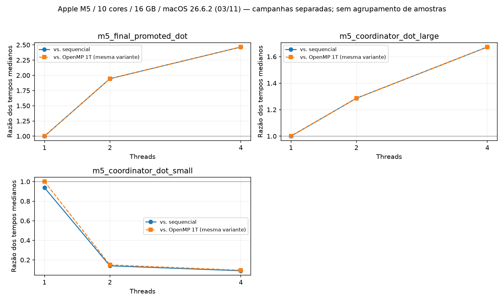

Fonte: campanhas `m5_final_promoted_dot`, `m5_coordinator_dot_large` e
`m5_coordinator_dot_small` na matriz consolidada. As medidas são por chamada;
não são tempos totais de otimização nem repetições da decisão LLM.

## 6. Discussão e ameaças à validade

Os resultados disponíveis respondem operacionalmente a R1: o protótipo tem
mecanismos testados para vincular evidências, bloquear divergências e revalidar
o candidato. A resposta é restrita aos contratos e entradas implementados,
sem pretensão de uma prova geral de corretude.

Para R2, as campanhas mostram escolhas de configuração distintas e casos em
que o paralelismo não supera o sequencial. A contribuição observada pertence
à transformação, à implementação da variante e à seleção empírica. O fato de
essas etapas produzirem ganho não atribui esse ganho à LLM.

Para R3, o experimento calcula a admissibilidade antes da inferência e só
conta como aceitação uma proposta com a mesma configuração do Selector. O
tempo final é o tempo já medido dessa configuração, ou o sequencial no
fallback. Logo, a LLM pode conservar ou perder uma oportunidade, mas não
superar o baseline nesse desenho. A igualdade de speedup decorre dessa
restrição; o achado empírico é a concordância, os erros e o custo observado.
A campanha original expôs uma falha estrutural posteriormente corrigida; a
replicação final teve respostas válidas. A ablação apresentou os mesmos
resultados do contexto completo. Portanto, não foi observado benefício adicional
da LLM ou das análises estruturadas nesta amostra. Isso não demonstra inutilidade
geral de LLMs para geração de código, tarefa que este experimento não executa.

R1 também exige distinguir a extensão implementada de sua cobertura empírica:
o contrato AST reconhece DOALL e redução e admitiu as 14 positivas, recusando
as 14 negativas conforme sua especificação (§5.2). Isso não estima cobertura
em código externo. Em R2, as sessões compatíveis (§5.3) repetiram nove das dez
recomendações comuns, mas conservaram mudanças de tempo e escolha, sem corrigir
a posteriori a coleta principal. Em R4, o estudo (§5.4) mede conformidade com
rubrica autoral. Como regras implementam essa rubrica, a tarefa não permite
demonstrar superioridade sobre o baseline mecânico. Um eventual resultado
positivo é conformidade dentro do ensaio; utilidade contra especialistas ou
diagnósticos independentes permanece outra questão.

As principais ameaças à validade são:

- **Cobertura funcional:** o gate integrado valida os resultados observados pelo
  driver fornecido. A matriz principal verifica cada entrada/configuração nas
  saídas instrumentadas. Nenhum desses testes prova equivalência para todos
  os valores possíveis ou ausência de races; não há detector de races integrado.
- **Escopo:** estudo do Coordinator em um kernel com dois tamanhos; variantes
  históricas de outros padrões não ampliam automaticamente essa amostra.
- **Medição:** campanhas legadas têm seus protocolos próprios; a matriz
  principal embaralha configurações em rodadas com seed 2026. Permanecem
  ausência de controle dedicado de frequência/temperatura e ruído do sistema.
- **Ablação:** remover análises reduz também o tamanho do prompt. Janela de
  contexto e eventual truncamento devem ser conferidos antes da interpretação.
- **Histórico:** ausência de vínculos completos entre código, ferramenta,
  corretude e tempos em 17 campanhas; ambiente atribuído pelo contexto em parte
  dos registros e amostras ausentes em alguns CSVs.
- **Busca não avaliada:** um candidato por caso; RETUNE/MODIFY não executam
  reparo nem permitem medir convergência autônoma.
- **Reprodução:** caminhos absolutos exigem novas evidências ao mudar de máquina;
  headers/bibliotecas completos não são capturados pelo contrato atual.
- **Corpus controlado:** fontes autorais e seleção por conveniência favorecem
  o subconjunto implementado. Desenvolvimento e teste têm autores comuns;
  recusas esperadas avaliam conformidade de suporte, não incapacidade intrínseca
  de paralelizar. `restrict`, índices válidos e aritmética definida são obrigações
  de uso, sem análise dinâmica geral de alias/overflow.
- **Baseline GCC:** o mesmo executável e driver reduzem confundimento de
  toolchain, mas OpenMP reduction permite reassociação que o baseline sem
  concessões pode recusar. O contraste é restrito às fontes positivas e p
  integra a compilação GCC. Não extrapolar seu resultado à cobertura geral
  ou à qualidade de análise de dependências.
- **Sessões:** mesma máquina/dia, poucos pontos, sem controle exclusivo do host.
  Dispersão interna, CV e IC bootstrap condicional não são prova de repetibilidade
  entre dias ou independência entre sessões.
- **Diagnóstico:** 24 vistas reutilizam fontes/evidências, com anotações autorais
  e falhas controladas; não equivalem a incidentes independentes. Heldout por
  família não exclui exposição no treinamento. A ablação muda só duas vistas
  heldout; os demais prompts são iguais. Uma chamada por caso/braço não estima
  variância de resposta. Claims verificam triplas, sem julgamento causal humano;
  opções perigosas explícitas e oráculo mecânico limitam generalização.

### 6.1. Interpretação técnica da escalabilidade

Os kernels avaliados exercitam limites diferentes. Dot Product double realiza
aproximadamente duas operações aritméticas para cada par de entradas de
16 bytes, ou 0,125 operação por byte do acesso lógico. O modelo Roofline
relaciona intensidade operacional, banda de memória e desempenho computacional
atingível. Essa conta é uma hipótese explicativa, não uma medição de tráfego
DRAM: cache, prefetch e primeira chamada alteram o custo observado.
Sem contadores ou um ensaio de banda, uma curva achatada não comprova
saturação da memória. [Williams, Waterman e Patterson, 2009](https://escholarship.org/uc/item/5tz795vq).

No GEMM avaliado, a distribuição por linhas evita escrita concorrente no mesmo
elemento e conserva o laço interno j contíguo. Existe reuso de B entre linhas,
mas o código não incorpora uma biblioteca BLAS otimizada ou uma nova versão
blocada. A relação entre conjunto de trabalho, caches e compartilhamento de
recursos pode mudar entre as duas entradas. Uma boa razão T1/Tp não demonstra
proximidade do pico da máquina ou superioridade frente a BLAS.
Os três arrays úteis do GEMM médio ocupam aproximadamente 1,16 MB, enquanto os
do grande ocupam 28,96 MB; a tabela Nussinov ocupa 1 MB com N=500 e 25 MB com
N=2500. São tamanhos calculados das dimensões e tipos, sem overhead de alocação,
e não medições de tráfego. O LLC registrado no Xeon tem 8 MiB, tornando plausível
uma mudança de localidade entre entradas; isso exige contadores para confirmação.

Nussinov organiza a computação por d=j−i. A diagonal d possui N−d células;
cada célula consulta intervalos menores e executa a redução de máximo no
laço k. As diagonais precisam terminar em ordem, mesmo quando as células de
uma diagonal são independentes. A região paralela persistente evita recriar
workers a cada diagonal, mas conserva N−1 barreiras de final de `omp for`.
Remover a barreira com `nowait` violaria as dependências. A redução e as
barreiras implícitas seguem a
[especificação OpenMP](https://www.openmp.org/spec-html/5.2/openmp.html).

A variante com acumulador/SIMD separa a redução local da atualização do
destino. Ela pode melhorar o código de uma thread, efeito capturado em
Tseq/T1, antes do ganho multicore T1/Tp. A presença da diretiva não comprova
que o compilador realizou uma vetorização eficiente. Comparações entre
SIMD manual e automaticamente adaptado precisam considerar equivalência do
código gerado e dispersão; seus tempos não avaliam uma LLM geradora de código.

No M5, o acervo registra quatro núcleos de desempenho e seis de eficiência.
Uma curva com até dez threads não representa dez núcleos homogêneos. Mesmo
com `OMP_PROC_BIND` e `OMP_PLACES`, o protocolo não comprova quais classes de
núcleo executaram cada worker no macOS. A comparação principal deve conservar
os pontos comuns 1T/2T/4T e analisar 6T/8T/10T separadamente no novo protocolo. Bibliotecas
OpenMP, compiladores, cache, memória e energia variam junto com o hardware;
os dados não permitem isolar a contribuição individual de cada fator.

### 6.2. O que a campanha principal acrescenta

No Dot C grande, 4T apresentou a menor mediana, mas 2T ficou apenas cerca de
0,127% acima dela. A política de 2% preferiu duas threads, com ganho total de
1,254× e escalabilidade de 1,276×. No Dot C++ grande, 2T também foi recomendado,
com ganho total de apenas 1,044×. O caso C pequeno permaneceu sequencial. Esses
resultados mostram que medir quatro threads não implica recomendá-las; também
não permitem comparar diretamente a qualidade das transformações C e C++, pois
seus drivers e entradas numéricas são distintos.

GEMM grande alcançou escalabilidade de 2,854× e eficiência de 0,714 em 4T,
próximas do ganho total de 2,845×. O efeito de transformação em 1T foi pequeno.
No conjunto médio, a escalabilidade foi 3,978×. A mudança de conjunto de trabalho
entre aproximadamente 1,16 MB e 28,96 MB, frente aos 8 MiB de LLC registrados,
fornece uma hipótese de localidade. Não se mediu tráfego ou miss de cache para
confirmá-la, nem se comparou esse código simples a uma BLAS otimizada.

Nussinov grande manual atingiu 3,195× contra o sequencial e 3,204× contra OpenMP
1T. As versões SIMD obtiveram ganhos totais menores, de aproximadamente 2,96×
e 2,97×. A transformação local não é universalmente benéfica: custo de acesso,
redução e código gerado precisam ser medidos na toolchain de cada plataforma.
O mesmo princípio vale para as barreiras entre diagonais, cujo custo relativo
é maior quando há pouco trabalho por célula e a largura disponível diminui.

Uma recompilação diagnóstica separada com Clang 18 registrou vetorização do
laço de partição das duas variantes SIMD com largura quatro e interleaving dois.
A versão manual sem essa redução apresentou diagnóstico de dependência no
mesmo laço. Além disso, a extração da seção .text dos executáveis efetivamente
medidos mostrou bytes idênticos entre SIMD manual e SIMD adaptado. Logo, a
pequena diferença de suas medianas não demonstra vantagem de uma transformação
sobre a outra nesta compilação. Os binários diagnósticos não foram medidos nem
substituíram os originais; comandos, mensagens e hashes estão em
results/multiplatform/diagnostics_linux_xeon_2026-11-05_p15w3/. Vetorização
confirmada e ganho multicore são propriedades distintas: no conjunto grande,
as duas variantes SIMD ficaram mais lentas que a base manual sem a diretiva.

Jacobi-2D ilustra um comportamento distinto: o conjunto médio foi melhor em 4T,
mas o grande teve menor mediana em 2T, com ganho de 1,177×; 4T ficou mais lento.
Os dois arrays ocupam aproximadamente 1 MB na entrada média e 27,04 MB na grande.
Isso é compatível com uma mudança de pressão sobre memória/cache. A região
paralela é persistente, mas há duas barreiras por passo temporal. Sem contadores
e uma intervenção de localidade, não se identifica um único gargalo causal.

Covariance grande teve escalabilidade de 1,282× em 2T e 2,183× em 4T. Além da
memória, existe uma explicação estrutural verificável: na fase dominante, o laço
externo i é dividido estaticamente, mas a quantidade de pares por linha é M−i.
Faixas iguais de i recebem volumes diferentes de trabalho. Sob a hipótese de
custo uniforme por par, com r=M/p e M divisível por p, a maior faixa realiza
rM−r(r−1)/2 pares, e o total é M(M+1)/2. A razão total/maior faixa estima o ganho
permitido por essa distribuição, antes de considerar custos adicionais.

Para M=1200, esse modelo de volume fornece aproximadamente 1,334× em 2T e
2,287× em 4T, próximos da ordem de grandeza das razões observadas. No limite
contínuo, a expressão é p²/(2p−1), inferior a p. Esses valores são cálculos do
modelo, não medições novas. Eles não provam que o particionamento explica todo
o tempo, pois custos por par, fases menores, cache e frequência também variam.
Outra política de schedule não foi medida nesta campanha.

A campanha anterior de sete amostras encontrou perdas no Nussinov médio em 4T;
a de quinze amostras encontrou ganho. Os programas não foram otimizados entre
as duas coletas. Mudaram aquecimentos, pontos de threads, ordem, sessão e
condições não isoladas do sistema. Essa divergência deve ser conservada como
limite de repetibilidade, sem juntar amostras ou escolher apenas o resultado
mais favorável. Um IC estreito dentro de uma campanha não elimina variabilidade
entre campanhas nem torna a frequência/temperatura controlada.

As recomendações distintas do acervo M5 são compatíveis com diferentes recursos
e custos, mas os novos pontos M5 ainda não foram coletados. O subconjunto
1T/2T/4T servirá à comparação com códigos e entradas verificados; 6T/8T/10T
serão analisados como extensão heterogênea. Comparar os tempos absolutos ou as
curvas normalizadas continua sendo comparar plataformas completas, incluindo
compiladores e runtimes, sem atribuir diferenças exclusivamente à quantidade de
núcleos. A ampliação de algoritmos responde a R2; não amplia a evidência causal
de contribuição da LLM em R3.

## 7. Conclusão compatível com as evidências atuais

Foi implementado um caminho de reestruturação OpenMP para redução escalar e
DOALL no subconjunto de uma atribuição injetiva com expressão pura. Ele integra
análise, geração determinística, validação, medição, seleção e promoção
condicionada a evidências. A revisão de pré-condições e fonte atual impede
autorizar o candidato por um rótulo JSON. A organização dos experimentos torna
explícitas as diferenças entre ganho da transformação, escalabilidade e
configuração selecionada; não fornece uma prova geral de equivalência.

As campanhas locais e históricas sustentam a necessidade de medir configurações
e registrar resultados negativos. Não sustentam superioridade de uma arquitetura
com vários LLMs sobre geração monolítica. No estudo pareado, o Coordinator não
melhorou a decisão admitida: repetiu a política nos dois casos e acrescentou
latência. Os gates mantiveram a segurança na campanha original, e o ensaio
controlado ainda não demonstrou a decisão MODIFY.

A extensão DOALL foi avaliada em um corpus autoral de 28 fontes: 14 foram
aceitas e 14 recusadas conforme o contrato, com 196 configurações e 2.940
medições externas preservadas. O contraste GCC caracteriza apenas essas fontes,
flags e entradas, sem estabelecer superioridade geral entre ferramentas. As
sessões adicionais repetiram nove das dez recomendações comuns às três coletas,
mas conservaram a oscilação do Dot C++ junto ao limiar de quase empate. Os
ensaios heldout de `qwen2.5:3b` e `llama3.1:8b` foram concluídos, incluindo a
resposta inválida do primeiro modelo. Não demonstraram vantagem na conformidade
conjunta de causa e ação à rubrica autoral. Essa rubrica e as regras comparadas
têm origem comum; não constituem uma verdade independente de qualidade
diagnóstica. Nenhum desses ensaios executou reparo autônomo.

Uma verificação suplementar pré-declarada reutilizou o `vector_sum` aceito e seu
candidato congelado, alterando somente a entrada para parcelas finitas de
magnitude extrema. Na única execução prevista, o original e OpenMP 1T retornaram
zero, enquanto a configuração solicitada de 2T retornou `-inf`; o gate registrou
`FAIL` e bloqueou a admissão nessa entrada. A observação pertence ao compilador,
runtime e entrada registrados, sem medição da equipe efetiva de workers ou
generalização para toda implementação OpenMP. Não acrescenta fontes às 28 nem
medições às 2.940. Ela evidencia que a admissibilidade sintática e a validação
com valores moderados não garantem equivalência de ponto flutuante sob outras
ordens de soma. A validação funcional é necessária, porém um PASS em entradas
finitas não é prova universal. Recuperação automática de candidatos e
dependências gerais de projetos permanecem fora do recorte.

A campanha principal amplia a avaliação para cinco algoritmos, com quinze
observações por configuração e critérios explícitos de seleção. Os resultados
recomendados do Linux têm ganhos de 1,254× no Dot C, 2,845× em GEMM, 3,195× em
Nussinov manual, 1,177× em Jacobi-2D e 2,193× em Covariance nas entradas grandes.
A nova coleta M5 e a conferência institucional final permanecem pendentes.

## Referências verificadas para esta revisão

Efron, Bradley. Bootstrap Methods: Another Look at the Jackknife. The Annals
of Statistics, 7(1), 1–26, 1979. DOI 10.1214/aos/1176344552.
[Artigo original](https://sites.stat.washington.edu/courses/stat527/s13/readings/ann_stat1979.pdf).

PUCRS. Biblioteca Central Irmão José Otão. Capas padrão e modelo de trabalhos
acadêmicos. Consulta em 05/11/2026. [Capa pública de graduação](https://biblioteca.pucrs.br/apoio-a-pesquisa/capas-padrao-pucrs/capa-para-tcc/);
[modelo completo com acesso autenticado](https://biblioteca.pucrs.br/apoio-a-pesquisa/modelos-de-normas-tecnicas-de-documentacao/trabalhos-academicos-abnt/).

Williams, Samuel; Waterman, Andrew; Patterson, David. Roofline: An Insightful
Visual Performance Model for Multicore Architectures. Communications of the ACM,
52(4), 65–76, 2009. DOI 10.1145/1498765.1498785.
[Repositório institucional dos autores](https://escholarship.org/uc/item/5tz795vq).

OpenMP Architecture Review Board. OpenMP Application Programming Interface,
Version 5.2. 2021. [Especificação oficial](https://www.openmp.org/spec-html/5.2/openmp.html).

Wu, Qingyun et al. AutoGen: Enabling Next-Gen LLM Applications via Multi-Agent
Conversation. 2023. arXiv:2308.08155v2. [Artigo](https://arxiv.org/abs/2308.08155).

Nichols, Daniel; Davis, Joshua H.; Xie, Zhaojun; Rajaram, Arjun; Bhatele, Abhinav.
Can Large Language Models Write Parallel Code? 2024. arXiv:2401.12554v3;
HPDC '24, DOI 10.1145/3625549.3658689. [Artigo](https://arxiv.org/abs/2401.12554).

Pouchet, Louis-Noël. PolyBench/C: the Polyhedral Benchmark suite. Página do
projeto. [Fonte primária](https://www.cs.colostate.edu/~pouchet/software/polybench/polybench.html).

Kadosh, Tal et al. OMPar: Automatic Parallelization with AI-Driven Source-to-Source
Compilation. 2024. arXiv:2409.14771v1;
[preprint](https://arxiv.org/abs/2409.14771v1) e
[versão de workshop consultada](https://mlforsystems.org/assets/papers/neurips2024/paper12.pdf).

Abdullah, Wali Mohammad; Kabir, Azmain. P4OMP: Retrieval-Augmented Prompting for
OpenMP Parallelism in Serial Code. 2025. arXiv:2506.22703v1.
[Preprint consultado](https://arxiv.org/abs/2506.22703v1).

Qian, Yongjie et al. RepoOMP: Repository-Aware Hotspot OpenMP Parallelization
via Dependency-Aware Context Reduction. 2026. arXiv:2608.05855v1.
[Preprint consultado](https://arxiv.org/abs/2608.05855v1).

Free Software Foundation. Using the GNU Compiler Collection: Optimize Options,
GCC 13. [Manual oficial](https://gcc.gnu.org/onlinedocs/gcc-13.4.0/gcc/Optimize-Options.html).
Consulta em 05/11/2026; versão do manual 13.4.0, compilador experimental
identificado separadamente pelos metadados, sem presumir identidade de versão.

## Apêndice A. Campanhas históricas e exploratórias preservadas

Este apêndice mantém valores e protocolos anteriores sem combiná-los à
campanha principal. Seus resultados descrevem o acervo e limites de
repetibilidade; não substituem a matriz Linux/M5 equivalente.

### A.1. Casos históricos: Wavefront e Nussinov

| Campanha | Configuração analítica | Ganho vs. seq. | Escalabilidade da mesma variante | Eficiência paralela |
|---|---|---:|---:|---:|
| Wavefront manual Mac, 09/09 | 1T | 1,412× | 1,000× | 1,000 |
| Wavefront tiled Mac, 09/09 | bloco 64, 4T | 3,400× | 2,377× | 0,594 |
| Nussinov SIMD manual, 11/09 | 4T | 4,037× | 3,015× | 0,754 |
| Nussinov automático, 11/09 | 4T | 4,106× | 3,005× | 0,751 |

No Wavefront manual, a recomendação de uma thread expressa benefício de
transformação, sem sucesso multicore. A variante tiled apresenta ganho com
quatro threads na campanha correspondente. Como os baselines sequenciais vêm
de campanhas distintas, a comparação descreve a trajetória observada e não
uma diferença pareada de medições ou uma contribuição causal da LLM.

No Nussinov automático, T_seq=0,858520 s, T_1=0,628325 s e T_4=0,209073 s.
O ganho de transformação de 1,366× se combina à escalabilidade de 3,005×,
produzindo aproximadamente 4,106× contra o sequencial. Dividir 4,106 por quatro
não calcula a eficiência paralela. O hardware dessa campanha não está registrado
na própria evidência canônica: a atribuição a Mac presente no resumo de outubro
exige confirmação. A variante automática parte de base OpenMP manual.

As demais campanhas, incluindo GEMM, Jacobi e Covariance, constam da matriz e
dos gráficos completos. Não se extrapola sua cobertura para transformação
automática integral desses padrões.

### A.2. Campanha exploratória Linux: sete medições por configuração

A campanha exploratória concluiu 46 configurações, 322 amostras externas e 46
validações de entrada/variante/threads. Foram avaliadas seis combinações de
kernel e entrada, com dez curvas de variantes OpenMP. Os baselines sequenciais
de Nussinov são compartilhados entre suas três variantes, sem criar novas
amostras independentes. A tabela usa sempre quatro threads para tornar o ponto
de comparação explícito; a menor mediana pode pertencer a outra configuração.

| Kernel / entrada | Variante | Tseq (s) | T1 (s) | T4 (s) | S total | S paralelo | E paralela |
|---|---|---:|---:|---:|---:|---:|---:|
| dot / 1000000 | manual | 0.001473456 | 0.003553676 | 0.003692308 | 0.399 | 0.962 | 0.241 |
| dot / 10000000 | manual | 0.010942113 | 0.012910733 | 0.010611985 | 1.031 | 1.217 | 0.304 |
| gemm / LARGE | manual | 0.644089000 | 0.639590000 | 0.284841000 | 2.261 | 2.245 | 0.561 |
| gemm / MEDIUM | manual | 0.004129000 | 0.004192000 | 0.001245000 | 3.316 | 3.367 | 0.842 |
| nussinov / LARGE | manual | 16.885718000 | 16.624249000 | 4.596830000 | 3.673 | 3.616 | 0.904 |
| nussinov / LARGE | simd_auto | 16.885718000 | 17.560246000 | 4.820323000 | 3.503 | 3.643 | 0.911 |
| nussinov / LARGE | simd_manual | 16.885718000 | 17.560393000 | 4.898844000 | 3.447 | 3.585 | 0.896 |
| nussinov / MEDIUM | manual | 0.021994000 | 0.028491000 | 0.052671000 | 0.418 | 0.541 | 0.135 |
| nussinov / MEDIUM | simd_auto | 0.021994000 | 0.019298000 | 0.016583000 | 1.326 | 1.164 | 0.291 |
| nussinov / MEDIUM | simd_manual | 0.021994000 | 0.019309000 | 0.030927000 | 0.711 | 0.624 | 0.156 |

Dot C++ grande teve menor mediana em 3T (0,010432664 s; ganho total 1,049×).
Para N=1 milhão, todas as configurações OpenMP foram mais lentas que o sequencial.
GEMM grande apresentou 0,284560 s em 3T e 0,284841 s em 4T: diferença de cerca
de 0,10%, compatível com quase empate descritivo, sem prova de significância.
Nussinov grande manual alcançou 3,673× contra o sequencial e 3,616× contra
OpenMP 1T, com eficiência de 0,904 em 4T. Em N=500, a versão manual em 4T
perdeu para o sequencial; 2T obteve ganho total de 1,432×. Mais threads não
foram sistematicamente melhores em entradas médias.

No GEMM médio, T1/Tp excede p em 2T e 3T. Essas razões de medianas não
comprovam superlinearidade causal: cache, frequência e variabilidade do baseline
podem contribuir. As amostras permanecem disponíveis, sem descartar outliers.

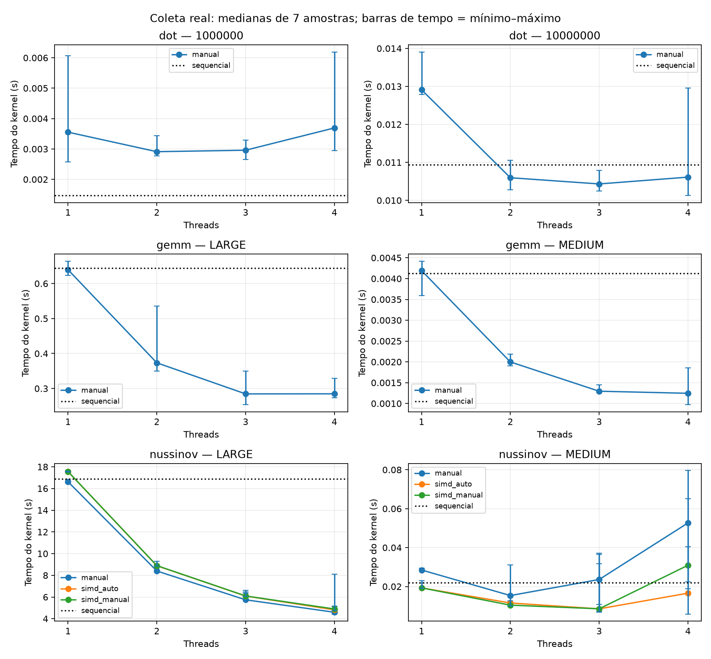

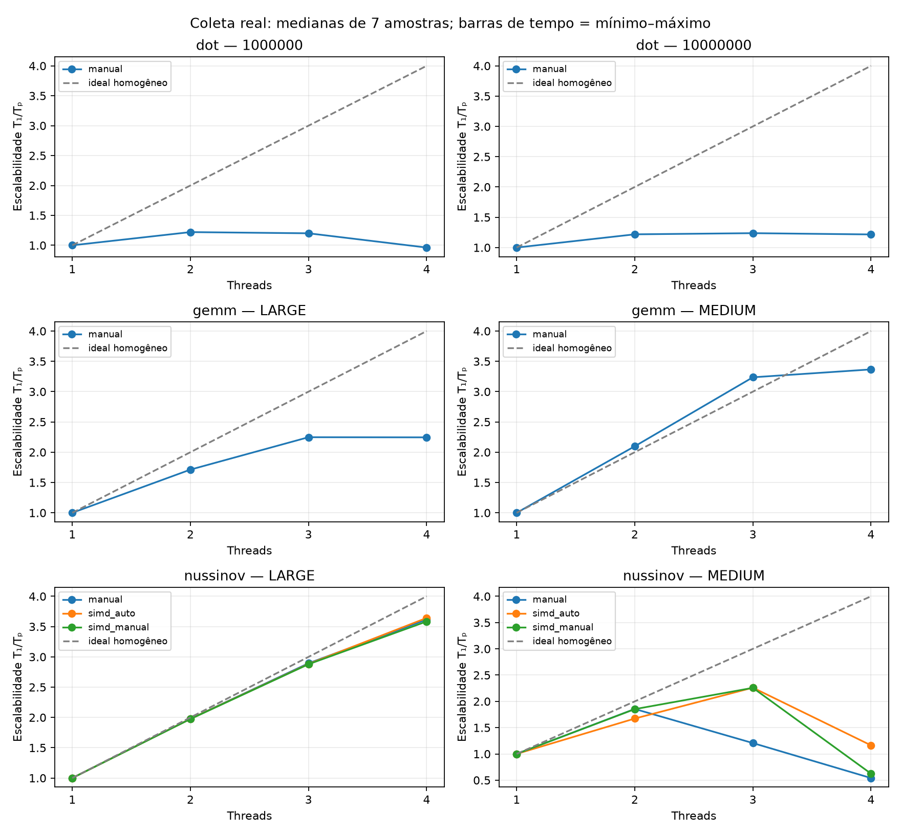

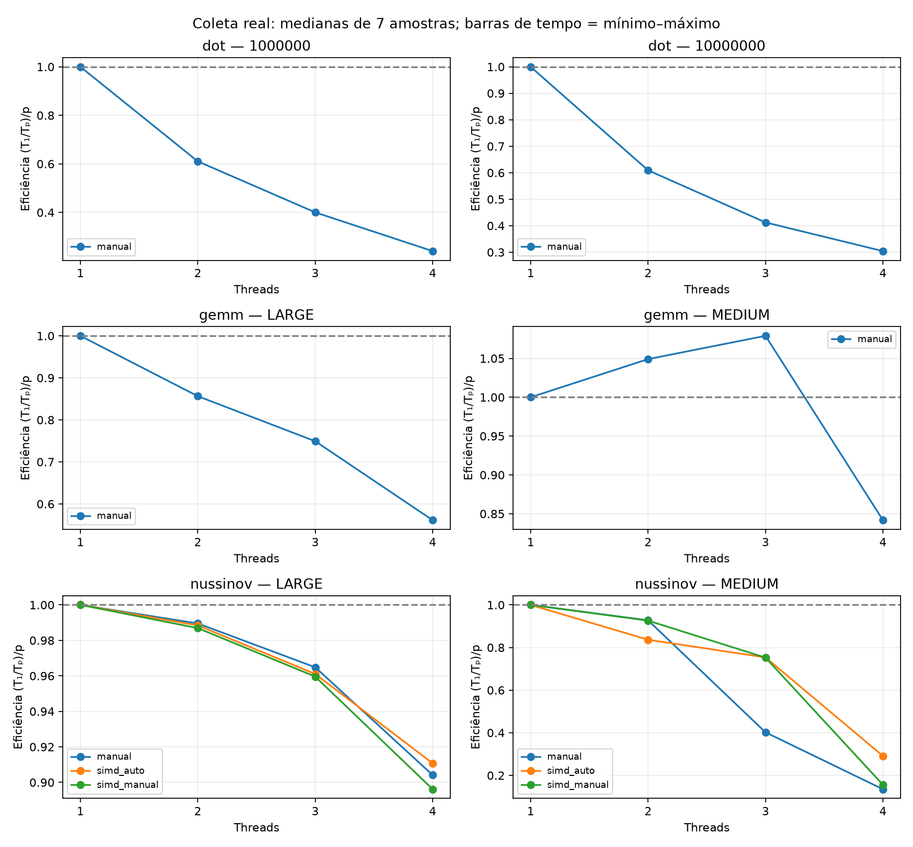

### A.3. Dot C exploratório: cinco medições e regime de medição

O pipeline foi executado em modo `--prepare-only`, sem inferência nem promoção,
com Clang 18.1.3 e 1T–4T. Os dois casos terminaram PREPARED e passaram pelos
gates de corretude. Cada configuração tem cinco medições externas. O caso
grande usa 100 chamadas internas de N=10 milhões; o pequeno usa 10.000 chamadas
de N=1024. Esses drivers e a distribuição dos valores diferem do Dot C++ manual.
A validação do pipeline usa seu driver de N=1 milhão e não constitui um teste
de todas as entradas temporizadas.

| Caso | Tseq (s) | T1 (s) | T4 (s) | S total 4T | S paralelo 4T | Seleção |
|---|---:|---:|---:|---:|---:|---|
| large | 0.010385878850 | 0.010864713850 | 0.008063438350 | 1.288 | 1.347 | 3T; S total 1.264× |
| small | 0.000000889980 | 0.000001850426 | 0.000004171944 | 0.213 | 0.444 | Sem paralelo admissível |

No caso grande, 4T teve a menor mediana (0,00806343835 s), mas 3T ficou
1,908% acima dela; a política de quase empate de 2% recomendou 3T, com
ganho total de 1,264×, escalabilidade de 1,322× e eficiência de 0,441.
O caso pequeno não admitiu paralelo. Essa diferença frente ao Dot C++
mostra que primeira chamada, driver e amortização precisam ser informados.
Os resultados não isolam o efeito de um único fator e não são ganhos da LLM.

Os diagnósticos novos do Clang confirmaram o bloqueio por dependência de memória
no laço k da versão manual de Nussinov e a vetorização de largura 4 e fator
de intercalação 2 nas versões SIMD. Apesar disso, em N=2500, SIMD 1T levou
cerca de 17,560 s, contra 16,624 s da versão manual sem a diretiva: a aplicação
de SIMD não garante benefício. A seção `.text` dos executáveis SIMD manual e
automático é idêntica nesta compilação LARGE (SHA-256 registrado nos
diagnósticos). Diferenças de tempo entre eles não evidenciam uma melhoria
do código computacional automático. Os executáveis de diagnóstico são
separados daqueles efetivamente medidos.

Fonte: `results/scaling/`, relatório de verificação, CSVs e diagnósticos de
05/11. As 22 campanhas da matriz anterior permanecem separadas desta coleta.

### A.4. Comparação contextual: Linux exploratório e registros do M5

A tabela conserva o ponto comum de 4T e usa cada variante com seu próprio
baseline OpenMP 1T. Ela compara registros de campanhas distintas, não uma
nova campanha pareada entre máquinas. O Dot C possui o mesmo SHA-256 de
candidato e driver de benchmark arquivado da promoção M5; GEMM/Nussinov
históricos não têm esse vínculo completo. O compilador Linux é Clang 18.1.3,
enquanto o acervo M5 registra LLVM Homebrew 23.1.1.

| Caso | Linux exploratório T4 (s) | Linux T1/T4 | M5 arquivado T4 (s) | M5 T1/T4 | Registro M5 |
|---|---:|---:|---:|---:|---|
| dot automatic_C | 0.008063438 | 1.347 | 0.001964010 | 2.465 | 03/11; gates verificados no Mac |
| gemm manual | 0.284841000 | 2.245 | 0.043192000 | 3.282 | setembro; HISTORICAL_UNBOUND |
| nussinov manual | 4.596830000 | 3.616 | 0.319542000 | 2.957 | setembro; HISTORICAL_UNBOUND |
| nussinov simd_manual | 4.898844000 | 3.585 | 0.209503000 | 3.015 | setembro; HISTORICAL_UNBOUND |

Nussinov manual tem maior escalabilidade normalizada no Linux exploratório, mas menor
latência absoluta no registro M5. Logo, escalabilidade relativa e desempenho
absoluto respondem a perguntas distintas. O Dot C do estudo pareado M5 de
03/11 obteve 1,673× contra o sequencial, abaixo dos 2,465× da promoção do
mesmo dia, reforçando o cuidado com condições e variabilidade de campanha.

No Linux, os contextos originais dos gates Mac contêm caminhos absolutos do
outro ambiente, e um contexto em build não foi transferido. A consolidação
usa um resumo arquivado explícito, fixado por hash, quando os artefatos locais
estão indisponíveis, com rótulo ARCHIVED_SUMMARY_ONLY. Divergências de hash ou
contexto inválido continuam sendo erros. Não se reescreveram caminhos nem
relatórios históricos para simular uma validação Linux desses gates.

O Nussinov automático histórico continua com hardware desconhecido e não
foi incluído como medição M5. As novas curvas M5 nas mesmas entradas, fontes,
repetições e política de medição ainda são necessárias para fortalecer esta
comparação. Os números acima não isolam ISA, memória ou contribuição da LLM.

## Apêndice de rastreabilidade e atualização

Fontes internas: [catálogo](../experiment_catalog.json),
[matriz completa](../../results/consolidated/REPORT.md),
[protocolo dos agentes](../COORDINATOR_EVALUATION.md),
[execução Linux](../COORDINATOR_EVALUATION_LOCAL.md),
[campanha Mac](../COORDINATOR_EVALUATION_MAC.md) e
[reprodução](../EXPERIMENT_REPRODUCTION.md). A conferência dos documentos Word
está em [LEITURA_DOS_DOCUMENTOS.md](LEITURA_DOS_DOCUMENTOS.md).

O estudo histórico de admissão foi preservado no resumo/abstract, §5.6, discussão e conclusão.
Não substituir tempos do kernel por latência de inferência. Nome de orientador,
template, paginação e exigências formais de entrega não foram inferidos dos
arquivos recebidos.

A coleta exploratória de 05/11 é descrita em §4.5 e preservada no Apêndice A,
com discussão técnica em §6.1. Fontes adicionais:
[protocolo multiplataforma](../ESCALABILIDADE_MULTIPLATAFORMA_2026-11-05.md),
[tabelas, amostras e gráficos novos](../../results/scaling/analysis_linux_xeon_2026-11-05/REPORT.md)
e [documento de revisão](../revisao_experimentos_2026-11-05/REVISAO.md).

A revisão principal utiliza [metodologia de quinze medições](../experiments/MULTIPLATFORM_METHODOLOGY.md),
[relatório numérico](../experiments/MULTIPLATFORM_REPORT.md) e os arquivos de
`results/multiplatform/`. A fonte original de `32ae80b` foi preservada como
`BASE_MONOGRAFIA_ORIGINAL_32ae80b.md`; a base de trabalho anterior também não foi
sobrescrita. Esta fonte `REVISAO_PUBLICACAO.md` é separada de
`REVISAO_MULTIPLATAFORMA.md`. A exportação deve gerar arquivos próprios, sem
sobrescrever a revisão que acompanhou p15w3; revisão PDF em ReportLab não equivale
a renderização nativa Office ou aprovação institucional.

Os experimentos novos estão especificados no [corpus](../publication/AUTOMATION_CORPUS.md),
[revisão do Transformer](../publication/TRANSFORM_REVIEW.md),
[repetibilidade](../publication/REPEATABILITY_PROTOCOL.md),
[diagnóstico](../publication/DIAGNOSTIC_PROTOCOL.md) e
[plano heldout](../publication/DIAGNOSTIC_RUN_PLAN.json). A comparação
bibliográfica possui [fontes/limites próprios](../publication/RELATED_WORK.md).
A bibliografia desta revisão é `referencias_publicacao.bib`. Os resultados do
corpus e das sessões compatíveis estão em §5.2–§5.3. O diagnóstico dispõe dos
relatórios finais de [Qwen](../../results/publication/diagnostics_qwen_heldout_linux_2026-11-05/results.json)
e [Llama](../../results/publication/diagnostics_llama_heldout_linux_2026-11-05/results.json),
com respostas, falhas e custos preservados separadamente do estudo histórico
de admissão.

O [protocolo do limite numérico](../publication/NUMERICAL_LIMIT_PROTOCOL.md) foi
fixado antes da execução. Seu [gate suplementar](../../results/publication/numerical_limit_linux_2026-11-06/gate.json)
e [manifesto](../../results/publication/numerical_limit_linux_2026-11-06/manifest.json)
preservam fontes, hashes, compilação e a falha observada com a configuração
solicitada de 2T. Essa única execução funcional é uma contraprova de garantia
numérica irrestrita, sem alterar os denominadores do corpus ou as campanhas
de tempo.
