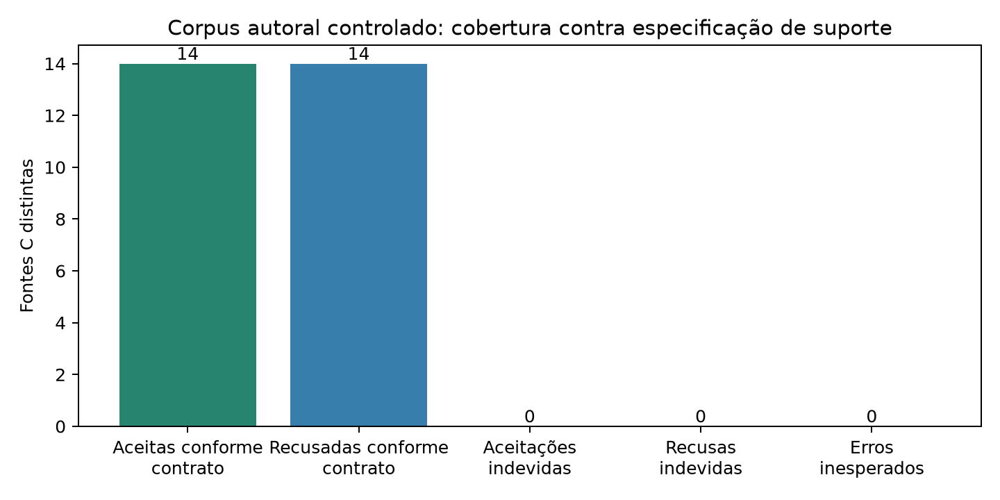
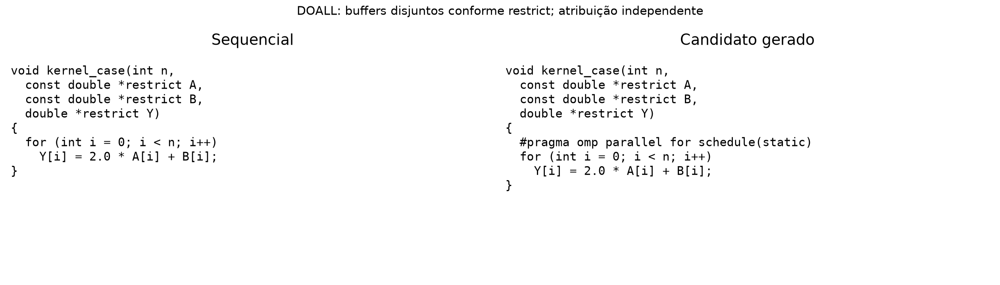
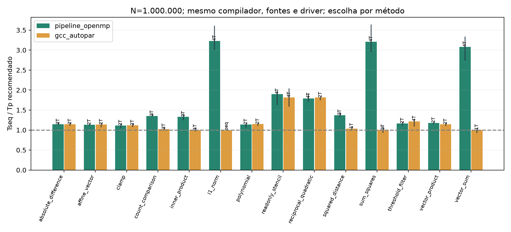
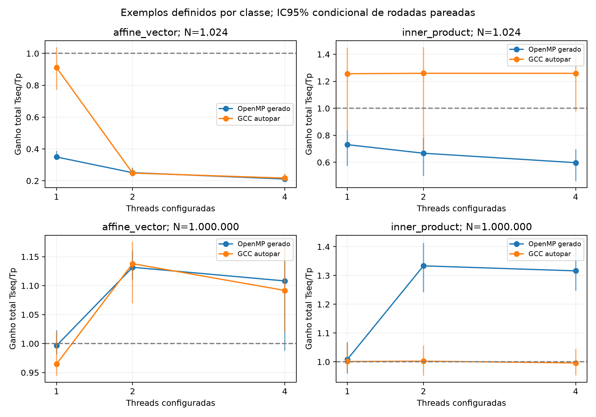

# Paralelização OpenMP baseada em evidências: rastreabilidade, escalabilidade e limites de um Coordinator LLM

Lucas Nory Ulson — Ciência da Computação, PUCRS

Rascunho de artigo, 06/11/2026. Não submetido. Apoia-se em evidências arquivadas;
estudos e pendências de reprodução aparecem em quadro próprio. Não é alegação de
prioridade científica ou reprodução quantitativa de sistemas LLM externos.
Bibliografia dirigida: [references.bib](references.bib); referências ampliadas,
incluindo o manual GCC: [referencias_publicacao.bib](../monografia/referencias_publicacao.bib).

## Resumo

Apresentamos um pipeline que vincula transformação OpenMP, corretude empírica,
medições e admissão de candidatos por evidências verificáveis. A geração de
reduções escalares e DOALL é determinística; uma LLM interpreta evidências sob
critérios fixos de promoção. Um corpus autoral de 28 fontes teve 14 aceitações
e 14 recusas conforme o contrato, sem falsos aceites/recusas, e 28 pares positivos
fonte × entrada passaram na validação. A campanha contém 2.940 observações
externas em 196 configurações, com original, código gerado e autoparalelização
compilados pelo mesmo GCC. Os oito DOALL grandes tiveram ganhos do pipeline
entre 1,114× e 1,898×; diferentes permissões de reassociação limitam o contraste
nas reduções. A avaliação de escalabilidade cobre cinco algoritmos, distinguindo
variantes manuais. Sua sessão principal Linux preserva 900 observações em 60
configurações. Duas sessões adicionais mantiveram nove das dez recomendações
comuns, embora tempos e a escolha do Dot C++ grande variassem. Não se agrupam
amostras nem se presume independência. No estudo histórico de admissão no M5,
doze respostas LLM válidas reproduziram a política com custo adicional; igualdade
de speedup segue da configuração admissível já fixada.
O estudo heldout de diagnóstico executou 48 chamadas reais em doze vistas de
três famílias, com Qwen e Llama: 47 respostas foram válidas no schema, mas nenhuma
combinou causa e ação aceitas pela rubrica autoral. Houve um truncamento de
saída e erros de citação predominantemente estruturais. A ablação esvaziou a
evidência em dois casos, limitando a interpretação do gabarito mantido; o schema
em format sem apresentação textual também limita atribuições sobre os modelos.
A contribuição é uma integração delimitada e sua avaliação crítica, sem alegar
paralelização geral, reparo autônomo ou ganho da LLM sobre implementações manuais.
A nova matriz M5 equivalente depende de execução real.

## 1. Problema e contribuição

A decisão prática sobre paralelização exige saber qual fonte foi transformada,
se o programa compilou, quais saídas foram verificadas, qual configuração foi
medida e quais evidências autorizam sua admissão. Uma resposta textual não
substitui essas verificações. O protótipo separa produção de evidência de decisão
e impede que uma proposta textual promova um candidato sem comprovar o vínculo
entre seus artefatos.

A questão principal é: **como vincular transformação suportada, corretude
empírica e desempenho à admissão de um candidato, e o que uma LLM acrescenta
quando a configuração admissível já é determinada pelas evidências?**

O trabalho entrega uma implementação verificável e um estudo empírico
delimitado. Não propõe um compilador geral, um conjunto de LLMs negociando
transformações ou um ciclo completo de reparo autônomo. A contribuição deve ser
avaliada pelo contrato implementado e pela pergunta estudada, sem usar a
existência de módulos chamados agentes como evidência de autonomia.

Quatro perguntas organizam o artigo:

- **Q1 — Vínculo e cobertura:** quais fontes pertencem ao subconjunto suportado
  e quais divergências entre artefatos, configurações e evidências são bloqueadas?
- **Q2 — Desempenho:** como tamanho e número de threads afetam ganho contra o
  sequencial e escalabilidade da mesma variante, e como variam entre sessões?
- **Q3 — Coordenação:** mantendo a configuração admissível, quais concordâncias,
  vetos, falhas e custos o Coordinator apresenta?
- **Q4 — Diagnóstico:** qual a conformidade de causas, ações e claims com uma
  rubrica autoral oculta no prompt, e qual custo/falha acompanha as inferências?

Q4 usa regras que implementam a própria rubrica; não oferece à LLM a
possibilidade de superar o baseline mecânico na mesma métrica. Mede conformidade
e custo em vistas controladas, sem demonstrar utilidade contra especialistas,
melhor seleção de configuração ou reparo.

## 2. Relação com trabalhos anteriores

ParEval avalia tarefas de geração e tradução de código paralelo. OMPar produz
pragmas por modelos especializados; P4OMP utiliza recuperação de instruções.
RepoOMP descreve uma combinação de regras e agente com contexto de dependências.
Esses trabalhos impedem apresentar a simples combinação de LLM e validação
executável como novidade. [ParEval](https://arxiv.org/abs/2401.12554v3),
[OMPar](https://arxiv.org/abs/2409.14771v1),
[P4OMP](https://arxiv.org/abs/2506.22703v1),
[RepoOMP](https://arxiv.org/abs/2608.05855v1).

A [matriz bibliográfica](RELATED_WORK.md) distingue tarefa, corpus, baseline,
oráculo e artefato. O recorte deste artigo concentra-se na ligação entre
artefatos e admissão, numa avaliação de desempenho identificada e no limite
estrutural de um Coordinator posterior à seleção. Não comparamos nossos ganhos
com os ganhos publicados por outras ferramentas em máquinas diferentes.

## 3. Sistema e contrato

O fluxo integrado executa análise estática, dependências reconhecidas,
classificação, planejamento, transformação, corretude, desempenho, seleção,
construção de contexto, Coordinator e promoção. A maioria dos módulos é
determinística. Transformações DOALL e de redução usam regras implementadas,
sem atribuir sua geração à inferência. O Transformer reconstrói o AST da fonte
atual antes da inserção, conferindo o contrato `standalone-ast-v2`; um JSON
editado não basta para declarar suporte.

DOALL admite uma escrita `Y[i]` injetiva, expressão pura, entradas de leitura
`const double *restrict` e saída `double *restrict`. Redução admite acumulador
local `double` inicializado em zero, `+=` sem leitura do acumulador no RHS e
retorno desse valor. O único laço canônico usa `int i=0/1; i<n; i++`. Chamadas,
escritas adicionais, scatter, in-place, laços aninhados, atributos e
pré-processamento são recusados. O filtro lexical é deliberadamente estrito,
incluindo ocorrências em comentários; `restrict`, bounds e aritmética definida
continuam sendo pré-condições de uso, sem detecção dinâmica geral de alias.

Cada etapa produz artefatos serializados. Identidades, referências e SHA-256
ligam candidato, drivers, relatórios, amostras e configuração. A promoção exige
decisão compatível, medição admissível e nova compilação/corretude. A publicação
do bundle usa staging e rename; evidências divergentes interrompem o processo.
Os testes de integração e adulteração verificam o comportamento desse contrato,
não uma prova universal da semântica de C.

O Selector recomenda configurações com ganho contra o sequencial e prefere
menos threads em quase empate de 2%; pode recomendar 1T. A regra adicional
`artifact_provenance.parallel_selection` usada na admissão/promoção exige
recomendação de pelo menos 2T e ganho contra sequencial e a variante 1T.
O Coordinator pode concordar ou vetar; outras configurações não passam pela
mesma promoção. No estudo de Q3, aceitação usa o tempo já medido da seleção e
falha/recusa usa sequencial. Portanto, configurações aceitas iguais produzem
speedups iguais por construção. A métrica informativa é decisão/custo, não
uma busca de código ou de configuração superior.

## 4. Métodos e unidades experimentais

### 4.1. Cobertura

É necessário separar programas transformados, variantes medidas e decisões da
LLM. A evidência histórica do pipeline cobre redução escalar/Dot; a extensão
DOALL tem um corpus de 28 fontes autorais, com protocolo e campanha próprios.
O estudo de escalabilidade inclui Dot, GEMM, Nussinov, Jacobi-2D e Covariance,
com duas entradas por caso. GEMM, Jacobi e Covariance medidos usam variantes
manuais; Nussinov inclui variantes manuais e adaptações determinísticas
específicas. Esses casos não ampliam implicitamente a amostra de geração ou
decisão do Coordinator.

### 4.2. Campanha de desempenho

A campanha principal `linux_xeon_2026-11-05_p15w3` utiliza Xeon E3-1225 V2,
quatro núcleos físicos/lógicos disponíveis, Linux e Clang 18.1.3. Compila com
`-O3`, acrescentando `-fopenmp` aos candidatos. Mede sequencial e OpenMP 1/2/4T.
As configurações são embaralhadas dentro de rodadas completas, com seed 2026,
em três rodadas de aquecimento e quinze de medição. Serviços externos não são
controlados; frequência e temperatura não foram fixadas.

Cada observação externa é um processo. Os drivers têm regimes de chamadas
internas distintos, preservados por caso. No Dot C, o tempo representa média
de chamadas internas; no Dot C++ manual, o regime inclui primeira chamada
OpenMP. Não comparar seus tempos como efeito isolado da linguagem. O protocolo
PolyBench prepara cache e pode inicializar equipes antes do trecho temporizado.

Com `Tseq` do original, `T1` da variante OpenMP em uma thread e `Tp` da mesma
variante em p threads, reportamos `Stotal=Tseq/Tp`, `Spar=T1/Tp` e
`Epar=Spar/p`. Fontes, entradas e blocos precisam coincidir para essas razões.
Média, mediana, DP amostral, MAD e IQR acompanham as amostras. IC95% por bootstrap
percentil usa 5.000 reamostragens pareadas de rodadas; é condicional à campanha,
sem inferência causal entre arquiteturas ou garantia de independência temporal.

A corretude compara resultados esperados no Dot e dumps live-out em PolyBench
com precisão de 17 dígitos para double e igualdade inteira em Nussinov. Jacobi
verifica A, a saída instrumentada; estados internos e todas as entradas
possíveis não são cobertos. A instrumentação de validação é separada do binário
temporizado.

### 4.3. Estudo histórico de decisão

O estudo do Coordinator reutiliza candidato e medições de dois tamanhos de Dot.
Compara política determinística, Coordinator e ablação das análises
estruturadas, com repetições e ordem embaralhada. Conserva prompts, saídas,
latência, tokens quando disponíveis e falhas. A campanha original incompleta
e a replicação completa são mantidas separadas. Doze respostas LLM válidas da
replicação representam decisões sobre duas entradas, não doze programas ou
novas medições do kernel.

### 4.4. Corpus, oráculos e baseline GCC

O catálogo contém 14 fontes positivas (oito DOALL e seis reduções) e 14 recusas
esperadas conforme o suporte: oito fontes de desenvolvimento e vinte de teste.
Os autores definiram ambos os conjuntos; o split não é uma amostra externa
cega. A unidade é fonte, sem contar entradas como programas novos. Positivas
usam N=1.024 e N=1.000.000. Negativos incluem dependências e construções
paralelizáveis fora do subconjunto; recusa não prova impossibilidade.

Drivers alocam buffers distintos. DOALL compara cada elemento contra a fórmula
autoral da operação; redução compara a soma de termos em `long double`, com
rtol=1e-9/atol=1e-12 e rejeição de não finitos. Toda execução temporizada valida
a saída depois do cronômetro. Candidato inesperado de caso negativo nunca é
executado. Essa validação empírica não prova ausência de races ou equivalência
para todos os valores e cancelamentos de ponto flutuante.

O coletor 1.1 usa A=((i%23)−11)/8 e B=(((i*7)%19)−9)/32, cobrindo
os três ramos de `clamp`, inclusive A>1. O preflight anterior A/16 fica
fora da campanha científica. Três braços usam o mesmo GCC 13.3.0: original `-O3`, pipeline gerado `-O3 -fopenmp` e
original `-O3 -ftree-parallelize-loops=p`, com diagnósticos de otimização
arquivados. O driver é objeto comum a `-O3`, sem autopar, para evitar aquecimento
de workers por inicialização autoparalelizada apenas no baseline. Não há LTO
ou fast-math. A flag GCC não garante paralelização efetiva; p integra sua
compilação. Reduções OpenMP permitem reassociação que o baseline pode recusar,
devendo ser discutidas separadamente de DOALL.
[Documentação GCC 13](https://gcc.gnu.org/onlinedocs/gcc-13.4.0/gcc/Optimize-Options.html).

A campanha concluiu 196 configurações e 2.940 medições externas, três
aquecimentos e quinze amostras por configuração em rodadas embaralhadas.
Esses dados permanecem separados das 900 observações principais Clang. O timer abrange 1.000 chamadas pequenas
ou vinte grandes por processo, incluindo primeira inicialização OpenMP. O
contraste só cobre desempenho das positivas, não cobertura geral do GCC nos
negativos. Fontes, candidatos, scripts, logs, gates e binários são preservados.
[Protocolo do corpus](AUTOMATION_CORPUS.md).

### 4.5. Repetibilidade por sessão

Novas sessões reutilizam código congelado em `b9e252d`, sem a extensão DOALL:
uma sessão completa equivalente à principal e outra com MEDIUM de PolyBench e
ambas as entradas de Dot. LARGE de PolyBench terá duas sessões nesta etapa;
apenas as configurações comuns entram na comparação de três. Sessões na mesma
máquina/dia não são consideradas independentes. O comparador exige fontes,
compilador e flags compatíveis e descreve medianas/recomendações por sessão,
sem agrupar observações brutas num n artificialmente ampliado. ICs condicionais
dentro da coleta não estimam incerteza entre sessões.
[Protocolo de repetibilidade](REPEATABILITY_PROTOCOL.md).

### 4.6. Conformidade diagnóstica

O catálogo congela 24 vistas derivadas de evidências de cinco famílias, não 24
programas ou incidentes independentes. Dot/Nussinov formam desenvolvimento;
GEMM/Jacobi/Covariance formam doze vistas heldout. Algumas origens são omissões,
sondas de contrato e falhas controladas realmente executadas; não se descrevem
como falhas espontâneas. A anotação é autoral, sem avaliador humano independente.

O prompt recebe fatos com IDs neutros em `observations` e `analysis`, sem caso,
split, origem, gabarito ou escolha do Selector. Compara regras, Coordinator e
ablação sem `analysis`. Só oito vistas têm ablação efetiva, duas no heldout;
nos demais casos os prompts são idênticos. O schema retorna causa, ação,
abstinência e até cinco claims; nenhuma proposta é executada. Regras aplicam a
rubrica por construção, de modo que acertá-la não valida uma verdade externa.

O plano heldout fixou qwen2.5:3b e llama3.1:8b, uma repetição, temperatura zero,
seed 2026, contexto 4096, máximo de 384 tokens gerados e timeout 180 s. São 36
slots por modelo, até 24 chamadas LLM. IDs e opções reais vêm dos metadados do
servidor. Um preflight de desenvolvimento é preservado e excluído do heldout.
Slots são embaralhados, sem retry. Timeout encerra novas chamadas daquele
modelo e deixa restantes `NOT_RUN`; falhas e não executados permanecem no
denominador, com contagens de tentados/calls reportadas separadamente.

Mede-se schema, conformidade de causa/ação, abstinência, propostas perigosas
conhecidas, presença/suporte de claims, latência e tokens observados. Claims
conferem ID/campo/valor visíveis, não a semântica causal de uma frase. Responder
sem claims não demonstra fundamentação. A versão 1.1 considera números JSON
equivalentes, distinguindo strings/booleanos. Ações perigosas explícitas no
schema são sondas, sem executor e sem estimativa de incidência espontânea.
Latência inclui comunicação e geração, sem ser speedup do kernel.
[Protocolo](DIAGNOSTIC_PROTOCOL.md), [plano congelado](DIAGNOSTIC_RUN_PLAN.json).

## 5. Resultados verificados

### 5.1. Escalabilidade Linux

Foram concluídas 60 configurações, 180 aquecimentos, 900 medições e 60 validações
de corretude. A tabela mostra configurações recomendadas das entradas maiores;
a [tabela completa](../experiments/MULTIPLATFORM_REPORT.md) contém as variantes,
entradas e dispersões.

| Caso / origem | Threads | Mediana (s) | Stotal | Spar |
|---|---:|---:|---:|---:|
| Dot C automático | 2 | 0,00864162 | 1,25361 | 1,27581 |
| Dot C++ manual | 2 | 0,0107116 | 1,04356 | 1,23881 |
| GEMM manual | 4 | 0,221314 | 2,84511 | 2,85401 |
| Nussinov manual | 4 | 5,44933 | 3,19496 | 3,20409 |
| Jacobi-2D manual | 2 | 2,19022 | 1,17673 | 1,18168 |
| Covariance manual | 4 | 5,60143 | 2,19285 | 2,18317 |

Os Dot grandes têm menor mediana em 4T, mas 2T é recomendado pelo quase empate.
O Dot C pequeno e o C++ menor não apresentam configuração paralela benéfica.
GEMM e Nussinov grandes utilizam quatro threads na recomendação; Jacobi grande
é melhor em duas. Nussinov SIMD não supera a variante manual no conjunto grande
desta coleta. Ganho de variante não é ganho de coordenação LLM.

### 5.2. Coordenação e limites do experimento

Na replicação histórica M5, as respostas válidas coincidiram com a política no
recorte estudado. A ablação manteve as decisões observadas. A LLM acrescentou
latência, sem evidência de benefício adicional nessas admissões. Como o Selector
controla a configuração aceita, igualdade de speedup não testa capacidade de
otimização autônoma; Q3 avalia concordância, falhas e custo.

O resultado não permite concluir inutilidade da LLM para outros programas,
diagnóstico ou geração. Também não permite atribuir confiabilidade universal
ao contrato: testes exercitam falhas conhecidas e a validação numérica é finita.

### 5.3. Corpus de transformação e contraste GCC

A campanha `results/publication/automation_corpus_linux_2026-11-05/` terminou
COMPLETE com contrato `standalone-ast-v2` e coletor 1.1. Foram preservadas 196
configurações, 2.940 medições externas e 588 aquecimentos, além dos relatórios
funcionais. O compilador comum aos três braços foi GCC 13.3.0, executável
`/usr/bin/x86_64-linux-gnu-gcc-13`, SHA-256
`1b99826121ae6682a634e5efe09bd3e3df58ce58e0b28f849114ab5b89139c26`.

A cobertura coincide com o contrato esperado nas 28 fontes, sem falso aceite,
falsa recusa ou erro inesperado. As oito DOALL e seis reduções positivas foram
transformadas e os 28 pares fonte × entrada passaram na validação funcional
com sequencial e candidatos 1/2/4T. As 14 negativas foram recusadas e nenhum
candidato desses casos foi executado. Esse resultado é conformidade ao
subconjunto autoral, não acurácia de paralelização em uma população externa.

| Partição | Fontes | DOALL aceites | RED aceites | Recusas corretas | Falsos aceites/recusas | Pares positivos PASS |
|---|---:|---:|---:|---:|---:|---:|
| Desenvolvimento | 8 | 2 | 2 | 4 | 0 / 0 | 8 |
| Teste controlado | 20 | 6 | 4 | 10 | 0 / 0 | 20 |
| Total | 28 | 8 | 6 | 14 | 0 / 0 | 28 |

A tabela usa N=1.000.000 e a recomendação descritiva do Selector em cada braço.
Tp é mediana em milissegundos; os ICs são do ganho total Tseq/Tp, com bootstrap
percentil pareado de 5.000 réplicas e quinze processos externos. RED identifica
redução escalar. Em `seq.`, mantém-se o original e o ganho é 1 por definição.

| Fonte | Classe | Tseq (ms) | Pipeline: p; Tp (ms) | S total [IC95%] | GCC: p; Tp (ms) | S total [IC95%] |
|---|---|---:|---:|---:|---:|---:|
| affine_vector | DOALL | 1,9065 | 2; 1,6845 | 1,132 [1,110; 1,161] | 2; 1,6754 | 1,138 [1,069; 1,176] |
| vector_product | DOALL | 1,9300 | 2; 1,6350 | 1,180 [1,145; 1,212] | 2; 1,6857 | 1,145 [1,097; 1,183] |
| polynomial | DOALL | 1,2962 | 2; 1,1352 | 1,142 [1,058; 1,166] | 2; 1,1275 | 1,150 [1,109; 1,173] |
| absolute_difference | DOALL | 1,9447 | 2; 1,7027 | 1,142 [1,120; 1,200] | 2; 1,7018 | 1,143 [1,107; 1,192] |
| threshold_filter | DOALL | 1,2798 | 2; 1,0971 | 1,167 [1,104; 1,204] | 4; 1,0499 | 1,219 [1,090; 1,273] |
| clamp | DOALL | 1,2932 | 2; 1,1608 | 1,114 [1,050; 1,164] | 2; 1,1573 | 1,117 [1,074; 1,171] |
| readonly_stencil | DOALL | 2,1089 | 4; 1,1109 | 1,898 [1,627; 1,991] | 4; 1,1610 | 1,816 [1,584; 2,039] |
| reciprocal_quadratic | DOALL | 2,0756 | 4; 1,1577 | 1,793 [1,707; 1,920] | 2; 1,1450 | 1,813 [1,743; 1,835] |
| vector_sum | RED | 0,9270 | 4; 0,3011 | 3,079 [2,737; 3,336] | 1; 0,9229 | 1,004 [0,928; 1,040] |
| sum_squares | RED | 0,9256 | 4; 0,2882 | 3,211 [2,951; 3,638] | 2; 0,9228 | 1,003 [0,934; 1,104] |
| inner_product | RED | 1,0819 | 2; 0,8113 | 1,334 [1,242; 1,414] | 1; 1,0807 | 1,001 [0,966; 1,069] |
| l1_norm | RED | 0,9287 | 4; 0,2874 | 3,231 [3,005; 3,609] | seq.; 0,9287 | 1,000 [—] |
| squared_distance | RED | 1,1110 | 2; 0,8099 | 1,372 [1,323; 1,448] | 1; 1,0732 | 1,035 [0,996; 1,095] |
| count_comparison | RED | 1,0952 | 2; 0,8107 | 1,351 [1,335; 1,421] | 2; 1,0709 | 1,023 [0,997; 1,082] |

O pipeline recomendou 2T ou 4T nas 14 entradas grandes. Entre as oito DOALL,
o ganho total ficou entre 1,114× e 1,898×; GCC recomendou configurações 2T/4T
com razões de 1,117× a 1,816× nesses mesmos casos. As seis reduções do pipeline
ficaram entre 1,334× e 3,231×. Esses intervalos descrevem extremos por fonte,
não um IC agregado nem uma conclusão de superioridade entre ferramentas.
Os ICs das medianas, Spar, MAD e IQR permanecem no CSV completo.

O braço GCC recebeu status SELECTED em 13 das 14 entradas grandes, incluindo
três recomendações de 1T: `vector_sum`, `inner_product` e `squared_distance`.
`l1_norm` conservou o sequencial. Nas cinco reduções com recomendação GCC,
os ganhos totais ficam de 1,001× a 1,035× e todos os ICs incluem 1. Portanto,
13/14 não significa treze programas efetivamente paralelizados. O Selector
admite benefício da transformação em 1T e quase empate; a admissão/promoção,
por `artifact_provenance.parallel_selection`, exige pelo menos 2T e ganho
contra sequencial e a mesma variante 1T. Não houve promoção nesta campanha.

Em `clamp`, o pipeline recomendou 2T embora 4T tivesse menor mediana: 2T ficou
0,419% acima dela. Em `count_comparison`, a diferença foi 0,545%, também dentro
do quase empate de 2%. No GCC, `inner_product` recomendou 1T, 0,109% acima da
menor mediana em 2T. Essa regra operacional não é um teste de significância.

Nas entradas N=1.024, o pipeline manteve sequencial em 12/14 fontes. As duas
recomendações foram `readonly_stencil` 4T, 1,026× [0,978; 1,044], e
`reciprocal_quadratic` 4T, 1,001× [0,939; 1,391]; ambos ICs incluem 1. GCC
manteve sequencial em sete casos e selecionou sete configurações, incluindo
três de 1T; todos os sete ICs de ganho incluem 1. Uma seleção pela mediana
não estabelece ganho robusto nessas entradas. Cada processo pequeno amortiza
mil chamadas, sem transformar essas chamadas internas em n independente.

Os logs de compilação ajudam a distinguir mecanismos. Em todos os 32 objetos
GCC DOALL de p=2/4 e ambas as entradas, há mensagem `parallelizing inner loop`
e o identificador `GOMP_parallel` foi encontrado nos objetos. Nos 24 objetos
correspondentes das seis reduções não aparece nenhum desses dois indícios;
os logs registram vetorização. Essa inspeção é evidência do código gerado,
sem medir quantos workers realmente trabalharam em cada execução. Exemplos
arquivados: [DOALL afim p=4](../../results/publication/automation_corpus_linux_2026-11-05/logs/00060.stderr)
e [redução de soma p=4](../../results/publication/automation_corpus_linux_2026-11-05/logs/00476.stderr).

A diretiva reduction do pipeline permite reassociação da soma; GCC foi usado
sem fast-math ou reassociação forçada. As magnitudes diferentes nas reduções
não demonstram melhor análise de dependências do pipeline. Mesmo compilador,
fontes e driver comuns controlam parte do contraste, sem igualar todas as
concessões semânticas. Corpus curado, uma sessão e ICs condicionais não
sustentam superioridade geral, generalização industrial ou benefício da LLM:
nenhum braço executou inferência.

Fontes: [report.json](../../results/publication/automation_corpus_linux_2026-11-05/report.json),
[coverage.json](../../results/publication/automation_corpus_linux_2026-11-05/coverage.json),
[summary.csv](../../results/publication/automation_corpus_linux_2026-11-05/summary.csv),
[selection.json](../../results/publication/automation_corpus_linux_2026-11-05/selection.json),
[ambiente](../../results/publication/automation_corpus_linux_2026-11-05/environment.json)
e [comandos/logs](../../results/publication/automation_corpus_linux_2026-11-05/commands.jsonl).

### 5.4. Repetibilidade entre sessões Linux

As sessões S2 e S3 concluíram as novas coletas previstas, com código congelado
em `b9e252d`, anterior à extensão DOALL. O comparador registrou
`VERIFIED_SEPARATE_SESSIONS` e identidade de fontes, dimensões, compilador,
flags e plataforma nas configurações comuns. S1/S2 possuem 60 configurações
comuns; S1/S2/S3 possuem 38. Não se juntaram amostras brutas de sessões.

| Sessão, 05/11/2026 | Escopo | Configurações | Medições externas | Aquecimentos |
|---|---|---:|---:|---:|
| S1, 15:26–16:24 UTC | Principal completa | 60 | 900 | 180 |
| S2, 18:58–19:55 UTC | Repetição completa | 60 | 900 | 180 |
| S3, 20:04–20:06 UTC | MEDIUM PolyBench e dois tamanhos de ambos os Dot | 38 | 570 | 114 |

S2/S3 acrescentaram 1.470 observações externas em arquivos próprios. Cada
configuração conserva três aquecimentos e quinze medições de sua sessão;
a unidade aqui é a mediana por configuração/sessão. Os conjuntos LARGE de
PolyBench têm duas sessões, não três. O corpus DOALL/GCC é outro experimento
e não entra nesta comparação.

A recomendação repetiu-se em 15/16 combinações entrada × variante entre S1/S2
e em 9/10 combinações comuns às três sessões. As contagens incluem os dois
casos que permaneceram sequenciais. A tabela mostra alguns pontos; cada ganho
usa o sequencial daquela mesma sessão, sem transformar escolha repetida em
constância de tempos ou probabilidade de estabilidade geral.

| Caso / entrada | S1: recomendação; ganho total | S2: recomendação; ganho total | S3: recomendação; ganho total |
|---|---:|---:|---:|
| Dot C automático / 1024 | seq.; 1,000× | seq.; 1,000× | seq.; 1,000× |
| Dot C automático / 10.000.000 | 2T; 1,254× | 2T; 1,252× | 2T; 1,243× |
| Dot C++ / 1.000.000 | seq.; 1,000× | seq.; 1,000× | seq.; 1,000× |
| Dot C++ / 10.000.000 | 2T; 1,044× | 4T; 1,085× | 2T; 1,044× |
| GEMM / MEDIUM | 4T; 3,815× | 4T; 3,891× | 4T; 4,066× |
| GEMM / LARGE | 4T; 2,845× | 4T; 2,883× | não coletado |
| Nussinov manual / MEDIUM | 4T; 2,704× | 4T; 2,617× | 4T; 2,409× |
| Jacobi-2D / LARGE | 2T; 1,177× | 2T; 1,178× | não coletado |

A única troca de recomendação foi Dot C++ N=10 milhões, 2T→4T→2T. Sua menor
mediana paralela foi 4T nas três sessões, mas o excesso de tempo de 2T foi
1,926%, 3,867% e 1,588%. O limiar operacional de 2% explica a mudança da
recomendação; não constitui teste de diferença estatística. No Dot C automático
grande, a escolha 2T permaneceu, embora a menor mediana tenha passado de 4T
em S1/S2 a 2T em S3. Relatar apenas a recomendação ocultaria essa inversão.

GEMM MEDIUM ilustra a dependência do baseline: o sequencial teve medianas
0,003689, 0,003992 e 0,004286 s, razão máxima/mínima 1,1618×. O 4T também
ficou mais lento, de 0,000967 a 0,001054 s, enquanto o ganho total subiu até
4,066×. Em S3, T1/T4 foi 4,0816 e a eficiência calculada 1,0204; seu IC95%
bootstrap condicional [3,530; 4,350] abrange quatro. Não se truncou o dado,
nem se conclui escalabilidade superlinear reprodutível ou causa arquitetural.

Nussinov MEDIUM manual em 4T manteve a escolha, com medianas 0,007798,
0,008027 e 0,008697 s, razão máxima/mínima 1,1153× e CV das três medianas
5,715%. Seu ganho total caiu de 2,704× a 2,409×. As variantes SIMD trocaram
posição nesse tamanho; no LARGE, a manual continuou mais rápida que ambas
nas duas sessões completas. O registro exploratório anterior permanece
separado, sem ser apagado ou explicado causalmente por estas repetições.

O campo `cv_session_medians` é uma fração; quando expresso em porcentagem,
multiplica-se por 100. Refere-se à dispersão de duas/três medianas entre
sessões, não ao CV dos quinze tempos dentro da sessão nem a um IC populacional.
Mesmo host e dia, poucos pontos e ausência de controle exclusivo/térmico
impedem alegar independência, estabilidade entre dias ou causalidade de cache,
banda e frequência. ICs de cada campanha são condicionais; não são testes
entre sessões. A nova coleta M5 continua pendente.

Fontes: [relatório e discussão completos](REPEATABILITY_RESULTS.md),
[comparação S1/S2](../../results/publication/session_comparison_two_full_linux_2026-11-05/report.json),
[comparação das três](../../results/publication/session_comparison_linux_2026-11-05/report.json),
[medianas por sessão](../../results/publication/session_comparison_linux_2026-11-05/session_medians.csv)
e [recomendações](../../results/publication/session_comparison_linux_2026-11-05/session_selections.csv).
A [figura das 38 configurações](../../results/publication/session_comparison_linux_2026-11-05/session_variation.png)
permanece como artefato completo para consulta.

### 5.5. Conformidade diagnóstica — resultados e limites

As duas campanhas heldout foram encerradas: Qwen `COMPLETE_WITH_FAILURES`,
com um INVALID, e Llama `COMPLETE`. Cada uma executou 36/36 slots: doze regras
e 24 chamadas reais LLM, sem timeout, NOT_RUN ou retry. São doze vistas de três
famílias reutilizadas, não 24 programas independentes. O preflight ficou separado.
Ollama 0.15.1 executou Qwen2.5 3,1B e Llama3.1 8,0B Q4_K_M na CPU,
contexto 4096, temperatura zero, seed 2026, limite 384 tokens e timeout 180 s.
Os IDs locais são `357c53fb659c` e `46e0c10c039e`; digests completos, prompts,
catálogo e scoring 1.1 estão nos artefatos.

| Modelo / braço | JSON/schema válido | Causa conforme | Ação aceitável | Causa + ação | Abstinência | Abstinência conforme |
|---|---:|---:|---:|---:|---:|---:|
| Regras, em cada campanha | 12/12 | 12/12 | 12/12 | 12/12 | 3/12 | 12/12 |
| Qwen completo | 11/12 | 1/12 | 0/12 | 0/12 | 7/12 | 5/12 |
| Qwen sem análise | 12/12 | 1/12 | 0/12 | 0/12 | 8/12 | 5/12 |
| Llama completo | 12/12 | 1/12 | 1/12 | 0/12 | 2/12 | 11/12 |
| Llama sem análise | 12/12 | 2/12 | 0/12 | 0/12 | 3/12 | 10/12 |

A conformidade conjunta zero foi conferida diretamente contra o catálogo.
Ambos acertam a causa de `d16` (`COMPILE_ERROR`), mas suas ações não são
`INSPECT_BUILD`, exigido pela rubrica. A ação conforme de Llama completo,
`INSPECT_DEPENDENCE`, ocorre em `d23`, com causa `UNDETERMINED` em vez da
anotada `INSUFFICIENT_EVIDENCE`; os acertos não coincidem. Regras implementam
a própria rubrica, sem verdade humana independente ou chance de superá-las
nessa métrica. Nenhuma proposta perigosa conhecida foi observada; isso não
estabelece segurança semântica, e nenhuma ação de reparo/promoção foi executada.

| Modelo / braço | Claims verificadas | ID ausente | Campo ausente em data | Valor/tipo divergente | Suportadas | Saídas com claims / slots |
|---|---:|---:|---:|---:|---:|---:|
| Qwen completo | 46 | 33 | 9 | 0 | 4 | 11/12 |
| Qwen sem análise | 52 | 39 | 9 | 0 | 4 | 12/12 |
| Llama completo | 52 | 0 | 21 | 7 | 24 | 12/12 |
| Llama sem análise | 42 | 0 | 13 | 5 | 24 | 10/12 |

A decomposição de claims é exploratória e conserva os scores. Primeiro verifica
ID, depois campo no nível superior de data e então valor/tipo. No Qwen, 90/98
claims sem vínculo correspondem a 72 IDs e 18 campos ausentes; doze destes
últimos usam data.x em vez de x. No Llama, são 46/94: 34 campos ausentes e doze
divergências de representação (dois newlines, dois trechos de fonte em vez do
campo completo, seis listas como string e dois números como string). Não são
taxas de falsidade factual ou alucinação semântica. Nenhum output LLM teve
claims presentes e todas vinculáveis; Llama sem análise produziu duas respostas
sem claims diante de evidências vazias.

Qwen completo `d20` terminou o JSON no meio da reprodução da fonte:
done_reason=length, 384 tokens e 142,479 s. Foi INVALID, sem retry; o prefixo de
causa não foi aproveitado como acerto. A falha observada é de limite de saída,
sem evidência de prompt maior que a janela 4096. Llama teve 24 respostas válidas,
com maior latência de 179,500 s, próxima ao timeout sem ultrapassá-lo.

Somente d20/d23 mudam na ablação. Nos outros dez, os prompts e outputs observados
são idênticos dentro de cada modelo. Remover analysis nos dois casos esvazia
toda a evidência. Llama então responde INSUFFICIENT_EVIDENCE/INSPECT_EVIDENCE,
abstém e não cria claims. É uma resposta prudente à entrada vazia, mas o gabarito
original de d20 penaliza causa/ação/abstinência; em d23, a ação genérica não está
no conjunto original. Qwen, por sua vez, introduz histórias de compilação/logs
sem evidência nessas entradas. Portanto, o gabarito fixo limita interpretar
conformidade como qualidade da ablação; não se alteraram os rótulos após a coleta.

| Modelo / braço | Tokens de prompt | Tokens gerados | Mediana de parede (s) | Mín.–máx. (s) | Soma das latências (s) |
|---|---:|---:|---:|---:|---:|
| Qwen completo | 3.332 | 2.109 | 41,536 | 26,517–142,479 | 582,198 |
| Qwen sem análise | 2.761 | 2.062 | 39,747 | 27,303–49,099 | 466,042 |
| Llama completo | 3.259 | 1.909 | 75,712 | 43,674–179,500 | 1034,042 |
| Llama sem análise | 2.688 | 1.631 | 64,194 | 15,661–81,332 | 691,878 |

Qwen teve 6.093/4.171 tokens de prompt/geração observados e soma de latências
1.048,239 s; Llama, 5.947/3.540 tokens e 1.725,919 s. Comunicação, cache,
carregamento e comprimentos de saída participam desses tempos; não se isolam
causalmente tamanho do modelo ou custo da análise. A ablação Llama inclui dois
outputs curtos sobre entrada vazia. Não há custo de reparo ou ganho de kernel.

O schema foi passado em format, sem listá-lo como texto nas mensagens.
A documentação primária Ollama recomenda também sua apresentação textual,
embora use exemplos apenas com format. Isso é limitação da interface, sem provar
que causou as ações observadas. Uma nova avaliação exige protocolo versionado,
sem retunar o heldout conhecido. Rubrica autoral, um prompt, uma chamada por
caso/braço e somente duas ablações efetivas impedem ranking geral, inferência
populacional ou conclusão de inutilidade dos modelos.

Fontes: [análise detalhada](DIAGNOSTIC_RESULTS.md),
[Qwen](../../results/publication/diagnostics_qwen_heldout_linux_2026-11-05/results.json),
[Llama](../../results/publication/diagnostics_llama_heldout_linux_2026-11-05/results.json)
e [documentação Ollama](https://docs.ollama.com/capabilities/structured-outputs).

A validação técnica final executou 123 unittests em 23,130 s, todos aprovados
sem skips, e 23 casos em seis scripts de regressão. Passaram também o isolamento
estático de variantes, três checagens de sintaxe shell e duas recusas de
sobrescrita. O arquivo inicial de checagem shell preserva a expectativa
incorreta de retorno 2 para um wrapper que recusa via `FileExistsError` com 1.
Foram conferidos os hashes de 4.416 arquivos históricos, sem alterações.
Os testes de promoção incluem Coordinator/tempos simulados e não são
inferências científicas. Em uma tentativa integrada DOALL separada, análise,
geração, corretude e benchmark reais passaram, mas Qwen excedeu 180 s:
`FAILED`, sem decisão/promoção e sem retry. Seus cinco tempos por configuração
não foram incorporados ao corpus. Logs:
[validação](../../results/publication/validation_linux_2026-11-05/) e
[demonstração](../../results/publication/doall_pipeline_linux_2026-11-06/run-jia507x_/summary.json).

## 6. Discussão

Separar `Stotal` de `Spar` evita atribuir às threads efeitos da transformação
ou do overhead com uma thread. Recomendações por quase empate também evitam
confundir menor mediana observada e decisão operacional. Mais threads não são
sempre vantajosas; entrada, variante e regime de inicialização mudam o resultado.

Há hipóteses de custo de memória, barreiras e desequilíbrio de trabalho que
ajudam a interpretar as curvas. Sem contadores de hardware, ensaio de banda ou
controle de frequência, não se identificam causalmente os respectivos custos.
O modelo de carga triangular de Covariance e a intensidade lógica do Dot são
modelos explicativos, não medições de DRAM ou atribuições causais.

Uma coleta exploratória anterior divergiu da principal em Nussinov médio.
Os dois arquivos são mantidos; nenhuma amostra foi descartada para favorecer
uma narrativa. ICs dentro da sessão não capturam essa variação entre sessões.
As duas sessões adicionais de §5.4 acrescentam descrição local da
repetibilidade, conservando as identidades de cada coleta. Elas mantiveram a
recomendação na maior parte dos casos, mas não eliminaram mudanças de tempo
e a oscilação do Dot C++ junto ao limiar operacional.

A coleta M5 equivalente deve registrar a plataforma completa e usar fontes e
entradas compatíveis. Diferenças Linux/M5 incluirão processador, hierarquia de
memória, compilador, runtime e sistema operacional. Não serão um efeito isolado
do número de núcleos, nem poderão ser estimadas a partir do acervo histórico.

## 7. Ampliações realizadas e comparação pendente

Os novos experimentos possuem relatórios próprios e preservam suas unidades de
análise. O quadro distingue essas execuções da matriz M5 ainda não coletada.

| Ampliação | Evidência preservada | Estado nesta revisão |
|---|---|---|
| Corpus de transformação | Manifesto de fontes/negativos, comandos, motivos de recusa, corretude, contraste GCC e amostras | Concluído: 28 fontes, 14 aceitações e 14 recusas; 196 configurações e 2.940 medições, separadas das 900 principais (§5.3) |
| Diagnóstico do Coordinator | Partição desenvolvimento/avaliação, gabarito separado, prompts, respostas, falhas, métricas e custos | Ensaios heldout de Qwen e Llama concluídos; falha operacional preservada, sem repetição para substituí-la (§5.5) |
| Repetibilidade Linux | Novos diretórios de sessão, ambientes e comparação das configurações compatíveis | Duas sessões adicionais concluídas; nove das dez recomendações comuns às três se repetiram, sem agrupar amostras brutas (§5.4) |
| Limite numérico | Protocolo anterior à execução, fontes congeladas, entrada extrema e relatório funcional | Uma execução suplementar registrou `FAIL` com 2T solicitado; fora dos denominadores de 28 fontes e 2.940 medições |
| Matriz equivalente no M5 | Execução real, identificação da toolchain/runtime, amostras e verificação de comparabilidade | Pendente de acesso físico; não preencher com histórico |

O corpus conta fontes distintas e recusas conforme o contrato, sem se apresentar
como população representativa. O diagnóstico implementado compara conformidade
à rubrica; não permite superar regras que definem essa mesma rubrica. Reparar
programas é outro desfecho e exige executar o reparo: uma recomendação textual
adequada não basta para demonstrá-lo.

## 8. Ameaças à validade e conclusão

A seleção de kernels e fontes é limitada; a comparação LLM original contém
um padrão com dois tamanhos. Há risco de contaminação de treinamento em código
público, efeitos de prompt/modelo, tamanho de contexto e custo de carga. A
máquina Linux não teve uso exclusivo; ICs são condicionais, sem ajuste para
comparações múltiplas e seleção posterior. SHA-256 verifica integridade local,
não prova semântica ou captura completa da plataforma. Não se reproduziram
OMPar, P4OMP ou RepoOMP para uma comparação quantitativa. O contraste GCC usa
fonte, driver e compilador comuns, porém suas reduções não têm necessariamente
as mesmas concessões de reassociação do OpenMP. O corpus é autoral e os
negativos medem conformidade de suporte. No diagnóstico, vistas reutilizam
fontes, rótulos têm autores comuns e só duas vistas heldout mudam na ablação.
Uma chamada por caso/braço não caracteriza variância de resposta ou uma
diferença causal entre tamanhos de modelo. Não se produz IC de generalização
da população a partir dessas repetições.

Uma contraprova funcional suplementar, fixada antes da execução, reutilizou o
`vector_sum` aceito e o candidato arquivado com uma entrada de parcelas finitas
de magnitude extrema. O original e a configuração OpenMP 1T retornaram zero;
com 2T solicitado, o candidato retornou `-inf` e o gate registrou `FAIL`. Foi
uma única execução prevista, sem reamostragem, fora das 28 fontes e das 2.940
medições da campanha. Não houve medição da equipe efetiva de workers; o desfecho
é específico da toolchain, runtime e entrada registrados. A checagem funcional
impediu admissão nessa entrada, mas não prova estabilidade em outras magnitudes.
A forma sintática suportada e um PASS sobre entradas moderadas não garantem
equivalência de ponto flutuante para toda ordem de redução. Fontes:
[protocolo](NUMERICAL_LIMIT_PROTOCOL.md) e
[relatório do gate](../../results/publication/numerical_limit_linux_2026-11-06/gate.json).

O estudo demonstra um pipeline delimitado que liga evidências à admissão e uma
avaliação de escalabilidade com origens de variantes explícitas. A coordenação
LLM histórica reproduziu a política no recorte, acrescentando custo sem
benefício adicional demonstrado. Esse resultado caracteriza o desenho avaliado;
não generaliza para geração ou reparo. O corpus de transformação, o contraste
GCC e as sessões adicionais ampliam a cobertura e a descrição de repetibilidade,
sem converter fontes curadas em amostra representativa ou contraste local em
superioridade geral. Os ensaios heldout de Qwen e Llama foram concluídos e não
demonstraram vantagem na conformidade conjunta de causa e ação à rubrica
autoral. Essa conformidade é distinta de qualidade diagnóstica independente e
de reparo efetivamente executado. As recusas, falhas e resultados negativos
integram a evidência final. A nova comparação com o M5 exige execução real.

## Disponibilidade e referências

O repositório acompanha fontes, scripts, amostras, hashes e relatório de ambiente
da campanha. Caminhos e validações estão no
[relatório principal](../experiments/MULTIPLATFORM_REPORT.md). Evidências
históricas e novas permanecem separadas. A relação de fontes primárias e
limitações de acesso está em [RELATED_WORK.md](RELATED_WORK.md); entradas
bibliográficas em [references.bib](references.bib).

Os dados não foram submetidos a um serviço de publicação nesta revisão. O
veículo e a formatação final permanecem por definir com o autor e a orientação.
