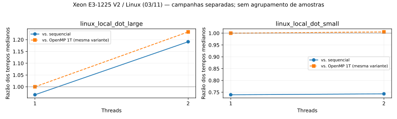
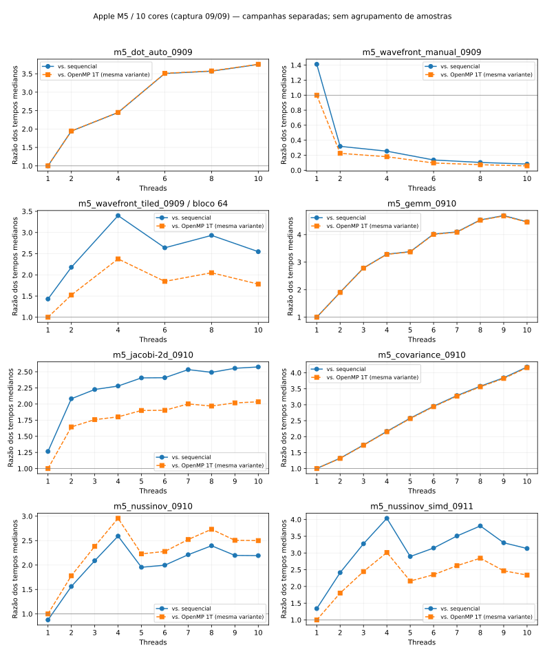
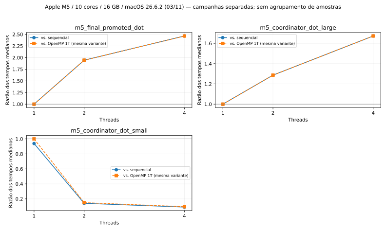
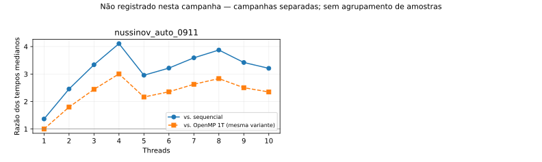
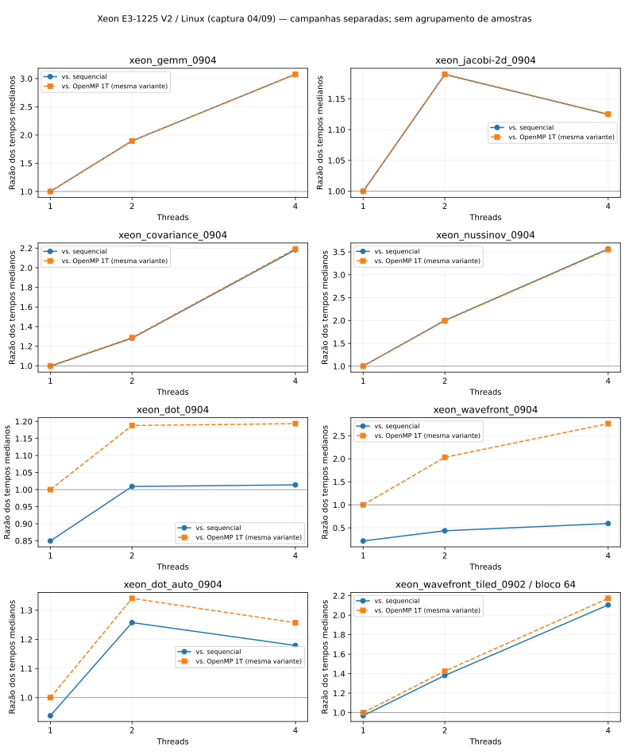

# Item 5 — matriz experimental consolidada

Campanhas históricas e gates locais permanecem separados. Seleção analítica não é promoção.
Flags e tamanhos rotulados como receita precisam de confirmação nas campanhas históricas.

| Campanha | Hardware | Origem | Configuração selecionada | Tempo (s) | vs. seq. | Escalabilidade 1T | Eficiência paralela | Evidência |
|---|---|---|---|---:|---:|---:|---:|---|
| xeon_gemm_0904 | Xeon E3-1225 V2 / Linux (captura 04/09) | manual | 4T | 0.2101 | 3.079 | 3.076 | 0.769 | HISTORICAL_UNBOUND |
| xeon_jacobi-2d_0904 | Xeon E3-1225 V2 / Linux (captura 04/09) | manual | 2T | 2.121 | 1.189 | 1.19 | 0.595 | HISTORICAL_UNBOUND |
| xeon_covariance_0904 | Xeon E3-1225 V2 / Linux (captura 04/09) | manual | 4T | 5.524 | 2.183 | 2.192 | 0.5481 | HISTORICAL_UNBOUND |
| xeon_nussinov_0904 | Xeon E3-1225 V2 / Linux (captura 04/09) | manual | 4T | 4.819 | 3.566 | 3.551 | 0.8877 | HISTORICAL_UNBOUND |
| xeon_dot_0904 | Xeon E3-1225 V2 / Linux (captura 04/09) | manual | 2T | 0.01072 | 1.009 | 1.188 | 0.594 | HISTORICAL_UNBOUND |
| xeon_wavefront_0904 | Xeon E3-1225 V2 / Linux (captura 04/09) | manual | sem recomendação | — | — | — | — | HISTORICAL_UNBOUND |
| xeon_dot_auto_0904 | Xeon E3-1225 V2 / Linux (captura 04/09) | transformação automática de redução | 2T | 0.008306 | 1.258 | 1.341 | 0.6705 | HISTORICAL_UNBOUND |
| xeon_wavefront_tiled_0902 | Xeon E3-1225 V2 / Linux (captura 04/09) | manual tiled + autotuning | 4T / bloco 64 | 0.01776 | 2.105 | 2.173 | 0.5432 | HISTORICAL_UNBOUND |
| m5_dot_auto_0909 | Apple M5 / 10 cores (captura 09/09) | transformação automática de redução | 10T | 0.00128 | 3.753 | 3.758 | 0.3758 | HISTORICAL_UNBOUND |
| m5_wavefront_manual_0909 | Apple M5 / 10 cores (captura 09/09) | manual | 1T | 0.01322 | 1.412 | 1 | 1 | HISTORICAL_UNBOUND |
| m5_wavefront_tiled_0909 | Apple M5 / 10 cores (captura 09/09) | manual tiled + autotuning | 4T / bloco 64 | 0.005603 | 3.4 | 2.377 | 0.5943 | HISTORICAL_UNBOUND |
| m5_gemm_0910 | Apple M5 / 10 cores (captura 09/09) | manual | 9T | 0.03031 | 4.691 | 4.677 | 0.5197 | HISTORICAL_UNBOUND |
| m5_jacobi-2d_0910 | Apple M5 / 10 cores (captura 09/09) | manual | 7T | 0.1639 | 2.533 | 2.002 | 0.286 | HISTORICAL_UNBOUND |
| m5_covariance_0910 | Apple M5 / 10 cores (captura 09/09) | manual | 10T | 0.2199 | 4.183 | 4.161 | 0.4161 | HISTORICAL_UNBOUND |
| m5_nussinov_0910 | Apple M5 / 10 cores (captura 09/09) | manual | 4T | 0.3195 | 2.592 | 2.957 | 0.7391 | HISTORICAL_UNBOUND |
| m5_nussinov_simd_0911 | Apple M5 / 10 cores (captura 09/09) | manual com acumulador + SIMD | 4T | 0.2095 | 4.037 | 3.015 | 0.7537 | HISTORICAL_UNBOUND |
| nussinov_auto_0911 | Não registrado nesta campanha | transformação adaptativa específica sobre base OpenMP manual | 4T | 0.2091 | 4.106 | 3.005 | 0.7513 | HISTORICAL_UNBOUND |
| linux_local_dot_large | Xeon E3-1225 V2 / Linux (03/11) | transformação automática de redução | 2T | 0.008905 | 1.191 | 1.233 | 0.6164 | ARCHIVED_SUMMARY_ONLY |
| linux_local_dot_small | Xeon E3-1225 V2 / Linux (03/11) | transformação automática de redução | sem recomendação | — | — | — | — | ARCHIVED_SUMMARY_ONLY |
| m5_final_promoted_dot | Apple M5 / 10 cores / 16 GB / macOS 26.6.2 (03/11) | transformação automática de redução + promoção revalidada | 4T | 0.001964 | 2.465 | 2.465 | 0.6162 | VERIFIED_LOCAL_GATES |
| m5_coordinator_dot_large | Apple M5 / 10 cores / 16 GB / macOS 26.6.2 (03/11) | transformação automática de redução | 4T | 0.004316 | 1.673 | 1.673 | 0.4182 | VERIFIED_LOCAL_GATES |
| m5_coordinator_dot_small | Apple M5 / 10 cores / 16 GB / macOS 26.6.2 (03/11) | transformação automática de redução | sem recomendação | — | — | — | — | VERIFIED_LOCAL_GATES |

## Lacunas por campanha

- **xeon_gemm_0904**: sem vínculo histórico entre hashes de fontes, corretude e medições; flags/entrada da receita atual não atestam a compilação histórica.
- **xeon_jacobi-2d_0904**: sem vínculo histórico entre hashes de fontes, corretude e medições; flags/entrada da receita atual não atestam a compilação histórica.
- **xeon_covariance_0904**: sem vínculo histórico entre hashes de fontes, corretude e medições; flags/entrada da receita atual não atestam a compilação histórica.
- **xeon_nussinov_0904**: sem vínculo histórico entre hashes de fontes, corretude e medições; flags/entrada da receita atual não atestam a compilação histórica.
- **xeon_dot_0904**: sem vínculo histórico entre hashes de fontes, corretude e medições; flags/entrada da receita atual não atestam a compilação histórica.
- **xeon_wavefront_0904**: sem vínculo histórico entre hashes de fontes, corretude e medições; flags/entrada da receita atual não atestam a compilação histórica.
- **xeon_dot_auto_0904**: sem vínculo histórico entre hashes de fontes, corretude e medições; flags/entrada da receita atual não atestam a compilação histórica.
- **xeon_wavefront_tiled_0902**: hardware atribuído pelo contexto Linux e captura de 04/09, sem captura específica de 02/09; sem vínculo histórico entre hashes de fontes, corretude e medições; flags/entrada da receita atual não atestam a compilação histórica; amostras individuais indisponíveis para parte das configurações.
- **m5_dot_auto_0909**: sem vínculo histórico entre hashes de fontes, corretude e medições; flags/entrada da receita atual não atestam a compilação histórica.
- **m5_wavefront_manual_0909**: sem vínculo histórico entre hashes de fontes, corretude e medições; flags/entrada da receita atual não atestam a compilação histórica.
- **m5_wavefront_tiled_0909**: usar campanha full; preliminary é outra execução, sem agrupar amostras; sem vínculo histórico entre hashes de fontes, corretude e medições; flags/entrada da receita atual não atestam a compilação histórica; amostras individuais indisponíveis para parte das configurações.
- **m5_gemm_0910**: ambiente de 09/09 reutilizado como contexto; falta captura específica da execução; sem vínculo histórico entre hashes de fontes, corretude e medições; flags/entrada da receita atual não atestam a compilação histórica.
- **m5_jacobi-2d_0910**: ambiente de 09/09 reutilizado como contexto; falta captura específica da execução; sem vínculo histórico entre hashes de fontes, corretude e medições; flags/entrada da receita atual não atestam a compilação histórica.
- **m5_covariance_0910**: ambiente de 09/09 reutilizado como contexto; falta captura específica da execução; sem vínculo histórico entre hashes de fontes, corretude e medições; flags/entrada da receita atual não atestam a compilação histórica.
- **m5_nussinov_0910**: ambiente de 09/09 reutilizado como contexto; falta captura específica da execução; sem vínculo histórico entre hashes de fontes, corretude e medições; flags/entrada da receita atual não atestam a compilação histórica.
- **m5_nussinov_simd_0911**: corretude e ambiente disponíveis pertencem a outra data; confirmar vínculo; sem vínculo histórico entre hashes de fontes, corretude e medições; flags/entrada da receita atual não atestam a compilação histórica.
- **nussinov_auto_0911**: hardware e versão do compilador não registrados na campanha; repetições=5 na receita; CSV não contém amostras nem contagem; sem vínculo histórico entre hashes de fontes, corretude e medições; flags/entrada da receita atual não atestam a compilação histórica; amostras individuais indisponíveis para parte das configurações.
- **linux_local_dot_large**: campanha local piloto; avaliação LLM ainda incompleta; sem vínculo histórico entre hashes de fontes, corretude e medições; flags/entrada da receita atual não atestam a compilação histórica; amostras individuais indisponíveis para parte das configurações.
- **linux_local_dot_small**: campanha local piloto; avaliação LLM ainda incompleta; sem vínculo histórico entre hashes de fontes, corretude e medições; flags/entrada da receita atual não atestam a compilação histórica; amostras individuais indisponíveis para parte das configurações.
- **m5_final_promoted_dot**: uma única campanha local de promoção; não representa outros padrões ou plataformas.
- **m5_coordinator_dot_large**: repetições da decisão LLM reutilizam estas medições e não são novas amostras do kernel.
- **m5_coordinator_dot_small**: nenhuma configuração paralela satisfez a política de admissão.

## Inventário dos CSVs

| Arquivo | Linhas | Duplicado de | Inconsistências |
|---|---:|---|---|
| results/coordinator_evaluation/mac-2026-11-03-final-v4-llama/evaluation-sl8k2oaz/trials.csv | 18 | — | — |
| results/coordinator_evaluation/mac_2026-11-03/evaluation-4vgn5q8n/dot_large/run-8_pcsne0/performance/922b7d9a60c94e0a8c93d54df7b7cfe4/performance.csv | 4 | — | — |
| results/coordinator_evaluation/mac_2026-11-03/evaluation-4vgn5q8n/dot_large/run-8_pcsne0/performance.csv | 4 | results/coordinator_evaluation/mac_2026-11-03/evaluation-4vgn5q8n/dot_large/run-8_pcsne0/performance/922b7d9a60c94e0a8c93d54df7b7cfe4/performance.csv | — |
| results/coordinator_evaluation/mac_2026-11-03/evaluation-4vgn5q8n/dot_small/run-qfrnpe7u/performance/fc80493973e0489fbdd78a05a070d3c0/performance.csv | 4 | — | — |
| results/coordinator_evaluation/mac_2026-11-03/evaluation-4vgn5q8n/dot_small/run-qfrnpe7u/performance.csv | 4 | results/coordinator_evaluation/mac_2026-11-03/evaluation-4vgn5q8n/dot_small/run-qfrnpe7u/performance/fc80493973e0489fbdd78a05a070d3c0/performance.csv | — |
| results/coordinator_evaluation/mac_2026-11-03/evaluation-4vgn5q8n/trials.csv | 18 | — | — |
| results/coordinator_evaluation/mac_2026-11-03_v2_llama/evaluation-x3s8jnw0/trials.csv | 18 | — | — |
| results/coordinator_evaluation/mac_2026-11-03_v2b_llama/evaluation-08pyj_e9/trials.csv | 18 | — | — |
| results/covariance/experiment_results.csv | 8 | — | HEADER_MISMATCH lines 6,7,8,9 |
| results/covariance/openmp_scaling.csv | 3 | — | — |
| results/covariance/openmp_scaling_generic.csv | 3 | — | — |
| results/dot/auto_generated_performance.csv | 4 | — | — |
| results/dot/experiment_results.csv | 16 | — | MULTIPLE_BASELINES lines 2,6,10,14; REPEATED_CONFIGURATIONS lines 6,7,8,9,10,11,12,13,14,15,16,17 |
| results/dot/reduction_results.csv | 6 | — | — |
| results/final-promoted/mac-2026-11-03/5eef401105cc51be73471cfbf836964f858d9453a381224490828123f54eb1d5/evidence/performance.csv | 4 | — | — |
| results/gemm/baseline.csv | 1 | — | — |
| results/gemm/experiment_results.csv | 12 | — | HEADER_MISMATCH lines 10,11,12,13; MULTIPLE_BASELINES lines 2,6; REPEATED_CONFIGURATIONS lines 6,7,8,9 |
| results/gemm/openmp_scaling.csv | 3 | — | — |
| results/gemm/openmp_scaling_generic.csv | 3 | — | — |
| results/jacobi-2d/experiment_results.csv | 8 | — | HEADER_MISMATCH lines 6,7,8,9 |
| results/jacobi-2d/openmp_scaling.csv | 12 | — | REPEATED_CONFIGURATIONS lines 5,6,7,8,9,10,11,12,13 |
| results/jacobi-2d/openmp_scaling_generic.csv | 3 | — | — |
| results/mac_m5_2026-09-09/performance/dot/performance.csv | 7 | — | — |
| results/mac_m5_2026-09-09/performance/wavefront/experiment_results.csv | 19 | — | MULTIPLE_BASELINES lines 2,6,10,14; REPEATED_CONFIGURATIONS lines 6,7,8,9,10,11,12,13,14,15,16,17 |
| results/mac_m5_2026-09-09/performance/wavefront/performance.csv | 7 | — | — |
| results/mac_m5_2026-09-09/performance/wavefront/tiled_full/tiled_autotuning_1_2_4_6_8_10.csv | 30 | — | — |
| results/mac_m5_2026-09-09/performance/wavefront/tiled_preliminary/tiled_autotuning_1_2_4.csv | 15 | — | — |
| results/mac_m5_2026-09-10/performance/covariance/experiment_results_dense_threads.csv | 19 | — | HEADER_MISMATCH lines 6,7,8,9,10,11,12,13,14,15,16,17,18,19,20 |
| results/mac_m5_2026-09-10/performance/covariance/performance_normalized_dense_threads.csv | 11 | — | — |
| results/mac_m5_2026-09-10/performance/gemm/experiment_results_dense_threads.csv | 23 | — | HEADER_MISMATCH lines 10,11,12,13,14,15,16,17,18,19,20,21,22,23,24; MULTIPLE_BASELINES lines 2,6; REPEATED_CONFIGURATIONS lines 6,7,8,9 |
| results/mac_m5_2026-09-10/performance/gemm/performance_normalized_dense_threads.csv | 11 | — | — |
| results/mac_m5_2026-09-10/performance/jacobi-2d/experiment_results.csv | 15 | — | HEADER_MISMATCH lines 6,7,8,9,10,11,12,13,14,15,16 |
| results/mac_m5_2026-09-10/performance/jacobi-2d/experiment_results_before_m5.csv | 8 | results/jacobi-2d/experiment_results.csv | HEADER_MISMATCH lines 6,7,8,9 |
| results/mac_m5_2026-09-10/performance/jacobi-2d/experiment_results_dense_threads.csv | 26 | — | HEADER_MISMATCH lines 6,7,8,9,10,11,12,13,14,15,16,17,18,19,20,21,22,23,24,25,26,27 |
| results/mac_m5_2026-09-10/performance/jacobi-2d/performance_normalized_dense_threads.csv | 11 | — | — |
| results/mac_m5_2026-09-10/performance/nussinov/experiment_results_dense_threads.csv | 23 | — | MULTIPLE_BASELINES lines 2,6,10,14; REPEATED_CONFIGURATIONS lines 6,7,8,9,10,11,12,13,14,15,16,18 |
| results/mac_m5_2026-09-10/performance/nussinov/performance_normalized_dense_threads.csv | 11 | — | — |
| results/mac_m5_2026-09-11/performance/nussinov-simd/performance_normalized_dense_threads.csv | 11 | — | — |
| results/mac_m5_2026-09-11/performance/nussinov-simd/raw_dense_threads.csv | 55 | — | — |
| results/nussinov/experiment_results.csv | 16 | — | MULTIPLE_BASELINES lines 2,6,10,14; REPEATED_CONFIGURATIONS lines 6,7,8,9,10,11,12,13,14,15,16,17 |
| results/nussinov-auto/experiment_results.csv | 11 | — | — |
| results/repro_2026-09-04/auto_dot/performance.csv | 4 | — | — |
| results/wavefront/experiment_results.csv | 8 | — | MULTIPLE_BASELINES lines 2,6; REPEATED_CONFIGURATIONS lines 6,7,8,9 |
| results/wavefront/tiled_autotuning.csv | 15 | — | — |

## Gráficos

Gráficos exibem razões de medianas, sem intervalos de confiança.
Dispersão e amostras recuperadas estão em measurements.csv e samples.csv; não se agrupam campanhas.
Hashes sha256_now identificam os arquivos disponíveis hoje, sem atestar os bytes compilados historicamente.
O resultado negativo (sem ganho) também é mantido. Nenhuma medição de LLM simulada entra nesta matriz.
