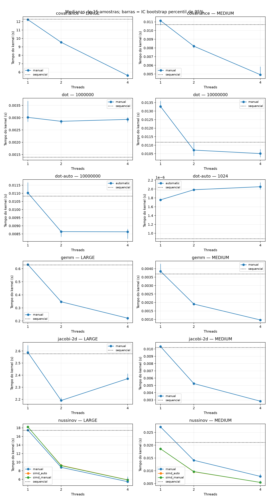
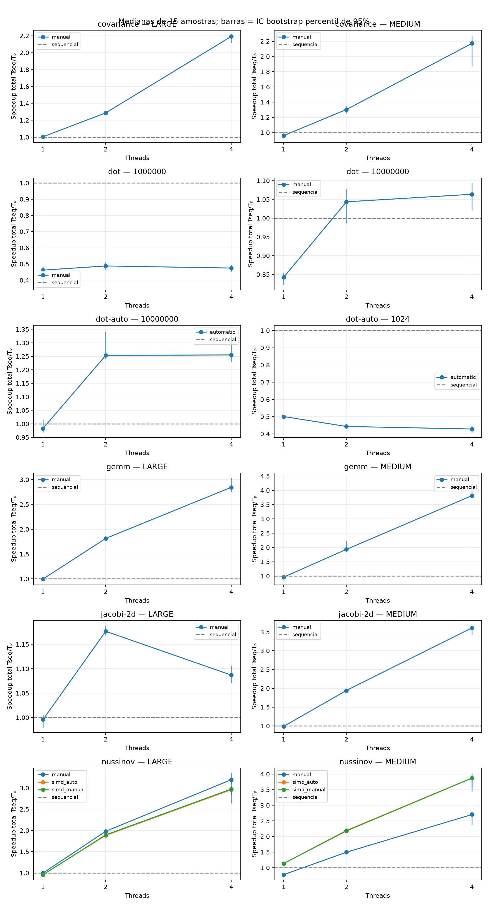
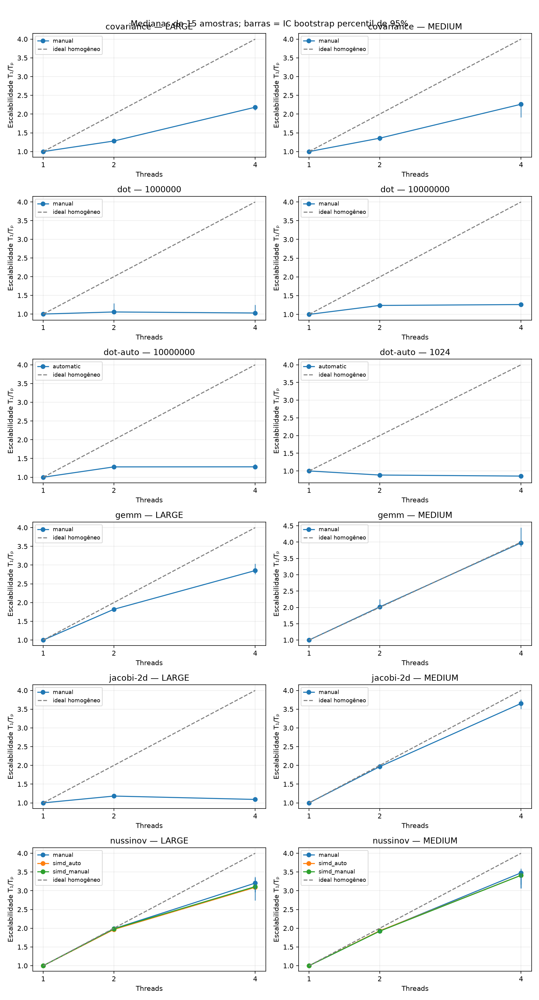
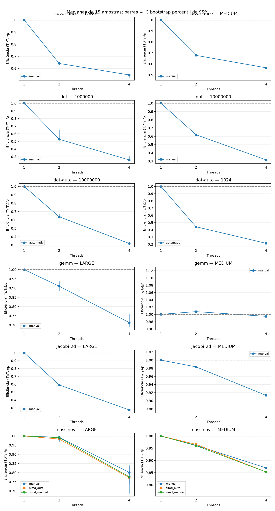
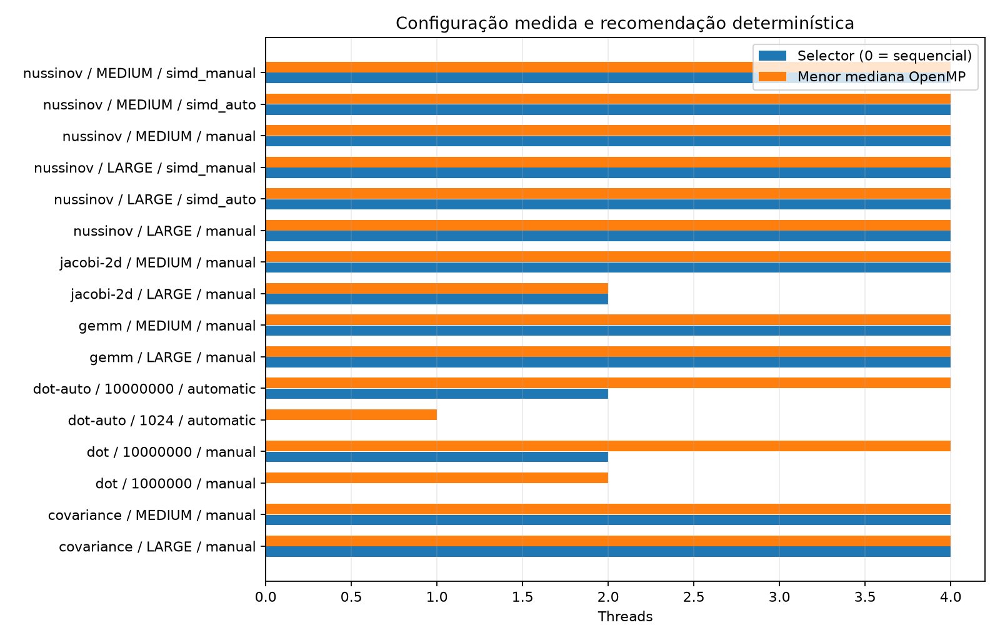

# Escalabilidade OpenMP — linux_xeon_2026-11-05_p15w3

Fonte: `/home/liswsz220-01/Desktop/tcc/tcc2/results/multiplatform/linux_xeon_2026-11-05_p15w3`. Fontes, binários e saídas conferidos por SHA-256; resumos recalculados das amostras.

15 amostras externas; 3 aquecimentos por configuração; blocos embaralhados (seed 2026).
Dot C automático usa o transformador determinístico real; demais variantes são manuais ou adaptações específicas preexistentes. Não houve inferência LLM.

| Kernel | Entrada | Variante | Threads | Mediana (s) | Mín.–máx. (s) | S total | S transf. | S paralelo | E paralela |
|---|---|---|---:|---:|---:|---:|---:|---:|---:|
| covariance | LARGE | manual | 1 | 12.228874000 | 12.191438000–12.686274000 | 1.0044 | 1.0044 | 1.0000 | 1.0000 |
| covariance | LARGE | manual | 2 | 9.540982000 | 9.499529000–9.817141000 | 1.2874 | 1.0044 | 1.2817 | 0.6409 |
| covariance | LARGE | manual | 4 | 5.601431000 | 5.554452000–5.944645000 | 2.1928 | 1.0044 | 2.1832 | 0.5458 |
| covariance | LARGE | sequential | 1 | 12.283083000 | 12.173638000–12.761320000 | 1.0000 | 1.0000 | 1.0000 | 1.0000 |
| covariance | MEDIUM | manual | 1 | 0.011136000 | 0.010216000–0.012220000 | 0.9598 | 0.9598 | 1.0000 | 1.0000 |
| covariance | MEDIUM | manual | 2 | 0.008204000 | 0.007775000–0.008400000 | 1.3028 | 0.9598 | 1.3574 | 0.6787 |
| covariance | MEDIUM | manual | 4 | 0.004922000 | 0.004755000–0.007059000 | 2.1715 | 0.9598 | 2.2625 | 0.5656 |
| covariance | MEDIUM | sequential | 1 | 0.010688000 | 0.010319000–0.011246000 | 1.0000 | 1.0000 | 1.0000 | 1.0000 |
| dot | 1000000 | manual | 1 | 0.003012283 | 0.002688682–0.005734629 | 0.4619 | 0.4619 | 1.0000 | 1.0000 |
| dot | 1000000 | manual | 2 | 0.002852883 | 0.002665224–0.003017958 | 0.4878 | 0.4619 | 1.0559 | 0.5279 |
| dot | 1000000 | manual | 4 | 0.002930302 | 0.002631969–0.003563654 | 0.4749 | 0.4619 | 1.0280 | 0.2570 |
| dot | 1000000 | sequential | 1 | 0.001391504 | 0.001246774–0.001589501 | 1.0000 | 1.0000 | 1.0000 | 1.0000 |
| dot | 10000000 | manual | 1 | 0.013269620 | 0.012520409–0.016811269 | 0.8424 | 0.8424 | 1.0000 | 1.0000 |
| dot | 10000000 | manual | 2 | 0.010711598 | 0.010338803–0.013164295 | 1.0436 | 0.8424 | 1.2388 | 0.6194 |
| dot | 10000000 | manual | 4 | 0.010509165 | 0.010008812–0.011940138 | 1.0637 | 0.8424 | 1.2627 | 0.3157 |
| dot | 10000000 | sequential | 1 | 0.011178234 | 0.010666547–0.012722730 | 1.0000 | 1.0000 | 1.0000 | 1.0000 |
| dot-auto | 1024 | automatic | 1 | 0.000001756 | 0.000001729–0.000002197 | 0.5004 | 0.5004 | 1.0000 | 1.0000 |
| dot-auto | 1024 | automatic | 2 | 0.000001984 | 0.000001933–0.000002179 | 0.4429 | 0.5004 | 0.8851 | 0.4426 |
| dot-auto | 1024 | automatic | 4 | 0.000002053 | 0.000001966–0.000002235 | 0.4280 | 0.5004 | 0.8553 | 0.2138 |
| dot-auto | 1024 | sequential | 1 | 0.000000879 | 0.000000865–0.000001021 | 1.0000 | 1.0000 | 1.0000 | 1.0000 |
| dot-auto | 10000000 | automatic | 1 | 0.011025060 | 0.010639129–0.012389246 | 0.9826 | 0.9826 | 1.0000 | 1.0000 |
| dot-auto | 10000000 | automatic | 2 | 0.008641622 | 0.008179255–0.010860364 | 1.2536 | 0.9826 | 1.2758 | 0.6379 |
| dot-auto | 10000000 | automatic | 4 | 0.008630659 | 0.008166054–0.014125380 | 1.2552 | 0.9826 | 1.2774 | 0.3194 |
| dot-auto | 10000000 | sequential | 1 | 0.010833251 | 0.010606116–0.013961188 | 1.0000 | 1.0000 | 1.0000 | 1.0000 |
| gemm | LARGE | manual | 1 | 0.631632000 | 0.612795000–0.651825000 | 0.9969 | 0.9969 | 1.0000 | 1.0000 |
| gemm | LARGE | manual | 2 | 0.346942000 | 0.319115000–0.364719000 | 1.8149 | 0.9969 | 1.8206 | 0.9103 |
| gemm | LARGE | manual | 4 | 0.221314000 | 0.195698000–0.399726000 | 2.8451 | 0.9969 | 2.8540 | 0.7135 |
| gemm | LARGE | sequential | 1 | 0.629662000 | 0.613770000–0.657554000 | 1.0000 | 1.0000 | 1.0000 | 1.0000 |
| gemm | MEDIUM | manual | 1 | 0.003847000 | 0.003625000–0.004406000 | 0.9589 | 0.9589 | 1.0000 | 1.0000 |
| gemm | MEDIUM | manual | 2 | 0.001909000 | 0.001855000–0.002166000 | 1.9324 | 0.9589 | 2.0152 | 1.0076 |
| gemm | MEDIUM | manual | 4 | 0.000967000 | 0.000959000–0.001580000 | 3.8149 | 0.9589 | 3.9783 | 0.9946 |
| gemm | MEDIUM | sequential | 1 | 0.003689000 | 0.003578000–0.004361000 | 1.0000 | 1.0000 | 1.0000 | 1.0000 |
| jacobi-2d | LARGE | manual | 1 | 2.588137000 | 2.559051000–2.949834000 | 0.9958 | 0.9958 | 1.0000 | 1.0000 |
| jacobi-2d | LARGE | manual | 2 | 2.190225000 | 2.159120000–2.393571000 | 1.1767 | 0.9958 | 1.1817 | 0.5908 |
| jacobi-2d | LARGE | manual | 4 | 2.370977000 | 2.215120000–2.765253000 | 1.0870 | 0.9958 | 1.0916 | 0.2729 |
| jacobi-2d | LARGE | sequential | 1 | 2.577300000 | 2.550873000–2.732931000 | 1.0000 | 1.0000 | 1.0000 | 1.0000 |
| jacobi-2d | MEDIUM | manual | 1 | 0.010337000 | 0.010126000–0.011226000 | 0.9878 | 0.9878 | 1.0000 | 1.0000 |
| jacobi-2d | MEDIUM | manual | 2 | 0.005255000 | 0.005003000–0.006032000 | 1.9431 | 0.9878 | 1.9671 | 0.9835 |
| jacobi-2d | MEDIUM | manual | 4 | 0.002830000 | 0.002667000–0.003820000 | 3.6081 | 0.9878 | 3.6527 | 0.9132 |
| jacobi-2d | MEDIUM | sequential | 1 | 0.010211000 | 0.009982000–0.010775000 | 1.0000 | 1.0000 | 1.0000 | 1.0000 |
| nussinov | LARGE | manual | 1 | 17.460141000 | 17.295139000–19.765806000 | 0.9972 | 0.9972 | 1.0000 | 1.0000 |
| nussinov | LARGE | manual | 2 | 8.790641000 | 8.698616000–9.399021000 | 1.9806 | 0.9972 | 1.9862 | 0.9931 |
| nussinov | LARGE | manual | 4 | 5.449333000 | 4.959073000–10.639998000 | 3.1950 | 0.9972 | 3.2041 | 0.8010 |
| nussinov | LARGE | sequential | 1 | 17.410415000 | 17.293152000–18.287514000 | 1.0000 | 1.0000 | 1.0000 | 1.0000 |
| nussinov | LARGE | simd_auto | 1 | 18.186172000 | 18.072031000–19.079336000 | 0.9573 | 0.9573 | 1.0000 | 1.0000 |
| nussinov | LARGE | simd_auto | 2 | 9.245178000 | 9.141078000–10.471042000 | 1.8832 | 0.9573 | 1.9671 | 0.9835 |
| nussinov | LARGE | simd_auto | 4 | 5.883270000 | 5.337138000–16.685568000 | 2.9593 | 0.9573 | 3.0912 | 0.7728 |
| nussinov | LARGE | simd_manual | 1 | 18.205711000 | 17.715801000–18.790756000 | 0.9563 | 0.9563 | 1.0000 | 1.0000 |
| nussinov | LARGE | simd_manual | 2 | 9.184278000 | 8.920827000–9.516648000 | 1.8957 | 0.9563 | 1.9823 | 0.9911 |
| nussinov | LARGE | simd_manual | 4 | 5.853742000 | 5.494988000–11.398109000 | 2.9742 | 0.9563 | 3.1101 | 0.7775 |
| nussinov | MEDIUM | manual | 1 | 0.027121000 | 0.026765000–0.030582000 | 0.7776 | 0.7776 | 1.0000 | 1.0000 |
| nussinov | MEDIUM | manual | 2 | 0.014095000 | 0.013611000–0.015321000 | 1.4962 | 0.7776 | 1.9242 | 0.9621 |
| nussinov | MEDIUM | manual | 4 | 0.007798000 | 0.007440000–0.009492000 | 2.7044 | 0.7776 | 3.4779 | 0.8695 |
| nussinov | MEDIUM | sequential | 1 | 0.021089000 | 0.020580000–0.023922000 | 1.0000 | 1.0000 | 1.0000 | 1.0000 |
| nussinov | MEDIUM | simd_auto | 1 | 0.018571000 | 0.018247000–0.019036000 | 1.1356 | 1.1356 | 1.0000 | 1.0000 |
| nussinov | MEDIUM | simd_auto | 2 | 0.009612000 | 0.009440000–0.011282000 | 2.1940 | 1.1356 | 1.9321 | 0.9660 |
| nussinov | MEDIUM | simd_auto | 4 | 0.005443000 | 0.005242000–0.015687000 | 3.8745 | 1.1356 | 3.4119 | 0.8530 |
| nussinov | MEDIUM | simd_manual | 1 | 0.018586000 | 0.018334000–0.031564000 | 1.1347 | 1.1347 | 1.0000 | 1.0000 |
| nussinov | MEDIUM | simd_manual | 2 | 0.009673000 | 0.009488000–0.009910000 | 2.1802 | 1.1347 | 1.9214 | 0.9607 |
| nussinov | MEDIUM | simd_manual | 4 | 0.005448000 | 0.005193000–0.009641000 | 3.8710 | 1.1347 | 3.4115 | 0.8529 |

S total = Tseq/Tp; S transf. = Tseq/T1 da mesma variante; S paralelo = T1/Tp; E paralela = (T1/Tp)/p.
Os CSVs incluem MAD, IQR, desvio padrão amostral e IC percentil bootstrap de 95%, 5.000 reamostragens de blocos completos, seed 2026, para n ≥ 15.
Os intervalos são condicionais a esta campanha; não comprovam estacionariedade nem significância entre plataformas.
O probe confirma o tamanho das equipes no runtime, sem provar a localização de cada thread dos kernels.
Validação de arrays usa binários de dump separados com os mesmos flags de otimização; não prova ausência de races.
Tempos excluem inicialização dos arrays, compilação e inferência. O Dot C++ inclui a primeira inicialização OpenMP; o PolyBench inicializa a equipe no flush antes do timer.
A coleta M5 equivalente ainda precisa ser executada; dados históricos não formam um experimento pareado com esta coleta.

