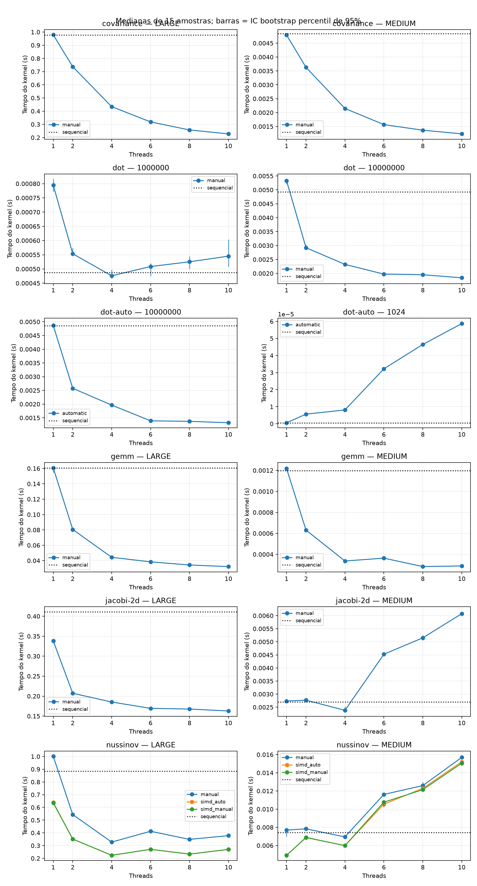
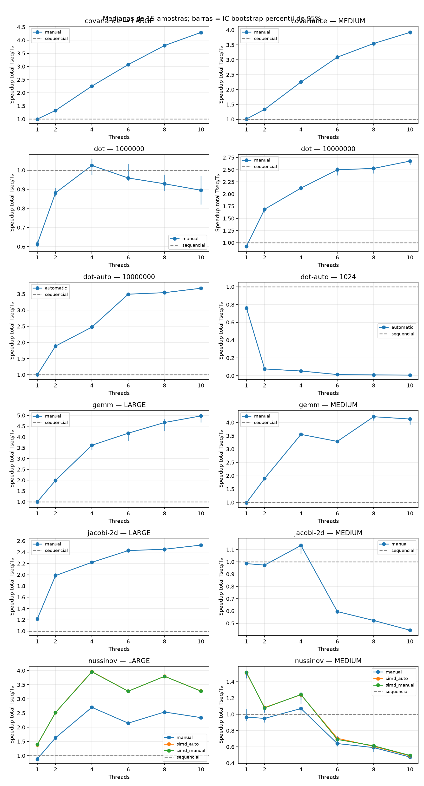
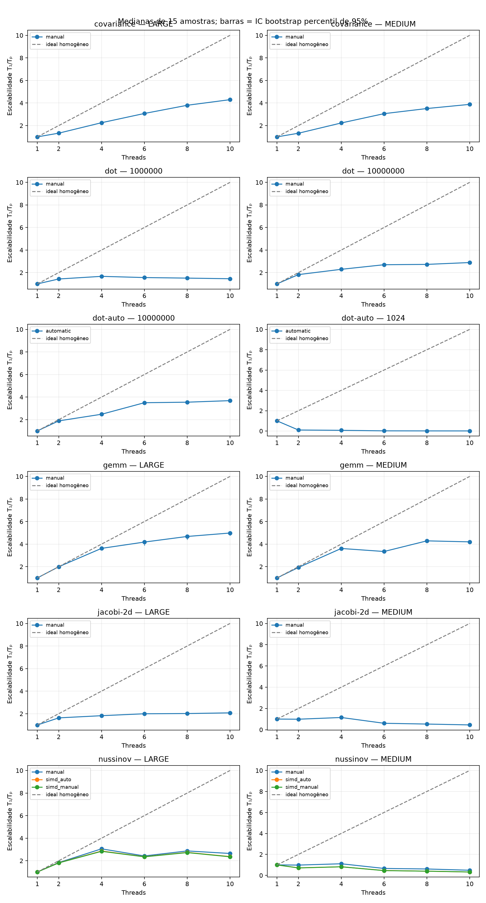
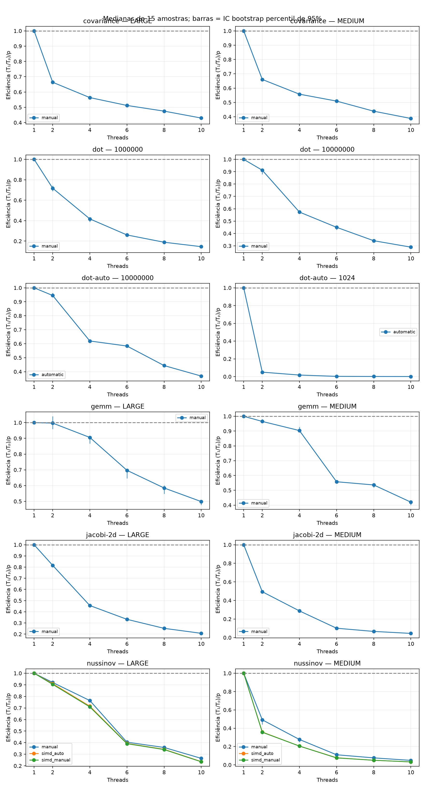
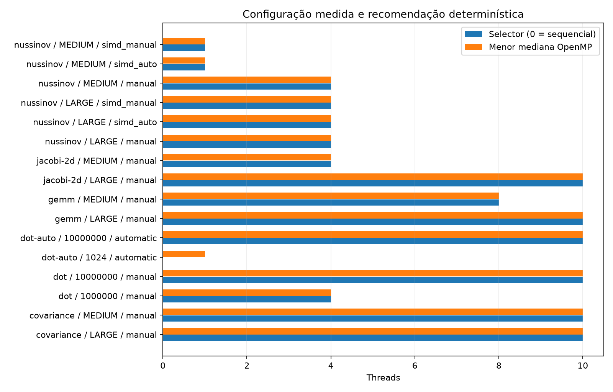

# Escalabilidade OpenMP — mac_m5_2026-11-16_p15w3_session01

Fonte: `/Users/lucasulson/Desktop/PUCRS/Ultimo semestre/TCC2/tcc2-experiments-mac-2026-11-16/results/multiplatform/mac_m5_2026-11-16_p15w3_session01`. Fontes, binários e saídas conferidos por SHA-256; resumos recalculados das amostras.

15 amostras externas; 3 aquecimentos por configuração; blocos embaralhados (seed 2026).
Dot C automático usa o transformador determinístico real; demais variantes são manuais ou adaptações específicas preexistentes. Não houve inferência LLM.

| Kernel | Entrada | Variante | Threads | Mediana (s) | Mín.–máx. (s) | S total | S transf. | S paralelo | E paralela |
|---|---|---|---:|---:|---:|---:|---:|---:|---:|
| covariance | LARGE | manual | 1 | 0.978757000 | 0.976894000–0.991110000 | 0.9993 | 0.9993 | 1.0000 | 1.0000 |
| covariance | LARGE | manual | 2 | 0.737213000 | 0.736496000–0.782243000 | 1.3268 | 0.9993 | 1.3276 | 0.6638 |
| covariance | LARGE | manual | 4 | 0.434113000 | 0.433448000–0.436733000 | 2.2531 | 0.9993 | 2.2546 | 0.5637 |
| covariance | LARGE | manual | 6 | 0.318493000 | 0.309828000–0.329743000 | 3.0711 | 0.9993 | 3.0731 | 0.5122 |
| covariance | LARGE | manual | 8 | 0.257559000 | 0.251081000–0.275638000 | 3.7976 | 0.9993 | 3.8001 | 0.4750 |
| covariance | LARGE | manual | 10 | 0.227721000 | 0.216802000–0.236471000 | 4.2952 | 0.9993 | 4.2981 | 0.4298 |
| covariance | LARGE | sequential | 1 | 0.978113000 | 0.977114000–0.993497000 | 1.0000 | 1.0000 | 1.0000 | 1.0000 |
| covariance | MEDIUM | manual | 1 | 0.004793000 | 0.004772000–0.004847000 | 1.0100 | 1.0100 | 1.0000 | 1.0000 |
| covariance | MEDIUM | manual | 2 | 0.003628000 | 0.003600000–0.003674000 | 1.3343 | 1.0100 | 1.3211 | 0.6606 |
| covariance | MEDIUM | manual | 4 | 0.002148000 | 0.002140000–0.002181000 | 2.2537 | 1.0100 | 2.2314 | 0.5578 |
| covariance | MEDIUM | manual | 6 | 0.001568000 | 0.001556000–0.006964000 | 3.0874 | 1.0100 | 3.0568 | 0.5095 |
| covariance | MEDIUM | manual | 8 | 0.001365000 | 0.001253000–0.001423000 | 3.5465 | 1.0100 | 3.5114 | 0.4389 |
| covariance | MEDIUM | manual | 10 | 0.001235000 | 0.001211000–0.001415000 | 3.9198 | 1.0100 | 3.8810 | 0.3881 |
| covariance | MEDIUM | sequential | 1 | 0.004841000 | 0.004815000–0.004895000 | 1.0000 | 1.0000 | 1.0000 | 1.0000 |
| dot | 1000000 | manual | 1 | 0.000794542 | 0.000734709–0.001626459 | 0.6139 | 0.6139 | 1.0000 | 1.0000 |
| dot | 1000000 | manual | 2 | 0.000553583 | 0.000522000–0.000726208 | 0.8812 | 0.6139 | 1.4353 | 0.7176 |
| dot | 1000000 | manual | 4 | 0.000475917 | 0.000438167–0.000700750 | 1.0250 | 0.6139 | 1.6695 | 0.4174 |
| dot | 1000000 | manual | 6 | 0.000508583 | 0.000472625–0.000653167 | 0.9591 | 0.6139 | 1.5623 | 0.2604 |
| dot | 1000000 | manual | 8 | 0.000525208 | 0.000473250–0.001312167 | 0.9288 | 0.6139 | 1.5128 | 0.1891 |
| dot | 1000000 | manual | 10 | 0.000545125 | 0.000486334–0.000849958 | 0.8948 | 0.6139 | 1.4575 | 0.1458 |
| dot | 1000000 | sequential | 1 | 0.000487792 | 0.000477167–0.000892042 | 1.0000 | 1.0000 | 1.0000 | 1.0000 |
| dot | 10000000 | manual | 1 | 0.005328167 | 0.005098750–0.007145834 | 0.9255 | 0.9255 | 1.0000 | 1.0000 |
| dot | 10000000 | manual | 2 | 0.002921708 | 0.002785333–0.005840584 | 1.6878 | 0.9255 | 1.8236 | 0.9118 |
| dot | 10000000 | manual | 4 | 0.002323542 | 0.002277833–0.002417750 | 2.1223 | 0.9255 | 2.2931 | 0.5733 |
| dot | 10000000 | manual | 6 | 0.001974084 | 0.001819208–0.002212084 | 2.4980 | 0.9255 | 2.6991 | 0.4498 |
| dot | 10000000 | manual | 8 | 0.001951625 | 0.001844625–0.002069000 | 2.5268 | 0.9255 | 2.7301 | 0.3413 |
| dot | 10000000 | manual | 10 | 0.001841792 | 0.001794416–0.002061333 | 2.6775 | 0.9255 | 2.8929 | 0.2893 |
| dot | 10000000 | sequential | 1 | 0.004931334 | 0.004788417–0.006976375 | 1.0000 | 1.0000 | 1.0000 | 1.0000 |
| dot-auto | 1024 | automatic | 1 | 0.000000566 | 0.000000556–0.000000583 | 0.7619 | 0.7619 | 1.0000 | 1.0000 |
| dot-auto | 1024 | automatic | 2 | 0.000005643 | 0.000005410–0.000005828 | 0.0765 | 0.7619 | 0.1004 | 0.0502 |
| dot-auto | 1024 | automatic | 4 | 0.000008107 | 0.000007923–0.000008393 | 0.0532 | 0.7619 | 0.0699 | 0.0175 |
| dot-auto | 1024 | automatic | 6 | 0.000032207 | 0.000031585–0.000033434 | 0.0134 | 0.7619 | 0.0176 | 0.0029 |
| dot-auto | 1024 | automatic | 8 | 0.000046493 | 0.000045341–0.000047125 | 0.0093 | 0.7619 | 0.0122 | 0.0015 |
| dot-auto | 1024 | automatic | 10 | 0.000058692 | 0.000057689–0.000059462 | 0.0074 | 0.7619 | 0.0097 | 0.0010 |
| dot-auto | 1024 | sequential | 1 | 0.000000432 | 0.000000427–0.000000439 | 1.0000 | 1.0000 | 1.0000 | 1.0000 |
| dot-auto | 10000000 | automatic | 1 | 0.004868770 | 0.004825650–0.005049870 | 0.9983 | 0.9983 | 1.0000 | 1.0000 |
| dot-auto | 10000000 | automatic | 2 | 0.002576050 | 0.002482290–0.002645070 | 1.8868 | 0.9983 | 1.8900 | 0.9450 |
| dot-auto | 10000000 | automatic | 4 | 0.001964700 | 0.001950860–0.002055220 | 2.4739 | 0.9983 | 2.4781 | 0.6195 |
| dot-auto | 10000000 | automatic | 6 | 0.001390910 | 0.001379480–0.001424530 | 3.4945 | 0.9983 | 3.5004 | 0.5834 |
| dot-auto | 10000000 | automatic | 8 | 0.001372190 | 0.001353620–0.001513890 | 3.5422 | 0.9983 | 3.5482 | 0.4435 |
| dot-auto | 10000000 | automatic | 10 | 0.001321270 | 0.001307870–0.001367210 | 3.6787 | 0.9983 | 3.6849 | 0.3685 |
| dot-auto | 10000000 | sequential | 1 | 0.004860560 | 0.004811420–0.005495770 | 1.0000 | 1.0000 | 1.0000 | 1.0000 |
| gemm | LARGE | manual | 1 | 0.160685000 | 0.149425000–0.172484000 | 0.9984 | 0.9984 | 1.0000 | 1.0000 |
| gemm | LARGE | manual | 2 | 0.080580000 | 0.075681000–0.082278000 | 1.9909 | 0.9984 | 1.9941 | 0.9971 |
| gemm | LARGE | manual | 4 | 0.044343000 | 0.043360000–0.046970000 | 3.6178 | 0.9984 | 3.6237 | 0.9059 |
| gemm | LARGE | manual | 6 | 0.038421000 | 0.036097000–0.043170000 | 4.1755 | 0.9984 | 4.1822 | 0.6970 |
| gemm | LARGE | manual | 8 | 0.034347000 | 0.032354000–0.050640000 | 4.6707 | 0.9984 | 4.6783 | 0.5848 |
| gemm | LARGE | manual | 10 | 0.032243000 | 0.030409000–0.034123000 | 4.9755 | 0.9984 | 4.9836 | 0.4984 |
| gemm | LARGE | sequential | 1 | 0.160426000 | 0.149337000–0.174671000 | 1.0000 | 1.0000 | 1.0000 | 1.0000 |
| gemm | MEDIUM | manual | 1 | 0.001218000 | 0.001198000–0.003538000 | 0.9828 | 0.9828 | 1.0000 | 1.0000 |
| gemm | MEDIUM | manual | 2 | 0.000631000 | 0.000617000–0.000642000 | 1.8970 | 0.9828 | 1.9303 | 0.9651 |
| gemm | MEDIUM | manual | 4 | 0.000337000 | 0.000322000–0.000384000 | 3.5519 | 0.9828 | 3.6142 | 0.9036 |
| gemm | MEDIUM | manual | 6 | 0.000364000 | 0.000346000–0.000399000 | 3.2885 | 0.9828 | 3.3462 | 0.5577 |
| gemm | MEDIUM | manual | 8 | 0.000284000 | 0.000277000–0.000314000 | 4.2148 | 0.9828 | 4.2887 | 0.5361 |
| gemm | MEDIUM | manual | 10 | 0.000290000 | 0.000280000–0.000326000 | 4.1276 | 0.9828 | 4.2000 | 0.4200 |
| gemm | MEDIUM | sequential | 1 | 0.001197000 | 0.001193000–0.001218000 | 1.0000 | 1.0000 | 1.0000 | 1.0000 |
| jacobi-2d | LARGE | manual | 1 | 0.338113000 | 0.336567000–0.341229000 | 1.2164 | 1.2164 | 1.0000 | 1.0000 |
| jacobi-2d | LARGE | manual | 2 | 0.207269000 | 0.203604000–0.211896000 | 1.9843 | 1.2164 | 1.6313 | 0.8156 |
| jacobi-2d | LARGE | manual | 4 | 0.185315000 | 0.183410000–0.213618000 | 2.2194 | 1.2164 | 1.8245 | 0.4561 |
| jacobi-2d | LARGE | manual | 6 | 0.169414000 | 0.165694000–0.213152000 | 2.4277 | 1.2164 | 1.9958 | 0.3326 |
| jacobi-2d | LARGE | manual | 8 | 0.167755000 | 0.164329000–0.188269000 | 2.4517 | 1.2164 | 2.0155 | 0.2519 |
| jacobi-2d | LARGE | manual | 10 | 0.162884000 | 0.161608000–0.183211000 | 2.5251 | 1.2164 | 2.0758 | 0.2076 |
| jacobi-2d | LARGE | sequential | 1 | 0.411292000 | 0.401263000–0.433991000 | 1.0000 | 1.0000 | 1.0000 | 1.0000 |
| jacobi-2d | MEDIUM | manual | 1 | 0.002736000 | 0.002710000–0.002753000 | 0.9854 | 0.9854 | 1.0000 | 1.0000 |
| jacobi-2d | MEDIUM | manual | 2 | 0.002770000 | 0.002358000–0.002801000 | 0.9733 | 0.9854 | 0.9877 | 0.4939 |
| jacobi-2d | MEDIUM | manual | 4 | 0.002380000 | 0.002276000–0.008180000 | 1.1328 | 0.9854 | 1.1496 | 0.2874 |
| jacobi-2d | MEDIUM | manual | 6 | 0.004525000 | 0.003824000–0.004642000 | 0.5958 | 0.9854 | 0.6046 | 0.1008 |
| jacobi-2d | MEDIUM | manual | 8 | 0.005152000 | 0.004896000–0.005389000 | 0.5233 | 0.9854 | 0.5311 | 0.0664 |
| jacobi-2d | MEDIUM | manual | 10 | 0.006074000 | 0.005782000–0.006766000 | 0.4439 | 0.9854 | 0.4504 | 0.0450 |
| jacobi-2d | MEDIUM | sequential | 1 | 0.002696000 | 0.002679000–0.003321000 | 1.0000 | 1.0000 | 1.0000 | 1.0000 |
| nussinov | LARGE | manual | 1 | 1.000907000 | 0.996699000–1.013036000 | 0.8847 | 0.8847 | 1.0000 | 1.0000 |
| nussinov | LARGE | manual | 2 | 0.543963000 | 0.541720000–2.913138000 | 1.6279 | 0.8847 | 1.8400 | 0.9200 |
| nussinov | LARGE | manual | 4 | 0.327572000 | 0.321811000–0.343647000 | 2.7033 | 0.8847 | 3.0555 | 0.7639 |
| nussinov | LARGE | manual | 6 | 0.412684000 | 0.411686000–0.428027000 | 2.1457 | 0.8847 | 2.4254 | 0.4042 |
| nussinov | LARGE | manual | 8 | 0.348856000 | 0.346075000–0.360777000 | 2.5383 | 0.8847 | 2.8691 | 0.3586 |
| nussinov | LARGE | manual | 10 | 0.378378000 | 0.376443000–0.382409000 | 2.3403 | 0.8847 | 2.6453 | 0.2645 |
| nussinov | LARGE | sequential | 1 | 0.885516000 | 0.871218000–0.917226000 | 1.0000 | 1.0000 | 1.0000 | 1.0000 |
| nussinov | LARGE | simd_auto | 1 | 0.639182000 | 0.633310000–0.672826000 | 1.3854 | 1.3854 | 1.0000 | 1.0000 |
| nussinov | LARGE | simd_auto | 2 | 0.351411000 | 0.350753000–0.372891000 | 2.5199 | 1.3854 | 1.8189 | 0.9095 |
| nussinov | LARGE | simd_auto | 4 | 0.223439000 | 0.218937000–0.245647000 | 3.9631 | 1.3854 | 2.8607 | 0.7152 |
| nussinov | LARGE | simd_auto | 6 | 0.270651000 | 0.268595000–0.296174000 | 3.2718 | 1.3854 | 2.3616 | 0.3936 |
| nussinov | LARGE | simd_auto | 8 | 0.233206000 | 0.228809000–0.252270000 | 3.7971 | 1.3854 | 2.7408 | 0.3426 |
| nussinov | LARGE | simd_auto | 10 | 0.270062000 | 0.266775000–0.285606000 | 3.2789 | 1.3854 | 2.3668 | 0.2367 |
| nussinov | LARGE | simd_manual | 1 | 0.635393000 | 0.633384000–0.639364000 | 1.3937 | 1.3937 | 1.0000 | 1.0000 |
| nussinov | LARGE | simd_manual | 2 | 0.351560000 | 0.350451000–0.358427000 | 2.5188 | 1.3937 | 1.8074 | 0.9037 |
| nussinov | LARGE | simd_manual | 4 | 0.223986000 | 0.219158000–0.238575000 | 3.9534 | 1.3937 | 2.8368 | 0.7092 |
| nussinov | LARGE | simd_manual | 6 | 0.270722000 | 0.269204000–0.286815000 | 3.2709 | 1.3937 | 2.3470 | 0.3912 |
| nussinov | LARGE | simd_manual | 8 | 0.233296000 | 0.230064000–0.247962000 | 3.7957 | 1.3937 | 2.7235 | 0.3404 |
| nussinov | LARGE | simd_manual | 10 | 0.270433000 | 0.267067000–0.276862000 | 3.2744 | 1.3937 | 2.3495 | 0.2350 |
| nussinov | MEDIUM | manual | 1 | 0.007698000 | 0.006766000–0.009922000 | 0.9662 | 0.9662 | 1.0000 | 1.0000 |
| nussinov | MEDIUM | manual | 2 | 0.007830000 | 0.007278000–0.008492000 | 0.9499 | 0.9662 | 0.9831 | 0.4916 |
| nussinov | MEDIUM | manual | 4 | 0.006944000 | 0.006746000–0.007364000 | 1.0711 | 0.9662 | 1.1086 | 0.2771 |
| nussinov | MEDIUM | manual | 6 | 0.011617000 | 0.011088000–0.012305000 | 0.6403 | 0.9662 | 0.6626 | 0.1104 |
| nussinov | MEDIUM | manual | 8 | 0.012591000 | 0.012317000–0.024416000 | 0.5907 | 0.9662 | 0.6114 | 0.0764 |
| nussinov | MEDIUM | manual | 10 | 0.015691000 | 0.015551000–0.016494000 | 0.4740 | 0.9662 | 0.4906 | 0.0491 |
| nussinov | MEDIUM | sequential | 1 | 0.007438000 | 0.005973000–0.007566000 | 1.0000 | 1.0000 | 1.0000 | 1.0000 |
| nussinov | MEDIUM | simd_auto | 1 | 0.004922000 | 0.004857000–0.007418000 | 1.5112 | 1.5112 | 1.0000 | 1.0000 |
| nussinov | MEDIUM | simd_auto | 2 | 0.006864000 | 0.006702000–0.007224000 | 1.0836 | 1.5112 | 0.7171 | 0.3585 |
| nussinov | MEDIUM | simd_auto | 4 | 0.005994000 | 0.005811000–0.009864000 | 1.2409 | 1.5112 | 0.8212 | 0.2053 |
| nussinov | MEDIUM | simd_auto | 6 | 0.010544000 | 0.009643000–0.011102000 | 0.7054 | 1.5112 | 0.4668 | 0.0778 |
| nussinov | MEDIUM | simd_auto | 8 | 0.012284000 | 0.011948000–0.013651000 | 0.6055 | 1.5112 | 0.4007 | 0.0501 |
| nussinov | MEDIUM | simd_auto | 10 | 0.015206000 | 0.014784000–0.015689000 | 0.4891 | 1.5112 | 0.3237 | 0.0324 |
| nussinov | MEDIUM | simd_manual | 1 | 0.004907000 | 0.004862000–0.004966000 | 1.5158 | 1.5158 | 1.0000 | 1.0000 |
| nussinov | MEDIUM | simd_manual | 2 | 0.006892000 | 0.006812000–0.007100000 | 1.0792 | 1.5158 | 0.7120 | 0.3560 |
| nussinov | MEDIUM | simd_manual | 4 | 0.005980000 | 0.005781000–0.006287000 | 1.2438 | 1.5158 | 0.8206 | 0.2051 |
| nussinov | MEDIUM | simd_manual | 6 | 0.010767000 | 0.009893000–0.011115000 | 0.6908 | 1.5158 | 0.4557 | 0.0760 |
| nussinov | MEDIUM | simd_manual | 8 | 0.012140000 | 0.012007000–0.012414000 | 0.6127 | 1.5158 | 0.4042 | 0.0505 |
| nussinov | MEDIUM | simd_manual | 10 | 0.015050000 | 0.014889000–0.015554000 | 0.4942 | 1.5158 | 0.3260 | 0.0326 |

S total = Tseq/Tp; S transf. = Tseq/T1 da mesma variante; S paralelo = T1/Tp; E paralela = (T1/Tp)/p.
Os CSVs incluem MAD, IQR, desvio padrão amostral e IC percentil bootstrap de 95%, 5.000 reamostragens de blocos completos, seed 2026, para n ≥ 15.
Os intervalos são condicionais a esta campanha; não comprovam estacionariedade nem significância entre plataformas.
O probe confirma o tamanho das equipes no runtime, sem provar a localização de cada thread dos kernels.
Validação de arrays usa binários de dump separados com os mesmos flags de otimização; não prova ausência de races.
Tempos excluem inicialização dos arrays, compilação e inferência. O Dot C++ inclui a primeira inicialização OpenMP; o PolyBench inicializa a equipe no flush antes do timer.
Cada arquivo é uma sessão própria. Uma comparação entre plataformas exige verificar separadamente a identidade dos códigos, entradas e protocolo; dados históricos incompatíveis não completam esta coleta.

