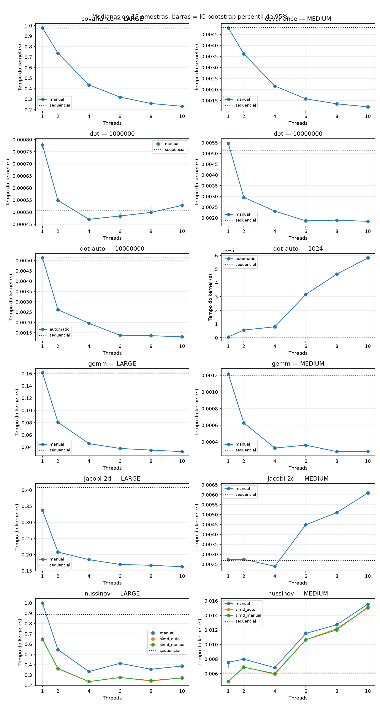
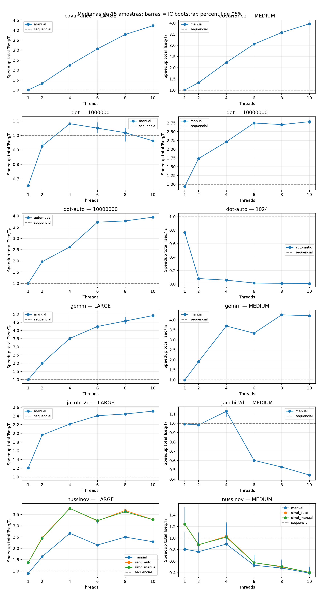
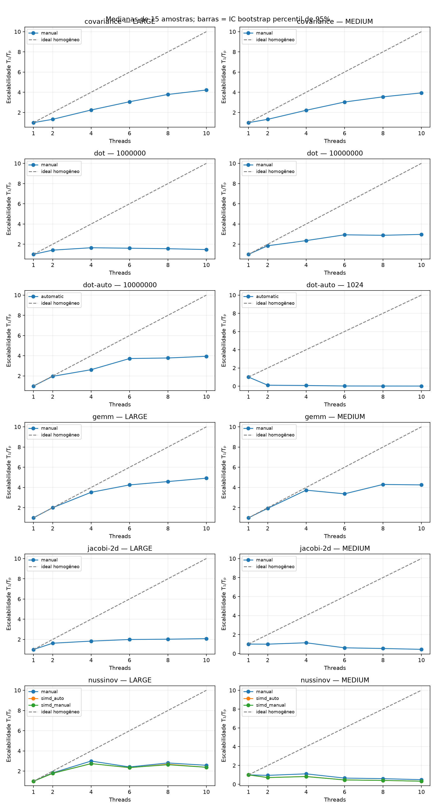
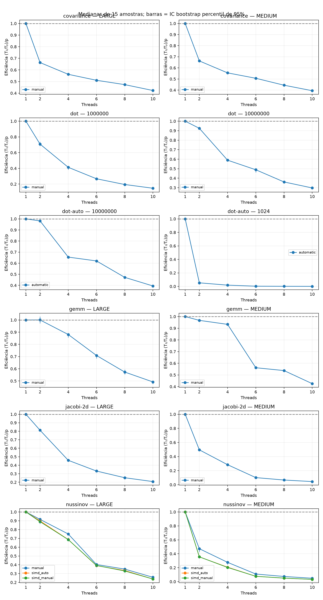
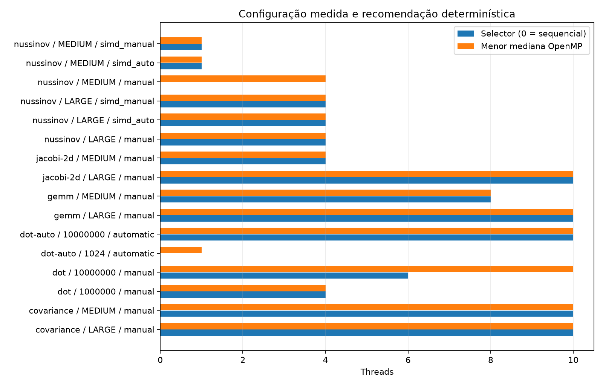

# Escalabilidade OpenMP — mac_m5_2026-11-16_p15w3_session02

Fonte: `/Users/lucasulson/Desktop/PUCRS/Ultimo semestre/TCC2/tcc2-experiments-mac-2026-11-16/results/multiplatform/mac_m5_2026-11-16_p15w3_session02`. Fontes, binários e saídas conferidos por SHA-256; resumos recalculados das amostras.

15 amostras externas; 3 aquecimentos por configuração; blocos embaralhados (seed 2026).
Dot C automático usa o transformador determinístico real; demais variantes são manuais ou adaptações específicas preexistentes. Não houve inferência LLM.

| Kernel | Entrada | Variante | Threads | Mediana (s) | Mín.–máx. (s) | S total | S transf. | S paralelo | E paralela |
|---|---|---|---:|---:|---:|---:|---:|---:|---:|
| covariance | LARGE | manual | 1 | 0.978347000 | 0.976363000–5.833792000 | 0.9999 | 0.9999 | 1.0000 | 1.0000 |
| covariance | LARGE | manual | 2 | 0.737365000 | 0.735150000–4.444317000 | 1.3267 | 0.9999 | 1.3268 | 0.6634 |
| covariance | LARGE | manual | 4 | 0.435069000 | 0.433446000–2.646991000 | 2.2486 | 0.9999 | 2.2487 | 0.5622 |
| covariance | LARGE | manual | 6 | 0.319195000 | 0.312203000–1.982247000 | 3.0649 | 0.9999 | 3.0650 | 0.5108 |
| covariance | LARGE | manual | 8 | 0.258328000 | 0.251423000–1.548460000 | 3.7870 | 0.9999 | 3.7872 | 0.4734 |
| covariance | LARGE | manual | 10 | 0.231464000 | 0.223150000–1.299625000 | 4.2265 | 0.9999 | 4.2268 | 0.4227 |
| covariance | LARGE | sequential | 1 | 0.978292000 | 0.972738000–34.299903000 | 1.0000 | 1.0000 | 1.0000 | 1.0000 |
| covariance | MEDIUM | manual | 1 | 0.004797000 | 0.004758000–0.004838000 | 1.0063 | 1.0063 | 1.0000 | 1.0000 |
| covariance | MEDIUM | manual | 2 | 0.003620000 | 0.003600000–0.003658000 | 1.3334 | 1.0063 | 1.3251 | 0.6626 |
| covariance | MEDIUM | manual | 4 | 0.002161000 | 0.002136000–0.003637000 | 2.2337 | 1.0063 | 2.2198 | 0.5550 |
| covariance | MEDIUM | manual | 6 | 0.001579000 | 0.001556000–0.001612000 | 3.0570 | 1.0063 | 3.0380 | 0.5063 |
| covariance | MEDIUM | manual | 8 | 0.001351000 | 0.001291000–0.001545000 | 3.5729 | 1.0063 | 3.5507 | 0.4438 |
| covariance | MEDIUM | manual | 10 | 0.001217000 | 0.001186000–0.001355000 | 3.9663 | 1.0063 | 3.9417 | 0.3942 |
| covariance | MEDIUM | sequential | 1 | 0.004827000 | 0.004814000–0.008741000 | 1.0000 | 1.0000 | 1.0000 | 1.0000 |
| dot | 1000000 | manual | 1 | 0.000777875 | 0.000746375–0.000807875 | 0.6538 | 0.6538 | 1.0000 | 1.0000 |
| dot | 1000000 | manual | 2 | 0.000549084 | 0.000506750–0.000979250 | 0.9262 | 0.6538 | 1.4167 | 0.7083 |
| dot | 1000000 | manual | 4 | 0.000470500 | 0.000449209–0.000593458 | 1.0809 | 0.6538 | 1.6533 | 0.4133 |
| dot | 1000000 | manual | 6 | 0.000484292 | 0.000458708–0.000535625 | 1.0501 | 0.6538 | 1.6062 | 0.2677 |
| dot | 1000000 | manual | 8 | 0.000499250 | 0.000469125–0.000618875 | 1.0186 | 0.6538 | 1.5581 | 0.1948 |
| dot | 1000000 | manual | 10 | 0.000528209 | 0.000481333–0.000586375 | 0.9628 | 0.6538 | 1.4727 | 0.1473 |
| dot | 1000000 | sequential | 1 | 0.000508542 | 0.000507250–0.000520583 | 1.0000 | 1.0000 | 1.0000 | 1.0000 |
| dot | 10000000 | manual | 1 | 0.005468250 | 0.005417917–0.005726417 | 0.9367 | 0.9367 | 1.0000 | 1.0000 |
| dot | 10000000 | manual | 2 | 0.002955833 | 0.002919375–0.003657041 | 1.7329 | 0.9367 | 1.8500 | 0.9250 |
| dot | 10000000 | manual | 4 | 0.002318583 | 0.002277334–0.002368583 | 2.2092 | 0.9367 | 2.3584 | 0.5896 |
| dot | 10000000 | manual | 6 | 0.001864500 | 0.001795333–0.002064084 | 2.7472 | 0.9367 | 2.9328 | 0.4888 |
| dot | 10000000 | manual | 8 | 0.001896125 | 0.001860250–0.001947125 | 2.7014 | 0.9367 | 2.8839 | 0.3605 |
| dot | 10000000 | manual | 10 | 0.001838875 | 0.001781125–0.001966458 | 2.7855 | 0.9367 | 2.9737 | 0.2974 |
| dot | 10000000 | sequential | 1 | 0.005122208 | 0.005091208–0.005765208 | 1.0000 | 1.0000 | 1.0000 | 1.0000 |
| dot-auto | 1024 | automatic | 1 | 0.000000591 | 0.000000565–0.000000598 | 0.7645 | 0.7645 | 1.0000 | 1.0000 |
| dot-auto | 1024 | automatic | 2 | 0.000005595 | 0.000005421–0.000005704 | 0.0808 | 0.7645 | 0.1057 | 0.0528 |
| dot-auto | 1024 | automatic | 4 | 0.000007944 | 0.000007858–0.000008122 | 0.0569 | 0.7645 | 0.0744 | 0.0186 |
| dot-auto | 1024 | automatic | 6 | 0.000031572 | 0.000031006–0.000032396 | 0.0143 | 0.7645 | 0.0187 | 0.0031 |
| dot-auto | 1024 | automatic | 8 | 0.000046401 | 0.000045133–0.000047119 | 0.0097 | 0.7645 | 0.0127 | 0.0016 |
| dot-auto | 1024 | automatic | 10 | 0.000058162 | 0.000057360–0.000059051 | 0.0078 | 0.7645 | 0.0102 | 0.0010 |
| dot-auto | 1024 | sequential | 1 | 0.000000452 | 0.000000435–0.000000459 | 1.0000 | 1.0000 | 1.0000 | 1.0000 |
| dot-auto | 10000000 | automatic | 1 | 0.005133550 | 0.005121790–0.005156030 | 0.9993 | 0.9993 | 1.0000 | 1.0000 |
| dot-auto | 10000000 | automatic | 2 | 0.002614850 | 0.002612470–0.002642860 | 1.9618 | 0.9993 | 1.9632 | 0.9816 |
| dot-auto | 10000000 | automatic | 4 | 0.001959100 | 0.001944800–0.001973120 | 2.6185 | 0.9993 | 2.6204 | 0.6551 |
| dot-auto | 10000000 | automatic | 6 | 0.001379120 | 0.001372830–0.001663210 | 3.7197 | 0.9993 | 3.7223 | 0.6204 |
| dot-auto | 10000000 | automatic | 8 | 0.001358550 | 0.001347740–0.001375250 | 3.7760 | 0.9993 | 3.7787 | 0.4723 |
| dot-auto | 10000000 | automatic | 10 | 0.001301190 | 0.001287450–0.001386070 | 3.9425 | 0.9993 | 3.9453 | 0.3945 |
| dot-auto | 10000000 | sequential | 1 | 0.005129910 | 0.005107070–0.005207370 | 1.0000 | 1.0000 | 1.0000 | 1.0000 |
| gemm | LARGE | manual | 1 | 0.161378000 | 0.151664000–0.164719000 | 0.9974 | 0.9974 | 1.0000 | 1.0000 |
| gemm | LARGE | manual | 2 | 0.080672000 | 0.075910000–0.084221000 | 1.9951 | 0.9974 | 2.0004 | 1.0002 |
| gemm | LARGE | manual | 4 | 0.045810000 | 0.042003000–0.047742000 | 3.5135 | 0.9974 | 3.5228 | 0.8807 |
| gemm | LARGE | manual | 6 | 0.037937000 | 0.037014000–0.040265000 | 4.2426 | 0.9974 | 4.2538 | 0.7090 |
| gemm | LARGE | manual | 8 | 0.035195000 | 0.032021000–0.038129000 | 4.5731 | 0.9974 | 4.5853 | 0.5732 |
| gemm | LARGE | manual | 10 | 0.032798000 | 0.029888000–0.034604000 | 4.9074 | 0.9974 | 4.9204 | 0.4920 |
| gemm | LARGE | sequential | 1 | 0.160952000 | 0.148970000–0.175152000 | 1.0000 | 1.0000 | 1.0000 | 1.0000 |
| gemm | MEDIUM | manual | 1 | 0.001217000 | 0.001211000–0.001253000 | 0.9893 | 0.9893 | 1.0000 | 1.0000 |
| gemm | MEDIUM | manual | 2 | 0.000629000 | 0.000622000–0.000645000 | 1.9141 | 0.9893 | 1.9348 | 0.9674 |
| gemm | MEDIUM | manual | 4 | 0.000326000 | 0.000321000–0.000445000 | 3.6933 | 0.9893 | 3.7331 | 0.9333 |
| gemm | MEDIUM | manual | 6 | 0.000361000 | 0.000355000–0.000389000 | 3.3352 | 0.9893 | 3.3712 | 0.5619 |
| gemm | MEDIUM | manual | 8 | 0.000283000 | 0.000276000–0.000286000 | 4.2544 | 0.9893 | 4.3004 | 0.5375 |
| gemm | MEDIUM | manual | 10 | 0.000286000 | 0.000282000–0.000312000 | 4.2098 | 0.9893 | 4.2552 | 0.4255 |
| gemm | MEDIUM | sequential | 1 | 0.001204000 | 0.001198000–0.001236000 | 1.0000 | 1.0000 | 1.0000 | 1.0000 |
| jacobi-2d | LARGE | manual | 1 | 0.337708000 | 0.336624000–0.352693000 | 1.2085 | 1.2085 | 1.0000 | 1.0000 |
| jacobi-2d | LARGE | manual | 2 | 0.207964000 | 0.203463000–0.219147000 | 1.9625 | 1.2085 | 1.6239 | 0.8119 |
| jacobi-2d | LARGE | manual | 4 | 0.184381000 | 0.183191000–0.195890000 | 2.2135 | 1.2085 | 1.8316 | 0.4579 |
| jacobi-2d | LARGE | manual | 6 | 0.169642000 | 0.166741000–0.185585000 | 2.4058 | 1.2085 | 1.9907 | 0.3318 |
| jacobi-2d | LARGE | manual | 8 | 0.166907000 | 0.162132000–0.168849000 | 2.4452 | 1.2085 | 2.0233 | 0.2529 |
| jacobi-2d | LARGE | manual | 10 | 0.162556000 | 0.161659000–0.180181000 | 2.5106 | 1.2085 | 2.0775 | 0.2077 |
| jacobi-2d | LARGE | sequential | 1 | 0.408119000 | 0.401974000–0.440406000 | 1.0000 | 1.0000 | 1.0000 | 1.0000 |
| jacobi-2d | MEDIUM | manual | 1 | 0.002722000 | 0.002543000–0.002766000 | 0.9927 | 0.9927 | 1.0000 | 1.0000 |
| jacobi-2d | MEDIUM | manual | 2 | 0.002749000 | 0.002580000–0.002829000 | 0.9829 | 0.9927 | 0.9902 | 0.4951 |
| jacobi-2d | MEDIUM | manual | 4 | 0.002394000 | 0.002288000–0.003375000 | 1.1287 | 0.9927 | 1.1370 | 0.2843 |
| jacobi-2d | MEDIUM | manual | 6 | 0.004489000 | 0.003886000–0.004702000 | 0.6019 | 0.9927 | 0.6064 | 0.1011 |
| jacobi-2d | MEDIUM | manual | 8 | 0.005100000 | 0.004493000–0.005309000 | 0.5298 | 0.9927 | 0.5337 | 0.0667 |
| jacobi-2d | MEDIUM | manual | 10 | 0.006089000 | 0.005908000–0.009214000 | 0.4438 | 0.9927 | 0.4470 | 0.0447 |
| jacobi-2d | MEDIUM | sequential | 1 | 0.002702000 | 0.002598000–0.002719000 | 1.0000 | 1.0000 | 1.0000 | 1.0000 |
| nussinov | LARGE | manual | 1 | 0.998452000 | 0.995056000–1.045718000 | 0.8899 | 0.8899 | 1.0000 | 1.0000 |
| nussinov | LARGE | manual | 2 | 0.545101000 | 0.541717000–0.587798000 | 1.6300 | 0.8899 | 1.8317 | 0.9158 |
| nussinov | LARGE | manual | 4 | 0.333023000 | 0.328907000–0.364012000 | 2.6680 | 0.8899 | 2.9981 | 0.7495 |
| nussinov | LARGE | manual | 6 | 0.413183000 | 0.410044000–2.256729000 | 2.1504 | 0.8899 | 2.4165 | 0.4027 |
| nussinov | LARGE | manual | 8 | 0.355536000 | 0.350522000–0.374070000 | 2.4991 | 0.8899 | 2.8083 | 0.3510 |
| nussinov | LARGE | manual | 10 | 0.387239000 | 0.378624000–0.412287000 | 2.2945 | 0.8899 | 2.5784 | 0.2578 |
| nussinov | LARGE | sequential | 1 | 0.888506000 | 0.881244000–0.922107000 | 1.0000 | 1.0000 | 1.0000 | 1.0000 |
| nussinov | LARGE | simd_auto | 1 | 0.647126000 | 0.634277000–25.638428000 | 1.3730 | 1.3730 | 1.0000 | 1.0000 |
| nussinov | LARGE | simd_auto | 2 | 0.360128000 | 0.352090000–2.099329000 | 2.4672 | 1.3730 | 1.7969 | 0.8985 |
| nussinov | LARGE | simd_auto | 4 | 0.235694000 | 0.231100000–0.446136000 | 3.7697 | 1.3730 | 2.7456 | 0.6864 |
| nussinov | LARGE | simd_auto | 6 | 0.276363000 | 0.269006000–0.343209000 | 3.2150 | 1.3730 | 2.3416 | 0.3903 |
| nussinov | LARGE | simd_auto | 8 | 0.241564000 | 0.231847000–0.246901000 | 3.6781 | 1.3730 | 2.6789 | 0.3349 |
| nussinov | LARGE | simd_auto | 10 | 0.271518000 | 0.261002000–0.279266000 | 3.2724 | 1.3730 | 2.3834 | 0.2383 |
| nussinov | LARGE | simd_manual | 1 | 0.646929000 | 0.624597000–0.681481000 | 1.3734 | 1.3734 | 1.0000 | 1.0000 |
| nussinov | LARGE | simd_manual | 2 | 0.363629000 | 0.350956000–0.379010000 | 2.4434 | 1.3734 | 1.7791 | 0.8895 |
| nussinov | LARGE | simd_manual | 4 | 0.235831000 | 0.220530000–0.241678000 | 3.7676 | 1.3734 | 2.7432 | 0.6858 |
| nussinov | LARGE | simd_manual | 6 | 0.275034000 | 0.271593000–0.291350000 | 3.2305 | 1.3734 | 2.3522 | 0.3920 |
| nussinov | LARGE | simd_manual | 8 | 0.245363000 | 0.239107000–0.292506000 | 3.6212 | 1.3734 | 2.6366 | 0.3296 |
| nussinov | LARGE | simd_manual | 10 | 0.271633000 | 0.269368000–13.103650000 | 3.2710 | 1.3734 | 2.3816 | 0.2382 |
| nussinov | MEDIUM | manual | 1 | 0.007557000 | 0.006773000–0.012334000 | 0.8073 | 0.8073 | 1.0000 | 1.0000 |
| nussinov | MEDIUM | manual | 2 | 0.007991000 | 0.007403000–0.008187000 | 0.7635 | 0.8073 | 0.9457 | 0.4728 |
| nussinov | MEDIUM | manual | 4 | 0.006819000 | 0.006612000–0.007193000 | 0.8947 | 0.8073 | 1.1082 | 0.2771 |
| nussinov | MEDIUM | manual | 6 | 0.011527000 | 0.010751000–0.016923000 | 0.5293 | 0.8073 | 0.6556 | 0.1093 |
| nussinov | MEDIUM | manual | 8 | 0.012713000 | 0.012050000–0.014630000 | 0.4799 | 0.8073 | 0.5944 | 0.0743 |
| nussinov | MEDIUM | manual | 10 | 0.015550000 | 0.015425000–0.015964000 | 0.3923 | 0.8073 | 0.4860 | 0.0486 |
| nussinov | MEDIUM | sequential | 1 | 0.006101000 | 0.005786000–0.008282000 | 1.0000 | 1.0000 | 1.0000 | 1.0000 |
| nussinov | MEDIUM | simd_auto | 1 | 0.004916000 | 0.004865000–0.006616000 | 1.2410 | 1.2410 | 1.0000 | 1.0000 |
| nussinov | MEDIUM | simd_auto | 2 | 0.006919000 | 0.006445000–0.009911000 | 0.8818 | 1.2410 | 0.7105 | 0.3553 |
| nussinov | MEDIUM | simd_auto | 4 | 0.005928000 | 0.005816000–0.009551000 | 1.0292 | 1.2410 | 0.8293 | 0.2073 |
| nussinov | MEDIUM | simd_auto | 6 | 0.010641000 | 0.009720000–0.011228000 | 0.5733 | 1.2410 | 0.4620 | 0.0770 |
| nussinov | MEDIUM | simd_auto | 8 | 0.012195000 | 0.011288000–0.018930000 | 0.5003 | 1.2410 | 0.4031 | 0.0504 |
| nussinov | MEDIUM | simd_auto | 10 | 0.015026000 | 0.014769000–0.015973000 | 0.4060 | 1.2410 | 0.3272 | 0.0327 |
| nussinov | MEDIUM | simd_manual | 1 | 0.004903000 | 0.004879000–0.005494000 | 1.2443 | 1.2443 | 1.0000 | 1.0000 |
| nussinov | MEDIUM | simd_manual | 2 | 0.006885000 | 0.006734000–0.008585000 | 0.8861 | 1.2443 | 0.7121 | 0.3561 |
| nussinov | MEDIUM | simd_manual | 4 | 0.006011000 | 0.005764000–0.006461000 | 1.0150 | 1.2443 | 0.8157 | 0.2039 |
| nussinov | MEDIUM | simd_manual | 6 | 0.010657000 | 0.010089000–0.011049000 | 0.5725 | 1.2443 | 0.4601 | 0.0767 |
| nussinov | MEDIUM | simd_manual | 8 | 0.012021000 | 0.011886000–0.013340000 | 0.5075 | 1.2443 | 0.4079 | 0.0510 |
| nussinov | MEDIUM | simd_manual | 10 | 0.015122000 | 0.014613000–0.021585000 | 0.4035 | 1.2443 | 0.3242 | 0.0324 |

S total = Tseq/Tp; S transf. = Tseq/T1 da mesma variante; S paralelo = T1/Tp; E paralela = (T1/Tp)/p.
Os CSVs incluem MAD, IQR, desvio padrão amostral e IC percentil bootstrap de 95%, 5.000 reamostragens de blocos completos, seed 2026, para n ≥ 15.
Os intervalos são condicionais a esta campanha; não comprovam estacionariedade nem significância entre plataformas.
O probe confirma o tamanho das equipes no runtime, sem provar a localização de cada thread dos kernels.
Validação de arrays usa binários de dump separados com os mesmos flags de otimização; não prova ausência de races.
Tempos excluem inicialização dos arrays, compilação e inferência. O Dot C++ inclui a primeira inicialização OpenMP; o PolyBench inicializa a equipe no flush antes do timer.
Cada arquivo é uma sessão própria. Uma comparação entre plataformas exige verificar separadamente a identidade dos códigos, entradas e protocolo; dados históricos incompatíveis não completam esta coleta.

