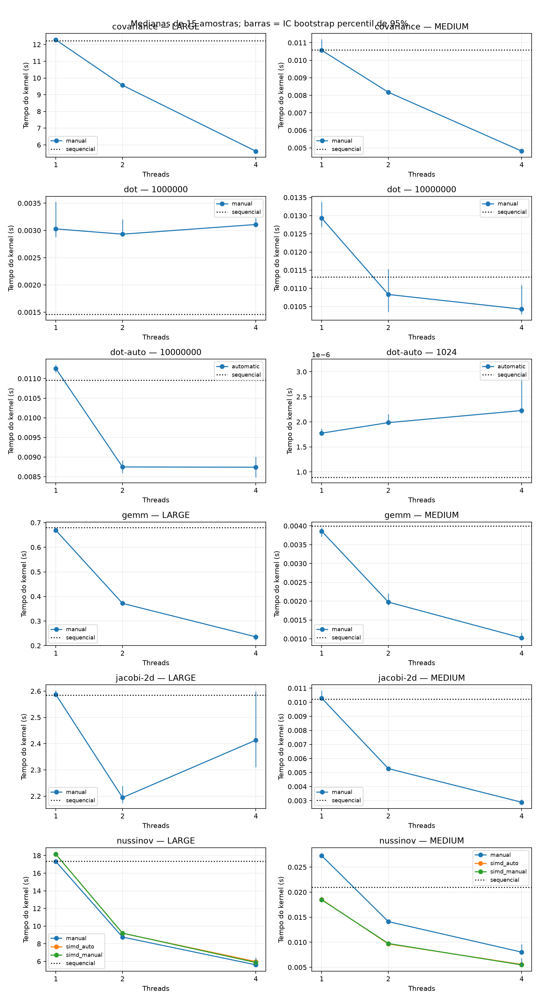
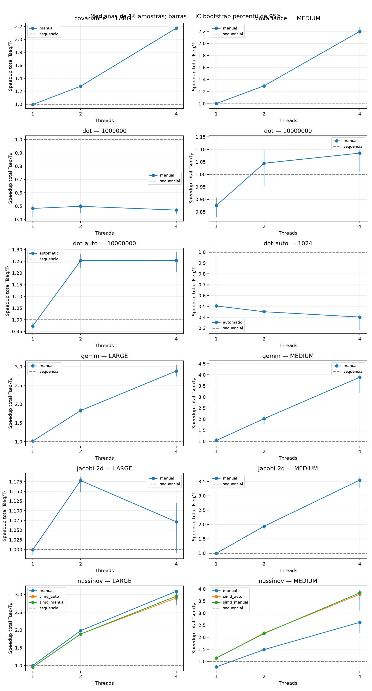
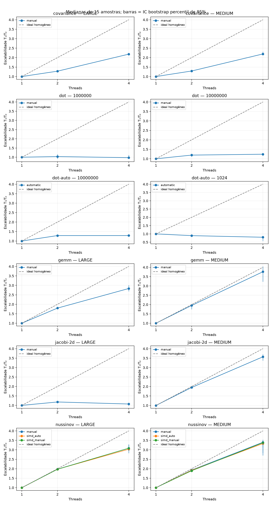
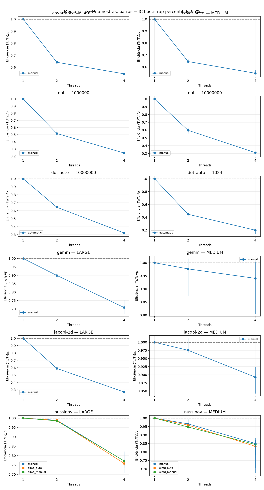
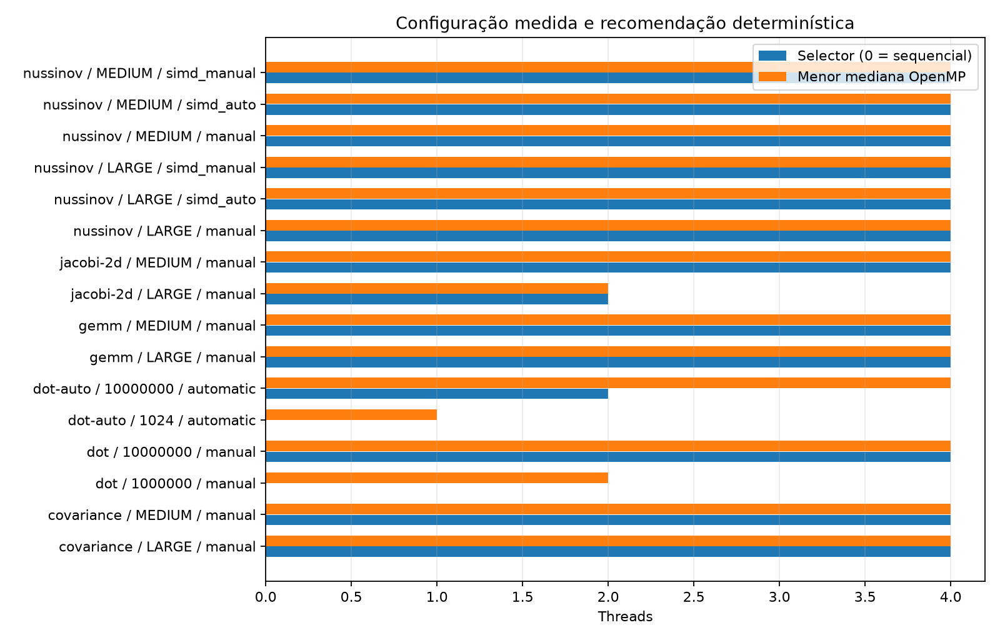

# Escalabilidade OpenMP — scaling_linux_session02_2026-11-05

Fonte: `/home/liswsz220-01/Desktop/tcc/tcc2/results/publication/scaling_linux_session02_2026-11-05`. Fontes, binários e saídas conferidos por SHA-256; resumos recalculados das amostras.

15 amostras externas; 3 aquecimentos por configuração; blocos embaralhados (seed 2026).
Dot C automático usa o transformador determinístico real; demais variantes são manuais ou adaptações específicas preexistentes. Não houve inferência LLM.

| Kernel | Entrada | Variante | Threads | Mediana (s) | Mín.–máx. (s) | S total | S transf. | S paralelo | E paralela |
|---|---|---|---:|---:|---:|---:|---:|---:|---:|
| covariance | LARGE | manual | 1 | 12.277155000 | 12.149153000–12.360745000 | 0.9951 | 0.9951 | 1.0000 | 1.0000 |
| covariance | LARGE | manual | 2 | 9.564339000 | 9.464393000–9.799884000 | 1.2773 | 0.9951 | 1.2836 | 0.6418 |
| covariance | LARGE | manual | 4 | 5.622756000 | 5.542000000–5.731902000 | 2.1728 | 0.9951 | 2.1835 | 0.5459 |
| covariance | LARGE | sequential | 1 | 12.216895000 | 12.090522000–12.606439000 | 1.0000 | 1.0000 | 1.0000 | 1.0000 |
| covariance | MEDIUM | manual | 1 | 0.010568000 | 0.010326000–0.015298000 | 1.0015 | 1.0015 | 1.0000 | 1.0000 |
| covariance | MEDIUM | manual | 2 | 0.008175000 | 0.007954000–0.008482000 | 1.2947 | 1.0015 | 1.2927 | 0.6464 |
| covariance | MEDIUM | manual | 4 | 0.004817000 | 0.004766000–0.005543000 | 2.1972 | 1.0015 | 2.1939 | 0.5485 |
| covariance | MEDIUM | sequential | 1 | 0.010584000 | 0.010231000–0.012158000 | 1.0000 | 1.0000 | 1.0000 | 1.0000 |
| dot | 1000000 | manual | 1 | 0.003028001 | 0.002800123–0.003606486 | 0.4822 | 0.4822 | 1.0000 | 1.0000 |
| dot | 1000000 | manual | 2 | 0.002931349 | 0.002836939–0.004153434 | 0.4981 | 0.4822 | 1.0330 | 0.5165 |
| dot | 1000000 | manual | 4 | 0.003108836 | 0.002658402–0.004009231 | 0.4697 | 0.4822 | 0.9740 | 0.2435 |
| dot | 1000000 | sequential | 1 | 0.001460085 | 0.001291394–0.001563819 | 1.0000 | 1.0000 | 1.0000 | 1.0000 |
| dot | 10000000 | manual | 1 | 0.012931574 | 0.012413654–0.014411848 | 0.8749 | 0.8749 | 1.0000 | 1.0000 |
| dot | 10000000 | manual | 2 | 0.010831587 | 0.010155275–0.017727462 | 1.0445 | 0.8749 | 1.1939 | 0.5969 |
| dot | 10000000 | manual | 4 | 0.010428314 | 0.009990678–0.014941659 | 1.0849 | 0.8749 | 1.2400 | 0.3100 |
| dot | 10000000 | sequential | 1 | 0.011313819 | 0.010834418–0.012334378 | 1.0000 | 1.0000 | 1.0000 | 1.0000 |
| dot-auto | 1024 | automatic | 1 | 0.000001775 | 0.000001740–0.000002192 | 0.5041 | 0.5041 | 1.0000 | 1.0000 |
| dot-auto | 1024 | automatic | 2 | 0.000001984 | 0.000001930–0.000002312 | 0.4509 | 0.5041 | 0.8944 | 0.4472 |
| dot-auto | 1024 | automatic | 4 | 0.000002226 | 0.000001997–0.000006652 | 0.4019 | 0.5041 | 0.7973 | 0.1993 |
| dot-auto | 1024 | sequential | 1 | 0.000000895 | 0.000000872–0.000001273 | 1.0000 | 1.0000 | 1.0000 | 1.0000 |
| dot-auto | 10000000 | automatic | 1 | 0.011254184 | 0.011039097–0.012280202 | 0.9735 | 0.9735 | 1.0000 | 1.0000 |
| dot-auto | 10000000 | automatic | 2 | 0.008746993 | 0.008531284–0.009606541 | 1.2525 | 0.9735 | 1.2866 | 0.6433 |
| dot-auto | 10000000 | automatic | 4 | 0.008740644 | 0.008405853–0.014027524 | 1.2534 | 0.9735 | 1.2876 | 0.3219 |
| dot-auto | 10000000 | sequential | 1 | 0.010955483 | 0.010757625–0.011368957 | 1.0000 | 1.0000 | 1.0000 | 1.0000 |
| gemm | LARGE | manual | 1 | 0.668710000 | 0.656674000–0.703985000 | 1.0169 | 1.0169 | 1.0000 | 1.0000 |
| gemm | LARGE | manual | 2 | 0.371781000 | 0.364495000–0.380919000 | 1.8291 | 1.0169 | 1.7987 | 0.8993 |
| gemm | LARGE | manual | 4 | 0.235891000 | 0.220361000–0.276861000 | 2.8827 | 1.0169 | 2.8348 | 0.7087 |
| gemm | LARGE | sequential | 1 | 0.680011000 | 0.655782000–0.721930000 | 1.0000 | 1.0000 | 1.0000 | 1.0000 |
| gemm | MEDIUM | manual | 1 | 0.003859000 | 0.003624000–0.005158000 | 1.0345 | 1.0345 | 1.0000 | 1.0000 |
| gemm | MEDIUM | manual | 2 | 0.001976000 | 0.001870000–0.005575000 | 2.0202 | 1.0345 | 1.9529 | 0.9765 |
| gemm | MEDIUM | manual | 4 | 0.001026000 | 0.000961000–0.005572000 | 3.8908 | 1.0345 | 3.7612 | 0.9403 |
| gemm | MEDIUM | sequential | 1 | 0.003992000 | 0.003590000–0.006233000 | 1.0000 | 1.0000 | 1.0000 | 1.0000 |
| jacobi-2d | LARGE | manual | 1 | 2.586918000 | 2.564520000–2.694763000 | 0.9993 | 0.9993 | 1.0000 | 1.0000 |
| jacobi-2d | LARGE | manual | 2 | 2.194598000 | 2.155248000–2.507374000 | 1.1779 | 0.9993 | 1.1788 | 0.5894 |
| jacobi-2d | LARGE | manual | 4 | 2.413190000 | 2.200101000–2.963268000 | 1.0712 | 0.9993 | 1.0720 | 0.2680 |
| jacobi-2d | LARGE | sequential | 1 | 2.585070000 | 2.556772000–2.736611000 | 1.0000 | 1.0000 | 1.0000 | 1.0000 |
| jacobi-2d | MEDIUM | manual | 1 | 0.010296000 | 0.009571000–0.011301000 | 0.9931 | 0.9931 | 1.0000 | 1.0000 |
| jacobi-2d | MEDIUM | manual | 2 | 0.005279000 | 0.004968000–0.005688000 | 1.9369 | 0.9931 | 1.9504 | 0.9752 |
| jacobi-2d | MEDIUM | manual | 4 | 0.002884000 | 0.002697000–0.003908000 | 3.5454 | 0.9931 | 3.5700 | 0.8925 |
| jacobi-2d | MEDIUM | sequential | 1 | 0.010225000 | 0.009443000–0.011181000 | 1.0000 | 1.0000 | 1.0000 | 1.0000 |
| nussinov | LARGE | manual | 1 | 17.323663000 | 17.174946000–18.003905000 | 1.0012 | 1.0012 | 1.0000 | 1.0000 |
| nussinov | LARGE | manual | 2 | 8.759814000 | 8.651779000–9.296491000 | 1.9800 | 1.0012 | 1.9776 | 0.9888 |
| nussinov | LARGE | manual | 4 | 5.614330000 | 5.212924000–6.259704000 | 3.0893 | 1.0012 | 3.0856 | 0.7714 |
| nussinov | LARGE | sequential | 1 | 17.344353000 | 17.246077000–17.483859000 | 1.0000 | 1.0000 | 1.0000 | 1.0000 |
| nussinov | LARGE | simd_auto | 1 | 18.148559000 | 17.975687000–18.590036000 | 0.9557 | 0.9557 | 1.0000 | 1.0000 |
| nussinov | LARGE | simd_auto | 2 | 9.187035000 | 9.134949000–9.645115000 | 1.8879 | 0.9557 | 1.9755 | 0.9877 |
| nussinov | LARGE | simd_auto | 4 | 5.980381000 | 5.305155000–6.723680000 | 2.9002 | 0.9557 | 3.0347 | 0.7587 |
| nussinov | LARGE | simd_manual | 1 | 18.143806000 | 17.958440000–18.365750000 | 0.9559 | 0.9559 | 1.0000 | 1.0000 |
| nussinov | LARGE | simd_manual | 2 | 9.205830000 | 9.114255000–9.451743000 | 1.8841 | 0.9559 | 1.9709 | 0.9855 |
| nussinov | LARGE | simd_manual | 4 | 5.876816000 | 5.293986000–7.796971000 | 2.9513 | 0.9559 | 3.0874 | 0.7718 |
| nussinov | MEDIUM | manual | 1 | 0.027286000 | 0.026943000–0.029625000 | 0.7698 | 0.7698 | 1.0000 | 1.0000 |
| nussinov | MEDIUM | manual | 2 | 0.014125000 | 0.013872000–0.015986000 | 1.4872 | 0.7698 | 1.9318 | 0.9659 |
| nussinov | MEDIUM | manual | 4 | 0.008027000 | 0.007492000–0.019408000 | 2.6169 | 0.7698 | 3.3993 | 0.8498 |
| nussinov | MEDIUM | sequential | 1 | 0.021006000 | 0.020774000–0.021753000 | 1.0000 | 1.0000 | 1.0000 | 1.0000 |
| nussinov | MEDIUM | simd_auto | 1 | 0.018531000 | 0.018274000–0.020451000 | 1.1336 | 1.1336 | 1.0000 | 1.0000 |
| nussinov | MEDIUM | simd_auto | 2 | 0.009666000 | 0.009379000–0.010330000 | 2.1732 | 1.1336 | 1.9171 | 0.9586 |
| nussinov | MEDIUM | simd_auto | 4 | 0.005561000 | 0.005203000–0.007381000 | 3.7774 | 1.1336 | 3.3323 | 0.8331 |
| nussinov | MEDIUM | simd_manual | 1 | 0.018473000 | 0.018189000–0.019076000 | 1.1371 | 1.1371 | 1.0000 | 1.0000 |
| nussinov | MEDIUM | simd_manual | 2 | 0.009749000 | 0.009552000–0.010828000 | 2.1547 | 1.1371 | 1.8949 | 0.9474 |
| nussinov | MEDIUM | simd_manual | 4 | 0.005473000 | 0.005213000–0.014281000 | 3.8381 | 1.1371 | 3.3753 | 0.8438 |

S total = Tseq/Tp; S transf. = Tseq/T1 da mesma variante; S paralelo = T1/Tp; E paralela = (T1/Tp)/p.
Os CSVs incluem MAD, IQR, desvio padrão amostral e IC percentil bootstrap de 95%, 5.000 reamostragens de blocos completos, seed 2026, para n ≥ 15.
Os intervalos são condicionais a esta campanha; não comprovam estacionariedade nem significância entre plataformas.
O probe confirma o tamanho das equipes no runtime, sem provar a localização de cada thread dos kernels.
Validação de arrays usa binários de dump separados com os mesmos flags de otimização; não prova ausência de races.
Tempos excluem inicialização dos arrays, compilação e inferência. O Dot C++ inclui a primeira inicialização OpenMP; o PolyBench inicializa a equipe no flush antes do timer.
A coleta M5 equivalente ainda precisa ser executada; dados históricos não formam um experimento pareado com esta coleta.

