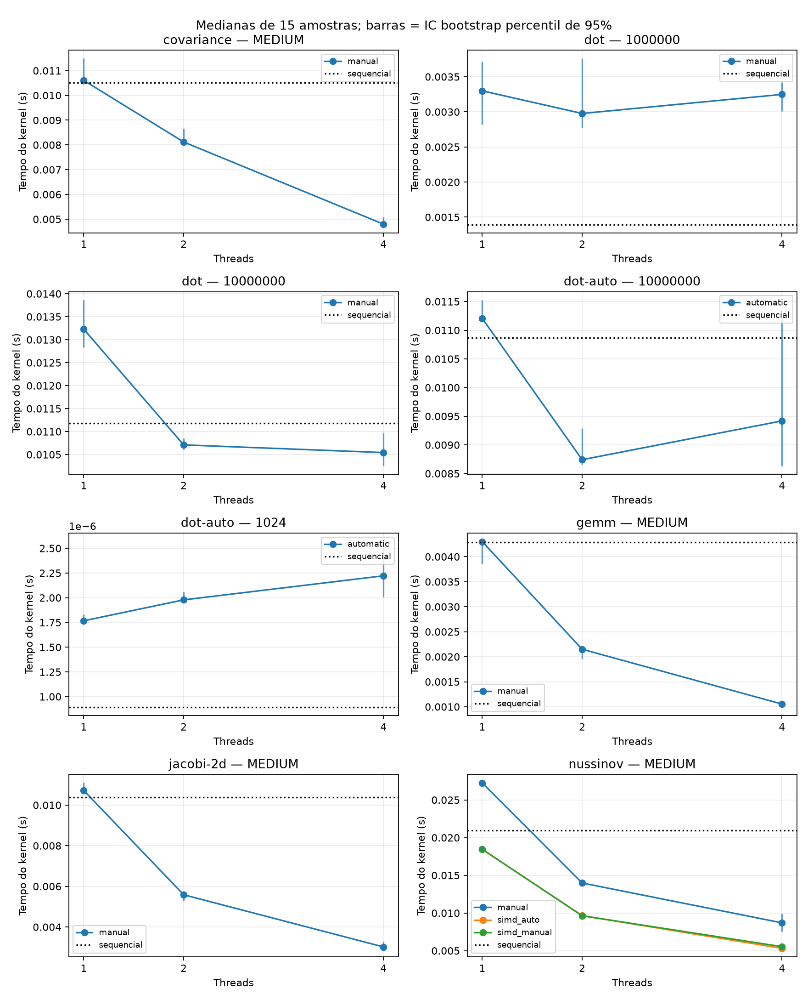
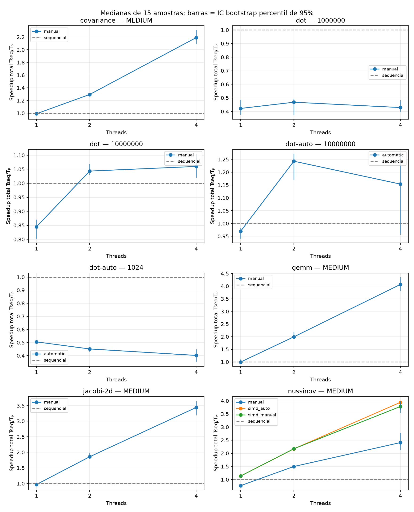
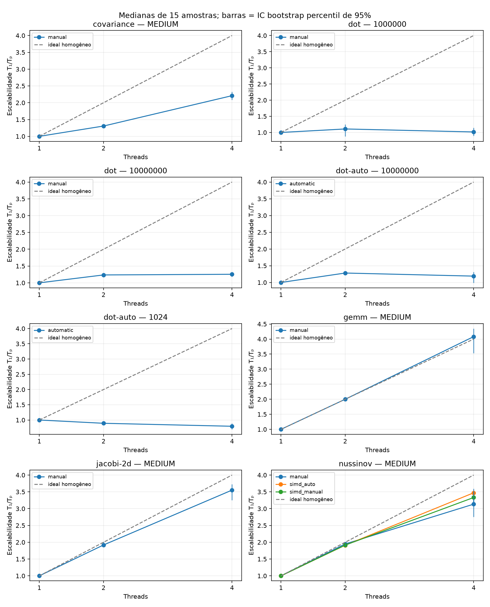
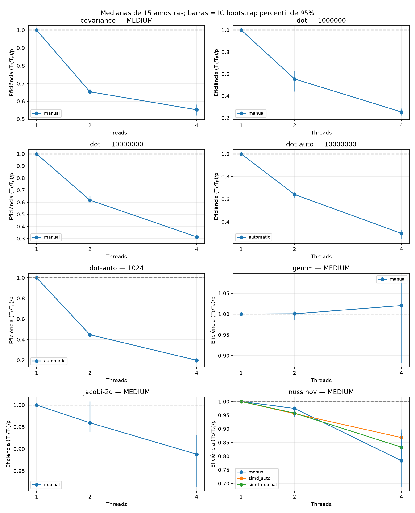
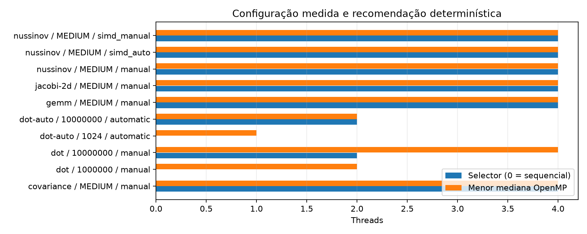

# Escalabilidade OpenMP — scaling_linux_session03_medium_2026-11-05

Fonte: `/home/liswsz220-01/Desktop/tcc/tcc2/results/publication/scaling_linux_session03_medium_2026-11-05`. Fontes, binários e saídas conferidos por SHA-256; resumos recalculados das amostras.

15 amostras externas; 3 aquecimentos por configuração; blocos embaralhados (seed 2026).
Dot C automático usa o transformador determinístico real; demais variantes são manuais ou adaptações específicas preexistentes. Não houve inferência LLM.

| Kernel | Entrada | Variante | Threads | Mediana (s) | Mín.–máx. (s) | S total | S transf. | S paralelo | E paralela |
|---|---|---|---:|---:|---:|---:|---:|---:|---:|
| covariance | MEDIUM | manual | 1 | 0.010606000 | 0.010397000–0.011568000 | 0.9913 | 0.9913 | 1.0000 | 1.0000 |
| covariance | MEDIUM | manual | 2 | 0.008118000 | 0.008044000–0.008933000 | 1.2951 | 0.9913 | 1.3065 | 0.6532 |
| covariance | MEDIUM | manual | 4 | 0.004799000 | 0.004739000–0.009371000 | 2.1909 | 0.9913 | 2.2100 | 0.5525 |
| covariance | MEDIUM | sequential | 1 | 0.010514000 | 0.010244000–0.012226000 | 1.0000 | 1.0000 | 1.0000 | 1.0000 |
| dot | 1000000 | manual | 1 | 0.003299522 | 0.002668202–0.010533637 | 0.4222 | 0.4222 | 1.0000 | 1.0000 |
| dot | 1000000 | manual | 2 | 0.002976949 | 0.002505426–0.007256588 | 0.4680 | 0.4222 | 1.1084 | 0.5542 |
| dot | 1000000 | manual | 4 | 0.003248617 | 0.002664981–0.004335798 | 0.4288 | 0.4222 | 1.0157 | 0.2539 |
| dot | 1000000 | sequential | 1 | 0.001393078 | 0.001188193–0.001534385 | 1.0000 | 1.0000 | 1.0000 | 1.0000 |
| dot | 10000000 | manual | 1 | 0.013229214 | 0.012569917–0.018806129 | 0.8449 | 0.8449 | 1.0000 | 1.0000 |
| dot | 10000000 | manual | 2 | 0.010710628 | 0.010406810–0.014913325 | 1.0435 | 0.8449 | 1.2351 | 0.6176 |
| dot | 10000000 | manual | 4 | 0.010543247 | 0.010062349–0.017252112 | 1.0601 | 0.8449 | 1.2548 | 0.3137 |
| dot | 10000000 | sequential | 1 | 0.011177029 | 0.010934487–0.013496511 | 1.0000 | 1.0000 | 1.0000 | 1.0000 |
| dot-auto | 1024 | automatic | 1 | 0.000001767 | 0.000001742–0.000002092 | 0.5048 | 0.5048 | 1.0000 | 1.0000 |
| dot-auto | 1024 | automatic | 2 | 0.000001978 | 0.000001920–0.000002120 | 0.4508 | 0.5048 | 0.8931 | 0.4465 |
| dot-auto | 1024 | automatic | 4 | 0.000002222 | 0.000001957–0.000017761 | 0.4014 | 0.5048 | 0.7952 | 0.1988 |
| dot-auto | 1024 | sequential | 1 | 0.000000892 | 0.000000873–0.000000956 | 1.0000 | 1.0000 | 1.0000 | 1.0000 |
| dot-auto | 10000000 | automatic | 1 | 0.011205836 | 0.011042104–0.011899512 | 0.9697 | 0.9697 | 1.0000 | 1.0000 |
| dot-auto | 10000000 | automatic | 2 | 0.008742062 | 0.008527751–0.010237040 | 1.2430 | 0.9697 | 1.2818 | 0.6409 |
| dot-auto | 10000000 | automatic | 4 | 0.009418599 | 0.008350836–0.012733485 | 1.1537 | 0.9697 | 1.1898 | 0.2974 |
| dot-auto | 10000000 | sequential | 1 | 0.010866280 | 0.010680944–0.011605252 | 1.0000 | 1.0000 | 1.0000 | 1.0000 |
| gemm | MEDIUM | manual | 1 | 0.004302000 | 0.003668000–0.004410000 | 0.9963 | 0.9963 | 1.0000 | 1.0000 |
| gemm | MEDIUM | manual | 2 | 0.002150000 | 0.001865000–0.003215000 | 1.9935 | 0.9963 | 2.0009 | 1.0005 |
| gemm | MEDIUM | manual | 4 | 0.001054000 | 0.000965000–0.001784000 | 4.0664 | 0.9963 | 4.0816 | 1.0204 |
| gemm | MEDIUM | sequential | 1 | 0.004286000 | 0.003706000–0.004455000 | 1.0000 | 1.0000 | 1.0000 | 1.0000 |
| jacobi-2d | MEDIUM | manual | 1 | 0.010720000 | 0.010245000–0.014755000 | 0.9684 | 0.9684 | 1.0000 | 1.0000 |
| jacobi-2d | MEDIUM | manual | 2 | 0.005586000 | 0.005256000–0.006079000 | 1.8584 | 0.9684 | 1.9191 | 0.9595 |
| jacobi-2d | MEDIUM | manual | 4 | 0.003018000 | 0.002818000–0.005129000 | 3.4397 | 0.9684 | 3.5520 | 0.8880 |
| jacobi-2d | MEDIUM | sequential | 1 | 0.010381000 | 0.010059000–0.011504000 | 1.0000 | 1.0000 | 1.0000 | 1.0000 |
| nussinov | MEDIUM | manual | 1 | 0.027254000 | 0.026785000–0.029276000 | 0.7688 | 0.7688 | 1.0000 | 1.0000 |
| nussinov | MEDIUM | manual | 2 | 0.013983000 | 0.013779000–0.016984000 | 1.4985 | 0.7688 | 1.9491 | 0.9745 |
| nussinov | MEDIUM | manual | 4 | 0.008697000 | 0.007516000–0.015797000 | 2.4093 | 0.7688 | 3.1337 | 0.7834 |
| nussinov | MEDIUM | sequential | 1 | 0.020954000 | 0.020620000–0.021630000 | 1.0000 | 1.0000 | 1.0000 | 1.0000 |
| nussinov | MEDIUM | simd_auto | 1 | 0.018449000 | 0.018089000–0.020569000 | 1.1358 | 1.1358 | 1.0000 | 1.0000 |
| nussinov | MEDIUM | simd_auto | 2 | 0.009653000 | 0.009491000–0.010317000 | 2.1707 | 1.1358 | 1.9112 | 0.9556 |
| nussinov | MEDIUM | simd_auto | 4 | 0.005314000 | 0.005214000–0.008005000 | 3.9432 | 1.1358 | 3.4718 | 0.8679 |
| nussinov | MEDIUM | simd_manual | 1 | 0.018449000 | 0.018062000–0.021040000 | 1.1358 | 1.1358 | 1.0000 | 1.0000 |
| nussinov | MEDIUM | simd_manual | 2 | 0.009635000 | 0.009298000–0.010363000 | 2.1748 | 1.1358 | 1.9148 | 0.9574 |
| nussinov | MEDIUM | simd_manual | 4 | 0.005537000 | 0.005265000–0.008359000 | 3.7844 | 1.1358 | 3.3319 | 0.8330 |

S total = Tseq/Tp; S transf. = Tseq/T1 da mesma variante; S paralelo = T1/Tp; E paralela = (T1/Tp)/p.
Os CSVs incluem MAD, IQR, desvio padrão amostral e IC percentil bootstrap de 95%, 5.000 reamostragens de blocos completos, seed 2026, para n ≥ 15.
Os intervalos são condicionais a esta campanha; não comprovam estacionariedade nem significância entre plataformas.
O probe confirma o tamanho das equipes no runtime, sem provar a localização de cada thread dos kernels.
Validação de arrays usa binários de dump separados com os mesmos flags de otimização; não prova ausência de races.
Tempos excluem inicialização dos arrays, compilação e inferência. O Dot C++ inclui a primeira inicialização OpenMP; o PolyBench inicializa a equipe no flush antes do timer.
A coleta M5 equivalente ainda precisa ser executada; dados históricos não formam um experimento pareado com esta coleta.

