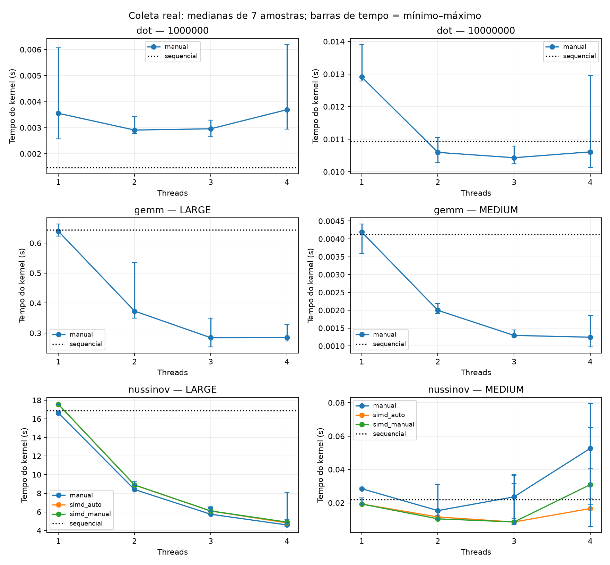
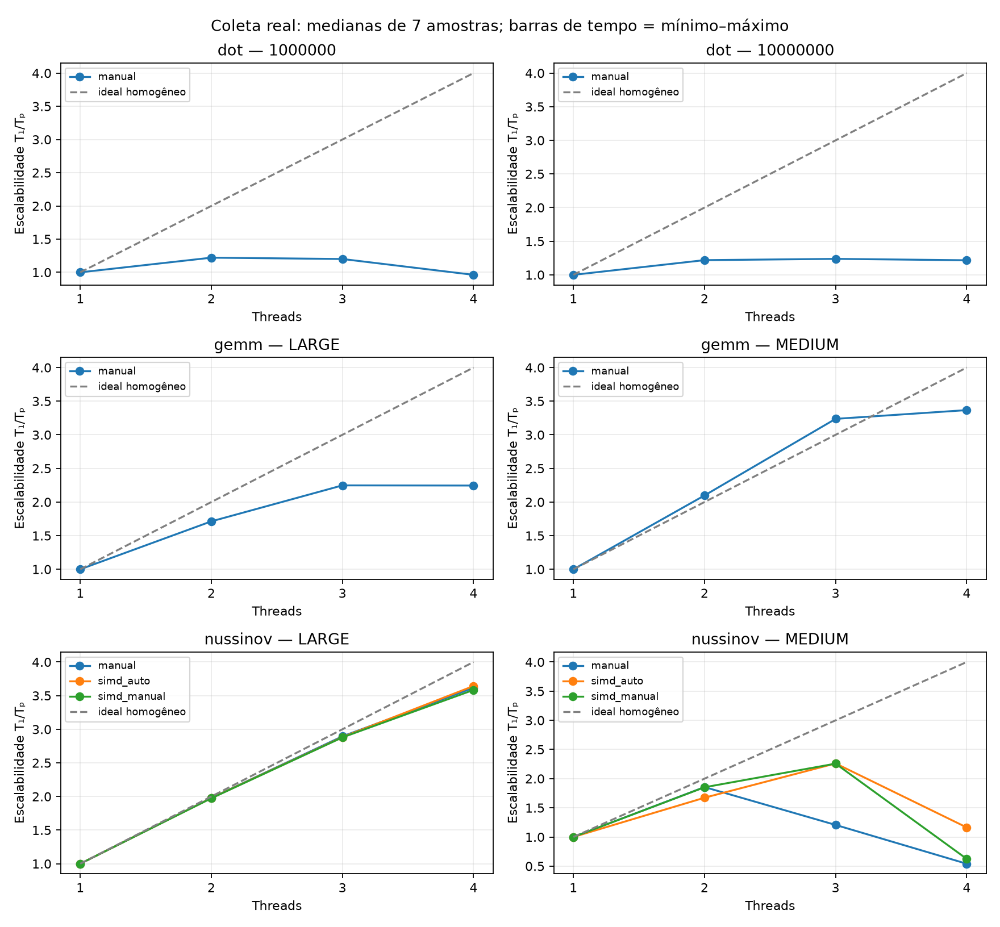
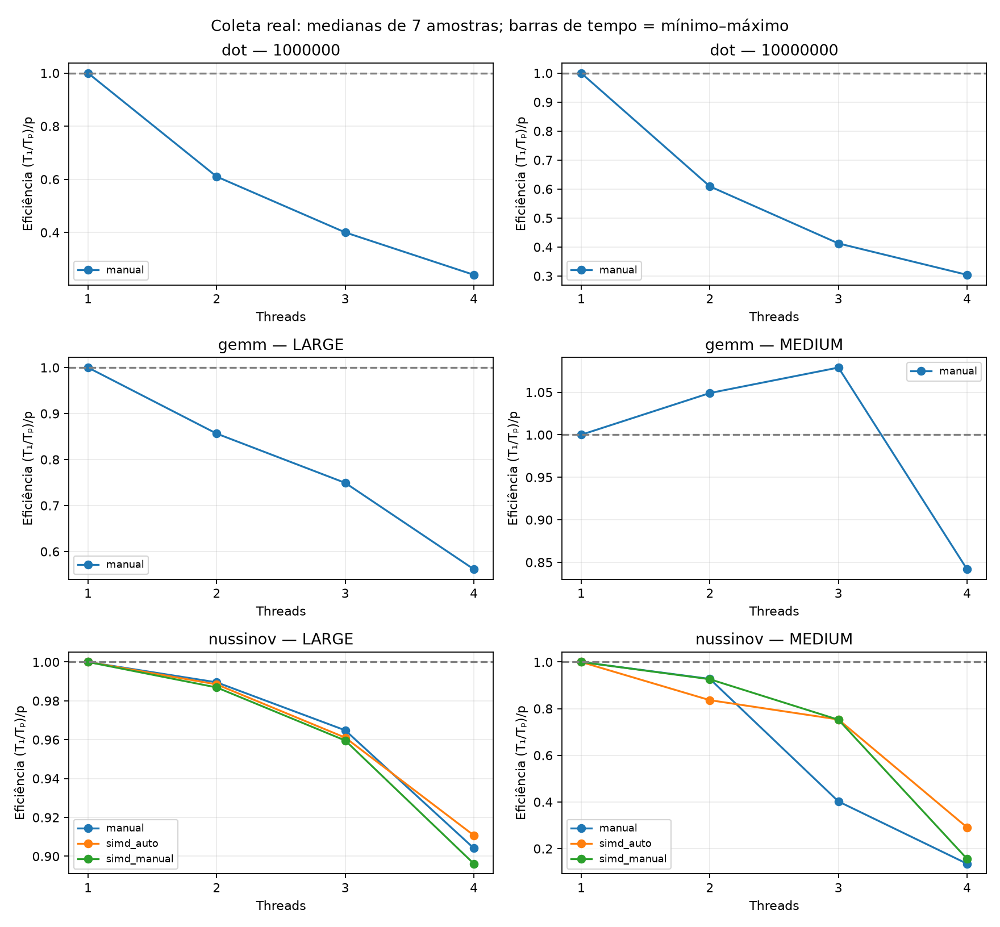

# Escalabilidade OpenMP — linux_xeon_2026-11-05

Fonte: `/home/liswsz220-01/Desktop/tcc/tcc2/results/scaling/linux_xeon_2026-11-05`. Fontes, binários e saídas conferidos por SHA-256; resumos recalculados das amostras.

7 amostras externas por configuração; um aquecimento; ordem embaralhada por rodada (seed 2026).
As variantes são manuais; simd_auto é adaptação determinística preexistente sobre base OpenMP. Não houve inferência LLM.

| Kernel | Entrada | Variante | Threads | Mediana (s) | Mín.–máx. (s) | S total | S transf. | S paralelo | E paralela |
|---|---|---|---:|---:|---:|---:|---:|---:|---:|
| dot | 1000000 | manual | 1 | 0.003553676 | 0.002579412–0.006061801 | 0.4146 | 0.4146 | 1.0000 | 1.0000 |
| dot | 1000000 | manual | 2 | 0.002911023 | 0.002770139–0.003440386 | 0.5062 | 0.4146 | 1.2208 | 0.6104 |
| dot | 1000000 | manual | 3 | 0.002959394 | 0.002654258–0.003290530 | 0.4979 | 0.4146 | 1.2008 | 0.4003 |
| dot | 1000000 | manual | 4 | 0.003692308 | 0.002941926–0.006191696 | 0.3991 | 0.4146 | 0.9625 | 0.2406 |
| dot | 1000000 | sequential | 1 | 0.001473456 | 0.001392651–0.001666272 | 1.0000 | 1.0000 | 1.0000 | 1.0000 |
| dot | 10000000 | manual | 1 | 0.012910733 | 0.012789683–0.013906163 | 0.8475 | 0.8475 | 1.0000 | 1.0000 |
| dot | 10000000 | manual | 2 | 0.010595838 | 0.010278938–0.011052679 | 1.0327 | 0.8475 | 1.2185 | 0.6092 |
| dot | 10000000 | manual | 3 | 0.010432664 | 0.010247196–0.010791839 | 1.0488 | 0.8475 | 1.2375 | 0.4125 |
| dot | 10000000 | manual | 4 | 0.010611985 | 0.010131724–0.012959856 | 1.0311 | 0.8475 | 1.2166 | 0.3042 |
| dot | 10000000 | sequential | 1 | 0.010942113 | 0.010667624–0.011312575 | 1.0000 | 1.0000 | 1.0000 | 1.0000 |
| gemm | LARGE | manual | 1 | 0.639590000 | 0.622963000–0.663593000 | 1.0070 | 1.0070 | 1.0000 | 1.0000 |
| gemm | LARGE | manual | 2 | 0.373426000 | 0.349548000–0.535419000 | 1.7248 | 1.0070 | 1.7128 | 0.8564 |
| gemm | LARGE | manual | 3 | 0.284560000 | 0.253694000–0.350145000 | 2.2635 | 1.0070 | 2.2476 | 0.7492 |
| gemm | LARGE | manual | 4 | 0.284841000 | 0.273401000–0.329054000 | 2.2612 | 1.0070 | 2.2454 | 0.5614 |
| gemm | LARGE | sequential | 1 | 0.644089000 | 0.618668000–0.676053000 | 1.0000 | 1.0000 | 1.0000 | 1.0000 |
| gemm | MEDIUM | manual | 1 | 0.004192000 | 0.003594000–0.004416000 | 0.9850 | 0.9850 | 1.0000 | 1.0000 |
| gemm | MEDIUM | manual | 2 | 0.001998000 | 0.001900000–0.002187000 | 2.0666 | 0.9850 | 2.0981 | 1.0490 |
| gemm | MEDIUM | manual | 3 | 0.001295000 | 0.001268000–0.001452000 | 3.1884 | 0.9850 | 3.2371 | 1.0790 |
| gemm | MEDIUM | manual | 4 | 0.001245000 | 0.000971000–0.001853000 | 3.3165 | 0.9850 | 3.3671 | 0.8418 |
| gemm | MEDIUM | sequential | 1 | 0.004129000 | 0.003594000–0.004444000 | 1.0000 | 1.0000 | 1.0000 | 1.0000 |
| nussinov | LARGE | manual | 1 | 16.624249000 | 16.529591000–16.818172000 | 1.0157 | 1.0157 | 1.0000 | 1.0000 |
| nussinov | LARGE | manual | 2 | 8.399909000 | 8.350731000–8.676186000 | 2.0102 | 1.0157 | 1.9791 | 0.9895 |
| nussinov | LARGE | manual | 3 | 5.743377000 | 5.717455000–6.459319000 | 2.9400 | 1.0157 | 2.8945 | 0.9648 |
| nussinov | LARGE | manual | 4 | 4.596830000 | 4.432981000–5.140925000 | 3.6733 | 1.0157 | 3.6165 | 0.9041 |
| nussinov | LARGE | sequential | 1 | 16.885718000 | 16.728578000–17.001674000 | 1.0000 | 1.0000 | 1.0000 | 1.0000 |
| nussinov | LARGE | simd_auto | 1 | 17.560246000 | 17.506116000–17.647324000 | 0.9616 | 0.9616 | 1.0000 | 1.0000 |
| nussinov | LARGE | simd_auto | 2 | 8.882462000 | 8.856890000–8.996812000 | 1.9010 | 0.9616 | 1.9770 | 0.9885 |
| nussinov | LARGE | simd_auto | 3 | 6.090541000 | 6.069169000–6.602635000 | 2.7724 | 0.9616 | 2.8832 | 0.9611 |
| nussinov | LARGE | simd_auto | 4 | 4.820323000 | 4.759143000–5.175816000 | 3.5030 | 0.9616 | 3.6430 | 0.9107 |
| nussinov | LARGE | simd_manual | 1 | 17.560393000 | 17.508382000–17.590015000 | 0.9616 | 0.9616 | 1.0000 | 1.0000 |
| nussinov | LARGE | simd_manual | 2 | 8.896586000 | 8.844411000–9.304063000 | 1.8980 | 0.9616 | 1.9738 | 0.9869 |
| nussinov | LARGE | simd_manual | 3 | 6.099967000 | 6.060786000–6.370204000 | 2.7682 | 0.9616 | 2.8788 | 0.9596 |
| nussinov | LARGE | simd_manual | 4 | 4.898844000 | 4.766117000–8.119998000 | 3.4469 | 0.9616 | 3.5846 | 0.8961 |
| nussinov | MEDIUM | manual | 1 | 0.028491000 | 0.028309000–0.029456000 | 0.7720 | 0.7720 | 1.0000 | 1.0000 |
| nussinov | MEDIUM | manual | 2 | 0.015356000 | 0.014636000–0.031121000 | 1.4323 | 0.7720 | 1.8554 | 0.9277 |
| nussinov | MEDIUM | manual | 3 | 0.023614000 | 0.010844000–0.031823000 | 0.9314 | 0.7720 | 1.2065 | 0.4022 |
| nussinov | MEDIUM | manual | 4 | 0.052671000 | 0.022423000–0.065209000 | 0.4176 | 0.7720 | 0.5409 | 0.1352 |
| nussinov | MEDIUM | sequential | 1 | 0.021994000 | 0.021597000–0.023020000 | 1.0000 | 1.0000 | 1.0000 | 1.0000 |
| nussinov | MEDIUM | simd_auto | 1 | 0.019298000 | 0.019046000–0.021671000 | 1.1397 | 1.1397 | 1.0000 | 1.0000 |
| nussinov | MEDIUM | simd_auto | 2 | 0.011535000 | 0.010136000–0.012641000 | 1.9067 | 1.1397 | 1.6730 | 0.8365 |
| nussinov | MEDIUM | simd_auto | 3 | 0.008536000 | 0.006741000–0.037090000 | 2.5766 | 1.1397 | 2.2608 | 0.7536 |
| nussinov | MEDIUM | simd_auto | 4 | 0.016583000 | 0.005864000–0.040434000 | 1.3263 | 1.1397 | 1.1637 | 0.2909 |
| nussinov | MEDIUM | simd_manual | 1 | 0.019309000 | 0.019101000–0.023091000 | 1.1391 | 1.1391 | 1.0000 | 1.0000 |
| nussinov | MEDIUM | simd_manual | 2 | 0.010424000 | 0.009880000–0.015350000 | 2.1099 | 1.1391 | 1.8524 | 0.9262 |
| nussinov | MEDIUM | simd_manual | 3 | 0.008553000 | 0.006989000–0.036539000 | 2.5715 | 1.1391 | 2.2576 | 0.7525 |
| nussinov | MEDIUM | simd_manual | 4 | 0.030927000 | 0.018774000–0.079551000 | 0.7112 | 1.1391 | 0.6243 | 0.1561 |

S total = Tseq/Tp; S transf. = Tseq/T1 da mesma variante; S paralelo = T1/Tp; E paralela = (T1/Tp)/p.
As barras representam dispersão observada, não intervalos de confiança. Não há teste de significância.
O probe confirma o tamanho das equipes no runtime, sem provar a localização de cada thread dos kernels.
Validação de arrays usa binários de dump separados com os mesmos flags de otimização; não prova ausência de races.
Tempos excluem inicialização, compilação e inferência. O PolyBench realiza seu flush de cache padrão antes do timer.
A coleta M5 equivalente ainda precisa ser executada; dados históricos não formam um experimento pareado com esta coleta.

